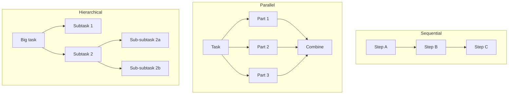
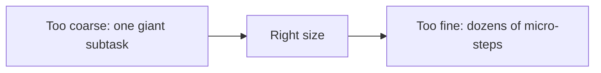
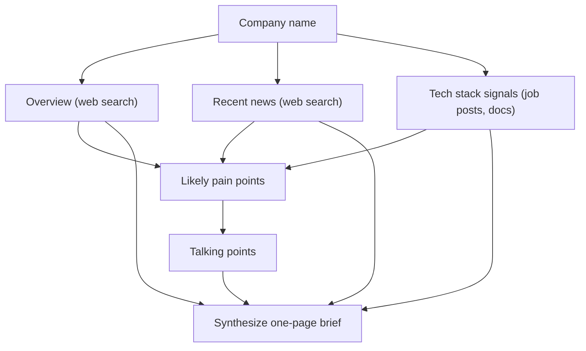

# Task Decomposition

## Introduction

**Task decomposition** means breaking a large task into smaller subtasks that are each easier to solve, then combining the results. It is the skill underneath almost every advanced agent pattern: [prompt chaining](./1-agents-prompt-chaining.mdx) is decomposition decided by a developer, [plan-and-execute](./4-agents-plan-and-execute.mdx) is decomposition decided by a planner model, and [orchestrator-workers](../8-agents-multi-agent-systems/1-agents-orchestrator-workers.mdx) is decomposition with parallel workers.

You do this all the time as a programmer. "Build a login page" becomes: design the form, write the validation, call the auth API, handle errors, write tests. Some pieces must happen in order, some can be done by different people at once, and some break down further.

LLMs benefit from decomposition for the same reasons people do:

- **Smaller tasks are more reliable.** A focused prompt with one job fails less often than a sprawling one.
- **Context stays small.** Each subtask sees only what it needs, which keeps attention sharp and costs down.
- **Independent parts can run in parallel**, which cuts wall-clock time.
- **Failures are local.** You can retry one subtask instead of the whole job.

This page covers the main decomposition strategies, how to represent subtasks with dependencies, how to execute them, and how to choose the right granularity.

## Three Shapes of Decomposition



| Shape | Description | Example | Pattern it leads to |
| --- | --- | --- | --- |
| Sequential | Each step needs the previous result | Extract facts, then draft, then translate | Prompt chaining |
| Parallel (fan-out, fan-in) | Independent parts, then a merge | Review each file in a pull request | Parallelization, map-reduce |
| Hierarchical (recursive) | Subtasks split further until small enough | Write a book: chapters, then sections | Orchestrator-workers, hierarchical teams |
| DAG (mixed) | Some steps depend on others, some do not | Research three competitors, then compare | Plan-and-execute, LLMCompiler |

Most real tasks are a **DAG** (directed acyclic graph): a mix of parallel and sequential dependencies.

## Who Decomposes: You or the Model?

| | Design-time decomposition | Run-time decomposition |
| --- | --- | --- |
| Who decides | You, in code | An LLM planner, per input |
| Predictability | High | Medium |
| Flexibility | Low | High |
| Testing | Easy | Needs evaluation of plans |
| Example | Fixed chain for every incident report | "Research this topic" where subtopics vary |

Start with design-time decomposition whenever the structure is stable across inputs. Use run-time decomposition when the subtasks really depend on the input. Anthropic's [Building effective agents](https://www.anthropic.com/engineering/building-effective-agents) makes the same distinction between parallelization (subtasks pre-defined) and orchestrator-workers (subtasks "determined by the orchestrator based on the specific input").

## Representing Subtasks as a Graph

When a model decomposes a task, ask it for a structured list of subtasks with explicit dependencies. Then your code, not the model, decides execution order.

```python
from pydantic import BaseModel, Field
from anthropic import Anthropic

client = Anthropic()

class Subtask(BaseModel):
    id: str = Field(description="Short unique id such as 't1'")
    instruction: str = Field(description="Self-contained instruction a worker can follow alone")
    depends_on: list[str] = Field(default_factory=list, description="Ids that must finish first")

class Decomposition(BaseModel):
    subtasks: list[Subtask]
    synthesis_instruction: str = Field(description="How to combine the results into the final answer")

DECOMPOSER_SYSTEM = """Break the task into 2 to 8 subtasks.
Rules:
- Each instruction must be self-contained: a worker sees only its instruction and its dependencies' results.
- Only add a dependency when a subtask truly needs another's output.
- Prefer independent subtasks so they can run in parallel."""

def decompose(task: str) -> Decomposition:
    response = client.messages.parse(
        model="claude-opus-5-5",
        max_tokens=4000,
        system=DECOMPOSER_SYSTEM,
        messages=[{"role": "user", "content": task}],
        output_format=Decomposition,
    )
    return response.parsed_output

d = decompose("Compare Postgres, MySQL, and SQLite for a small startup's first product, "
              "and recommend one.")
for t in d.subtasks:
    print(t.id, t.depends_on, "-", t.instruction[:70])
```

Example output:

```text
t1 [] - Summarize Postgres strengths, weaknesses, and operational cost for a small startup.
t2 [] - Summarize MySQL strengths, weaknesses, and operational cost for a small startup.
t3 [] - Summarize SQLite strengths, weaknesses, and operational cost for a small startup.
t4 ['t1', 't2', 't3'] - Compare the three on a table of criteria and recommend one with reasons.
```

### Validating the graph

Never trust a model-generated graph blindly. Check for unknown ids and cycles before running anything.

```python
def validate(subtasks: list[Subtask]) -> list[str]:
    errors = []
    ids = {t.id for t in subtasks}
    if len(ids) != len(subtasks):
        errors.append("duplicate ids")
    for t in subtasks:
        for dep in t.depends_on:
            if dep not in ids:
                errors.append(f"{t.id} depends on unknown {dep}")
    # Cycle check with depth-first search
    graph = {t.id: t.depends_on for t in subtasks}
    state: dict[str, str] = {}
    def visit(node: str) -> bool:
        if state.get(node) == "visiting":
            return False
        if state.get(node) == "done":
            return True
        state[node] = "visiting"
        ok = all(visit(dep) for dep in graph.get(node, []) if dep in graph)
        state[node] = "done"
        return ok
    if not all(visit(n) for n in graph):
        errors.append("dependency cycle")
    return errors

bad = [Subtask(id="a", instruction="x", depends_on=["b"]),
       Subtask(id="b", instruction="y", depends_on=["a"])]
print(validate(bad))
```

Output:

```text
['dependency cycle']
```

If validation fails, send the errors back to the decomposer and ask for a corrected plan, with a retry cap.

## Executing in Waves

With a valid graph, run subtasks in **waves**: every subtask whose dependencies are finished runs in the current wave, in parallel. This is a topological execution order.

```python
from concurrent.futures import ThreadPoolExecutor

def text_of(response) -> str:
    return "".join(b.text for b in response.content if b.type == "text")

def run_worker(task: Subtask, results: dict[str, str]) -> str:
    deps = "\n\n".join(f"[{d}]\n{results[d]}" for d in task.depends_on)
    prompt = task.instruction + (f"\n\nInputs from earlier subtasks:\n{deps}" if deps else "")
    response = client.messages.create(
        model="claude-sonnet-5-5",
        max_tokens=4000,
        messages=[{"role": "user", "content": prompt}],
    )
    return text_of(response)

def execute_dag(subtasks: list[Subtask], max_workers: int = 4) -> dict[str, str]:
    results: dict[str, str] = {}
    pending = {t.id: t for t in subtasks}
    wave = 0
    with ThreadPoolExecutor(max_workers=max_workers) as pool:
        while pending:
            ready = [t for t in pending.values() if all(d in results for d in t.depends_on)]
            if not ready:
                raise RuntimeError("No runnable subtasks: graph is broken")
            wave += 1
            print(f"Wave {wave}: {[t.id for t in ready]}")
            futures = {t.id: pool.submit(run_worker, t, results) for t in ready}
            for tid, fut in futures.items():
                results[tid] = fut.result()
                del pending[tid]
    return results

def synthesize(task: str, d: Decomposition, results: dict[str, str]) -> str:
    joined = "\n\n".join(f"[{tid}]\n{text}" for tid, text in results.items())
    response = client.messages.create(
        model="claude-opus-5-5",
        max_tokens=8000,
        messages=[{"role": "user", "content":
            f"Original task: {task}\n\n{d.synthesis_instruction}\n\nSubtask results:\n{joined}"}],
    )
    return text_of(response)

task = "Compare Postgres, MySQL, and SQLite for a small startup's first product, and recommend one."
d = decompose(task)
assert not validate(d.subtasks)
results = execute_dag(d.subtasks)
print(synthesize(task, d, results)[:200])
```

Example output:

```text
Wave 1: ['t1', 't2', 't3']
Wave 2: ['t4']
For a small startup's first product, Postgres is the strongest default. It offers...
```

Three subtasks ran at the same time in wave 1, so the wall-clock time is roughly that of the slowest one, not the sum. Watch your provider's rate limits when you raise `max_workers` (see [Scaling and Concurrency](../13-agents-production/2-agents-scaling.mdx)).

### Synthesis strategies

The final combine step deserves as much thought as the split. Common options:

| Strategy | How it works | Good for |
| --- | --- | --- |
| Single synthesis call | All results in one prompt with clear instructions | A handful of short results |
| Hierarchical (map-reduce) | Summarize groups of results, then combine the summaries | Many or long results that do not fit one context |
| Code-based merge | Concatenate, sort, deduplicate, or aggregate in Python | Structured results such as lists, counts, records |
| Template fill | Results slot into fixed sections of a template | Reports with a stable layout |

Prefer a code-based merge whenever results are structured. It is free, exact, and easy to test.

## Choosing the Right Granularity

The hardest part of decomposition is deciding **how small** to go.



| Symptom | Likely cause | Fix |
| --- | --- | --- |
| Subtask outputs are shallow or miss parts | Subtasks too big | Split along natural boundaries (per entity, per file, per section) |
| Synthesis is incoherent or repetitive | Subtasks too small or overlapping | Merge related steps; give each a distinct scope |
| Workers ask for information they lack | Instructions not self-contained | Include needed context in the instruction or add a dependency |
| High cost, little quality gain | Too many subtasks | Cap the count; compare against a single call |
| Results contradict each other | Workers made different assumptions | Put shared assumptions in every instruction |

Good rules of thumb:

- **A subtask should fit comfortably in one focused prompt** and produce one clear artifact.
- **Split along natural seams** of the data: one per document, per competitor, per file, per test.
- **Keep the count small.** A handful of well-scoped subtasks usually beats dozens of tiny ones.
- **Give every worker the shared context**: the overall goal, definitions, format requirements.

## Recursive Decomposition

Some tasks are too big even after one split. A recursive decomposer asks, for each subtask, "Is this small enough to do directly?" and splits again if not, up to a maximum depth.

```python
class SizeCheck(BaseModel):
    atomic: bool = Field(description="True if one focused prompt can complete it well")

def is_atomic(instruction: str) -> bool:
    response = client.messages.parse(
        model="claude-haiku-5-5",
        max_tokens=500,
        messages=[{"role": "user", "content":
            f"Can a single focused LLM call complete this well, in under ~800 words of output?\n\n{instruction}"}],
        output_format=SizeCheck,
    )
    return response.parsed_output.atomic

def solve(instruction: str, depth: int = 0, max_depth: int = 2) -> str:
    if depth >= max_depth or is_atomic(instruction):
        return run_worker(Subtask(id="leaf", instruction=instruction), {})
    d = decompose(instruction)
    parts = {t.id: solve(t.instruction, depth + 1, max_depth) for t in d.subtasks}
    return synthesize(instruction, d, parts)
```

The `max_depth` limit is essential: without it, a decomposer can keep splitting forever. This simplified version also ignores dependencies between subtasks at deeper levels. A real implementation would reuse `execute_dag`.

## Real-World Scenario

**Your team builds a "due diligence" feature** for a B2B sales tool. A sales rep enters a prospect company name, and the tool must produce a one-page brief: company overview, recent news, tech stack signals, likely pain points, and suggested talking points.

### The decomposition



Here the structure is the **same for every company**, so it is decomposed at design time, in code. The three research subtasks run in parallel with web search tools. Pain points depend on all three, talking points depend on pain points, and a final synthesis writes the brief.

### Why this approach

- **Speed.** The three research tasks are independent, so parallel execution roughly cuts the research phase to the time of the slowest one.
- **Focus.** Each research worker has one job and a short context, so it searches more thoroughly than one agent juggling everything.
- **Debuggability.** If talking points are weak, you can inspect the pain-point step's input and output directly.

### When to use it, and when not to

Use decomposition when a task has **natural seams** and the parts benefit from **focus or parallelism**. Avoid it when the task is small enough for one call, or when the parts are **tightly coupled**: if every part needs to see every other part's details (like writing a tightly argued essay), splitting causes inconsistency and the synthesis step does all the real work anyway. In those cases a single strong call, possibly with higher effort, is often better.

### Alternatives and trade-offs

| Approach | Pros | Cons | Best for |
| --- | --- | --- | --- |
| Single call | Simple, coherent | May miss parts, no parallelism | Small, tightly coupled tasks |
| Fixed decomposition in code | Predictable, testable, parallel | Cannot adapt to unusual inputs | Repeated tasks with stable structure |
| Model-generated DAG | Adapts per input | Needs validation, plans vary | Varied research and analysis tasks |
| Recursive decomposition | Handles very large tasks | Cost grows fast, needs depth limit | Long documents, large codebases |
| Multi-agent orchestrator | Workers can use tools and own contexts | Most complex, coordination overhead | Very large or tool-heavy tasks |

## Common Mistakes

1. **Non-self-contained instructions.** "Now do the same for the second one" means nothing to a worker that never saw the first. Every instruction must stand alone.
2. **Spurious dependencies.** Marking everything as dependent on the previous step serializes work that could run in parallel.
3. **Skipping validation.** Model-generated graphs can contain cycles, unknown ids, or duplicates.
4. **Unlimited fan-out or depth.** Cap the number of subtasks and the recursion depth, and keep a budget across all workers.
5. **A weak synthesis step.** Combining results is a real task. Give it the strongest model you can afford and clear instructions.
6. **Decomposing what should not be split.** Measure against a single call. Decomposition is not automatically better.

## Summary

- Decomposition splits a task into subtasks that are smaller, more focused, and sometimes parallel.
- The main shapes are sequential, parallel, hierarchical, and DAG.
- Decompose at design time when the structure is stable, and at run time when it depends on the input.
- Represent model-generated subtasks as structured data with explicit dependencies, validate the graph, and execute in waves.
- Granularity is the key judgment: self-contained subtasks with clear scope, in small numbers.

## Exercises

1. Add a retry loop that sends `validate()` errors back to the decomposer until the graph is valid or three attempts fail.
2. Modify `execute_dag` to record each subtask's duration and print which wave dominated total time.
3. Make one worker fail randomly. Change `execute_dag` so a failed subtask is retried once, and if it still fails, its dependents receive a placeholder saying the input is missing.
4. Compare a single call and the decomposed version on three "compare X, Y, and Z" questions. Judge depth, accuracy, and total tokens.

### Related pages

- [Plan-and-Execute](./4-agents-plan-and-execute.mdx)
- [Orchestrator-Workers Pattern](../8-agents-multi-agent-systems/1-agents-orchestrator-workers.mdx)
- [Parallel Agents](../8-agents-multi-agent-systems/4-agents-parallel-agents.mdx)
- [Subagents and Context Isolation](../8-agents-multi-agent-systems/8-agents-subagents-and-context-isolation.mdx)
