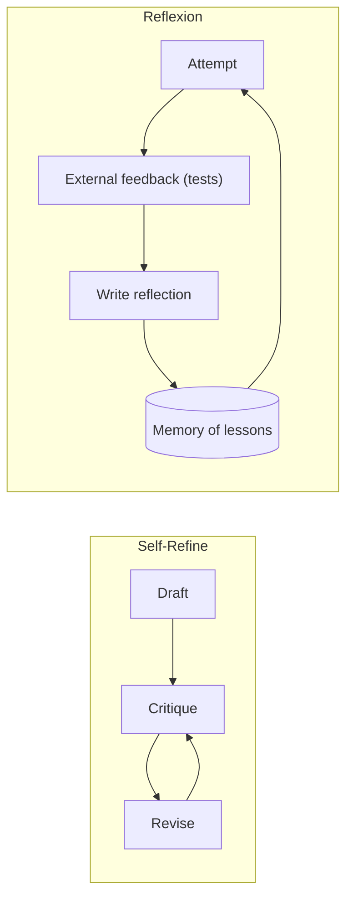
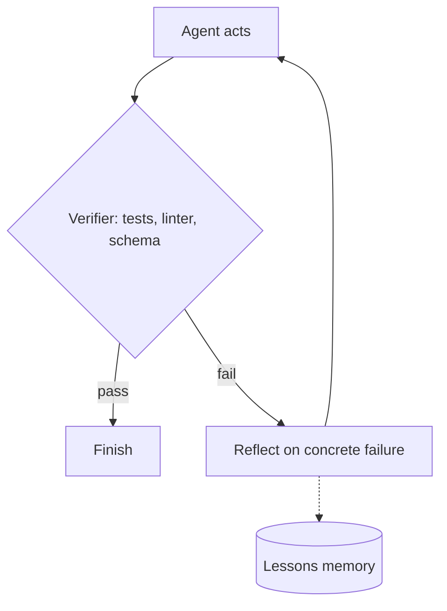

# Reflection and Self-Critique

## Introduction

**Reflection** is a pattern where an agent looks back at its own output or its own failed attempt, writes down what went wrong, and uses that critique to do better on the next try.

Think about how you write code. You rarely get it perfect on the first pass. You run the tests, read the failure, think "ah, I forgot the empty-list case", and fix it. The test failure is the key ingredient: it gives you **new information** you did not have when you wrote the first version.

That point is also the most important lesson about reflection for LLMs:

:::warning Reflection needs evidence
Research has found that asking a model to critique its own reasoning **without any outside feedback** often does not help and can even make answers worse. Huang et al., [Large Language Models Cannot Self-Correct Reasoning Yet](https://arxiv.org/abs/2310.01798) (ICLR 2024), report that LLMs "struggle to self-correct their responses without external feedback". Reflection works best when the critique is grounded in something new: test results, tool errors, a validator, a retrieved source, or explicit criteria.
:::

This page covers three forms of reflection, from simplest to most powerful:

1. **Self-refine**: draft, critique, revise in a loop, using the same model.
2. **Grounded reflection**: the critique is based on external feedback such as test results.
3. **Reflexion**: the agent keeps a memory of lessons from failed attempts and uses it on later attempts.

## The Research Behind It

Two papers shaped this pattern:

- **Self-Refine** (Madaan et al., [NeurIPS 2023](https://arxiv.org/abs/2303.17651)). One model generates an output, gives feedback on it, and refines it, repeating several rounds. No training is needed. The authors reported improvements over one-step generation across seven tasks, including dialogue and code optimization.
- **Reflexion** (Shinn et al., [2023](https://arxiv.org/abs/2303.11366)). An agent attempts a task, receives a feedback signal (for example, unit tests pass or fail), writes a verbal "reflection" about what went wrong, and stores it in an **episodic memory**. On the next attempt, the reflections are included in the prompt. The authors describe it as reinforcing agents "through linguistic feedback" instead of updating weights, and reported gains on coding, reasoning, and decision-making tasks.

The difference is important: Self-Refine improves one output; Reflexion improves the next **attempt**, carrying lessons forward.



## Form 1: Simple Self-Refine

The basic loop: generate, critique against explicit criteria, revise. Explicit criteria are what keep the critique from being vague.

```python
from anthropic import Anthropic

client = Anthropic()

def ask(prompt: str, system: str = "", model: str = "claude-opus-5-5") -> str:
    response = client.messages.create(
        model=model,
        max_tokens=4000,
        system=system,
        messages=[{"role": "user", "content": prompt}],
    )
    return "".join(b.text for b in response.content if b.type == "text")

CRITERIA = """- Under 120 words
- Explains WHY, not only WHAT
- Includes one concrete example
- No jargon without a definition"""

def self_refine(task: str, rounds: int = 2) -> str:
    draft = ask(task)
    for i in range(rounds):
        critique = ask(
            f"Critique this answer against the criteria. List specific problems only. "
            f"If there are none, reply exactly NO_ISSUES.\n\nCriteria:\n{CRITERIA}\n\nAnswer:\n{draft}"
        )
        print(f"Round {i + 1} critique: {critique[:100]}")
        if critique.strip() == "NO_ISSUES":
            break
        draft = ask(
            f"Revise the answer to fix these problems. Return only the revised answer.\n\n"
            f"Task: {task}\n\nAnswer:\n{draft}\n\nProblems:\n{critique}"
        )
    return draft

print(self_refine("Explain what a database index is to a junior developer."))
```

Example output:

```text
Round 1 critique: - 164 words, over the limit. - "B-tree" is not defined. - No concrete example.
Round 2 critique: NO_ISSUES
A database index is like the index at the back of a book...
```

This works because the criteria are **checkable**. "Under 120 words" and "includes an example" are things a critic can verify. Compare with "make it better", which tends to produce cosmetic changes. Note that the word limit could be checked in code for free, which brings us to grounding.

## Form 2: Grounded Reflection with Real Feedback

The strongest critiques come from the outside world. For code, that means running tests. The model then reflects on the **actual failure** rather than guessing.

```python
import os
import subprocess
import sys
import tempfile

def run_tests(code: str, tests: str, timeout: int = 10) -> tuple[bool, str]:
    """Run candidate code plus tests in a separate Python process."""
    with tempfile.TemporaryDirectory() as tmp:
        path = os.path.join(tmp, "candidate.py")
        with open(path, "w") as f:
            f.write(code + "\n\n" + tests)
        try:
            proc = subprocess.run(
                [sys.executable, "-I", path],
                capture_output=True, text=True, timeout=timeout, cwd=tmp,
            )
        except subprocess.TimeoutExpired:
            return False, f"Timed out after {timeout}s (infinite loop?)"
    output = (proc.stdout + proc.stderr)[-2000:]   # keep the tail, which has the error
    return proc.returncode == 0, output

TESTS = """
assert parse_duration("90s") == 90
assert parse_duration("2m") == 120
assert parse_duration("1h30m") == 5400
assert parse_duration("") == 0
print("all tests passed")
"""

passed, out = run_tests("def parse_duration(s):\n    return int(s[:-1])", TESTS)
print(passed, out.strip().splitlines()[-1])
```

Output:

```text
False AssertionError
```

:::caution Running generated code
`subprocess` with a timeout isolates crashes and infinite loops, but it is **not** a security sandbox. The code can still read files and use the network. For untrusted tasks, run generated code in a container or a hosted code-execution tool (see [Sandboxing Agent Execution](../12-agents-safety-and-security/3-agents-sandboxing.mdx)).
:::

## Form 3: A Reflexion-Style Agent

Now combine attempts, external feedback, written reflections, and a memory of lessons.

```python
import re

FENCE = "`" * 3   # a markdown code fence

def extract_code(text: str) -> str:
    match = re.search(FENCE + r"(?:python)?\n(.*?)" + FENCE, text, re.S)
    return match.group(1) if match else text

def reflexion_solve(spec: str, tests: str, max_attempts: int = 4) -> str | None:
    lessons: list[str] = []          # episodic memory across attempts
    for attempt in range(1, max_attempts + 1):
        memory = "\n".join(f"- {l}" for l in lessons) or "(none yet)"
        code = extract_code(ask(
            f"Write a Python function for this spec. Return one python code block only.\n\n"
            f"Spec: {spec}\n\nLessons from previous failed attempts:\n{memory}"
        ))
        passed, output = run_tests(code, tests)
        print(f"Attempt {attempt}: {'PASS' if passed else 'FAIL'}")
        if passed:
            return code

        reflection = ask(
            "Your code failed its tests. In 1-2 sentences, state the root cause and a concrete "
            "rule to avoid it next time. Do not write code.\n\n"
            f"Code:\n{code}\n\nTest output:\n{output}",
            model="claude-sonnet-5-5",
        )
        lessons.append(reflection.strip())
        print(f"  Lesson: {lessons[-1][:100]}")
    return None

spec = ("parse_duration(s: str) -> int: convert strings like '90s', '2m', '1h30m' to seconds. "
        "Empty string returns 0.")
solution = reflexion_solve(spec, TESTS)
```

Example output:

```text
Attempt 1: FAIL
  Lesson: The parser assumed a single unit; inputs can combine units like '1h30m', so parse every number-unit pair.
Attempt 2: FAIL
  Lesson: Empty input raised ValueError; handle the empty string before parsing.
Attempt 3: PASS
```

Why this works better than "try again":

- The **test output** is new information the model did not have when writing the code.
- The **reflection** turns a noisy error trace into a short, reusable rule.
- **Memory** keeps earlier lessons, so attempt 3 does not reintroduce the bug fixed in attempt 2.
- **`max_attempts`** bounds cost.

Reflections can also be saved across tasks, which turns them into a simple form of long-term procedural memory (see [Episodic, Semantic and Procedural Memory](../4-agents-memory-and-context/8-agents-memory-types.mdx)).

## Where Reflection Fits in an Agent Loop

In a tool-using agent, much of the reflection happens naturally. When a tool returns an error with `is_error: True`, a capable model with built-in thinking reasons about the error and adjusts. You can strengthen this with:

- **A verification step in the system prompt**: "Before finishing, run the tests and check your output against the requirements."
- **A final self-check tool** that runs validators and returns concrete failures.
- **A separate evaluator** with explicit criteria, which becomes the [Evaluator-Optimizer](./7-agents-evaluator-optimizer.mdx) pattern.



### A verification tool for agents

In a tool-using agent, you can make grounded reflection a habit by giving the agent a dedicated checking tool and telling it when to use it. The tool returns concrete failures, which the model reasons about before its next action.

```python
VERIFY_TOOL = {
    "name": "run_checks",
    "description": ("Run the project's tests and linters against the current code. "
                    "Returns PASS, or a list of failures with file, line, and message. "
                    "Call this after every change and before declaring the task done."),
    "input_schema": {"type": "object", "properties": {}, "required": []},
}

SYSTEM = """You are a coding agent.
After each edit, call run_checks. If anything fails, read the failure carefully,
state the root cause in one sentence, then fix it. Do not declare the task complete
until run_checks returns PASS. If the same failure persists after 3 attempts, stop
and explain what is blocking you."""
```

The system prompt does three things: it makes verification routine, it asks for a one-sentence root cause (a lightweight reflection), and it sets a stopping rule for failures the agent cannot fix. Pair the prompt rule with a hard limit in code, as described in [Stopping Conditions and Budgets](./10-agents-stopping-conditions.mdx).

## Measuring Whether Reflection Helps

Reflection costs extra calls, so prove it pays for itself on your own tasks. A minimal experiment runs the same tasks with and without reflection and compares pass rate and tokens.

```python
def compare(tasks: list[tuple[str, str]], solve_once, solve_with_reflection) -> None:
    """tasks: (spec, tests) pairs. Each solver returns (passed: bool, tokens: int)."""
    rows = {"single attempt": solve_once, "with reflection": solve_with_reflection}
    for label, solver in rows.items():
        passed = tokens = 0
        for spec, tests in tasks:
            ok, used = solver(spec, tests)
            passed += ok
            tokens += used
        print(f"{label:16} pass {passed}/{len(tasks)}  tokens {tokens:,}")
```

Example output:

```text
single attempt   pass 31/50  tokens 212,400
with reflection  pass 42/50  tokens 498,900
```

The numbers above are illustrative. Run the comparison on your own tasks. Then ask the real question: is the gain in pass rate worth the extra tokens and latency compared with alternatives, such as a single attempt at a higher effort level, or a stronger model? The answer differs by task.

## Real-World Scenario

**Your platform team** maintains an internal tool that generates data-migration scripts. Engineers describe a schema change ("split `full_name` into `first_name` and `last_name`"), and the tool writes a Python migration. About a third of the first drafts fail on edge cases such as names with no spaces, NULL values, or very long strings, and engineers waste time debugging them.

### The design

1. Generate the migration script.
2. Run it against a **disposable test database** seeded with tricky fixture rows, then run assertions on the result.
3. On failure, the agent writes a short reflection based on the actual error and stores it.
4. Retry with all reflections, up to three attempts.
5. Successful scripts go to human code review. Lessons that recur across many migrations ("always handle NULL in string columns") are promoted into the system prompt after a human reviews them.

### Why this approach

- The feedback is **objective and cheap**: the test database tells you exactly what broke.
- Reflections **compress** long stack traces into rules the model can act on.
- Recurring lessons improve the base prompt over time without fine-tuning.

### When to use it, and when not to

Use reflection when you have a **reliable feedback signal** (tests, compilers, validators, schema checks, retrieved evidence) and when a second attempt is cheaper than a human fixing the output. Avoid "ungrounded" reflection on reasoning or factual questions, where the model has no new information. It adds cost and can talk the model out of a correct answer. Also avoid it on latency-critical paths: each round adds at least one more model call.

### Alternatives and trade-offs

| Approach | Pros | Cons | Best for |
| --- | --- | --- | --- |
| Single attempt, higher effort | One call, simple | No outside feedback | Reasoning tasks without a verifier |
| Self-refine with explicit criteria | Easy, no infrastructure | Critic shares the generator's blind spots | Writing quality, format compliance |
| Grounded reflection (tests, tools) | Uses real evidence, reliable gains | Needs a verifier and a sandbox | Code, SQL, data transforms |
| Reflexion with memory | Learns across attempts, avoids repeated mistakes | Memory can accumulate bad lessons | Repeated task families |
| Separate evaluator model | Independent judgment, clear rubric | More calls, judge can be wrong too | Quality gating with criteria |
| Best-of-N plus verifier | Parallel, no sequential rounds | Cost scales with N | When a cheap verifier exists |

## Common Mistakes

1. **"Are you sure?" reflection.** Asking the model to double-check with no new evidence often changes correct answers to wrong ones. Ground the critique.
2. **Vague critique prompts.** "Improve this" produces cosmetic edits. Give explicit, checkable criteria.
3. **Checking in the LLM what code can check.** Word counts, JSON validity, and test results should be checked in code: faster, free, and exact.
4. **Unlimited rounds.** Quality usually plateaus after a few rounds. Cap attempts and stop on "no issues".
5. **Letting bad lessons accumulate.** A wrong reflection stored in memory misleads every later attempt. Keep memory short, recent, and reviewed.
6. **Feeding the whole error log.** Trim to the relevant tail so the reflection focuses on the actual failure.

## Summary

- Reflection lets an agent critique and improve its own work.
- **Self-Refine** loops draft, critique, revise. **Reflexion** stores verbal lessons from failed attempts in memory.
- Reflection works best when **grounded in external feedback** such as tests and tool errors. Ungrounded self-correction on reasoning can hurt.
- Use explicit criteria, check in code what code can check, and cap rounds.
- When you need an independent judge with a rubric, move to the evaluator-optimizer pattern.

## Exercises

1. Replace the LLM word-count check in `self_refine` with a code check, and send only the remaining criteria to the critic.
2. Add a fifth test case to `TESTS` (for example `"45"` with no unit) and see whether the Reflexion agent learns to handle it.
3. Persist `lessons` to a JSON file and reuse them for a second, related spec. Does attempt 1 succeed more often?
4. Run a small experiment: take ten math word problems, answer each once, then apply ungrounded "check your answer and correct it" reflection. Count how many answers change from right to wrong and vice versa.

### Related pages

- [Evaluator-Optimizer Loops](./7-agents-evaluator-optimizer.mdx)
- [Handling Tool Errors](../2-agents-tool-use/6-agents-tool-errors.mdx)
- [Long-Term Memory](../4-agents-memory-and-context/5-agents-long-term-memory.mdx)
- [Project: Coding Agent](../14-agents-projects/2-agents-project-coding-agent.mdx)
