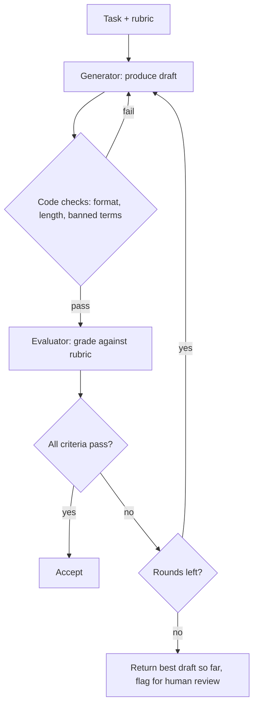
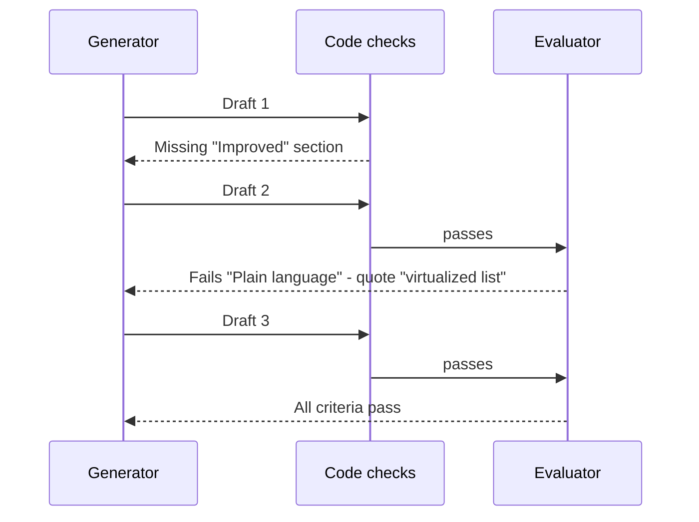

# Evaluator-Optimizer Loops

## Introduction

In an **evaluator-optimizer** loop, one LLM call (the **optimizer** or generator) produces a response, and a second call (the **evaluator**) grades it against explicit criteria and gives feedback. The generator revises using that feedback, and the loop repeats until the evaluator approves or a round limit is reached.

It works like a writer and an editor. The writer drafts, the editor marks up the draft with specific notes ("the intro buries the main point", "paragraph 3 contradicts the style guide"), and the writer revises. Because the editor has a different job and a clear checklist, they catch things the writer misses.

Anthropic's [Building effective agents](https://www.anthropic.com/engineering/building-effective-agents) lists two signs this pattern fits: first, responses demonstrably improve when a human gives feedback; second, an LLM can give that kind of feedback. Its examples include literary translation, where an evaluator can catch nuances the translator missed, and complex search tasks where an evaluator decides whether more searching is needed.

### How it differs from reflection

[Reflection](./6-agents-reflection.mdx) and evaluator-optimizer overlap. The practical difference:

| | Reflection | Evaluator-optimizer |
| --- | --- | --- |
| Who critiques | Usually the same agent, about itself | A separate evaluator role with its own prompt (and possibly its own model) |
| Criteria | Often implicit or from tool feedback | An explicit rubric, ideally with pass/fail per criterion |
| Output of critique | Free-text lesson | Structured verdict plus actionable feedback |
| Typical use | Agents recovering from failed attempts | Quality-gating a deliverable before it ships |

## The Loop



Notice the **code checks before the LLM evaluator**. Anything that code can verify (length, valid JSON, required sections, forbidden words) should be checked for free before you pay for an evaluator call.

## Step 1: A Structured Evaluator

A good evaluator returns a **structured verdict**: pass or fail for each criterion, with a specific reason. Per-criterion results are more reliable and more actionable than a single 1-to-10 score.

```python
from pydantic import BaseModel, Field
from anthropic import Anthropic

client = Anthropic()

class CriterionResult(BaseModel):
    criterion: str
    passed: bool
    feedback: str = Field(description="If failed: what exactly is wrong and how to fix it")

class Evaluation(BaseModel):
    results: list[CriterionResult]

    @property
    def all_passed(self) -> bool:
        return all(r.passed for r in self.results)

    def feedback_text(self) -> str:
        return "\n".join(f"- {r.criterion}: {r.feedback}" for r in self.results if not r.passed)

RUBRIC = [
    "Accurate: every claim is supported by the source changes; nothing invented",
    "User-focused: describes benefits to users, not internal implementation",
    "Plain language: no internal ticket ids, code names, or unexplained jargon",
    "Grouped: items grouped under 'New', 'Improved', and 'Fixed' headings",
]

EVALUATOR_SYSTEM = """You are a strict release-notes editor.
Judge the draft against each criterion independently. Be specific: quote the problem text.
Pass a criterion only if it is fully met."""

def evaluate(source: str, draft: str) -> Evaluation:
    criteria = "\n".join(f"{i + 1}. {c}" for i, c in enumerate(RUBRIC))
    response = client.messages.parse(
        model="claude-opus-5-5",
        max_tokens=4000,
        system=EVALUATOR_SYSTEM,
        messages=[{"role": "user", "content":
            f"Criteria:\n{criteria}\n\nSource changes:\n{source}\n\nDraft release notes:\n{draft}"}],
        output_format=Evaluation,
    )
    return response.parsed_output
```

## Step 2: The Generator

The generator takes the task and, on later rounds, the previous draft plus the evaluator's feedback.

```python
def text_of(response) -> str:
    return "".join(b.text for b in response.content if b.type == "text")

GENERATOR_SYSTEM = """You write customer-facing release notes for a project-management SaaS.
Write in plain, friendly language for non-technical users."""

def generate(source: str, previous: str = "", feedback: str = "") -> str:
    prompt = f"Write release notes for these merged changes:\n{source}"
    if previous:
        prompt += (f"\n\nYour previous draft:\n{previous}\n\n"
                   f"An editor found these problems. Fix all of them and keep what was good:\n{feedback}")
    response = client.messages.create(
        model="claude-sonnet-5-5",
        max_tokens=4000,
        system=GENERATOR_SYSTEM,
        messages=[{"role": "user", "content": prompt}],
    )
    return text_of(response)
```

## Step 3: Code Checks

```python
import re

def code_checks(draft: str) -> list[str]:
    problems = []
    if re.search(r"\b[A-Z]{2,}-\d+\b", draft):          # ticket ids like PROJ-123
        problems.append("Remove internal ticket ids.")
    for heading in ("New", "Improved", "Fixed"):
        if heading.lower() not in draft.lower():
            problems.append(f"Missing '{heading}' section.")
    if len(draft.split()) > 300:
        problems.append("Too long: keep under 300 words.")
    return problems

print(code_checks("## New\n- Dark mode (PROJ-412)\n## Fixed\n- Login bug"))
```

Output:

```text
['Remove internal ticket ids.', "Missing 'Improved' section."]
```

## Step 4: The Full Loop

```python
def evaluator_optimizer(source: str, max_rounds: int = 3) -> tuple[str, bool]:
    draft, feedback = "", ""
    best_draft, best_score = "", -1

    for round_no in range(1, max_rounds + 1):
        draft = generate(source, draft, feedback)

        problems = code_checks(draft)
        if problems:
            feedback = "\n".join(f"- {p}" for p in problems)
            print(f"Round {round_no}: code checks failed ({len(problems)})")
            continue

        evaluation = evaluate(source, draft)
        score = sum(r.passed for r in evaluation.results)
        print(f"Round {round_no}: {score}/{len(RUBRIC)} criteria passed")
        if score > best_score:
            best_draft, best_score = draft, score
        if evaluation.all_passed:
            return draft, True
        feedback = evaluation.feedback_text()

    return best_draft or draft, False      # not approved: flag for human review

source_changes = """- PROJ-412: add dark mode toggle in settings
- PROJ-398: refactor board rendering to virtualized list (boards with 1000+ cards load faster)
- PROJ-430: fix due-date reminder emails sent in UTC instead of user's time zone"""

notes, approved = evaluator_optimizer(source_changes)
print("Approved:", approved)
print(notes)
```

Example output:

```text
Round 1: code checks failed (1)
Round 2: 3/4 criteria passed
Round 3: 4/4 criteria passed
Approved: True
## New
- **Dark mode**: switch to a darker theme in Settings, easier on the eyes at night.
## Improved
- **Faster large boards**: boards with over 1,000 cards now load much faster.
## Fixed
- **Reminder times**: due-date reminder emails now arrive in your own time zone.
```

Design choices worth noting:

- **Keep the best draft.** Revisions sometimes get worse. Track the best-scoring version and return it if the loop runs out of rounds.
- **Fail closed.** If the evaluator never approves, the caller gets `approved=False` and can route the draft to a human instead of publishing it.
- **Different models per role.** Here a mid-tier model generates and a stronger model evaluates. The reverse can also work. Decide with an evaluation set, not by intuition.

## Making the Evaluator Trustworthy

The loop is only as good as its judge. LLM judges have known weaknesses: they can be lenient, prefer longer answers, or favor text that sounds like their own style. Practical safeguards:

1. **Binary, specific criteria.** "Contains no ticket ids" is easier to judge consistently than "is well written".
2. **Ask for evidence.** Requiring the evaluator to quote the problem text reduces vague or invented complaints.
3. **Calibrate against humans.** Have people label 30 to 50 drafts pass or fail, run the evaluator on them, and measure agreement. Fix the rubric where they disagree. See [Grading Methods: Code, Rubrics and LLM Judges](../11-agents-evaluation-and-testing/2-agents-grading-methods.mdx).
4. **Give the evaluator the source.** Accuracy can only be judged against the original facts.
5. **Watch for oscillation.** If round 3 reintroduces a problem fixed in round 2, include the history of feedback, or stop early.



## Variation: Pairwise Comparison

Absolute grading ("does this pass?") is not the only way to judge. Sometimes it is easier and more reliable to ask an evaluator which of **two** drafts is better. A pairwise loop keeps a current champion and only replaces it when a new revision wins.

```python
from typing import Literal

class Comparison(BaseModel):
    winner: Literal["A", "B"]
    reason: str

def compare(source: str, draft_a: str, draft_b: str) -> Comparison:
    response = client.messages.parse(
        model="claude-opus-5-5",
        max_tokens=2000,
        system="Compare two release-note drafts against the criteria. Ignore length unless a criterion mentions it.",
        messages=[{"role": "user", "content":
            "Criteria:\n" + "\n".join(RUBRIC) +
            f"\n\nSource:\n{source}\n\nDraft A:\n{draft_a}\n\nDraft B:\n{draft_b}"}],
        output_format=Comparison,
    )
    return response.parsed_output

def pairwise_loop(source: str, rounds: int = 3) -> str:
    champion = generate(source)
    for _ in range(rounds):
        challenger = generate(source, champion, "Improve this draft against the criteria.")
        if compare(source, champion, challenger).winner == "B":
            champion = challenger
    return champion
```

LLM judges can favor whichever answer appears first or second. A common mitigation is to run the comparison twice with the order swapped and only accept a win that holds both ways.

## Variation: Deciding When to Stop Searching

The evaluator does not have to grade prose. Anthropic's post mentions search tasks where an evaluator decides whether more searching is needed. The same loop shape works: a researcher gathers sources, and an evaluator checks whether the gathered material answers every part of the question, returning the missing parts as feedback for the next search round. This is a natural fit for [Agentic RAG](../5-agents-rag/6-agents-agentic-rag.mdx).

## Cost and Latency

Each round costs at least one generator call and one evaluator call, and they run sequentially. With three rounds you may pay roughly six calls instead of one. Ways to keep this under control:

- **Do code checks first** so many failures never reach the evaluator.
- **Cap rounds** (two or three is typical) and stop as soon as everything passes.
- **Use a cheaper judge for easy criteria** and a strong judge only for the hard ones, such as factual accuracy.
- **Measure the gain.** If round 2 rarely changes the verdict on your evaluation set, drop it.

## Real-World Scenario

**Your product team ships weekly** and has to turn 20 to 40 merged pull request titles into customer-facing release notes. Engineers write cryptic PR titles, and the notes often leak internal names or describe implementation details users do not care about. A single "write release notes" prompt produces something decent about half the time, and someone spends an hour fixing it.

### The design

- Input: merged PR titles and descriptions for the week.
- Generator: writes grouped, user-focused notes.
- Code checks: no ticket ids, required headings, length limit, no internal code names from a deny list.
- Evaluator: strong model with the four-criterion rubric, quoting problems.
- Up to three rounds. Approved notes go to a product manager for a final skim. Unapproved notes go to the PM with the evaluator's remaining feedback attached.

### Why this approach

- The quality criteria are **clear and articulable**, which is the precondition for this pattern.
- Human editors were already giving the **same kind of feedback** each week, so an LLM evaluator can take over the first passes.
- Code checks catch the most common failures for free.

### When to use it, and when not to

Use evaluator-optimizer when you can write down **specific criteria**, when **revisions measurably improve** results, and when the extra latency is acceptable (batch jobs, background generation, drafts). Avoid it when criteria are subjective and undefined ("make it pop"), when a deterministic check is enough, when latency matters more than polish (live chat), or when the evaluator is no better than the generator at spotting errors. In that last case you are paying for agreement, not quality.

### Alternatives and trade-offs

| Approach | Pros | Cons | Best for |
| --- | --- | --- | --- |
| Single call with a detailed prompt | Fast, cheap | No quality gate | Low-stakes or real-time output |
| Code-only validation and retry | Free, exact | Catches only mechanical issues | Format and policy rules |
| Evaluator-optimizer loop | Catches semantic issues, gives actionable feedback | 2 or more calls per round, judge errors | Polished deliverables with clear criteria |
| Best-of-N plus judge picks the winner | Parallel, no sequential rounds | Cost scales with N, no targeted fixes | When variety helps more than revision |
| Human editor | Highest judgment | Slow, expensive | Final sign-off on high-stakes content |

## Common Mistakes

1. **Vague rubrics.** "Is it good?" produces random verdicts. Write binary, specific criteria.
2. **Single numeric scores.** "7 out of 10" gives the generator nothing to act on. Use per-criterion pass/fail with feedback.
3. **No round limit.** Evaluators can always find something. Cap rounds and accept or escalate.
4. **Returning the last draft instead of the best.** Revisions can regress.
5. **Using the LLM to check what code can check.** Put structural checks in code before the evaluator.
6. **Never validating the judge.** Measure judge agreement with human labels before trusting it as a gate.
7. **Hiding the source from the evaluator.** Without the source, "accuracy" can only mean "sounds plausible".

## Summary

- Evaluator-optimizer pairs a **generator** with a separate **evaluator** that grades against an explicit rubric.
- Use structured, per-criterion verdicts with quoted evidence and actionable feedback.
- Run free code checks first, cap rounds, keep the best draft, and fail closed to human review.
- The pattern fits when criteria are clear and feedback measurably improves output.
- Calibrate the evaluator against human judgments before relying on it.

## Exercises

1. Add a fifth rubric criterion, "Every PR in the source is mentioned or intentionally omitted as internal-only", and see how often it fails.
2. Add an oscillation guard: if a criterion that passed in an earlier round fails again, stop and return the best draft.
3. Swap the models (strong generator, mid-tier evaluator) and compare approval rate and total cost on ten weeks of sample PRs.
4. Label 20 drafts by hand as pass or fail, run `evaluate()` on them, and compute the agreement rate. Which criterion disagrees most?

### Related pages

- [Reflection and Self-Critique](./6-agents-reflection.mdx)
- [Prompt Chaining](./1-agents-prompt-chaining.mdx)
- [Grading Methods: Code, Rubrics and LLM Judges](../11-agents-evaluation-and-testing/2-agents-grading-methods.mdx)
- [Input and Output Guardrails](../12-agents-safety-and-security/6-agents-guardrails.mdx)
