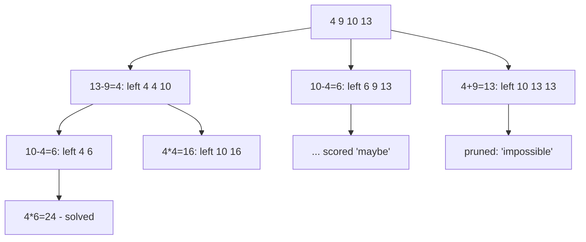

# Tree-of-Thoughts and Search-Based Planning

## Introduction

Most agent patterns follow a single path: the model picks one next step, then another, and never goes back. That works until the model commits to a bad early choice. A chess player who never considers alternatives, and never takes back a move in their head, plays badly.

**Search-based planning** lets an agent consider **several candidate steps**, **score** them, explore the promising ones further, and **backtrack** from dead ends. The best-known version for LLMs is **Tree of Thoughts (ToT)**, introduced by Yao et al. in [Tree of Thoughts: Deliberate Problem Solving with Large Language Models](https://arxiv.org/abs/2305.10601) (NeurIPS 2023).

The paper frames ToT as four design choices:

1. **Thought decomposition**: what counts as one step (a line of an equation, a paragraph plan, a crossword word).
2. **Thought generator**: how to propose candidate next steps.
3. **State evaluator**: how to score a partial solution, for example as a number or as a label like "sure / maybe / impossible".
4. **Search algorithm**: how to explore the tree, such as breadth-first search (BFS) or depth-first search (DFS) with pruning.

On the Game of 24 puzzle (combine four numbers with arithmetic to make 24), the authors report that GPT-4 with chain-of-thought prompting solved 4% of problems, while ToT with BFS (keeping the 5 best candidates per step) solved 74%. That is a striking gain on a task where early mistakes are fatal and partial progress can be judged.

:::note The modern context
That result is from 2023. Today's reasoning models explore alternatives internally while they think, so many problems that once needed explicit ToT scaffolding are now solved in a single call with higher effort. Explicit search still earns its place when you have a **reliable external evaluator** (tests, a game engine, a constraint checker) or need **guarantees** that the model's internal reasoning cannot give. Always compare against a single call at high effort first.
:::

## The Search Family, from Cheap to Expensive


| Method | Idea | Calls | Needs | Good for |
| --- | --- | --- | --- | --- |
| Best-of-N + verifier | Generate N full answers, keep the one that passes a check | N + checks | A verifier (tests, validator) | Code, SQL, structured output |
| Self-consistency | Sample N reasoning paths, take the majority answer | N | Answers that can be compared for equality | Math, classification |
| BFS / beam over thoughts (ToT) | Expand k candidates per step, keep the best b | about depth x b x (k + scoring) | A scorer for partial solutions | Puzzles, constrained planning |
| DFS with pruning | Go deep on the best candidate, backtrack when it is hopeless | Variable | A "dead end" detector | Constraint satisfaction, crosswords |
| MCTS-style (for example LATS) | Balance exploring new branches with exploiting good ones, using environment feedback | Many | An environment you can reset or simulate | Web navigation, coding with tests |

Self-consistency comes from Wang et al., [Self-Consistency Improves Chain of Thought Reasoning in Language Models](https://arxiv.org/abs/2203.11171). Language Agent Tree Search (LATS) comes from Zhou et al., [Language Agent Tree Search Unifies Reasoning Acting and Planning in Language Models](https://arxiv.org/abs/2310.04406), which applies Monte Carlo tree search to tool-using agents.

## Start Simple: Best-of-N with a Verifier

Before building a tree, try the simplest search: generate several complete answers and keep one that passes a check. When the check is reliable, this captures much of the benefit of search with very little code.

```python
from concurrent.futures import ThreadPoolExecutor
from anthropic import Anthropic

client = Anthropic()

def text_of(response) -> str:
    return "".join(b.text for b in response.content if b.type == "text")

def candidate(task: str) -> str:
    response = client.messages.create(
        model="claude-sonnet-5-5",
        max_tokens=2000,
        messages=[{"role": "user", "content": task}],
    )
    return text_of(response).strip()

def best_of_n(task: str, verify, n: int = 4) -> str | None:
    with ThreadPoolExecutor(max_workers=n) as pool:
        answers = list(pool.map(lambda _: candidate(task), range(n)))
    passing = [a for a in answers if verify(a)]
    print(f"{len(passing)}/{n} candidates passed")
    return passing[0] if passing else None

def is_valid_slug(s: str) -> bool:
    return s.isascii() and s == s.lower() and " " not in s and 3 <= len(s) <= 30

slug = best_of_n("Suggest one URL slug for a blog post titled 'Ten Tips for Faster Python Loops'. "
                 "Reply with the slug only.", is_valid_slug)
print(slug)
```

Example output:

```text
4/4 candidates passed
faster-python-loops
```

The candidates are independent, so they run in parallel: latency stays close to one call while cost grows with N.

## Self-Consistency: Voting Without a Verifier

When you have no verifier but the answer is short and comparable (a number, a label, a yes or no), sample several independent answers and take the majority. Disagreement among samples is also a useful signal of uncertainty.

```python
from collections import Counter
from pydantic import BaseModel

class FinalNumber(BaseModel):
    answer: float

def solve_once(question: str) -> float:
    response = client.messages.parse(
        model="claude-sonnet-5-5",
        max_tokens=4000,
        messages=[{"role": "user", "content": question}],
        output_format=FinalNumber,
    )
    return response.parsed_output.answer

def self_consistency(question: str, n: int = 5) -> tuple[float, float]:
    with ThreadPoolExecutor(max_workers=n) as pool:
        answers = list(pool.map(lambda _: solve_once(question), range(n)))
    value, votes = Counter(answers).most_common(1)[0]
    return value, votes / n          # answer and agreement ratio

answer, agreement = self_consistency(
    "A train leaves at 9:40 and arrives at 13:05. How many minutes is the trip?")
print(answer, f"{agreement:.0%} agreement")
```

Example output:

```text
205.0 100% agreement
```

Low agreement (for example 2 of 5) is a good trigger for escalation: a stronger model, a higher effort level, or a human.

## Tree of Thoughts with BFS

Now a real tree search on the Game of 24. Each **thought** is one arithmetic step that combines two of the remaining numbers. This is a good teaching example because:

- **Code can verify each step exactly**, so invalid arithmetic is pruned for free.
- **The LLM evaluator judges promise**: can the remaining numbers still reach 24?
- **Early mistakes are fatal**, which is exactly where single-path reasoning fails.



### Step 1: Propose candidate thoughts

```python
from typing import Literal
from pydantic import BaseModel, Field

class Move(BaseModel):
    a: float
    op: Literal["+", "-", "*", "/"]
    b: float
    result: float
    remaining: list[float] = Field(description="Numbers left after this move, including result")

class Proposals(BaseModel):
    moves: list[Move]

def propose(numbers: list[float], k: int = 5) -> list[Move]:
    response = client.messages.parse(
        model="claude-sonnet-5-5",
        max_tokens=4000,
        messages=[{"role": "user", "content":
            f"Game of 24. Numbers: {numbers}. Propose up to {k} different next moves. "
            "Each move combines exactly two of the numbers with + - * / into a result."}],
        output_format=Proposals,
    )
    return response.parsed_output.moves
```

### Step 2: Verify with code, score with the LLM

```python
import math
from collections import Counter

OPS = {"+": lambda x, y: x + y, "-": lambda x, y: x - y,
       "*": lambda x, y: x * y, "/": lambda x, y: x / y if y != 0 else math.nan}

def is_legal(numbers: list[float], m: Move) -> bool:
    """Exact check: the operands exist, the arithmetic is right, the remainder is right."""
    pool = Counter(numbers)
    for x in (m.a, m.b):
        if pool[x] == 0:
            return False
        pool[x] -= 1
    result = OPS[m.op](m.a, m.b)
    if math.isnan(result) or not math.isclose(result, m.result):
        return False
    expected = sorted(list(pool.elements()) + [result])
    return len(expected) == len(m.remaining) and all(
        math.isclose(x, y) for x, y in zip(expected, sorted(m.remaining)))

class Value(BaseModel):
    label: Literal["sure", "maybe", "impossible"]

SCORE = {"sure": 3, "maybe": 1, "impossible": 0}

def evaluate_state(numbers: list[float]) -> int:
    if len(numbers) == 1:
        return 3 if math.isclose(numbers[0], 24) else 0     # exact, no LLM needed
    response = client.messages.parse(
        model="claude-haiku-5-5",
        max_tokens=1000,
        messages=[{"role": "user", "content":
            f"Game of 24. Can the numbers {numbers} reach exactly 24 using each once "
            "with + - * /? Answer sure, maybe, or impossible."}],
        output_format=Value,
    )
    return SCORE[response.parsed_output.label]

print(is_legal([4, 9, 10, 13], Move(a=13, op="-", b=9, result=4, remaining=[4, 4, 10])))
print(is_legal([4, 9, 10, 13], Move(a=13, op="-", b=9, result=5, remaining=[4, 5, 10])))
```

Output:

```text
True
False
```

### Step 3: Breadth-first search with a beam

```python
def tree_of_thoughts(numbers: list[float], breadth: int = 3, k: int = 5) -> list[Move] | None:
    frontier: list[tuple[list[float], list[Move]]] = [(numbers, [])]
    calls = 0
    while frontier:
        children = []
        for state, path in frontier:
            moves = propose(state, k)
            calls += 1
            for m in moves:
                if not is_legal(state, m):
                    continue                      # pruned for free by code
                new_state = m.remaining
                score = evaluate_state(new_state)
                calls += len(new_state) > 1
                if score == 0:
                    continue                      # pruned: impossible
                if len(new_state) == 1:
                    print(f"Solved with {calls} LLM calls")
                    return path + [m]
                children.append((score, new_state, path + [m]))
        children.sort(key=lambda c: c[0], reverse=True)
        frontier = [(s, p) for _, s, p in children[:breadth]]   # keep the best b
    print(f"No solution found after {calls} LLM calls")
    return None

solution = tree_of_thoughts([4, 9, 10, 13])
if solution:
    for m in solution:
        print(f"{m.a:g} {m.op} {m.b:g} = {m.result:g}")
```

Example output:

```text
Solved with 19 LLM calls
13 - 9 = 4
10 - 4 = 6
4 * 6 = 24
```

Three things make this work:

- **Code-level pruning** discards illegal moves without spending a call.
- **The evaluator** prunes hopeless states and orders the rest, so the beam keeps the promising ones.
- **The beam width** (`breadth`) bounds cost: at most `breadth` states are expanded per level.

For comparison, the same puzzle can also be solved by a short brute-force program with no LLM at all. That is a useful reminder: if a problem has a small, exact search space, write the search in code. Use LLM-guided search when the space of "moves" is **natural language** (plans, proofs, designs, code edits) and cannot be enumerated.

## Cost: The Big Trade-Off

Search multiplies calls. A rough estimate for BFS:

```python
def tot_calls(depth: int, breadth: int, k: int) -> int:
    # per level: one propose call per kept state, plus one evaluation per candidate
    return sum(min(breadth, k ** level) * (1 + k) for level in range(depth))

for b in (1, 3, 5):
    print(f"depth=3, breadth={b}, k=5 -> up to {tot_calls(3, b, 5)} calls")
```

Output:

```text
depth=3, breadth=1, k=5 -> up to 18 calls
depth=3, breadth=3, k=5 -> up to 42 calls
depth=3, breadth=5, k=5 -> up to 66 calls
```

Each extra unit of breadth adds cost at every level. Use cheap models for the evaluator where your measurements allow, prune with code wherever possible, stop at the first verified solution, and set a hard budget (see [Stopping Conditions and Budgets](./10-agents-stopping-conditions.mdx)).

## Real-World Scenario

**Your team builds a scheduling assistant** for a clinic. Given staff availability, room constraints, and patient preferences, it must propose a week's appointment plan. Constraints interact: placing one appointment early can make several later ones impossible. A single LLM call produces schedules that look plausible but violate one or two hard constraints about a third of the time.

### The design

- **Thought** = assigning one appointment to a slot.
- **Generator** = an LLM proposes 3 to 5 placements for the next appointment, preferring patient preferences expressed in free text ("mornings, not Mondays").
- **Verifier** = code checks hard constraints (double booking, room capacity, staff hours) and prunes illegal placements instantly.
- **Evaluator** = a cheap model rates how well soft preferences are met so far.
- **Search** = beam search with a small width, plus a hard cap on LLM calls. If no full schedule is found, return the best partial schedule and flag the rest for a human scheduler.

### Why this approach

- Hard constraints are **checkable by code**, giving a reliable pruning signal.
- Soft preferences are in **natural language**, which a pure constraint solver handles poorly and an LLM handles well.
- Early choices **constrain later ones**, the classic case where single-path generation fails.

### When to use it, and when not to

Use search when early decisions are hard to undo, partial solutions can be **scored reliably**, and correctness is worth several times the cost of a single call. Do not use it for open-ended writing or chat, for tasks a single high-effort call already handles, for problems a classical algorithm solves exactly (use a constraint solver or plain search in code), or for latency-sensitive paths. A hybrid often wins: a classical solver for the hard constraints, an LLM only for interpreting preferences.

### Alternatives and trade-offs

| Approach | Pros | Cons | Best for |
| --- | --- | --- | --- |
| Single call, high effort | Simple, model explores internally | No guarantees, opaque | First attempt on any problem |
| Best-of-N + verifier | Parallel, easy, strong when verifier is good | Wasteful if most candidates fail the same way | Code, SQL, formats |
| Self-consistency voting | No verifier needed | Only for answers you can compare | Short factual or numeric answers |
| ToT beam / BFS | Recovers from bad early steps, prunes systematically | Many calls, needs a partial-state scorer | Puzzles, constrained planning |
| Classical solver (OR-Tools, SAT, search in code) | Exact, fast, cheap | Needs a formal model of the problem | Well-specified constraint problems |
| Hybrid: solver + LLM for fuzzy parts | Exactness plus language understanding | Integration work | Real scheduling and planning products |

## Common Mistakes

1. **Using ToT before trying a single call at high effort.** Modern reasoning models often close the gap without explicit search.
2. **An unreliable evaluator.** If the scorer cannot tell good partial states from bad ones, search just burns money. Validate the evaluator first.
3. **No code-level pruning.** Every illegal state that reaches the LLM evaluator is a wasted call.
4. **Unbounded breadth or depth.** Cost grows multiplicatively. Set the beam width, depth, and a total call budget.
5. **LLM search for exactly enumerable problems.** If code can enumerate the search space, let it.
6. **Forgetting latency.** Sequential levels add up. Parallelize proposals and evaluations within a level.

## Summary

- Search-based planning explores **multiple candidate steps**, **scores** them, and **backtracks** from dead ends.
- Tree of Thoughts formalizes this with thought decomposition, a generator, a state evaluator, and a search algorithm (BFS or DFS).
- Simpler relatives, best-of-N with a verifier and self-consistency, are often enough.
- Search pays off when partial solutions can be scored reliably and early mistakes are costly. It multiplies cost, so prune with code and set budgets.
- Compare against a single high-effort call and classical solvers before building a tree.

## Exercises

1. Add a `max_calls` budget to `tree_of_thoughts` that stops the search and returns `None` when exceeded.
2. Replace the LLM evaluator with a simple code heuristic (for example, "how close is any pair's product or sum to 24?"). Compare solve rate and calls on ten puzzles.
3. Implement self-consistency: ask for an answer to a math word problem five times in parallel and return the most common final number.
4. Convert BFS to DFS with pruning: explore the best child first, and backtrack when a state is scored "impossible".

### Related pages

- [The ReAct Pattern](./3-agents-react-pattern.mdx)
- [Reflection and Self-Critique](./6-agents-reflection.mdx)
- [Reasoning, Thinking and Effort](../1-agents-llm-apis/7-agents-thinking-and-effort.mdx)
- [Debate and Consensus](../8-agents-multi-agent-systems/6-agents-debate-and-consensus.mdx)
