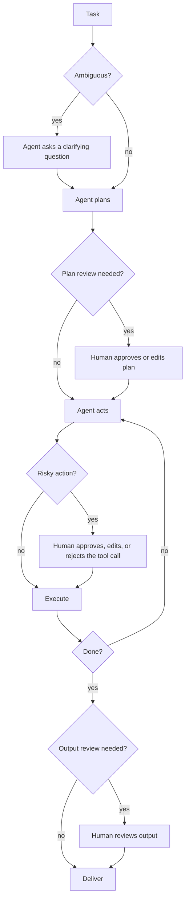
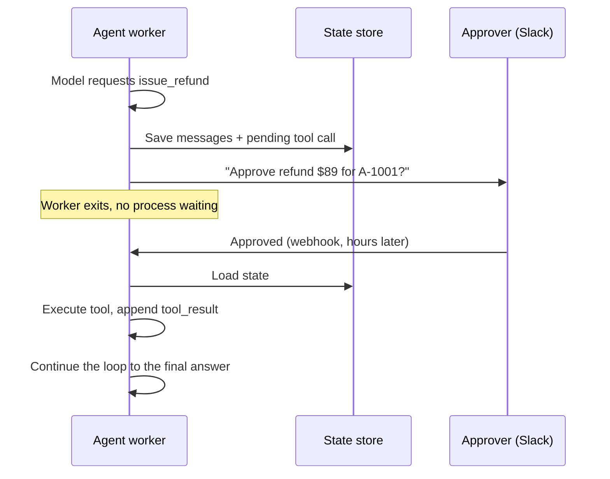

# Human-in-the-Loop

## Introduction

**Human-in-the-loop (HITL)** means designing an agent so that a person can step in at chosen points: approve a risky action, answer a clarifying question, edit a plan, or review the final output before it goes out.

Think of a junior engineer on their first week. They can read the codebase and run tests on their own, but they ask before deploying to production, and they check with you when a requirement is unclear. That is not a lack of trust in their abilities. It is a sensible match between **autonomy** and **risk**. Agents deserve the same arrangement.

HITL is not a separate architecture. It is a modifier you add to any pattern in this section: a [ReAct](./3-agents-react-pattern.mdx) agent with approval gates, a [plan-and-execute](./4-agents-plan-and-execute.mdx) agent whose plan a person approves, an [evaluator-optimizer](./7-agents-evaluator-optimizer.mdx) loop that escalates to an editor. Anthropic's [Building effective agents](https://www.anthropic.com/engineering/building-effective-agents) notes that agents "can then pause for human feedback at checkpoints or when encountering blockers."

This page covers:

- Where to put humans in the loop, and where not to.
- Approval gates on tool calls, including edits and rejections.
- Letting the agent ask clarifying questions.
- Pausing and resuming agents when approvals take hours, not seconds.

## Where Humans Fit



| Interaction | When to use | Example |
| --- | --- | --- |
| Clarifying question | The request is ambiguous and guessing is costly | "Which environment: staging or production?" |
| Plan review | Multi-step work where a wrong direction wastes a lot | Approve a 6-step data migration plan |
| Action approval | Irreversible, external, costly, or sensitive actions | Sending an email, issuing a refund, deleting data |
| Argument editing | The action is right but details need adjusting | Change a refund amount before approving |
| Output review | Published or customer-facing content | Release notes, legal summaries |
| Escalation | The agent is stuck, unsure, or out of budget | Hand the ticket to a human support agent |

## Deciding What Needs Approval

Not every action needs a human. Too many approvals create **approval fatigue**: people click "approve" without reading, and the gate stops protecting anything. Classify tools by risk:

| Risk tier | Examples | Policy |
| --- | --- | --- |
| Read-only | Search docs, query metrics, read a file | Run automatically |
| Reversible, internal | Create a draft, add a label, write to a scratch branch | Run automatically, log, maybe notify |
| Irreversible or external | Send email, post publicly, charge a card, delete records, deploy | Require approval |
| Forbidden | Change permissions, access secrets | Do not give the agent this tool at all |

A useful test: **"If the agent does this wrongly, how hard is it to undo, and who is affected?"** Easy to undo and internal means automate. Hard to undo or customer-facing means gate. The [Least Privilege for Agent Tools](../12-agents-safety-and-security/2-agents-least-privilege.mdx) and [Human Approval Gates](../12-agents-safety-and-security/7-agents-approval-gates.mdx) pages cover the security side in depth.

## Approval Gates in an Agent Loop

The cleanest place for a gate is **between the model's tool request and your execution of it**. The model asks to call a tool; your code checks the policy; a human approves, edits, or rejects; and the result (or the rejection) goes back to the model as a normal tool result.

```python
import json
from anthropic import Anthropic

client = Anthropic()

TOOLS = [
    {
        "name": "lookup_order",
        "description": "Look up an order by id. Read-only.",
        "input_schema": {"type": "object",
                         "properties": {"order_id": {"type": "string"}},
                         "required": ["order_id"]},
    },
    {
        "name": "issue_refund",
        "description": "Refund an order. Irreversible. Amount in USD.",
        "input_schema": {"type": "object",
                         "properties": {"order_id": {"type": "string"},
                                        "amount": {"type": "number"},
                                        "reason": {"type": "string"}},
                         "required": ["order_id", "amount", "reason"]},
    },
]

NEEDS_APPROVAL = {"issue_refund"}

def execute(name: str, args: dict) -> str:
    if name == "lookup_order":
        return json.dumps({"order_id": args["order_id"], "total": 89.00, "status": "delivered"})
    if name == "issue_refund":
        return f"Refunded ${args['amount']:.2f} on order {args['order_id']}."
    raise ValueError(f"unknown tool {name}")

def ask_human(name: str, args: dict) -> tuple[str, dict]:
    """Return ('approve' | 'reject' | 'edit', possibly edited args)."""
    print(f"\nAgent wants to call {name} with {json.dumps(args)}")
    choice = input("approve / reject / edit? ").strip().lower()
    if choice == "edit":
        args = {**args, **json.loads(input("JSON fields to change: "))}
        return "approve", args
    return ("approve" if choice == "approve" else "reject"), args

def run_tool_with_gate(block) -> dict:
    args = dict(block.input)
    if block.name in NEEDS_APPROVAL:
        decision, args = ask_human(block.name, args)
        if decision == "reject":
            return {"type": "tool_result", "tool_use_id": block.id, "is_error": True,
                    "content": "A human reviewer rejected this action. Do not retry it; "
                               "explain to the user what you would need instead."}
    try:
        return {"type": "tool_result", "tool_use_id": block.id,
                "content": execute(block.name, args)}
    except Exception as exc:
        return {"type": "tool_result", "tool_use_id": block.id,
                "content": f"Error: {exc}", "is_error": True}

def support_agent(user_message: str, max_steps: int = 8) -> str:
    messages = [{"role": "user", "content": user_message}]
    for _ in range(max_steps):
        response = client.messages.create(
            model="claude-opus-5-5",
            max_tokens=8000,
            system="You are a support agent. Check order details before any refund.",
            tools=TOOLS,
            messages=messages,
        )
        messages.append({"role": "assistant", "content": response.content})
        if response.stop_reason != "tool_use":
            return "".join(b.text for b in response.content if b.type == "text")
        results = [run_tool_with_gate(b) for b in response.content if b.type == "tool_use"]
        messages.append({"role": "user", "content": results})
    return "Stopped: step limit reached."

print(support_agent("Order A-1001 arrived broken. I want my money back."))
```

Example session:

```text
Agent wants to call issue_refund with {"order_id": "A-1001", "amount": 89.0, "reason": "Item arrived damaged"}
approve / reject / edit? approve
I've refunded the full $89.00 for order A-1001. You should see it on your statement within 5-10 business days.
```

Key design decisions:

- **Rejections are tool results, not crashes.** Returning `is_error: True` with a clear message lets the model adapt: apologize, offer an alternative, or escalate.
- **The human can edit arguments.** Often the action is right but the amount or recipient needs a tweak. Editing is faster than rejecting and re-prompting.
- **Policy lives in code.** The model cannot talk its way past `NEEDS_APPROVAL`, because the check runs outside the model.

:::tip With an SDK tool runner
You do not need a hand-written loop to add gates. With a tool runner, put the approval check inside the tool function itself and return a "declined by reviewer" string when rejected. See [Using an SDK Tool Runner](../2-agents-tool-use/4-agents-tool-runner.mdx).
:::

## Letting the Agent Ask Questions

Instead of guessing on ambiguous requests, give the agent a tool for asking the user. A tool is better than hoping the model ends its turn with a question, because your app can render it properly (a modal, a Slack message, a form) and knows the agent is blocked.

```python
ASK_USER_TOOL = {
    "name": "ask_user",
    "description": ("Ask the user a clarifying question when the request is ambiguous and a wrong "
                    "guess would waste work or cause harm. Do not ask about things you can look up."),
    "input_schema": {
        "type": "object",
        "properties": {
            "question": {"type": "string"},
            "options": {"type": "array", "items": {"type": "string"},
                        "description": "Optional suggested answers"},
        },
        "required": ["question"],
    },
}

def handle_ask_user(args: dict) -> str:
    print(f"\nAgent asks: {args['question']}")
    for i, opt in enumerate(args.get("options", []), 1):
        print(f"  {i}. {opt}")
    return input("Your answer: ")
```

Add `ASK_USER_TOOL` to the tool list, and in your dispatcher route `ask_user` calls to `handle_ask_user`. The human's answer becomes the tool result. The description tells the model **when not to ask**, which matters: an agent that asks about everything is as frustrating as one that asks about nothing.

## Asynchronous Approvals: Pause and Resume

`input()` works in a terminal, but real approvals happen in Slack, email, or a web dashboard, and may take hours. The agent cannot hold a process open that long. Instead:

1. When a gated tool call arrives, **save the conversation state** and the pending call to a database.
2. **Notify** the approver and end the request.
3. When the decision arrives, **load the state**, append the tool result, and **continue the loop**.



```python
import json
import uuid
from pathlib import Path

STATE_DIR = Path("pending_approvals")
STATE_DIR.mkdir(exist_ok=True)

def save_pending(messages: list, response) -> str:
    """Persist the conversation plus the assistant turn that requested gated tools."""
    approval_id = str(uuid.uuid4())
    serializable = messages + [{
        "role": "assistant",
        "content": [block.model_dump(exclude_none=True) for block in response.content],
    }]
    (STATE_DIR / f"{approval_id}.json").write_text(json.dumps(serializable))
    return approval_id

def resume(approval_id: str, approved: bool) -> list:
    """Load state and build the tool_result message for the pending calls."""
    messages = json.loads((STATE_DIR / f"{approval_id}.json").read_text())
    pending = [b for b in messages[-1]["content"] if b["type"] == "tool_use"]
    results = []
    for block in pending:
        if approved or block["name"] not in NEEDS_APPROVAL:
            content, is_error = execute(block["name"], block["input"]), False
        else:
            content, is_error = "Rejected by reviewer.", True
        result = {"type": "tool_result", "tool_use_id": block["id"], "content": content}
        if is_error:
            result["is_error"] = True
        results.append(result)
    messages.append({"role": "user", "content": results})
    return messages   # pass back into the agent loop to continue
```

Points to get right in production:

- **Store the complete assistant content**, including any thinking blocks, exactly as returned. Thinking blocks must be passed back unchanged for the model to continue its reasoning.
- **Every `tool_use` needs a matching `tool_result`** in the next user message, including ungated calls from the same turn.
- **Decide what happens on timeout.** A safe default is "rejected" after a deadline, with the agent informing the user.
- **Record who approved what and when** for auditing.
- **Re-check the world before executing.** If the order was refunded by someone else during the wait, the approved action may no longer be valid.

See [Session Persistence](../4-agents-memory-and-context/10-agents-session-persistence.mdx) and [Running Agents as Background Jobs](../10-agents-integration/3-agents-background-jobs.mdx) for storage and worker patterns.

### The same idea in LangGraph

Frameworks provide this as a built-in feature. In LangGraph, a node calls `interrupt()` to pause; state is saved by a checkpointer; and you resume by invoking the graph again with `Command(resume=...)` and the same `thread_id`. A minimal shape, following the [LangGraph interrupts docs](https://docs.langchain.com/oss/python/langgraph/interrupts):

```python
from typing_extensions import TypedDict
from langgraph.checkpoint.memory import InMemorySaver
from langgraph.graph import START, StateGraph
from langgraph.types import Command, interrupt

class State(TypedDict):
    refund_amount: float
    approved: bool

def approval_node(state: State):
    decision = interrupt({"question": f"Approve refund of ${state['refund_amount']:.2f}?"})
    return {"approved": decision == "yes"}

builder = StateGraph(State)
builder.add_node("approval", approval_node)
builder.add_edge(START, "approval")
graph = builder.compile(checkpointer=InMemorySaver())   # use a durable checkpointer in production

config = {"configurable": {"thread_id": "refund-A-1001"}}
first = graph.invoke({"refund_amount": 89.0, "approved": False}, config)
print(first["__interrupt__"])                            # surfaced to your UI

final = graph.invoke(Command(resume="yes"), config)      # later, when the human answers
print(final["approved"])
```

One caveat from the docs: when resumed, the interrupted node **restarts from the beginning**, so code with side effects should not run before `interrupt()` in the same node.

## Real-World Scenario

**Your SRE team** wants an on-call agent that can investigate alerts and also take remediation actions: restart a pod, scale a deployment, roll back a release. Investigation is safe. Remediation in production is not.

### The design

- **Read-only tools** (metrics, logs, deploy history) run automatically.
- **Remediation tools** are gated. The agent posts a Slack message with the proposed action, the evidence, and the expected effect, with Approve, Edit, and Reject buttons.
- State is saved while waiting. The webhook from Slack resumes the agent.
- **Rollback** additionally requires approval from someone other than the person who deployed.
- If no one responds in 15 minutes, the agent escalates to the secondary on-call rather than acting.
- **Forbidden**: deleting resources or changing IAM. Those tools do not exist in the agent's tool list.

### Why this approach

- It captures most of the time savings (investigation is where on-call engineers spend much of their time) while keeping humans in control of changes.
- The approval message doubles as an **incident log entry** with evidence.
- Policy is enforced in code and infrastructure permissions, not in the prompt.

### When to use it, and when not to

Use HITL when actions are **irreversible, external, costly, or regulated**, when requests are often **ambiguous**, or while you are still **building trust** in a new agent (start with approvals on everything, then relax gates for actions with a clean track record). Avoid gates on high-volume, low-risk actions. They slow everything down and train people to rubber-stamp. Also avoid HITL as a substitute for proper permissions: a human clicking "approve" on an action the agent should never have been able to request is a design flaw.

### Alternatives and trade-offs

| Approach | Pros | Cons | Best for |
| --- | --- | --- | --- |
| Fully autonomous | Fastest, cheapest to run | Mistakes reach the world unchecked | Read-only or easily reversible work |
| Approval on risky tools only | Good balance of speed and safety | Needs a risk classification | Most production agents |
| Approval on every action | Maximum control | Slow, approval fatigue | New agents, high-stakes pilots |
| Plan approval only | One review per task | Execution can still deviate | Multi-step tasks with stable plans |
| Output review only | Simple to add | Too late for side-effecting actions | Content generation |
| Post-hoc audit | No delay | Detects problems after the fact | Low-risk, high-volume actions |

## Common Mistakes

1. **Approval prompts without context.** "Approve tool call issue_refund?" is useless. Show what will happen in plain language, the arguments, and the evidence.
2. **Gating everything.** Approval fatigue turns gates into rubber stamps. Gate by risk.
3. **Enforcing policy in the prompt.** "Always ask before refunds" in the system prompt is not a control. Enforce gates in code.
4. **Crashing on rejection.** Return a rejection as a tool result so the agent can recover gracefully.
5. **Losing state while waiting.** Long waits need persisted state and a resume path, not an open process.
6. **No timeout policy.** Decide in advance whether silence means reject, escalate, or retry.
7. **Executing stale approvals.** Re-validate preconditions when the approval finally arrives.

## Summary

- Human-in-the-loop adds people at chosen points: clarifying questions, plan review, action approval, output review, and escalation.
- Classify tools by risk: automate read-only and reversible actions, gate irreversible or external ones, and do not provide forbidden ones at all.
- Put gates between the model's tool request and execution. Return rejections as tool results.
- Give the agent an `ask_user` tool for ambiguity, with guidance on when not to ask.
- For real-world approvals, persist state, end the request, and resume when the decision arrives.

## Exercises

1. Add a policy that auto-approves refunds under $20 and requires approval above that. Log every decision with a timestamp.
2. Add the `ask_user` tool to `support_agent` and test it with "Refund my last order", where the user has several orders.
3. Build a tiny Flask or FastAPI endpoint that receives `approval_id` and `approved`, calls `resume()`, and continues the agent loop.
4. Simulate approval fatigue: list ten tool calls your agent made today and decide which ones truly needed a human. Update the risk tiers accordingly.

### Related pages

- [Human Approval Gates](../12-agents-safety-and-security/7-agents-approval-gates.mdx)
- [Levels of Agent Autonomy](../0-agents-fundamentals/6-agents-autonomy-levels.mdx)
- [Agents in Slack and Chat Platforms](../10-agents-integration/8-agents-chat-platform-bots.mdx)
- [Stopping Conditions and Budgets](./10-agents-stopping-conditions.mdx)
