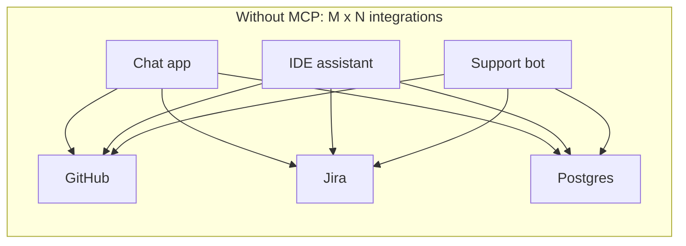
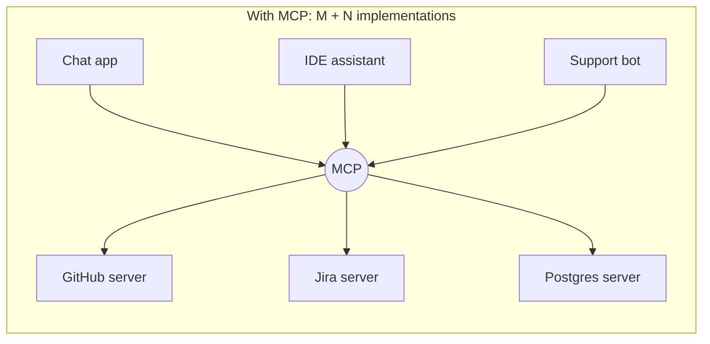
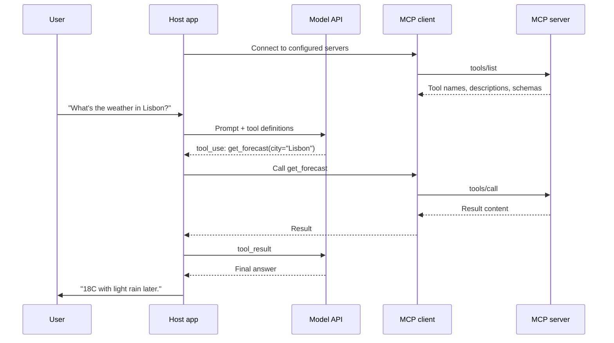

# MCP Introduction

## Introduction

In the [Tool Use](../2-agents-tool-use/0-agents-tool-use-introduction.mdx) section you gave a model tools by writing Python functions and JSON schemas directly inside your application. That works well when one application needs a handful of tools. It stops scaling when:

- Five different AI applications in your company each need to talk to the same ticketing system, and each team writes its own slightly different wrapper.
- Your users want to plug *their* tools (GitHub, Google Drive, a local database) into *your* AI product without you writing an integration for every one.
- A vendor wants to ship one integration that works in Claude, ChatGPT, VS Code, Cursor, and dozens of other AI applications.

The **Model Context Protocol (MCP)** is an open standard that solves this. It defines one common way for an AI application to discover and use tools, data, and prompt templates that live in a separate program called an **MCP server**. Write a server once, and any MCP-compatible application can use it.

:::tip Analogy
MCP is often compared to USB-C. Before USB, every printer, mouse, and camera needed its own port and driver. USB defined one plug and one protocol, so any device works with any computer. MCP does the same for AI applications and the systems they need to reach: one protocol, and any server works with any compatible host.
:::

Another useful comparison is the **Language Server Protocol (LSP)**, which the MCP specification itself names as an inspiration. Before LSP, every code editor had to implement "go to definition" separately for every programming language. LSP split the work: language teams build one language server, editor teams build one LSP client, and everything works together. MCP applies the same split to AI integrations.

## What You Will Learn in This Section

| Page | What it covers |
| --- | --- |
| MCP Architecture | Hosts, clients, servers, JSON-RPC messages, and the stateless protocol |
| Building Your First MCP Server | A working Python server with typed tools, tests, and host setup |
| MCP Tools, Resources and Prompts | The three server primitives and when to use each |
| Building an MCP Client | Connecting to servers from your own code, including several at once |
| MCP Transports | stdio versus Streamable HTTP, and deploying a remote server |
| Connecting MCP Servers to LLM APIs | Client-side bridges and the Claude API MCP connector |
| Wrapping an Existing API with MCP | Turning a REST API into a well-designed server |
| MCP Security | Tool poisoning, prompt injection, confused deputies, OAuth, least privilege |
| The MCP Ecosystem | Hosts, registries, vendor servers, gateways, and how to vet servers |
| Agent-to-Agent (A2A) Protocol | The complementary protocol for agent-to-agent collaboration |

## Key Terms

You will see these words throughout the section. Keep this table handy.

| Term | Meaning |
| --- | --- |
| **Host** | The AI application the user interacts with, such as Claude Code, an IDE, or your own agent |
| **Client** | The component inside a host that holds a connection to exactly one server |
| **Server** | A program that exposes tools, resources, and prompts through MCP |
| **Transport** | How messages travel: stdio (local subprocess) or Streamable HTTP (network) |
| **Primitive** | One of the things a server can offer: tool, resource, or prompt |
| **Capability** | A feature one side declares it supports, such as tools or elicitation |
| **Connector** | A common product name for a remote MCP server added to a chat app or model API |
| **Registry** | An index where servers are published and discovered |

## The Integration Problem MCP Solves

Without a shared protocol, connecting M AI applications to N external systems takes M times N custom integrations. Each integration has its own auth handling, schema conventions, and bugs.



With MCP, each application implements the client side of the protocol once, and each external system gets one MCP server. The work becomes M plus N.



This is the same economic argument that made HTTP, SQL drivers, and LSP successful. The protocol itself is not magic. Its value comes from the fact that many parties agree on it.

## What MCP Actually Is

MCP is a **specification**, not a library. It is published at [modelcontextprotocol.io](https://modelcontextprotocol.io/specification/latest) and defines:

- **Who talks to whom.** A **host** (the AI application, such as Claude Desktop or your own agent) creates one **client** per **server** it connects to.
- **The message format.** All messages are [JSON-RPC 2.0](https://www.jsonrpc.org/specification) requests, results, errors, and notifications.
- **How messages travel.** Two standard transports: **stdio** (the host starts the server as a local subprocess) and **Streamable HTTP** (the server runs as a web service).
- **What servers can offer.** Three building blocks called **primitives**:

| Primitive | Who controls it | What it is | Example |
| --- | --- | --- | --- |
| **Tools** | The model | Functions the model can call | `create_ticket`, `run_sql_query` |
| **Resources** | The application | Read-only data the app can load into context | A file, a database schema, a policy document |
| **Prompts** | The user | Reusable prompt templates the user picks | "Summarize this pull request", "Triage ticket" |

- **What clients can offer back.** The main one today is **elicitation**, which lets a server ask the user for input (for example, "Confirm you want to delete 40 rows?").
- **How to secure remote servers.** An OAuth 2.1-based authorization flow for HTTP servers.

The official SDKs (TypeScript, Python, C#, Go, Rust, Ruby, Java, Swift, PHP, and Kotlin at the time of writing; see the [SDK list](https://modelcontextprotocol.io/docs/sdk) for their maturity tiers) implement all of this so you rarely touch raw JSON-RPC. You will use the official **Python SDK** (the `mcp` package) throughout this section.

:::info Versions move fast
The current protocol revision at the time of writing is **`2026-07-28`**. It made MCP stateless: there is no longer an `initialize` handshake or a session ID, and every request carries its own protocol version. Many servers in the wild still speak the earlier `2025-11-25` revision, and the official SDKs can talk to both. Check the [specification changelog](https://modelcontextprotocol.io/specification/latest/changelog) for the latest revision before you start a new project.
:::

## A Quick Look at the Code

Here is a complete MCP server written with the Python SDK. Do not worry about the details yet. [Building Your First MCP Server](./2-agents-mcp-first-server.mdx) walks through it line by line.

```python
# server.py
from mcp.server.mcpserver import MCPServer

mcp = MCPServer("weather")


@mcp.tool()
def get_forecast(city: str) -> str:
    """Get a short weather forecast for a city."""
    # A real server would call a weather API here.
    return f"Forecast for {city}: 18C, light rain in the afternoon."


if __name__ == "__main__":
    mcp.run()  # stdio transport by default
```

Notice what is *not* here: no model, no API key, no prompt, no agent loop. An MCP server only exposes capabilities. The **host** decides which model to use, when to call the tool, and what to do with the result. That separation is the whole point. The same server can be used by Claude, by a GPT-based app, by an open-source model running in Ollama, or by a plain script with no model at all.

To try it in Claude Code, you would register it with one command:

```bash
claude mcp add weather -- python server.py
```

After that, asking Claude Code "What's the weather in Lisbon?" makes it discover and call `get_forecast` through MCP.

### One server, many consumers

The payoff is that the *same file* works everywhere, unchanged. A desktop chat app that uses an `mcpServers` configuration block can start it like this:

```json
{
  "mcpServers": {
    "weather": {"command": "python", "args": ["/absolute/path/to/server.py"]}
  }
}
```

And a plain Python script, with no model involved, can call the tool directly through the SDK's client:

```python
import asyncio
import sys

from mcp import Client, StdioServerParameters


async def main() -> None:
    server = StdioServerParameters(command=sys.executable, args=["server.py"])
    async with Client(server) as client:
        tools = await client.list_tools()
        print("Tools:", [t.name for t in tools.tools])
        result = await client.call_tool("get_forecast", {"city": "Lisbon"})
        print(result.content[0].text)


asyncio.run(main())
```

Output:

```text
Tools: ['get_forecast']
Forecast for Lisbon: 18C, light rain in the afternoon.
```

Three consumers, zero changes to the server. That is the whole value proposition of MCP in miniature.

## How a Request Flows

The diagram below shows what happens when a user asks a question in an MCP-enabled host.



Two things to notice:

1. **The model never talks to the MCP server directly.** The model still uses ordinary tool calling. The host translates between the model API's tool format and MCP. You will build that translation yourself in [Connecting MCP Servers to LLM APIs](./6-agents-mcp-with-llm-apis.mdx).
2. **MCP standardizes the right-hand side of the diagram** (host to server). It does not change how model APIs work.

## What MCP Does Not Do

MCP is deliberately narrow. Knowing its limits prevents unrealistic expectations:

- **It does not include a model.** The host owns the conversation with the model. A server may call an LLM internally, but that is a private implementation detail, not part of the protocol.
- **It does not make tools good.** A badly designed tool with a vague description is just as confusing to a model over MCP as it is with plain function calling. [Tool Design Principles](../2-agents-tool-use/7-agents-tool-design-principles.mdx) still apply.
- **It does not make servers trustworthy.** The protocol defines how to connect, not whom to trust. Tool descriptions and results can contain malicious instructions.
- **It is not a workflow engine.** MCP does not decide the order of steps or retry failed tasks. That is the agent loop's job, covered in [The Agent Loop](../0-agents-fundamentals/4-agents-agent-loop.mdx) and [Planning and Agent Patterns](../6-agents-planning-and-reasoning/0-agents-patterns-overview.mdx).
- **It does not replace your API.** An MCP server usually sits in front of an existing REST API or database. The API remains the system of record and keeps serving non-AI clients.
- **It does not remove the need for evaluation.** Connecting a server is easy. Knowing whether the agent uses it correctly requires testing, as described in [Agent Evaluation Introduction](../11-agents-evaluation-and-testing/0-agents-evaluation-introduction.mdx).

## Who Benefits, and How

| Role | Without MCP | With MCP |
| --- | --- | --- |
| **Tool or SaaS vendor** | Builds a plugin for each AI product, each with its own format | Ships one server that works in every compatible host |
| **AI application developer** | Writes and maintains every integration in-house | Lets users and partners plug in servers |
| **Platform team in a company** | Sees each team wrap the same internal APIs differently | Publishes one approved server per system, with central auth and logging |
| **End user** | Waits for the app to add the integration they need | Adds an existing server in a few clicks |

## Where MCP Came From

- **November 2024:** Anthropic released MCP as an open specification with Python and TypeScript SDKs and a set of reference servers.
- **2025:** Adoption spread quickly. Major AI applications, IDEs, and agent frameworks added MCP client support, and many SaaS vendors published official servers. The spec added Streamable HTTP, OAuth-based authorization, structured tool output, and elicitation.
- **December 2025:** MCP was donated to the **Agentic AI Foundation (AAIF)**, a directed fund under the Linux Foundation, so that no single company controls it.
- **July 2026:** The `2026-07-28` revision removed protocol-level sessions to make servers easier to scale and introduced a formal deprecation policy and an extensions mechanism.

Exact adoption numbers change constantly, so check the [MCP Registry](https://registry.modelcontextprotocol.io) and the [official servers repository](https://github.com/modelcontextprotocol/servers) for the current picture. [The MCP Ecosystem](./9-agents-mcp-ecosystem.mdx) covers this in more depth.

## MCP vs Plain Function Calling vs A2A

MCP does not replace tool use. It sits on top of it. A third protocol, **A2A (Agent-to-Agent)**, solves yet another problem. Knowing which one you need saves a lot of over-engineering.

| | Plain function calling | MCP | A2A |
| --- | --- | --- | --- |
| **Connects** | Your code to the model | An AI app to tools and data | An agent to another agent |
| **Where tools live** | Inside your app process | In a separate server process or service | Hidden inside the remote agent |
| **Who defines the interface** | You, per provider API | The MCP spec, provider-neutral | The A2A spec |
| **Unit of work** | One function call | One tool call, resource read, or prompt | A task that may run for minutes or days |
| **Reuse across apps** | Copy-paste | Any MCP host can use the server | Any A2A client can call the agent |
| **Extra moving parts** | None | A server process, a transport, maybe auth | An agent service, Agent Card, task tracking |

### When to use plain function calling

- You have **one application** and a **small, private set of tools**.
- The tools are tightly coupled to your app's code (for example, they read the current user's session).
- You want the fewest moving parts. A function in the same process is faster to call, easier to debug, and has no extra deployment.

### When to use MCP

- The same tools should work in **several AI applications** (your agent, Claude Code, an IDE, a chat app).
- You want users or other teams to **bring their own integrations** to your host.
- You are a **vendor** who wants to expose your product to every AI client with one integration.
- You want a **clean security boundary**: the server holds credentials and enforces permissions, and the host never sees the database password.

### When to use A2A

- You need to delegate a **whole task** to an independent agent, often owned by another team or company, without knowing which tools it uses internally.
- The work is **long-running** and needs status updates, cancellation, or follow-up questions.

A common architecture uses all three: an agent uses plain function calling for a few internal helpers, connects to MCP servers for shared tools, and delegates big sub-tasks to other agents over A2A. [Agent-to-Agent (A2A) Protocol](./10-agents-a2a-protocol.mdx) covers A2A in detail.

## Real-World Scenario

Your company runs a SaaS helpdesk product. Three teams are building AI features at the same time:

- The **support team** wants a triage agent that reads new tickets and suggests a priority.
- The **engineering team** wants Claude Code and their IDE assistant to look up the tickets linked to a bug.
- The **sales team** wants a chat assistant that checks a customer's open tickets before a call.

Each team started writing its own `get_ticket` and `search_tickets` functions against the helpdesk REST API. Within a month there are three copies with different field names, different error handling, and three places that hold the API key.

### The solution

The platform team builds one **Helpdesk MCP server** that exposes:

- Tools: `search_tickets`, `get_ticket`, `add_internal_note`
- A resource: `helpdesk://sla-policy` with the current SLA rules
- A prompt: `triage_ticket`, a template support agents can pick from a menu

The server runs as a Streamable HTTP service behind the company's identity provider. Each team connects to it:

- The triage agent uses a small MCP client inside its own agent loop.
- Engineers add it to Claude Code and their IDE with one config entry.
- The sales chat app passes the server URL to the Claude API's MCP connector.

### Why this approach

- **One implementation** of the helpdesk integration, owned by the team that knows the API best.
- **One place for credentials and permissions.** The server checks each user's token and only exposes what they are allowed to see.
- **Works with any model.** If the sales team later switches providers, the server does not change.

### When to use it, and when not to

Use MCP here because there are several consumers and the integration is shared. If only the triage agent needed two read-only helpdesk calls, plain function calling inside that agent would be simpler and faster to ship. You can always extract the functions into an MCP server later. The tool definitions barely change.

### Alternatives and trade-offs

| Approach | Pros | Cons | Best for |
| --- | --- | --- | --- |
| Function calling in each app | Simple, no extra service | Duplicated code and credentials | One app, few tools |
| Shared Python library | Reuse within one language | Every app must use Python; credentials still spread out | One language, trusted apps |
| Internal REST API plus per-app tool wrappers | Familiar, language-neutral | Each app still writes tool schemas and descriptions | Teams without MCP-capable hosts |
| **MCP server** | Reusable across hosts, models, and languages; central auth | Another service to run and secure | Several AI consumers of the same system |
| A2A agent | Delegates whole tasks, hides internals | Heavier; you lose fine-grained control | Cross-team or cross-company agent collaboration |

## Common Mistakes

- **Reaching for MCP too early.** If you have one agent and three tools, a server process adds deployment and debugging cost without benefit. Start with function calling. Move to MCP when a second consumer appears.
- **Thinking MCP makes tools safe.** MCP standardizes the connection, not the trust. A malicious or buggy server can still return harmful instructions or leak data. See [MCP Security](./8-agents-mcp-security.mdx).
- **Assuming the model "speaks MCP".** Models speak their provider's tool-calling format. The host (or a provider feature such as the Claude API MCP connector) does the translation.
- **Copying old tutorials blindly.** The protocol and SDKs have changed a lot. For example, the Python SDK renamed `FastMCP` to `MCPServer` in version 2, and the protocol dropped the `initialize` handshake in `2026-07-28`. Always check the version a tutorial targets.
- **Exposing every endpoint of an API as a tool.** Twenty thin, overlapping tools confuse models. Design a few task-shaped tools instead. See [Wrapping an Existing API with MCP](./7-agents-mcp-wrapping-existing-apis.mdx).
- **Confusing MCP with A2A.** MCP connects an agent to tools and data. Delegating a whole goal to another team's agent is what A2A is for.

## Summary

- MCP is an open protocol that standardizes how AI applications connect to tools, data, and prompt templates.
- It turns M times N custom integrations into M plus N: each host implements a client, each system gets a server.
- Servers expose **tools** (model-controlled), **resources** (application-controlled), and **prompts** (user-controlled).
- Messages are JSON-RPC 2.0 over **stdio** or **Streamable HTTP**. The current revision, `2026-07-28`, is stateless.
- The model still uses normal tool calling. The host translates between the model API and MCP.
- Use plain function calling for small, single-app toolsets, MCP for shared and reusable integrations, and A2A for delegating whole tasks to other agents.
- MCP does not provide a model, good tool design, trust, or evaluation. Those remain your job.

## Exercises

1. List the tools your current or planned agent uses. For each one, decide whether it belongs in the app (function calling) or in a shared MCP server, and write one sentence explaining why.
2. Install Claude Code or another MCP-capable host, then add any official reference server (for example, the filesystem server from the [servers repository](https://github.com/modelcontextprotocol/servers)). Ask the assistant to use it and watch which tools it calls.
3. Read the [specification overview](https://modelcontextprotocol.io/specification/latest) and write down which three server features and which client feature it lists.
4. Run the weather server from this page and call it from the small Python client. Then change the docstring of `get_forecast` and print `tools.tools[0].description` again. Where would a model see that change?

**Next:** [MCP Architecture](./1-agents-mcp-architecture.mdx) explains hosts, clients, servers, and the messages that flow between them.
