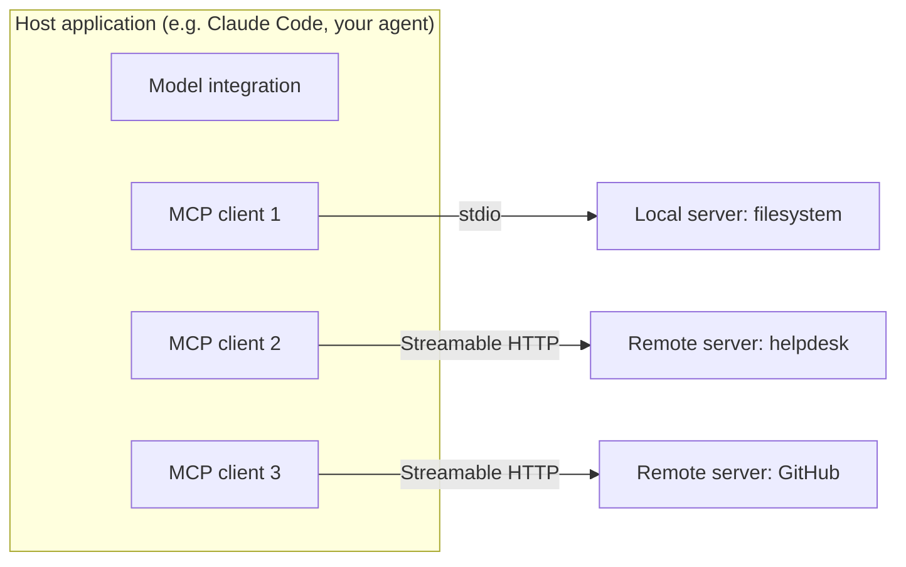
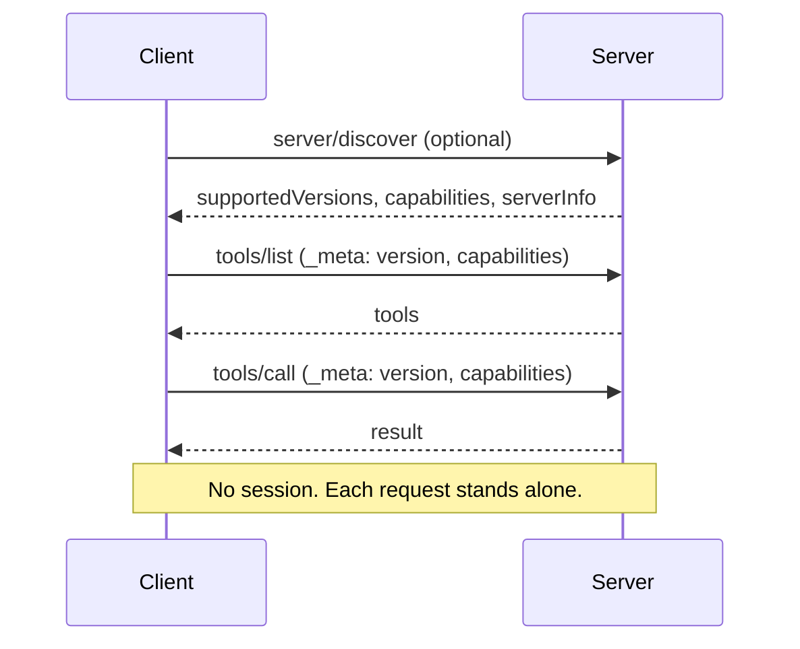
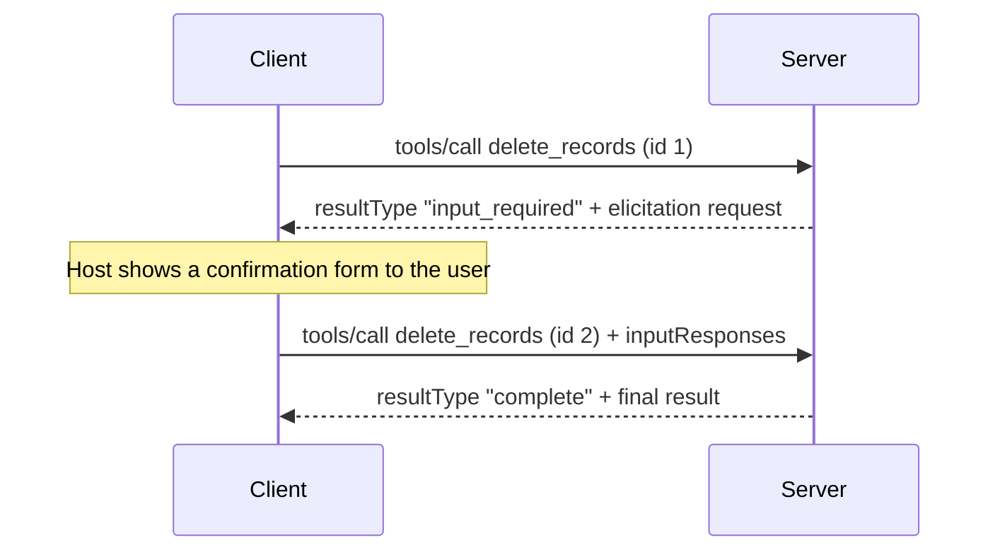
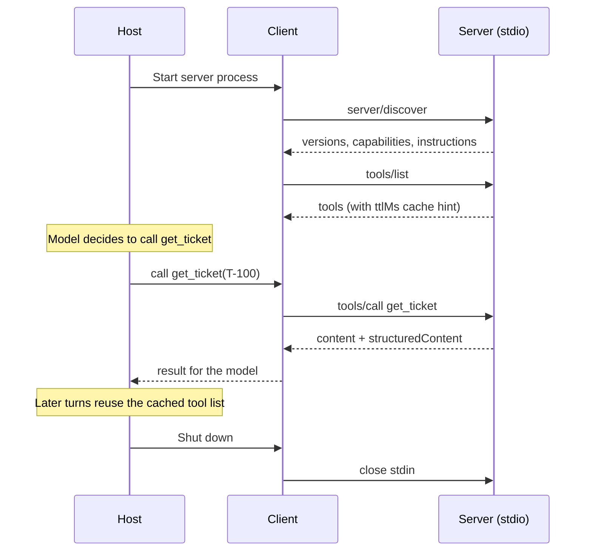

# MCP Architecture

## Introduction

Before you write a server or a client, it helps to see the whole system. MCP has a small number of moving parts, and each one has a clear job. Once you know who owns what, questions like "where does the API key live?", "who decides when a tool runs?", and "why does my server see a request from a client it has never met?" have obvious answers.

This page covers:

- The three **participants**: host, client, and server
- The two **layers**: the data layer (JSON-RPC messages) and the transport layer
- **Capabilities** and how each side learns what the other supports
- The **stateless** design introduced in protocol revision `2026-07-28`
- How a server asks the user for input (**multi round-trip requests**)
- Which features are **current**, which are **deprecated**, and which are **extensions**

:::tip Analogy
Think of a hotel concierge (the **host**). Guests (users) ask the concierge for things. The concierge has a phone line (a **client**) to each partner business: a restaurant, a taxi company, a theater (the **servers**). Each partner publishes a menu of what it can do. The concierge decides which partner to call and relays the answer. The partners never talk to the guests directly, and they never talk to each other.
:::

## Participants: Host, Client, Server



### Host

The **host** is the AI application the user interacts with: Claude Desktop, Claude Code, an IDE, a chat product, or an agent you write. The host:

- Decides which servers to connect to (usually from configuration)
- Creates one client per server
- Owns the conversation with the model and decides which tools to show it
- Enforces user consent: approving tool calls, showing what data leaves the machine
- Merges context from all servers into one prompt

### Client

An **MCP client** is a component inside the host that holds a connection to **exactly one** server. If the host talks to three servers, it has three clients. A client:

- Sends requests (`tools/list`, `tools/call`, `resources/read`, and so on)
- Receives results and notifications
- Answers the server's requests for user input (elicitation)

In code, the Python SDK's `Client` class is one MCP client.

### Server

An **MCP server** is a program that exposes capabilities through MCP. It can run as:

- A **local process** that the host starts and talks to over stdio (for example, a server that reads files on your laptop)
- A **remote service** reachable over HTTP (for example, a SaaS vendor's hosted server)

A server does not know or care which model the host uses. It focuses on one domain, such as a ticketing system or a database, and exposes tools, resources, and prompts for it.

:::note Isolation by design
Servers cannot see each other, and they cannot read the full conversation. A server only sees the requests the host chooses to send it. This keeps a compromised or buggy server from reading data that belongs to another server, and it is one reason the host is responsible for consent and security decisions.
:::

## Two Layers: Data and Transport

MCP separates *what* is said from *how* it travels.

| Layer | Responsibility | Defined by |
| --- | --- | --- |
| **Data layer** | Message types, capabilities, tools, resources, prompts, errors | JSON-RPC 2.0 plus the MCP schema |
| **Transport layer** | Moving bytes between client and server, framing, auth headers | stdio or Streamable HTTP |

Because the data layer is identical on every transport, a server you test over stdio behaves the same way when you later deploy it over HTTP. [MCP Transports](./5-agents-mcp-transports.mdx) covers the transport layer in detail.

### JSON-RPC in one minute

Every MCP message is a JSON-RPC 2.0 object. There are three kinds:

- **Request:** has an `id` and a `method`, expects a reply
- **Response:** has the same `id`, and either a `result` or an `error`
- **Notification:** has a `method` but no `id`, so no reply is expected (for example, progress updates)

Here is a real `tools/call` request, as the current Python SDK sends it over stdio:

```json
{
  "jsonrpc": "2.0",
  "id": 2,
  "method": "tools/call",
  "params": {
    "name": "get_ticket",
    "arguments": {"ticket_id": "T-100"},
    "_meta": {
      "io.modelcontextprotocol/protocolVersion": "2026-07-28",
      "io.modelcontextprotocol/clientInfo": {"name": "raw-client", "version": "0.1"},
      "io.modelcontextprotocol/clientCapabilities": {}
    }
  }
}
```

And the server's response:

```json
{
  "jsonrpc": "2.0",
  "id": 2,
  "result": {
    "resultType": "complete",
    "content": [
      {"type": "text", "text": "{\"id\": \"T-100\", \"status\": \"open\", \"priority\": \"high\", \"subject\": \"Cannot log in\"}"}
    ],
    "structuredContent": {"id": "T-100", "status": "open", "priority": "high", "subject": "Cannot log in"},
    "isError": false,
    "_meta": {
      "io.modelcontextprotocol/serverInfo": {"name": "helpdesk", "version": ""}
    }
  }
}
```

Look at the `_meta` block in the request. It carries the **protocol version**, the **client's identity**, and the **client's capabilities**. In the current revision, every request carries this information. That is the key to the stateless design described next.

## The Stateless Protocol (2026-07-28)

Earlier revisions of MCP (up to `2025-11-25`) worked like a phone call. The client first sent an `initialize` request, the two sides agreed on a version and capabilities, and the server kept a **session** for the rest of the conversation. Over HTTP, that session was tracked with an `Mcp-Session-Id` header.

Sessions made remote servers hard to scale. A load balancer had to send every request from a client to the same server instance, or the instances had to share session storage. Revision `2026-07-28` removed protocol-level sessions entirely:

- **No handshake.** There is no `initialize` request. Each request carries its version and capabilities in `_meta`.
- **Any instance can answer any request.** A remote server can run behind an ordinary load balancer.
- **`server/discover`** is a new method that every server must implement. A client may call it first to learn the server's supported versions, capabilities, and identity, but it does not have to.
- **Version mismatch is a normal error.** If a server does not support the requested version, it returns an `UnsupportedProtocolVersionError` that lists the versions it does support, and the client retries.



Here is the real `server/discover` result from the helpdesk server you will build later in this section:

```json
{
  "resultType": "complete",
  "supportedVersions": ["2026-07-28"],
  "capabilities": {
    "prompts": {"listChanged": true},
    "resources": {"listChanged": true, "subscribe": true},
    "tools": {"listChanged": true}
  },
  "instructions": "Look up support tickets for Acme Inc.",
  "ttlMs": 0,
  "cacheScope": "private",
  "_meta": {"io.modelcontextprotocol/serverInfo": {"name": "helpdesk", "version": ""}}
}
```

Two fields worth noticing:

- **`instructions`** is optional guidance the host can show the model about how to use this server.
- **`ttlMs` and `cacheScope`** are caching hints. List results (`tools/list`, `resources/list`, `prompts/list`) carry them too, so clients can cache tool lists instead of asking again on every turn.

### What about state that really is needed?

Some tools need memory across calls: a shopping cart, an open browser tab, a multi-step database transaction. Without sessions, the spec recommends **explicit handles**. A tool such as `create_cart` returns an ID like `cart_8f3a2c`, and later tools take that ID as an ordinary argument. The server stores the state under that key. Because handles are just arguments, they work the same way on every transport, and they survive reconnects.

:::warning Handles are names, not passwords
If your server is authenticated, check on every call that the handle belongs to the calling user. Possessing a handle must never be enough to access someone else's state. Generate handles with a secure random generator so they cannot be guessed.
:::

### Backward compatibility

Many deployed servers still speak `2025-11-25` or earlier. The spec defines how a **dual-era** client detects which kind of server it is talking to. On stdio, it sends `server/discover` first and falls back to the old `initialize` handshake if the server does not understand it. On HTTP, it inspects the error body of a `400` response. The Python SDK's `Client` does this automatically by default (`mode="auto"`), so in most code you never think about it.

## Capabilities

Not every server offers every feature, and not every client supports every feature. **Capabilities** are how each side advertises what it supports.

- **Server capabilities** (returned by `server/discover`): `tools`, `resources`, `prompts`, `completions`, plus flags such as `listChanged` and `subscribe`.
- **Client capabilities** (sent in every request's `_meta`): for example `elicitation` if the client can show the user a form.
- **Extensions** (in an `extensions` map inside capabilities): optional add-ons negotiated by both sides, such as `io.modelcontextprotocol/tasks` for long-running work.

If a server needs a client capability that the client did not declare, it returns a `MissingRequiredClientCapabilityError` instead of guessing.

## Server Primitives

Servers expose three primitives. You will build all three in [MCP Tools, Resources and Prompts](./3-agents-mcp-tools-resources-prompts.mdx).

| Primitive | Control | Discovery method | Use method | Typical host UI |
| --- | --- | --- | --- | --- |
| Tools | Model-controlled | `tools/list` | `tools/call` | The model calls them during the agent loop |
| Resources | Application-controlled | `resources/list`, `resources/templates/list` | `resources/read` | A file picker or "attach context" menu |
| Prompts | User-controlled | `prompts/list` | `prompts/get` | Slash commands or a template menu |

The "control" column matters. It tells you who decides when each primitive is used, which in turn tells you how to design it. A tool must be safe for a model to call on its own judgment. A prompt can assume a human chose it on purpose.

## When the Server Needs Something from the User

Sometimes a tool needs more information halfway through. For example, a `delete_records` tool should confirm with the user before deleting anything.

In older revisions, the server sent its own request back to the client in the middle of a call. That required a long-lived, two-way connection. In `2026-07-28`, this was replaced with **Multi Round-Trip Requests (MRTR)**:



1. The server returns a result with `resultType: "input_required"` and a list of `inputRequests` (for example, an `elicitation/create` request with a JSON schema for a form).
2. The host collects the answer from the user.
3. The client **retries the original request** with `inputResponses` attached (and an opaque `requestState` if the server provided one).
4. The server finishes and returns `resultType: "complete"`.

Every request is still independent, so this works with stateless servers and load balancers. SDKs hide most of this. You will see the Python version in [MCP Tools, Resources and Prompts](./3-agents-mcp-tools-resources-prompts.mdx).

## Errors at the Protocol Level

MCP uses standard JSON-RPC error objects for protocol problems, and reserves a range of codes for its own errors. The ones you will meet most often:

| Code | Name | Typical cause |
| --- | --- | --- |
| `-32601` | Method not found | The server does not implement the method (for example, `prompts/list` on a tools-only server) |
| `-32602` | Invalid params | Unknown tool name, unknown resource URI, or malformed arguments |
| `-32603` | Internal error | The server failed while handling the request |
| `-32020` | HeaderMismatch | An HTTP header such as `Mcp-Name` does not match the JSON body |
| `-32021` | MissingRequiredClientCapability | The server needs a capability (such as elicitation) the client did not declare |
| `-32022` | UnsupportedProtocolVersion | The requested protocol version is not supported. The error lists the supported versions. |

Remember the distinction from [Tool Use](../2-agents-tool-use/6-agents-tool-errors.mdx): a tool that runs but fails (for example, "ticket not found") does **not** produce a JSON-RPC error. It returns a normal result with `isError: true`, so the model can read the message and recover. JSON-RPC errors are for problems with the request itself.

## A Full Exchange, End to End

Putting the pieces together, here is everything that crosses the wire when a host with one stdio server answers a single question that needs one tool call:



The host does not need to repeat discovery on every turn. The `ttlMs` hint tells it how long the tool list stays fresh, and a client that opened a `subscriptions/listen` stream hears about changes immediately.

## Notifications and Utilities

A few more pieces round out the protocol:

- **Progress:** a server can send `notifications/progress` while a long request runs.
- **Cancellation:** on HTTP, the client closes the response stream. On stdio, it sends `notifications/cancelled`.
- **Change notifications:** a client that wants to know when the tool list changes opens a long-lived `subscriptions/listen` request and opts into event types such as `toolsListChanged`.
- **Pagination:** list methods return a `nextCursor` when there are more results.
- **Tracing:** the spec reserves `_meta` keys for OpenTelemetry trace context (`traceparent`, `tracestate`, `baggage`), so a trace can follow a tool call from host to server. See [OpenTelemetry for Agents](../11-agents-evaluation-and-testing/9-agents-opentelemetry.mdx).

## Current, Deprecated, and Extension Features

The `2026-07-28` revision introduced a formal feature lifecycle with a minimum twelve-month deprecation window. As of that revision:

| Status | Features |
| --- | --- |
| **Core** | Tools, resources, prompts, elicitation, completions, progress, cancellation, `server/discover`, `subscriptions/listen`, stdio, Streamable HTTP, OAuth-based authorization |
| **Deprecated** | Sampling (servers asking the host's model to generate text), Roots (client sharing directory boundaries), Logging via `notifications/message`, the old HTTP+SSE transport, Dynamic Client Registration (in favor of Client ID Metadata Documents) |
| **Extensions** | Tasks (long-running asynchronous operations), MCP Apps (interactive UI rendered in the host), Skills over MCP, and authorization extensions |

Deprecated features still work during the deprecation window, but new code should not adopt them. The spec suggests alternatives: pass directories as tool parameters instead of Roots, call an LLM API directly instead of Sampling, and log to stderr or OpenTelemetry instead of protocol logging. Check the [deprecated features registry](https://modelcontextprotocol.io/specification/latest/deprecated) for the current list.

## Real-World Scenario

Your platform team is deploying the Helpdesk MCP server from the [previous page](./0-agents-mcp-introduction.mdx) for 2,000 employees. Usage is spiky: quiet at night, heavy on Monday mornings. You need to decide how to run it.

### The solution

Because the server speaks `2026-07-28`, it holds no per-client protocol state. You deploy it as a normal stateless web service:

- Several identical containers behind a standard HTTP load balancer, with autoscaling on CPU
- No sticky sessions and no shared session store
- The one stateful tool, `start_bulk_update`, returns a random handle (`bulk_7c1e...`) and stores progress in Redis keyed by user ID plus handle
- The load balancer routes on the `Mcp-Method` header (mirrored from the JSON-RPC body by the transport) to send slow `tools/call` traffic to a separate pool

Hosts connect with a single URL. Older hosts that still speak `2025-11-25` are served because the SDK supports both eras on the same endpoint.

### Why this approach

The stateless protocol lets you treat the MCP server exactly like any other HTTP API: scale horizontally, deploy with rolling updates, and lose an instance without breaking clients. State lives where you control it, keyed to an authenticated user.

### When to use it, and when not to

Stateless, horizontally scaled deployment is right for shared remote servers. For a local developer tool that runs over stdio on one laptop, none of this matters: the host starts one process, and scaling is not a concern.

### Alternatives and trade-offs

| Approach | Pros | Cons | Best for |
| --- | --- | --- | --- |
| Stateless server, explicit handles | Scales horizontally, simple load balancing | Tools must pass handles explicitly | Shared remote servers |
| Legacy session-based server (`2025-11-25`) | Works with older hosts only | Needs sticky sessions or shared session storage | Existing deployments during migration |
| Local stdio server per user | No network, no auth needed | Runs on every user's machine; harder to update | Developer tools, local files |
| One server per tenant | Strong isolation | Many deployments to manage | High-security or regulated tenants |

## Common Mistakes

- **Putting model logic in the server.** The server should not decide what the user "really meant". That is the host's and the model's job. Keep servers focused on doing well-defined actions and returning clear data.
- **Assuming one client equals one user.** A remote server receives requests from many hosts and users. Identify the caller from the auth token on each request, never from connection state.
- **Relying on hidden per-connection state.** Under the stateless protocol, consecutive requests may hit different server instances. Use explicit handles.
- **Using deprecated features in new code.** Sampling, Roots, and protocol logging still appear in older tutorials. Prefer the alternatives listed above.
- **Treating `serverInfo` as proof of identity.** The server's self-reported name and version are for display and debugging only. Never base security decisions on them.

## Summary

- A **host** runs one **client** per **server**. Servers are isolated from each other and from the full conversation.
- The **data layer** is JSON-RPC 2.0. The **transport layer** is stdio or Streamable HTTP.
- Since `2026-07-28`, MCP is **stateless**: no `initialize`, no sessions, protocol version and capabilities in every request's `_meta`, and `server/discover` for optional up-front discovery.
- Servers expose **tools** (model-controlled), **resources** (app-controlled), and **prompts** (user-controlled).
- Servers ask for user input with **multi round-trip requests**: return `input_required`, and the client retries with answers.
- Sampling, Roots, and protocol logging are **deprecated**. Tasks and MCP Apps are **extensions**.

## Exercises

1. Draw the architecture of an AI app you use (for example, an IDE assistant) as host, clients, and servers. Mark which servers are local (stdio) and which are remote (HTTP).
2. Read the [versioning page](https://modelcontextprotocol.io/specification/latest/basic/versioning) and explain in your own words what a client should do when it receives an `UnsupportedProtocolVersionError`.
3. Design a stateful "shopping cart" MCP server with three tools. Write their names and arguments, and explain how you would stop one user from reading another user's cart.

**Next:** [Building Your First MCP Server](./2-agents-mcp-first-server.mdx) turns these ideas into running code.
