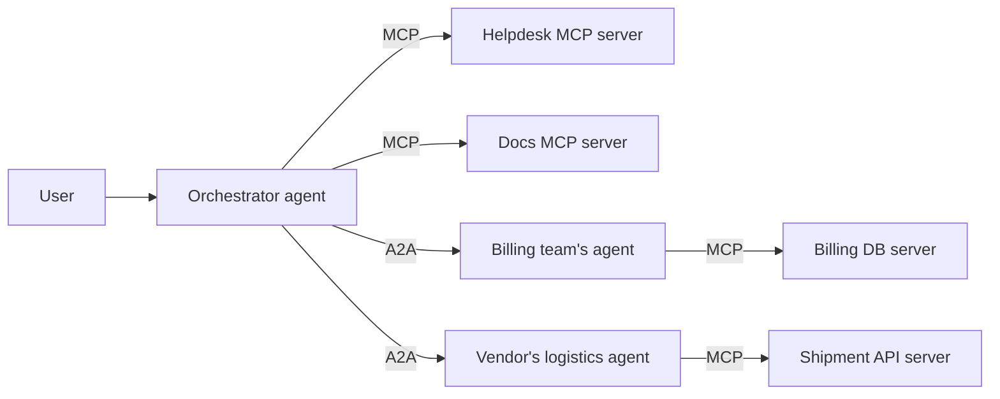
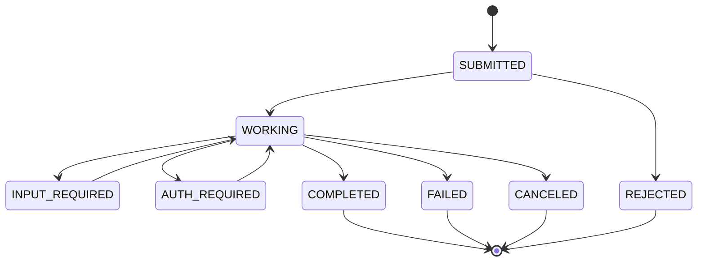

# Agent-to-Agent (A2A) Protocol

## Introduction

MCP connects an agent to **tools and data**. But what if the thing you need to call is not a tool, but **another agent**: one built by a different team, in a different framework, perhaps at a different company, that takes minutes or hours to finish, asks follow-up questions, and does not want to reveal how it works inside?

You could wrap that agent as an MCP tool, and for simple cases that is fine. But a tool call is a short, synchronous request with a fixed schema. Delegating real work to an independent agent needs more: discovery of what the agent can do, a task that can run for a long time, status updates, follow-up questions, cancellation, files and structured results, and enterprise authentication.

The **Agent2Agent (A2A) protocol** standardizes exactly that. Google introduced it in April 2025 and donated it to the Linux Foundation that June. Version **1.0** of the specification is the current release at the time of writing, and in 2026 the project joined the **Agentic AI Foundation**, the same foundation that hosts MCP.

:::tip Analogy
If MCP is how a worker uses their tools (a drill, a spreadsheet, a database), A2A is how one company hires another company. You read their brochure (the **Agent Card**), send a work order (a **message**), get a job number (a **task**), receive progress reports and questions, and finally get deliverables (**artifacts**). You never see their internal tools or processes.
:::

## Where A2A Fits



The A2A specification itself describes the two protocols as complementary: MCP standardizes how an agent connects to tools, APIs, and data; A2A standardizes how independent, often opaque agents discover each other and collaborate as peers. A typical A2A server agent uses MCP internally to do its work.

| | MCP | A2A |
| --- | --- | --- |
| **Connects** | An AI application to tools, data, and prompts | An agent (client) to another agent (server) |
| **Unit of work** | A tool call, resource read, or prompt | A **task** with a lifecycle |
| **Duration** | Usually seconds | Seconds to days |
| **What the caller sees** | Tool schemas and results | Skills, status updates, messages, artifacts. Internals stay hidden. |
| **Multi-turn** | Elicitation for small inputs | Built-in `input-required` and `auth-required` states |
| **Async delivery** | Progress notifications, Tasks extension | Polling, streaming (SSE), and push notifications (webhooks) |
| **Discovery** | `server/discover`, registries | Agent Card at a well-known URL |
| **Typical boundary** | Inside one application or organization | Across teams, vendors, and organizations |

### When to use plain function calling, MCP, or A2A

- **Plain function calling:** the capability lives inside your application, and only your agent uses it.
- **MCP:** the capability is a tool or data source that several AI applications should share, and the caller should control each step.
- **A2A:** you want to hand off a **goal** to an independent agent that decides its own steps, may take a long time, may need to ask questions, and is owned by someone else.

If you find yourself designing an MCP tool with a "status" polling tool, a "send follow-up answer" tool, and a "cancel" tool, you are reinventing A2A.

## Core Concepts

### Agent Card

Every A2A server publishes an **Agent Card**: a JSON document describing the agent. Clients fetch it from a well-known path:

```text
https://{server_domain}/.well-known/agent-card.json
```

Here is the card served by the example agent you will build below:

```json
{
  "name": "Ticket Triage Agent",
  "description": "Assigns a priority and owning team to a customer support ticket.",
  "supportedInterfaces": [
    {"url": "http://127.0.0.1:9871", "protocolBinding": "HTTP+JSON", "protocolVersion": "1.0"}
  ],
  "version": "1.0.0",
  "capabilities": {"streaming": false},
  "defaultInputModes": ["text/plain"],
  "defaultOutputModes": ["text/plain"],
  "skills": [
    {
      "id": "triage-ticket",
      "name": "Triage ticket",
      "description": "Given the text of a support ticket, return a priority (P1-P4) and a team.",
      "tags": ["support", "triage"],
      "examples": ["Customer cannot log in after password reset since 9am."]
    }
  ]
}
```

Key fields:

- **`skills`**: what the agent can do, with descriptions and examples. An orchestrator model reads these to decide which agent to delegate to, much as it reads tool descriptions.
- **`supportedInterfaces`**: where to reach the agent and with which **protocol binding**. A2A defines three equivalent bindings: **JSON-RPC**, **gRPC**, and **HTTP+JSON** (REST).
- **`capabilities`**: optional features such as `streaming`, `pushNotifications`, and `extendedAgentCard` (a richer card available only to authenticated clients).
- **`securitySchemes`** and **`securityRequirements`**: how to authenticate. Supported schemes include API keys, HTTP auth, OAuth 2.0, OpenID Connect, and mutual TLS.
- **`signatures`**: optional JWS signatures, so clients can verify the card was published by who it claims.

### Task

A **task** is the unit of work. The server creates it, gives it an `id`, and moves it through states:



In JSON the states are written as `TASK_STATE_SUBMITTED`, `TASK_STATE_WORKING`, `TASK_STATE_INPUT_REQUIRED`, `TASK_STATE_COMPLETED`, and so on. `COMPLETED`, `FAILED`, `CANCELED`, and `REJECTED` are terminal. `INPUT_REQUIRED` and `AUTH_REQUIRED` are interrupted states: the agent is waiting for the client to send another message. Related tasks share a `contextId`, which groups a multi-turn interaction.

### Message, Part, and Artifact

- A **message** is one turn of communication, with a `role` (`ROLE_USER` for the client, `ROLE_AGENT` for the server), a `messageId`, and a list of **parts**.
- A **part** holds exactly one kind of content: `text`, `raw` (bytes, base64-encoded in JSON), `url` (a file reference), or `data` (arbitrary JSON). Parts can carry a `mediaType` and `filename`.
- An **artifact** is an output of a task, also made of parts. The spec recommends putting results in artifacts rather than in messages, and using messages for conversation and status.

### Operations

The core operations (shown with their JSON-RPC method names and REST paths) are:

| Operation | JSON-RPC method | HTTP+JSON binding |
| --- | --- | --- |
| Send a message | `SendMessage` | `POST /message:send` |
| Send and stream updates | `SendStreamingMessage` | `POST /message:stream` (SSE) |
| Get a task | `GetTask` | `GET /tasks/{id}` |
| List tasks | `ListTasks` | `GET /tasks` |
| Cancel a task | `CancelTask` | `POST /tasks/{id}:cancel` |
| Resubscribe to updates | `SubscribeToTask` | `POST /tasks/{id}:subscribe` (SSE) |
| Manage push notification webhooks | `CreateTaskPushNotificationConfig` and others | `/tasks/{id}/pushNotificationConfigs` |
| Get the authenticated extended card | `GetExtendedAgentCard` | `GET /extendedAgentCard` |

Clients send an **`A2A-Version`** header (for example `1.0`) on each request. A server that does not support the requested version returns a version-not-supported error.

## Example: A Ticket Triage Agent

You will build a small A2A agent with the official Python SDK, call it with plain HTTP to see the wire format, and then call it with the SDK's client. The triage logic is a simple keyword rule so the example runs without an API key. In a real system, `triage()` would run an LLM agent loop, perhaps using the helpdesk MCP server from earlier pages.

Install the SDK with its HTTP server extras:

```bash
pip install "a2a-sdk[http-server]" uvicorn httpx
```

### The server

```python
"""An A2A agent that triages support tickets (rule-based here; an LLM in real life)."""
import uvicorn
from starlette.applications import Starlette

from a2a.helpers import get_message_text, new_task_from_user_message, new_text_message, new_text_part
from a2a.server.agent_execution import AgentExecutor, RequestContext
from a2a.server.events import EventQueue
from a2a.server.request_handlers import DefaultRequestHandler
from a2a.server.routes import create_agent_card_routes, create_rest_routes
from a2a.server.tasks import InMemoryTaskStore, TaskUpdater
from a2a.types import AgentCapabilities, AgentCard, AgentInterface, AgentSkill, TaskState

BASE_URL = "http://127.0.0.1:9871"


def triage(text: str) -> str:
    """Stand-in for the real agent. In production this would run an LLM agent loop."""
    urgent = any(w in text.lower() for w in ("outage", "cannot log in", "data loss", "down"))
    priority = "P1" if urgent else "P3"
    team = "identity" if "log in" in text.lower() else "general-support"
    return f"priority={priority}; team={team}; reason=keyword triage"


class TriageExecutor(AgentExecutor):
    async def execute(self, context: RequestContext, event_queue: EventQueue) -> None:
        task = context.current_task or new_task_from_user_message(context.message)
        if not context.current_task:
            await event_queue.enqueue_event(task)

        updater = TaskUpdater(event_queue=event_queue, task_id=task.id, context_id=task.context_id)
        await updater.update_status(state=TaskState.TASK_STATE_WORKING,
                                    message=new_text_message("Triaging ticket..."))

        result = triage(get_message_text(context.message))
        await updater.add_artifact(parts=[new_text_part(text=result, media_type="text/plain")],
                                   name="triage-decision")
        await updater.update_status(state=TaskState.TASK_STATE_COMPLETED)

    async def cancel(self, context: RequestContext, event_queue: EventQueue) -> None:
        raise NotImplementedError("Triage is fast; cancellation is not supported.")


card = AgentCard(
    name="Ticket Triage Agent",
    description="Assigns a priority and owning team to a customer support ticket.",
    version="1.0.0",
    default_input_modes=["text/plain"],
    default_output_modes=["text/plain"],
    capabilities=AgentCapabilities(streaming=False),
    supported_interfaces=[
        AgentInterface(protocol_binding="HTTP+JSON", url=BASE_URL, protocol_version="1.0"),
    ],
    skills=[
        AgentSkill(
            id="triage-ticket",
            name="Triage ticket",
            description="Given the text of a support ticket, return a priority (P1-P4) and a team.",
            tags=["support", "triage"],
            examples=["Customer cannot log in after password reset since 9am."],
        )
    ],
)

handler = DefaultRequestHandler(agent_executor=TriageExecutor(), task_store=InMemoryTaskStore(), agent_card=card)
app = Starlette(routes=[*create_agent_card_routes(card), *create_rest_routes(handler)])

if __name__ == "__main__":
    uvicorn.run(app, host="127.0.0.1", port=9871)
```

The pieces:

- **`AgentExecutor`** holds your agent logic. `execute` receives the request context and publishes events to a queue: the task, status updates, and artifacts.
- **`TaskUpdater`** is a helper for publishing status changes and artifacts for one task.
- **`DefaultRequestHandler`** implements the protocol operations and stores tasks in a **task store**. `InMemoryTaskStore` is for demos. Production agents need a durable store so tasks survive restarts.
- **`create_agent_card_routes`** serves the card at the well-known path. **`create_rest_routes`** exposes the HTTP+JSON binding. The SDK also has `create_jsonrpc_routes` and gRPC support.

Start it with `python triage_agent.py`.

### Calling it with plain HTTP

Because A2A is ordinary HTTP and JSON, any language can call it. This client uses only `httpx`:

```python
import uuid

import httpx

AGENT = "http://127.0.0.1:9871"
HEADERS = {"A2A-Version": "1.0", "Content-Type": "application/a2a+json"}

with httpx.Client(timeout=30) as http:
    # 1. Discover: fetch the Agent Card from the well-known path
    card = http.get(f"{AGENT}/.well-known/agent-card.json").json()
    print("Agent:", card["name"], "| skills:", [s["id"] for s in card["skills"]])
    interface = next(i for i in card["supportedInterfaces"] if i["protocolBinding"] == "HTTP+JSON")

    # 2. Send a message; the agent replies with a Task
    body = {
        "message": {
            "messageId": str(uuid.uuid4()),
            "role": "ROLE_USER",
            "parts": [{"text": "Globex: users cannot log in after password reset since 9am."}],
        }
    }
    resp = http.post(f"{interface['url']}/message:send", headers=HEADERS, json=body)
    resp.raise_for_status()
    task = resp.json()["task"]
    print("Task:", task["id"][:8], "state:", task["status"]["state"])

    # 3. Read the result from the task's artifacts (or poll GET /tasks/{id} for long jobs)
    task = http.get(f"{interface['url']}/tasks/{task['id']}", headers=HEADERS).json()
    for artifact in task.get("artifacts", []):
        print("Artifact", artifact.get("name"), "->", artifact["parts"][0]["text"])
```

Example output (the task ID is random):

```text
Agent: Ticket Triage Agent | skills: ['triage-ticket']
Task: 579ef069 state: TASK_STATE_COMPLETED
Artifact triage-decision -> priority=P1; team=identity; reason=keyword triage
```

The raw response to `POST /message:send` looks like this (IDs shortened):

```json
{
  "task": {
    "id": "7e2a92c2-...",
    "contextId": "9661687b-...",
    "status": {"state": "TASK_STATE_COMPLETED", "timestamp": "2026-10-11T06:19:07.675340Z"},
    "artifacts": [
      {
        "artifactId": "eca18c2e-...",
        "name": "triage-decision",
        "parts": [{"text": "priority=P1; team=general-support; reason=keyword triage", "mediaType": "text/plain"}]
      }
    ],
    "history": [
      {"messageId": "m1", "role": "ROLE_USER", "parts": [{"text": "Our dashboard is down for all users"}]},
      {"messageId": "b157ae00-...", "role": "ROLE_AGENT", "parts": [{"text": "Triaging ticket..."}]}
    ]
  }
}
```

By default, `message:send` waits until the task reaches a terminal or interrupted state. For long-running work, a client can ask the server to return immediately and then poll `GET /tasks/{id}`, stream updates with `message:stream`, or register a webhook for push notifications.

Sending an unsupported version, for example `A2A-Version: 9.0`, returns an error with reason `VERSION_NOT_SUPPORTED`.

### Calling it with the SDK client

The SDK client reads the card, picks a compatible binding, and handles the protocol details:

```python
import asyncio

import httpx
from a2a.client import A2ACardResolver, ClientConfig, create_client
from a2a.helpers import get_artifact_text, new_text_message
from a2a.types import Role, SendMessageRequest, TaskState


async def main() -> None:
    async with httpx.AsyncClient() as http:
        card = await A2ACardResolver(httpx_client=http, base_url="http://127.0.0.1:9871").get_agent_card()

    config = ClientConfig(streaming=False, supported_protocol_bindings=["HTTP+JSON"])
    client = await create_client(agent=card, client_config=config)
    request = SendMessageRequest(
        message=new_text_message("Initech: typo on the pricing page.", role=Role.ROLE_USER)
    )
    async for event in client.send_message(request):
        if event.HasField("task"):
            task = event.task
            print("state:", TaskState.Name(task.status.state))
            for artifact in task.artifacts:
                print(artifact.name, "->", get_artifact_text(artifact))
    await client.close()


asyncio.run(main())
```

Output:

```text
state: TASK_STATE_COMPLETED
triage-decision -> priority=P3; team=general-support; reason=keyword triage
```

Note `supported_protocol_bindings`: the client defaults to JSON-RPC only, so it must be told it may use the HTTP+JSON binding this agent advertises. The SDK's types are generated from the protocol's Protocol Buffers definition, which is why the client works with protobuf messages (`HasField`, `TaskState.Name`). The SDK API is evolving, so check the [Python SDK documentation](https://a2a-protocol.org/latest/sdk/python/api/) and the [official samples](https://github.com/a2aproject/a2a-samples) for the current version.

### Using an A2A agent from an LLM agent

To let a model delegate to A2A agents, give it a tool such as `delegate_to_agent(agent_name, request)`. Build the tool description from the Agent Cards' skills, and implement it with an A2A client. This is the same pattern as [Agent Handoffs](../8-agents-multi-agent-systems/3-agents-handoffs.mdx), except the other agent runs somewhere else and is owned by someone else.

## Security Considerations

A2A crosses organizational boundaries, so security matters even more than with MCP:

- **Authenticate both ways.** Use the schemes declared in the card (OAuth 2.0 or OpenID Connect for most enterprise cases, mutual TLS for service-to-service). Servers must reject missing or invalid credentials and must not reveal whether a resource exists to unauthorized callers.
- **Verify the card.** Fetch cards over HTTPS only, and verify signatures when present. A spoofed card can redirect your tasks to an attacker.
- **Treat remote agent output as untrusted.** Artifacts and messages from another agent can contain prompt injection, exactly like MCP tool results. Apply the defenses from [MCP Security](./8-agents-mcp-security.mdx).
- **Share the minimum.** Send only the data the remote agent needs for the task, not your whole conversation history.
- **Secure push notifications.** Webhook endpoints should authenticate notifications and validate that they refer to tasks you created.

## Real-World Scenario

An e-commerce company runs a customer-facing support agent. Refund questions need the **payments team's** refund agent, which applies fraud checks and policy rules the support team should not reimplement. Shipping questions need the **logistics vendor's** agent, which runs at another company.

### The solution

- The **refund agent** and the **vendor's shipping agent** each publish an Agent Card and expose A2A over HTTPS with OAuth client credentials.
- The **support agent** gets one tool, `delegate(agent, request)`, whose description lists the skills from both cards. It still uses MCP for its own tools (helpdesk, order lookup).
- Refunds above a threshold make the refund agent move the task to `INPUT_REQUIRED` with a question ("Manager approval ID?"). The support agent relays the question to a human and sends the answer as a follow-up message in the same `contextId`.
- The shipping vendor's investigations take hours, so the support agent registers a **push notification** webhook, tells the customer it will follow up, and resumes when the task completes.

### Why this approach

Each team keeps ownership of its logic, models, and data. The support agent does not need to know how refunds are checked or which tools the vendor uses. The task lifecycle handles long-running work and human approval cleanly, which a single MCP tool call cannot.

### When to use it, and when not to

Use A2A when the other side is a genuine **agent** with its own reasoning, owned by another team or company, and when tasks can be long or interactive. If the "agent" is really a deterministic function or a single API call, expose it as an MCP tool or call it directly. A2A adds latency, infrastructure, and a security surface you do not need for simple calls. Inside one codebase, in-process subagents are simpler (see [Subagents and Context Isolation](../8-agents-multi-agent-systems/8-agents-subagents-and-context-isolation.mdx)).

### Alternatives and trade-offs

| Approach | Pros | Cons | Best for |
| --- | --- | --- | --- |
| In-process subagents | Fast, simple, shared code | Same team and codebase only | Multi-agent systems you own entirely |
| Remote agent wrapped as an MCP tool | Works in any MCP host today | No standard task lifecycle, follow-ups, or push updates | Short, synchronous delegations |
| **A2A** | Standard discovery, long-running tasks, multi-turn, opaque internals, enterprise auth | More infrastructure; ecosystem still maturing | Cross-team and cross-company agent collaboration |
| Custom REST API between agents | Full control | Every integration is bespoke | Two systems that will never connect to anything else |
| Message queue or event bus | Decoupled, durable | No standard agent semantics | High-volume asynchronous pipelines |

## Common Mistakes

- **Using A2A for simple tools.** If it is a function, use function calling or MCP.
- **Putting results in messages instead of artifacts.** Clients look for deliverables in artifacts.
- **Ignoring interrupted states.** A client that only checks for `COMPLETED` hangs when the agent asks a question (`INPUT_REQUIRED`) or needs credentials (`AUTH_REQUIRED`).
- **Blocking on long tasks.** Use non-blocking sends with polling, streaming, or push notifications for work that takes more than a few seconds.
- **In-memory task stores in production.** Tasks vanish on restart. Use a durable store.
- **Trusting remote agents' output.** Treat artifacts and messages as untrusted input to your own model.
- **Forgetting the `A2A-Version` header.** Without it, servers may assume an older protocol version.

## Summary

- **A2A** standardizes how independent agents discover each other and collaborate on tasks. **MCP** standardizes how an agent uses tools and data. They are complementary, and both are now governed by the Agentic AI Foundation.
- An **Agent Card** at `/.well-known/agent-card.json` describes an agent's skills, endpoints, bindings, capabilities, and security requirements.
- Work happens in **tasks** with a lifecycle (submitted, working, input-required, auth-required, completed, failed, canceled, rejected). **Messages** carry conversation and **artifacts** carry results, both made of **parts**.
- A2A defines equivalent **JSON-RPC, gRPC, and HTTP+JSON** bindings, with polling, streaming, and push notifications for updates.
- Use function calling for in-app helpers, MCP for shared tools, and A2A for delegating goals to agents owned by others.

## Exercises

1. Change `TriageExecutor` so that tickets with fewer than five words move to `TASK_STATE_INPUT_REQUIRED` with a message asking for more detail. Update the plain-HTTP client to send a follow-up message with the same `taskId` and `contextId`.
2. Replace the keyword `triage()` function with a Claude call that uses the helpdesk MCP server from this section through the bridge in [Connecting MCP Servers to LLM APIs](./6-agents-mcp-with-llm-apis.mdx).
3. Add `create_jsonrpc_routes` to the server, list both interfaces in the card, and call the agent with the SDK client's default JSON-RPC binding.
4. Write a `delegate(agent_name, request)` tool for an LLM agent. Build its description from the skills in two Agent Cards, and decide what the tool should return while a task is still `WORKING`.

**Next:** [Multi-Agent Systems Introduction](../8-agents-multi-agent-systems/0-agents-multi-agent-introduction.mdx) explores how to design systems of cooperating agents, whether they run in one process or communicate over A2A.
