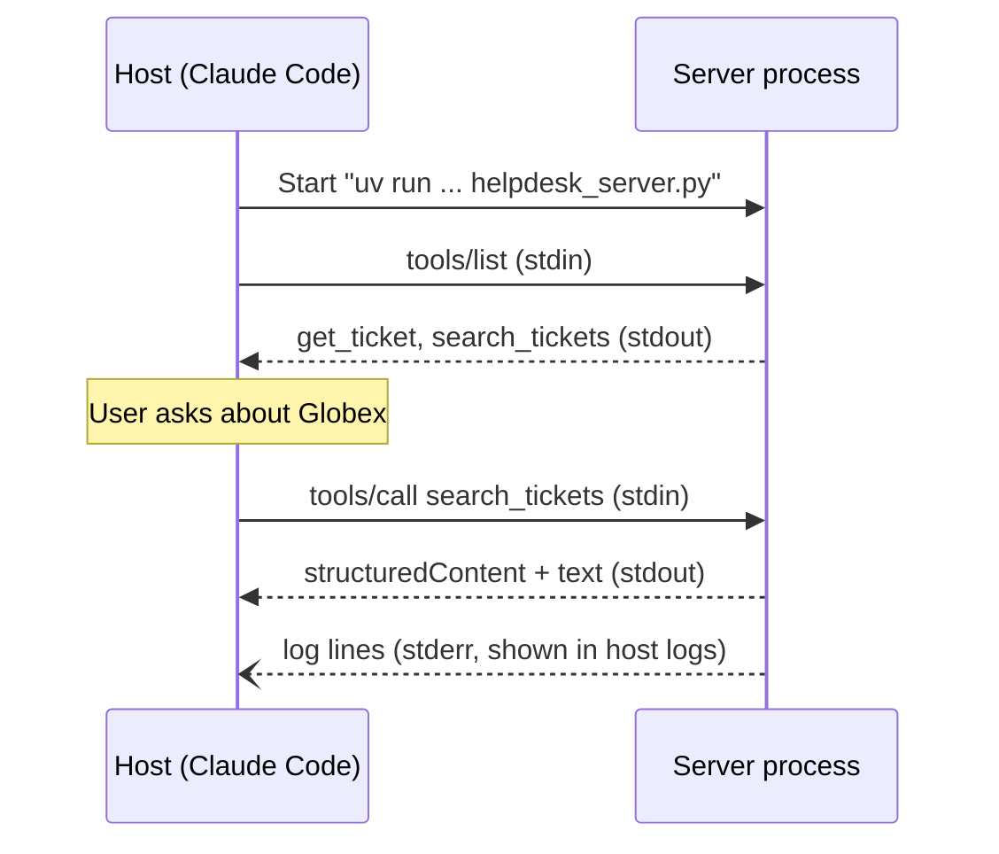

# Building Your First MCP Server

## Introduction

In this page you will build a small but realistic MCP server for a helpdesk: it lets any MCP-capable AI application look up and search support tickets. By the end you will have:

- A server written with the official Python SDK
- Tools with typed inputs, validated arguments, and structured outputs
- Error messages the model can act on
- Automated tests that run the server in-process
- The server connected to Claude Code and Claude Desktop

You will reuse this server in later pages to add resources and prompts, write a client, deploy it over HTTP, and connect it to an LLM API.

:::info About the SDK version
This page uses the official `mcp` package, **version 2.x**, which speaks protocol revision `2026-07-28`. In version 2, the high-level server class is `MCPServer`, imported from `mcp.server.mcpserver`. Many older tutorials use version 1, where the same class was called `FastMCP` and imported from `mcp.server.fastmcp`. That import now fails with a `ModuleNotFoundError` that points to the [migration guide](https://py.sdk.modelcontextprotocol.io/v2/migration/). If you must run v1 code, pin `mcp` to a version below 2.
:::

## Step 1: Set Up the Project

You need Python 3.10 or newer. The SDK's docs recommend [uv](https://docs.astral.sh/uv/), but `pip` works too.

```bash
mkdir helpdesk-mcp && cd helpdesk-mcp
uv init
uv add "mcp[cli]"
```

Or with pip:

```bash
python -m venv .venv
source .venv/bin/activate   # Windows: .venv\Scripts\activate
pip install "mcp[cli]"
```

The `[cli]` extra installs the `mcp` command, which you will use to launch the MCP Inspector.

## Step 2: The Smallest Possible Server

Create `helpdesk_server.py`:

```python
from mcp.server.mcpserver import MCPServer

mcp = MCPServer("helpdesk")


@mcp.tool()
def ping() -> str:
    """Check that the helpdesk server is alive."""
    return "pong"


if __name__ == "__main__":
    mcp.run()
```

That is a complete MCP server. Here is what each piece does:

- **`MCPServer("helpdesk")`** creates a server. The name appears in hosts and logs.
- **`@mcp.tool()`** registers the function as a tool. The SDK uses the function name as the tool name and the **docstring as the tool description**. The model reads that description to decide when to call the tool, so write it for the model.
- **`mcp.run()`** starts the server on the **stdio** transport: it reads JSON-RPC messages from standard input and writes responses to standard output. The host launches this script as a subprocess.

If you run `python helpdesk_server.py` directly, it appears to hang. That is expected: it is waiting for JSON-RPC messages on stdin. Press Ctrl+C to stop it.

## Step 3: Real Tools with Typed Inputs and Outputs

Now replace the file with something useful. This version exposes two tools over a small in-memory dataset.

```python
"""Helpdesk MCP server: look up and search support tickets."""
import logging
from typing import Annotated, Literal

from pydantic import BaseModel, Field
from mcp.server.mcpserver import MCPServer
from mcp.server.mcpserver.exceptions import ToolError

# Log to stderr. Never print() to stdout in a stdio server.
logging.basicConfig(level=logging.INFO)
log = logging.getLogger("helpdesk")

mcp = MCPServer(
    "helpdesk",
    instructions="Tools for reading Acme Inc. support tickets. Ticket IDs look like T-100.",
)

# Fake data so the example runs anywhere. Replace with a real database or API.
TICKETS = {
    "T-100": {"id": "T-100", "status": "open", "priority": "high",
              "customer": "Globex", "subject": "Cannot log in after password reset"},
    "T-101": {"id": "T-101", "status": "closed", "priority": "low",
              "customer": "Initech", "subject": "Typo on pricing page"},
    "T-102": {"id": "T-102", "status": "open", "priority": "medium",
              "customer": "Globex", "subject": "CSV export times out"},
}


class Ticket(BaseModel):
    id: str
    status: Literal["open", "closed"]
    priority: Literal["low", "medium", "high"]
    customer: str
    subject: str


@mcp.tool()
def get_ticket(
    ticket_id: Annotated[str, Field(description="Ticket ID, for example T-100")],
) -> Ticket:
    """Fetch one support ticket by its ID.

    Use this when the user mentions a specific ticket ID.
    """
    log.info("get_ticket %s", ticket_id)
    ticket = TICKETS.get(ticket_id.upper())
    if ticket is None:
        raise ToolError(f"No ticket with ID {ticket_id}. IDs look like T-100.")
    return Ticket(**ticket)


@mcp.tool()
def search_tickets(
    customer: Annotated[str | None, Field(description="Exact customer name to filter by")] = None,
    status: Annotated[Literal["open", "closed"] | None, Field(description="Filter by status")] = None,
    limit: Annotated[int, Field(ge=1, le=50, description="Maximum results")] = 10,
) -> list[Ticket]:
    """Search tickets by customer and/or status. Returns at most `limit` tickets."""
    results = [
        Ticket(**t) for t in TICKETS.values()
        if (customer is None or t["customer"].lower() == customer.lower())
        and (status is None or t["status"] == status)
    ]
    return results[:limit]


if __name__ == "__main__":
    mcp.run()  # stdio by default
```

### What the SDK generates for you

The SDK reads your type hints and turns them into the JSON Schema that `tools/list` returns. For `search_tickets`, the input schema includes:

- `customer` and `status` as optional fields (they have defaults)
- `status` restricted to `"open"` or `"closed"` (from `Literal`)
- `limit` with `minimum: 1` and `maximum: 50` (from `Field(ge=1, le=50)`)
- The `description` you passed to each `Field`

This is the same JSON Schema you wrote by hand in [Tool Input Schemas](../2-agents-tool-use/2-agents-tool-input-schemas.mdx). The SDK also **validates incoming arguments** against it, so a call with `limit=500` is rejected before your function runs.

### Structured output

Because `get_ticket` is annotated to return a Pydantic model, the SDK:

1. Publishes an **`outputSchema`** for the tool, so clients know the shape of the result
2. Returns the data in **`structuredContent`** (machine-readable JSON)
3. Also returns the same JSON as a **text block** in `content`, for clients and models that only read text

Return types that are not objects, such as `list[Ticket]`, `int`, or `str` with an explicit annotation, are wrapped in an object with a single `result` key, because structured content is published with an object schema. You will see `structured_content["result"]` in the test below.

:::tip When to use structured output
Structured output is most useful when a **program** consumes the result: a client that renders a table, a workflow that branches on `status`, or a test. The model itself mostly reads the text block. If a tool returns prose for the model, a plain `str` return type is fine.
:::

### Errors the model can act on

MCP distinguishes two kinds of errors:

- **Tool execution errors** are returned as a normal result with `isError: true`. The model sees the message and can correct itself, for example by retrying with a valid ID.
- **Protocol errors** (unknown tool, malformed request) are JSON-RPC errors.

In the Python SDK, raise **`ToolError`** for problems you expect, like "ticket not found". Its message is sent to the client. If any *other* exception escapes your function, the SDK treats it as a crash, logs the traceback on the server, and sends the client only a generic "Error executing tool" message. That default keeps stack traces and internal details out of the model's context.

```text
Expected failure  -> raise ToolError("No ticket with ID T-999. IDs look like T-100.")
                  -> client sees: "Error executing tool get_ticket: No ticket with ID T-999. IDs look like T-100."
Unexpected crash  -> KeyError deep in your code
                  -> client sees: "Error executing tool get_ticket"
```

Write `ToolError` messages the way you would write them for a junior colleague: say what went wrong and what to try instead. See [Handling Tool Errors](../2-agents-tool-use/6-agents-tool-errors.mdx) for more on error design.

:::warning Never write to stdout in a stdio server
On the stdio transport, **stdout is the protocol channel**. A stray `print("debug")` inserts invalid JSON into the stream and the host disconnects with a confusing parse error. Use the `logging` module (which writes to stderr by default) or `print(..., file=sys.stderr)`.
:::

## Step 4: Test the Server

### Option A: Automated tests with an in-process client

The SDK's `Client` class can connect directly to a server object in the same Python process. There is no subprocess and no network, which makes it ideal for unit tests. Create `test_helpdesk.py`:

```python
import asyncio

from mcp import Client

from helpdesk_server import mcp


async def main() -> None:
    # Passing the server object connects in-process: no subprocess, no network.
    async with Client(mcp) as client:
        tools = await client.list_tools()
        print("Tools:", [t.name for t in tools.tools])

        result = await client.call_tool("get_ticket", {"ticket_id": "T-100"})
        print("Structured:", result.structured_content)

        result = await client.call_tool("search_tickets", {"customer": "globex", "status": "open"})
        print("Search:", [t["id"] for t in result.structured_content["result"]])

        result = await client.call_tool("get_ticket", {"ticket_id": "T-999"})
        print("Error?", result.is_error, "-", result.content[0].text)

        result = await client.call_tool("search_tickets", {"limit": 500})
        print("Bad input?", result.is_error, "-", result.content[0].text[:80])


asyncio.run(main())
```

Run it with `python test_helpdesk.py`.

Output:

```text
Tools: ['get_ticket', 'search_tickets']
Structured: {'id': 'T-100', 'status': 'open', 'priority': 'high', 'customer': 'Globex', 'subject': 'Cannot log in after password reset'}
Search: ['T-100', 'T-102']
Error? True - Error executing tool get_ticket: No ticket with ID T-999. IDs look like T-100.
Bad input? True - Error executing tool search_tickets: 1 validation error for search_ticketsArgume
```

(You will also see the server's `INFO` log lines on stderr.) Note that the Python SDK uses **snake_case** attribute names such as `structured_content`, `is_error`, and `input_schema`. On the wire, the JSON fields are camelCase (`structuredContent`, `isError`, `inputSchema`).

In a real project, turn these checks into `pytest` tests with `assert` statements. Because no model is involved, the tests are fast and deterministic. See [Unit Testing Agent Code](../11-agents-evaluation-and-testing/4-agents-unit-testing.mdx).

### Option B: The MCP Inspector

The **MCP Inspector** is an official browser-based tool for exploring a server by hand: list tools, fill in arguments, and see raw responses.

```bash
uv run mcp dev helpdesk_server.py
```

This starts your server and opens the Inspector in your browser (it needs Node.js, because the Inspector is distributed through npm). You can also run the Inspector against any server, in any language, with `npx @modelcontextprotocol/inspector`. Use it whenever a host does not behave as expected. It shows exactly what the server returns, without a model in the way.

## Step 5: Connect It to a Real Host

### Claude Code

From your project directory, register the server. Everything after `--` is the command Claude Code runs to start it:

```bash
claude mcp add helpdesk -- uv run --directory /absolute/path/to/helpdesk-mcp python helpdesk_server.py
```

Then start Claude Code and ask: "Which open tickets does Globex have?" Claude Code lists the server's tools, calls `search_tickets`, and answers with the results. Run `/mcp` inside Claude Code to see connected servers and their status, or `claude mcp list` from the shell.

To share the configuration with your team, add `--scope project`. Claude Code then writes it to a `.mcp.json` file in the project root that you can commit.

### Claude Desktop and other hosts

Most desktop hosts use a JSON configuration with an `mcpServers` map. For Claude Desktop, open **Settings, Developer, Edit Config** and add:

```json
{
  "mcpServers": {
    "helpdesk": {
      "command": "uv",
      "args": ["run", "--directory", "/absolute/path/to/helpdesk-mcp", "python", "helpdesk_server.py"]
    }
  }
}
```

Restart the app after editing. Other hosts (VS Code, Cursor, and many others) use similar formats. Check each host's documentation, because the file location and some field names differ.

:::caution Use absolute paths
Hosts often start servers from a different working directory than your terminal. Relative paths, a missing virtual environment, or a different Python on `PATH` are the most common reasons a server works in your terminal but fails in a host. Absolute paths and `uv run --directory` avoid most of these problems.
:::

## How It Fits Together



## Real-World Scenario

Your support engineers spend about ten minutes per escalation copying ticket details into chat to ask an AI assistant for help. You want them to be able to say "summarize T-4821 and suggest next steps" in Claude Code or Claude Desktop, which they already use.

### The solution

You build exactly the server on this page, but replace the `TICKETS` dictionary with calls to your helpdesk's REST API (covered in [Wrapping an Existing API with MCP](./7-agents-mcp-wrapping-existing-apis.mdx)). Each engineer runs it locally over stdio, with their own personal API token in an environment variable:

```bash
claude mcp add --env HELPDESK_TOKEN=their-token --transport stdio helpdesk \
  -- uv run --directory /opt/helpdesk-mcp python helpdesk_server.py
```

### Why this approach

- **Fast to ship.** One Python file, no deployment, no auth server.
- **Uses each engineer's own permissions.** The API token belongs to the person, so the server can only see what that person can see.
- **Reusable.** The same server works in any MCP host your engineers prefer.

### When to use it, and when not to

A local stdio server is ideal for a pilot with a handful of technical users. It is a poor fit when hundreds of non-technical users need access, when you cannot hand out API tokens, or when you need central logging. At that point, deploy the same code over Streamable HTTP with OAuth, as described in [MCP Transports](./5-agents-mcp-transports.mdx).

### Alternatives and trade-offs

| Approach | Pros | Cons | Best for |
| --- | --- | --- | --- |
| Local stdio server (this page) | Simple, per-user credentials, no infrastructure | Must be installed on each machine | Pilots, developer tools |
| Remote HTTP server | Central updates, auth, and logging | Needs hosting, OAuth, monitoring | Company-wide rollout |
| Function calling inside one custom app | No MCP layer at all | Only works in that one app | A single dedicated support bot |
| Copy-paste into chat | Zero setup | Slow, error-prone, leaks data into chat history | Occasional one-off use |

## Common Mistakes

- **Printing to stdout.** It corrupts the stdio protocol stream. Log to stderr.
- **Vague docstrings.** `"""Gets a ticket."""` gives the model nothing to go on. Say what the tool does, when to use it, and what the ID format looks like.
- **Raising generic exceptions for expected errors.** A plain `ValueError` reaches the client as a generic "Error executing tool" message, so the model cannot recover. Use `ToolError` with a helpful message.
- **Returning huge payloads.** Returning 5,000 tickets floods the model's context window. Add a `limit` with a sensible default and maximum.
- **Following v1 tutorials with the v2 SDK.** `from mcp.server.fastmcp import FastMCP` fails in version 2. Use `from mcp.server.mcpserver import MCPServer`.
- **Testing only through a chat host.** When something breaks in Claude Desktop, you cannot tell whether the model, the host, or your server is at fault. Test the server directly with an in-process `Client` or the Inspector first.

## Summary

- Install the SDK with `uv add "mcp[cli]"` or `pip install "mcp[cli]"`, and create a server with `MCPServer("name")`.
- `@mcp.tool()` turns a typed Python function into an MCP tool. The docstring becomes the description, and type hints become the input schema.
- Returning a Pydantic model (or another annotated type) produces an `outputSchema` and `structuredContent`.
- Raise `ToolError` for expected failures so the model sees a useful message. Other exceptions are hidden behind a generic error.
- `mcp.run()` uses stdio by default. Never print to stdout.
- Test with `Client(mcp)` in-process or with the MCP Inspector, then register the server in a host such as Claude Code.

## Exercises

1. Add a `get_customer_summary(customer)` tool that returns the number of open and closed tickets for a customer as a Pydantic model. Write a test for it using `Client(mcp)`.
2. Remove the docstring from `search_tickets`, connect the server to Claude Code, and ask a question that requires it. Does the model still pick the right tool? Put the docstring back and compare.
3. Deliberately add `print("hello")` at the top of `get_ticket`, connect the server to a host, and observe the failure. Then fix it by logging to stderr.
4. Open the server in the MCP Inspector and compare the `inputSchema` it shows for `search_tickets` with the type hints in your code.

**Next:** [MCP Tools, Resources and Prompts](./3-agents-mcp-tools-resources-prompts.mdx) adds the other two primitives to this server.
