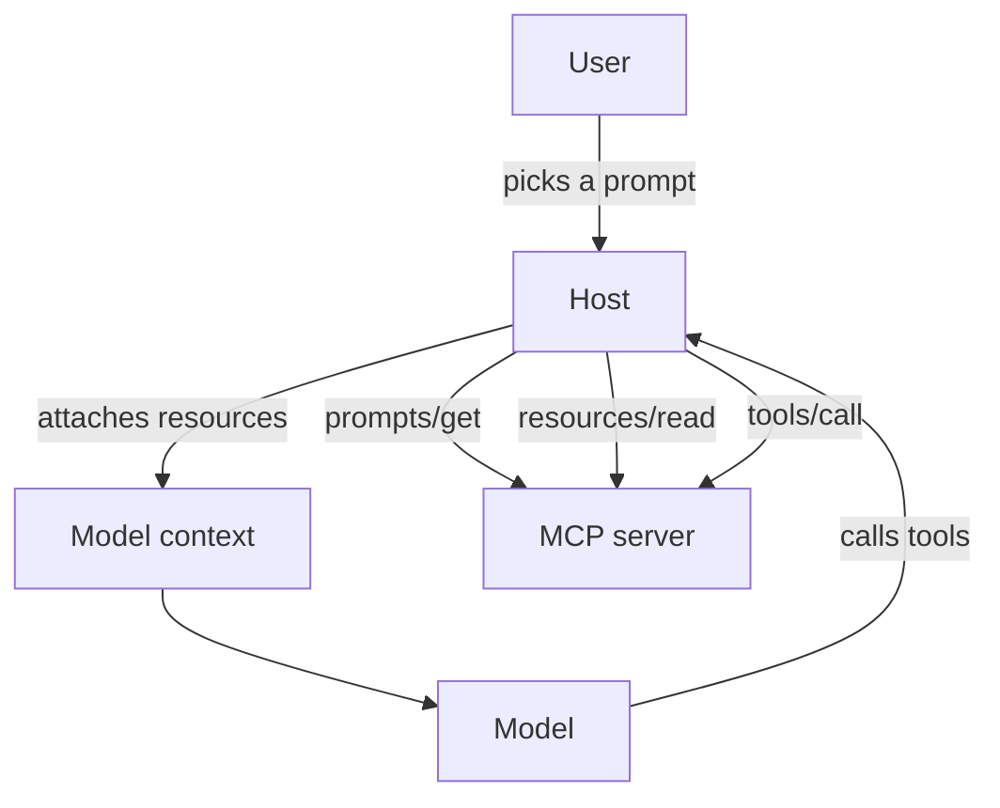

# MCP Tools, Resources and Prompts

## Introduction

An MCP server can offer three kinds of things: **tools**, **resources**, and **prompts**. Beginners often expose everything as a tool, because tools are what they know from function calling. That works, but it misses the point of the other two primitives, which exist because they are controlled by *different parties*.

| Primitive | Controlled by | Question it answers | Everyday analogy |
| --- | --- | --- | --- |
| **Tool** | The model | "What actions can the AI take?" | Buttons the assistant can press |
| **Resource** | The application (host) | "What data can be loaded into context?" | Documents you attach to an email |
| **Prompt** | The user | "What ready-made tasks can I start?" | Saved templates or macros |

In this page you will extend the helpdesk server from [Building Your First MCP Server](./2-agents-mcp-first-server.mdx) with all three, add a confirmation step that asks the user before a destructive action, and learn how to decide which primitive fits a given capability.



## Tools: Actions the Model Can Take

You already built tools. This section adds three important details: annotations, titles, and progress.

### Tool annotations

Annotations are **hints** that describe how a tool behaves. Hosts use them to decide how careful to be, for example whether to ask the user before running a tool.

| Annotation | Meaning when true | Example |
| --- | --- | --- |
| `readOnlyHint` | Does not modify anything | `get_ticket` |
| `destructiveHint` | May delete or overwrite data (only meaningful if not read-only) | `close_ticket`, `delete_file` |
| `idempotentHint` | Calling twice with the same arguments has no extra effect | `set_status("closed")` |
| `openWorldHint` | Interacts with an open, external world (the web, email) rather than a closed system | `web_search`, `send_email` |

In the Python SDK, pass a `ToolAnnotations` object. Its fields use snake_case:

```python
from mcp.server.mcpserver import MCPServer
from mcp.server.mcpserver.exceptions import ToolError
from mcp.types import ToolAnnotations

mcp = MCPServer("helpdesk")
TICKETS = {"T-100": {"status": "open", "priority": "high", "customer": "Globex",
                     "subject": "Cannot log in after password reset", "notes": []}}


@mcp.tool(annotations=ToolAnnotations(read_only_hint=True, open_world_hint=False))
def get_ticket(ticket_id: str) -> dict:
    """Fetch one support ticket by ID (for example T-100)."""
    if ticket_id not in TICKETS:
        raise ToolError(f"No ticket with ID {ticket_id}.")
    return {"id": ticket_id, **TICKETS[ticket_id]}
```

:::warning Annotations are hints, not guarantees
The spec says clients **must treat annotations as untrusted** unless they come from a server they trust. A malicious server can label a destructive tool as read-only. Annotations help an honest server communicate with a host. They are not a security control. See [MCP Security](./8-agents-mcp-security.mdx).
:::

### Titles and progress

A `title` is a human-friendly name for UIs, while `name` stays a stable identifier. For slow tools, ask for a `Context` parameter and report progress. The SDK injects the context automatically, and it is not part of the tool's input schema.

```python
from mcp.server.mcpserver import Context, MCPServer
from mcp.server.mcpserver.exceptions import ToolError
from mcp.types import ToolAnnotations

mcp = MCPServer("helpdesk")
TICKETS = {"T-100": {"notes": []}}


@mcp.tool(
    title="Add internal note",
    annotations=ToolAnnotations(read_only_hint=False, destructive_hint=False, idempotent_hint=False),
)
async def add_internal_note(ticket_id: str, note: str, ctx: Context) -> str:
    """Add an internal note to a ticket. Notes are visible to staff only, never to the customer."""
    if ticket_id not in TICKETS:
        raise ToolError(f"No ticket with ID {ticket_id}.")
    await ctx.report_progress(0.5, 1.0, "Saving note")
    TICKETS[ticket_id]["notes"].append(note)
    return f"Note added to {ticket_id}. It now has {len(TICKETS[ticket_id]['notes'])} note(s)."
```

Progress notifications are delivered only if the client asked for them, so calling `report_progress` is always safe.

### Asking the user before a destructive action

Some tools should not run on the model's judgment alone. MCP's **elicitation** feature lets the server ask the *user* a question, with a small form defined by a JSON schema. Under the current protocol this uses the [multi round-trip request](./1-agents-mcp-architecture.mdx) pattern, and the Python SDK wraps it in a dependency-injection style API: a **resolver** function returns an `Elicit` request, and the SDK fills a tool parameter with the user's answer.

```python
from typing import Annotated

from pydantic import BaseModel, Field
from mcp.server.mcpserver import Elicit, ElicitationResult, MCPServer, Resolve
from mcp.server.mcpserver.exceptions import ToolError
from mcp.types import ToolAnnotations

mcp = MCPServer("helpdesk")
TICKETS = {"T-100": {"status": "open"}}


class CloseConfirmation(BaseModel):
    confirm: bool = Field(description="Really close this ticket?")
    resolution: str = Field(default="", description="Short resolution summary")


def ask_to_confirm_close(ticket_id: str) -> Elicit[CloseConfirmation]:
    return Elicit(f"Close ticket {ticket_id}? The customer will be notified.", CloseConfirmation)


@mcp.tool(annotations=ToolAnnotations(destructive_hint=True, idempotent_hint=True))
def close_ticket(
    ticket_id: str,
    answer: Annotated[ElicitationResult[CloseConfirmation], Resolve(ask_to_confirm_close)],
) -> str:
    """Close a ticket. The user is asked to confirm before anything changes."""
    if ticket_id not in TICKETS:
        raise ToolError(f"No ticket with ID {ticket_id}.")
    if answer.action != "accept" or not answer.data.confirm:
        return f"Ticket {ticket_id} was left open (user did not confirm)."
    TICKETS[ticket_id]["status"] = "closed"
    return f"Closed {ticket_id}. Resolution: {answer.data.resolution or 'not given'}"
```

How it works:

1. The model calls `close_ticket(ticket_id="T-100")`. Only `ticket_id` appears in the tool's input schema. The `answer` parameter is filled by the SDK.
2. The SDK runs `ask_to_confirm_close`, sees the `Elicit` request, and returns an `input_required` result to the client.
3. The host shows the message and form to the user. The user accepts, declines, or cancels.
4. The client retries the call with the answer, and the SDK passes it to `close_ticket` as `answer`.

`answer.action` is `"accept"`, `"decline"`, or `"cancel"`. If you annotate the parameter with the plain model type (`Annotated[CloseConfirmation, Resolve(...)]`) instead of `ElicitationResult[...]`, a decline or cancel aborts the call automatically.

:::note Elicitation depends on the host
The client must declare the elicitation capability, and the host must actually show a form. If it does not, the request fails with a "missing required client capability" error. For critical safety checks, also enforce approval in your host. See [Human Approval Gates](../12-agents-safety-and-security/7-agents-approval-gates.mdx). Never use elicitation to ask for passwords or API keys. The spec forbids requesting sensitive information this way.
:::

## Resources: Data the Application Can Load

A **resource** is read-only data identified by a URI, such as `helpdesk://policies/sla` or `file:///project/README.md`. The host decides when to read it. Typical host behaviors:

- Show a picker so the user can attach a resource to the conversation
- Automatically include certain resources (for example, a database schema) in the system prompt
- Let the model request a resource through a host-provided tool

Resources come in two forms:

- **Direct resources** have a fixed URI and appear in `resources/list`.
- **Resource templates** have a URI with placeholders (an RFC 6570 URI template) and appear in `resources/templates/list`.

```python
from mcp.server.mcpserver import MCPServer
from mcp.server.mcpserver.exceptions import ResourceNotFoundError

mcp = MCPServer("helpdesk")
TICKETS = {"T-100": {"status": "open", "subject": "Cannot log in after password reset"}}

SLA_POLICY = """# Support SLA
- High priority: first response within 4 business hours
- Medium priority: first response within 1 business day
- Low priority: first response within 3 business days
"""


@mcp.resource("helpdesk://policies/sla", mime_type="text/markdown")
def sla_policy() -> str:
    """The current support SLA policy."""
    return SLA_POLICY


@mcp.resource("helpdesk://tickets/{ticket_id}", mime_type="application/json")
def ticket_resource(ticket_id: str) -> dict:
    """A support ticket as JSON."""
    if ticket_id not in TICKETS:
        raise ResourceNotFoundError(f"No ticket with ID {ticket_id}")
    return {"id": ticket_id, **TICKETS[ticket_id]}
```

Key points:

- A URI with `{placeholders}` automatically becomes a template, and the placeholder values are passed as function arguments.
- Return `str` for text, `bytes` for binary data, or another value (such as a `dict`) to have it serialized as JSON.
- Raise `ResourceNotFoundError` for missing items. Like `ToolError`, other exceptions are hidden behind a generic message.
- The SDK applies path-safety checks to template parameters by default, which helps block tricks like `../` in a file path. You can adjust this with the `security` argument, but leave the defaults on unless you have a reason.

### Resource or tool?

The same data can often be exposed either way. Use this rule of thumb:

| If... | Use |
| --- | --- |
| The **user or app** decides what to load, often before the model starts | Resource |
| The **model** must decide on its own, mid-task, what to fetch | Tool |
| It changes state or has side effects | Tool (never a resource) |
| It needs complex parameters or search logic | Tool |
| It is a stable document, schema, or file | Resource |

Many servers expose the same entity both ways: `get_ticket` as a tool for the model, and `helpdesk://tickets/{id}` as a resource the user can attach. Be aware that **host support for resources varies**. Some hosts only use tools. If the model must be able to reach some data in every host, expose it as a tool too.

## Prompts: Templates the User Starts

A **prompt** is a reusable, parameterized message template. Hosts typically show prompts as slash commands or menu items. The user picks one, fills in arguments, and the host inserts the resulting messages into the conversation.

```python
from mcp.server.mcpserver import MCPServer, UserMessage

mcp = MCPServer("helpdesk")


@mcp.prompt(title="Triage a ticket")
def triage_ticket(ticket_id: str, audience: str = "support engineer") -> list:
    """Triage a ticket: assess priority against the SLA and propose next steps."""
    return [
        UserMessage(
            f"You are helping a {audience}. Read ticket {ticket_id} with the get_ticket tool, "
            "compare it with the SLA policy (helpdesk://policies/sla), and reply with: "
            "1) a one-line summary, 2) whether the priority looks right, 3) the next step."
        ),
    ]
```

The function arguments become the prompt's arguments (`ticket_id` is required, `audience` is optional). A prompt can return a plain string (treated as one user message) or a list of `UserMessage` and `AssistantMessage` objects to set up a multi-turn example.

Prompts are a good way to **package expertise**. The team that owns the helpdesk knows the right way to triage a ticket. Instead of every user inventing their own prompt, they publish one. See [Prompt Templates](../3-agents-prompt-engineering/7-agents-prompt-templates.mdx) for template design.

## Putting It Together

Combine the snippets above into one file, `helpdesk_full.py`, ending with:

```python
if __name__ == "__main__":
    mcp.run()
```

Then explore it with a small client. The `elicitation_callback` stands in for the form a real host would show. You will learn the client API properly in [Building an MCP Client](./4-agents-mcp-client.mdx).

```python
import asyncio
import sys

from mcp import Client, StdioServerParameters, types


async def confirm_in_terminal(context, params: types.ElicitRequestParams) -> types.ElicitResult:
    """Called when the server asks the user a question. A real host shows a form."""
    print(f"[server asks] {params.message}")
    return types.ElicitResult(action="accept", content={"confirm": True, "resolution": "Reset MFA"})


async def main() -> None:
    server = StdioServerParameters(command=sys.executable, args=["helpdesk_full.py"])
    async with Client(server, elicitation_callback=confirm_in_terminal) as client:
        # Tools
        for tool in (await client.list_tools()).tools:
            print(f"tool: {tool.name:18} annotations: {tool.annotations}")

        result = await client.call_tool("add_internal_note", {"ticket_id": "T-100", "note": "Asked for screenshot"})
        print(result.content[0].text)

        result = await client.call_tool("close_ticket", {"ticket_id": "T-100"})
        print(result.content[0].text)

        # Resources
        for res in (await client.list_resources()).resources:
            print(f"resource: {res.uri} ({res.mime_type})")
        for tmpl in (await client.list_resource_templates()).resource_templates:
            print(f"template: {tmpl.uri_template}")

        sla = await client.read_resource("helpdesk://policies/sla")
        print(sla.contents[0].text.splitlines()[1])

        ticket = await client.read_resource("helpdesk://tickets/T-100")
        print(ticket.contents[0].text)

        # Prompts
        for prompt in (await client.list_prompts()).prompts:
            print(f"prompt: {prompt.name} args={[a.name for a in prompt.arguments]}")
        rendered = await client.get_prompt("triage_ticket", {"ticket_id": "T-102"})
        print(rendered.messages[0].role, "->", rendered.messages[0].content.text[:70], "...")


asyncio.run(main())
```

Example output (with the full `TICKETS` data from the previous page):

```text
tool: get_ticket         annotations: title=None read_only_hint=True destructive_hint=None idempotent_hint=None open_world_hint=False
tool: add_internal_note  annotations: title=None read_only_hint=False destructive_hint=False idempotent_hint=False open_world_hint=None
tool: close_ticket       annotations: title=None read_only_hint=None destructive_hint=True idempotent_hint=True open_world_hint=None
Note added to T-100. It now has 1 note(s).
[server asks] Close ticket T-100? The customer will be notified.
Closed T-100. Resolution: Reset MFA
resource: helpdesk://policies/sla (text/markdown)
template: helpdesk://tickets/{ticket_id}
- High priority: first response within 4 business hours
{
  "id": "T-100",
  "status": "closed",
  "priority": "high",
  "customer": "Globex",
  "subject": "Cannot log in after password reset",
  "notes": [
    "Asked for screenshot"
  ]
}
prompt: triage_ticket args=['ticket_id', 'audience']
user -> You are helping a support engineer. Read ticket T-102 with the get_tic ...
```

Notice that the server kept the note in memory between calls. That works because one stdio process serves one host. A remote server should keep state in a database instead, as discussed in [MCP Architecture](./1-agents-mcp-architecture.mdx).

## Real-World Scenario

Your company's internal analytics team wants an AI assistant that helps analysts query the data warehouse. Analysts use Claude Desktop and an IDE assistant. The team has to decide how to expose the warehouse.

### The solution

They build one MCP server with all three primitives:

- **Resources:** `warehouse://schemas/{dataset}` returns table and column descriptions. Analysts attach the dataset they care about at the start of a conversation, so the model knows the schema without spending tool calls on it.
- **Tools:** `run_query(sql, max_rows)` is annotated read-only and runs against a read-only replica with a row limit and a timeout. `explain_query(sql)` returns the query plan.
- **Prompts:** `weekly_kpi_report(week)` and `investigate_metric_drop(metric, date)` encode the team's standard analysis steps, including which tables to trust.

### Why this approach

- Schemas are large and stable, and the analyst already knows which dataset matters. That is application or user control, so **resources** fit.
- Choosing and running queries happens mid-task, based on intermediate results. That is model control, so **tools** fit.
- The KPI report follows a fixed, expert-defined procedure the user deliberately starts. That is user control, so **prompts** fit.

### When to use it, and when not to

This split pays off when hosts support all three primitives and users are sophisticated enough to attach resources and pick prompts. If your main consumer is a fully automated agent with no human in the loop, resources and prompts add little: the agent cannot pick from a menu. In that case, expose everything the agent needs as tools and put procedures in its system prompt.

### Alternatives and trade-offs

| Approach | Pros | Cons | Best for |
| --- | --- | --- | --- |
| Tools only | Works in every host, simplest | Model spends tool calls fetching static context; no shared templates | Automated agents, hosts with tool-only support |
| Tools + resources | Efficient context loading, user control over data | Host support for resources varies | Interactive assistants with large reference data |
| Tools + resources + prompts | Packages expert workflows for users | More surface area to design and maintain | Teams sharing standard procedures |
| Static context in the system prompt | No protocol features needed | Wastes tokens when irrelevant; goes stale | Small, rarely changing context |

## Common Mistakes

- **Putting side effects in resources.** Reading a resource must never change anything. Hosts may read resources speculatively or repeatedly.
- **Trusting annotations from unknown servers.** They are hints for honest servers, not security guarantees.
- **Relying on resources for data the model must fetch on its own.** Many hosts never let the model read resources directly. Expose a tool as well.
- **Elicitation for secrets.** Never ask for passwords, API keys, or payment details through an elicitation form. Use the authorization flow or a URL-based flow handled by the host.
- **Prompts that hard-code tool names from other servers.** A prompt can only rely on tools from its own server, and even those may be disabled by the host. Write prompts that degrade gracefully.
- **Too many tiny tools.** Prefer a few task-shaped tools over one tool per API endpoint. See [Tool Design Principles](../2-agents-tool-use/7-agents-tool-design-principles.mdx).

## Summary

- **Tools** are model-controlled actions. Add annotations (`read_only_hint`, `destructive_hint`, `idempotent_hint`, `open_world_hint`) to help hosts decide how careful to be, but remember they are untrusted hints.
- Use `Context` for progress, and `Resolve` plus `Elicit` to ask the user for confirmation in the middle of a tool call.
- **Resources** are application-controlled, read-only data addressed by URIs. URIs with placeholders become resource templates.
- **Prompts** are user-controlled templates with arguments, often shown as slash commands.
- Choose the primitive by asking **who decides** when it is used: the model, the application, or the user.

## Exercises

1. Add a resource template `helpdesk://customers/{name}/open-tickets` that returns a Markdown list of a customer's open tickets. Read it with a client.
2. Add a `reassign_ticket(ticket_id, team)` tool. Decide its four annotation values and justify each one in a comment.
3. Change `close_ticket` so its `answer` parameter uses `Annotated[CloseConfirmation, Resolve(...)]` instead of `ElicitationResult[...]`. Make your test client return `action="decline"` and observe what happens.
4. Write a prompt `customer_reply(ticket_id, tone)` that returns a `UserMessage` followed by an `AssistantMessage` example. When would a multi-message prompt be better than a single message?

**Next:** [Building an MCP Client](./4-agents-mcp-client.mdx) shows the other side of the connection.
