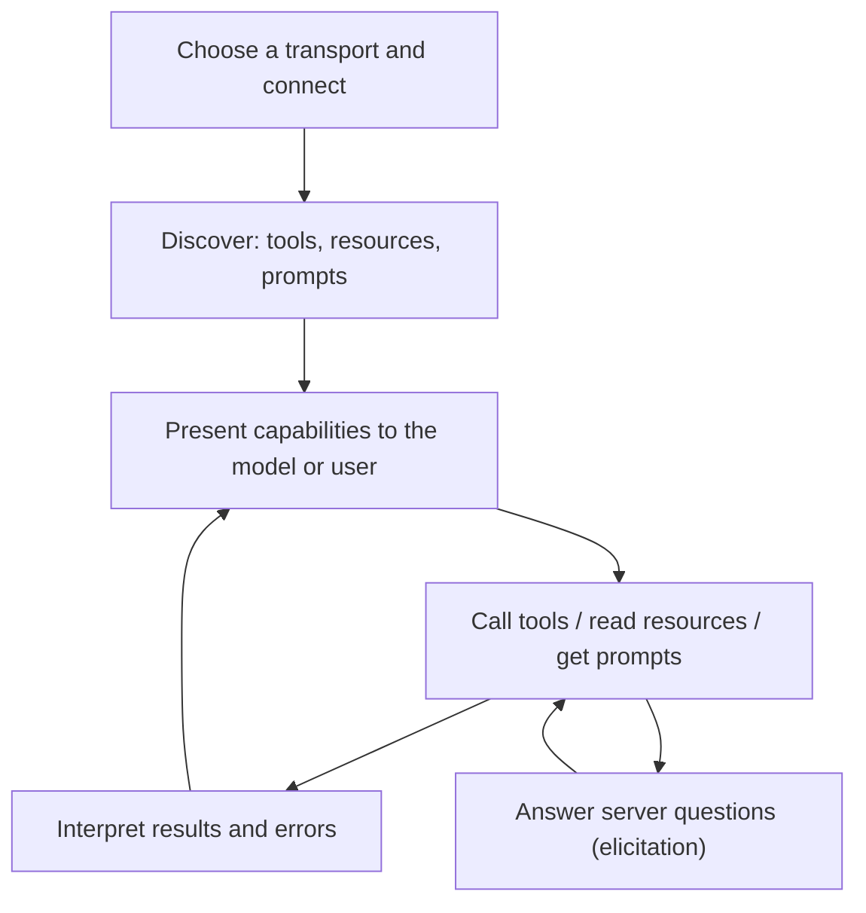

# Building an MCP Client

## Introduction

Most developers start with MCP by building servers, because hosts such as Claude Code and Claude Desktop already include a client. You need to write a client yourself when:

- You are building your **own agent or AI application** and want it to use MCP servers
- You want to **test** a server in CI without a chat app
- You are writing a **gateway** that sits between hosts and many servers
- You need a script that calls MCP tools **without any model at all** (for example, a nightly report)

This page shows how to do all of that with the Python SDK's `Client` class. In the [next pages](./6-agents-mcp-with-llm-apis.mdx) you will plug this client into an LLM agent loop.

:::tip Analogy
A client is like a universal remote control. Each server is a different device. The remote first asks a device what buttons it has (`tools/list`), shows them to whoever is holding it, and then sends button presses (`tools/call`). One remote per device keeps things simple, and a "universal" remote just bundles several of them behind one interface.
:::

## The Client's Responsibilities



A good client also enforces the **host's policies**: which servers are allowed, which tools need user approval, timeouts, and logging. The protocol gives the client information. Your code decides what to trust and what to allow.

## Connecting to a Server

The `Client` class accepts four kinds of targets:

| Target you pass | Transport used | Typical use |
| --- | --- | --- |
| `StdioServerParameters(...)` | stdio (launches a subprocess) | Local servers |
| A URL string such as `"https://mcp.example.com/mcp"` | Streamable HTTP | Remote servers |
| A `Transport` object | Whatever it implements | Custom headers, auth, or transports |
| An `MCPServer` instance | In-process, no I/O | Unit tests |

The `Client` is an async context manager. Entering it connects (and, by default, auto-detects whether the server speaks the current stateless protocol or the older handshake-based one). Leaving it closes the connection and, for stdio, shuts the subprocess down.

### A complete stdio client

This client connects to the helpdesk server from [Building Your First MCP Server](./2-agents-mcp-first-server.mdx), discovers its tools, calls one, and shows both kinds of errors.

```python
import asyncio
import sys

from mcp import Client, MCPError, StdioServerParameters


async def main() -> None:
    server = StdioServerParameters(
        command=sys.executable,
        args=["helpdesk_server.py"],
        env={"HELPDESK_REGION": "eu"},  # extra variables for the server process
    )

    async with Client(server, read_timeout_seconds=30) as client:
        print("Server:", client.server_info.name, "| protocol", client.protocol_version)
        print("Instructions:", client.instructions)

        # 1. Discover tools (follow pagination cursors if the server pages its list)
        tools, cursor = [], None
        while True:
            page = await client.list_tools(cursor=cursor)
            tools.extend(page.tools)
            cursor = page.next_cursor
            if not cursor:
                break
        for tool in tools:
            required = tool.input_schema.get("required", [])
            print(f"- {tool.name}: {tool.description.splitlines()[0]} (required: {required})")

        # 2. Call a tool and read every kind of result
        result = await client.call_tool("search_tickets", {"status": "open"})
        if result.is_error:
            print("Tool reported an error:", result.content[0].text)
        elif result.structured_content is not None:
            for t in result.structured_content["result"]:
                print(f"  {t['id']} [{t['priority']}] {t['subject']}")

        # 3. Bad arguments come back as a tool error the model can read...
        result = await client.call_tool("search_tickets", {"limit": "lots"})
        print("Bad arguments -> is_error =", result.is_error)

        # 4. ...while protocol-level failures raise MCPError
        try:
            await client.read_resource("helpdesk://does-not-exist")
        except MCPError as exc:
            print(f"MCPError {exc.code}: {exc.message}")


asyncio.run(main())
```

Output:

```text
Server: helpdesk | protocol 2026-07-28
Instructions: Tools for reading Acme Inc. support tickets. Ticket IDs look like T-100.
- get_ticket: Fetch one support ticket by its ID. (required: ['ticket_id'])
- search_tickets: Search tickets by customer and/or status. Returns at most `limit` tickets. (required: [])
  T-100 [high] Cannot log in after password reset
  T-102 [medium] CSV export times out
Bad arguments -> is_error = True
MCPError -32602: Unknown resource: helpdesk://does-not-exist
```

Let's unpack the important parts.

### stdio and environment variables

`StdioServerParameters` takes a `command`, `args`, optional `env`, and optional `cwd`. For safety, the SDK does **not** pass your whole environment to the server. The subprocess only inherits a short list of basic variables (such as `HOME`, `PATH`, and `USER` on Linux and macOS) plus whatever you put in `env`. That means your `ANTHROPIC_API_KEY` or database password does not leak into every server you launch. If a server needs a secret, pass exactly that secret in `env`.

### Two kinds of errors

The client sees failures in two different ways, and your code should handle both:

| Failure | How it arrives | Example | What to do |
| --- | --- | --- | --- |
| **Tool execution error** | A normal result with `is_error=True` | Invalid arguments, "ticket not found", upstream API down | Pass the text to the model so it can adjust |
| **Protocol error** | An `MCPError` exception with a JSON-RPC code | Unknown resource, unsupported protocol version, malformed request | Log it; usually tell the model the call failed |

Connection failures (the server process crashed, the network dropped) surface as exceptions as well. Wrap long-running agent loops so one broken server does not take down the whole application.

### Reading results

A `CallToolResult` has:

- **`content`**: a list of content blocks for the model. Each has a `type`: `"text"`, `"image"`, `"audio"`, `"resource_link"` (a URI the client may fetch), or `"resource"` (an embedded resource).
- **`structured_content`**: optional machine-readable JSON matching the tool's `output_schema`.
- **`is_error`**: whether the tool reported a failure.

A small helper that turns any result into text for a model is handy:

```python
def result_to_text(result) -> str:
    """Flatten an MCP CallToolResult into plain text for a model or log."""
    parts = []
    for block in result.content:
        if block.type == "text":
            parts.append(block.text)
        elif block.type == "resource_link":
            parts.append(f"[resource link: {block.uri}]")
        elif block.type == "resource":
            parts.append(getattr(block.resource, "text", "[binary resource]"))
        else:  # image, audio
            parts.append(f"[{block.type} content: {block.mime_type}]")
    return "\n".join(parts) or "(no output)"
```

In a real host, you would forward images to the model as image blocks rather than dropping them. [Connecting MCP Servers to LLM APIs](./6-agents-mcp-with-llm-apis.mdx) shows a conversion layer.

:::note Python attribute names
The Python SDK (version 2) uses snake_case attributes: `input_schema`, `output_schema`, `structured_content`, `is_error`, `next_cursor`, `mime_type`. The JSON on the wire uses camelCase. If you convert a model object to a dictionary for another API, use `model_dump(by_alias=True, mode="json")` to get the wire names.
:::

### Timeouts and caching

- `read_timeout_seconds` sets how long the client waits for a response. Always set it in production. A hung server should not hang your agent.
- The client caches list results (`tools/list` and similar) according to the `ttlMs` hint the server returns. You can force a fresh list with `cache_mode="refresh"` on the list call, or disable caching by passing `cache=None` to `Client`.

## Connecting to a Remote Server

For a remote server, pass the URL. The client uses Streamable HTTP:

```python
import asyncio

from mcp import Client


async def main() -> None:
    async with Client("http://127.0.0.1:8000/mcp") as client:
        tools = await client.list_tools()
        print([t.name for t in tools.tools])


asyncio.run(main())
```

Most remote servers require authentication. If you already have a bearer token (for example, a service token or a token your app obtained through OAuth), build the transport yourself and pass an HTTP client with the header. The SDK's HTTP transport uses the `httpx2` package, which it installs as a dependency:

```python
import asyncio
import os

import httpx2
from mcp import Client
from mcp.client.streamable_http import streamable_http_client


async def main() -> None:
    http = httpx2.AsyncClient(
        headers={"Authorization": f"Bearer {os.environ['HELPDESK_MCP_TOKEN']}"},
        timeout=httpx2.Timeout(30, read=300),
    )
    transport = streamable_http_client("https://mcp.example.com/mcp", http_client=http)
    async with Client(transport) as client:
        result = await client.call_tool("search_tickets", {"status": "open"})
        print(result.structured_content)


asyncio.run(main())
```

For interactive user login, the SDK also includes OAuth client support that runs the full discovery, PKCE, and token flow described in [MCP Security](./8-agents-mcp-security.mdx). See the [Python SDK documentation](https://py.sdk.modelcontextprotocol.io) for the current OAuth client API.

## Answering Server Questions

When a server needs input from the user (elicitation), it returns an `input_required` result. The `Client` handles the retry loop for you. You only supply a callback that produces the answer:

```python
from mcp import types


async def ask_user(context, params: types.ElicitRequestParams) -> types.ElicitResult:
    print(f"The server asks: {params.message}")
    answer = input("Approve? [y/N] ").strip().lower()
    if answer != "y":
        return types.ElicitResult(action="decline")
    return types.ElicitResult(action="accept", content={"confirm": True})
```

Pass it as `Client(server, elicitation_callback=ask_user)`. If you do not provide a callback, the client does not advertise the elicitation capability, and servers that require it return an error instead of waiting forever. In a GUI host, the callback would render `params.requested_schema` as a form.

## Connecting to Several Servers

Real hosts connect to many servers at once. Two problems appear immediately:

1. **Lifecycle:** every connection must be opened and closed cleanly.
2. **Name collisions:** two servers may both expose a tool called `search`. The spec explicitly warns about this and recommends prefixing tool names with a server identifier. The server's own self-reported name is not guaranteed to be unique, so use the name *you* gave it in your configuration.

This `MultiServerClient` solves both with an `AsyncExitStack` and a routing table:

```python
import asyncio
import sys
from contextlib import AsyncExitStack

from mcp import Client, StdioServerParameters

SERVERS = {
    "helpdesk": StdioServerParameters(command=sys.executable, args=["helpdesk_server.py"]),
    "kb": StdioServerParameters(command=sys.executable, args=["kb_server.py"]),
}


class MultiServerClient:
    """Connects to several MCP servers and exposes their tools under prefixed names."""

    def __init__(self, servers: dict[str, StdioServerParameters]) -> None:
        self.servers = servers
        self.clients: dict[str, Client] = {}
        self.routes: dict[str, tuple[str, str]] = {}  # public name -> (server, tool name)
        self.tools: list = []
        self._stack = AsyncExitStack()

    async def __aenter__(self) -> "MultiServerClient":
        for server_name, params in self.servers.items():
            client = await self._stack.enter_async_context(Client(params))
            self.clients[server_name] = client
            for tool in (await client.list_tools()).tools:
                public_name = f"{server_name}__{tool.name}"  # avoid collisions
                self.routes[public_name] = (server_name, tool.name)
                self.tools.append((public_name, tool))
        return self

    async def __aexit__(self, *exc) -> None:
        await self._stack.aclose()

    async def call(self, public_name: str, arguments: dict):
        if public_name not in self.routes:
            raise KeyError(f"Unknown tool {public_name}")
        server_name, tool_name = self.routes[public_name]
        return await self.clients[server_name].call_tool(tool_name, arguments)


async def main() -> None:
    async with MultiServerClient(SERVERS) as mcp:
        print("Tools:", [name for name, _ in mcp.tools])
        result = await mcp.call("kb__search", {"query": "password"})
        print("kb__search ->", result.structured_content)
        result = await mcp.call("helpdesk__get_ticket", {"ticket_id": "T-100"})
        print("helpdesk__get_ticket ->", result.structured_content["subject"])


asyncio.run(main())
```

Here `kb_server.py` is a second tiny server with one `search(query)` tool.

Output:

```text
Tools: ['helpdesk__get_ticket', 'helpdesk__search_tickets', 'kb__search']
kb__search -> {'result': ['password-reset']}
helpdesk__get_ticket -> Cannot log in after password reset
```

Tool names may contain letters, digits, underscores, hyphens, and dots, so a double underscore separator is safe and easy to split. Keep the full prefixed name within the length limit of the model API you use.

:::tip There is a built-in option too
The SDK also ships a `ClientSessionGroup` class for managing several sessions. Writing a small class like the one above is still worth doing once, because it makes the routing and naming rules explicit, and you will need the same routing table when you connect the tools to a model.
:::

## Real-World Scenario

Your team maintains six internal MCP servers (helpdesk, billing, feature flags, deploys, docs, and on-call). They break often after changes, and you only find out when someone complains that Claude Code "cannot see the billing tools anymore".

### The solution

You write a **contract-test client** that runs in CI for every server repository and nightly against production:

1. Connect to the server (stdio in CI, HTTP with a service token in production).
2. Assert that the expected tools exist and that their `input_schema` still contains the required fields other teams depend on.
3. Call each read-only tool with a known fixture and validate `structured_content` against `output_schema` with the `jsonschema` package.
4. Fail the build if a tool disappears, a required argument is added, or a description becomes empty.

No model is involved, so the tests are fast, free, and deterministic.

### Why this approach

The client exercises the exact protocol path that hosts use, so it catches problems that unit tests of individual Python functions miss: a broken decorator, an import error at startup, an accidental `print` to stdout, or a schema change.

### When to use it, and when not to

Contract tests catch structural breakage. They do not tell you whether a model will *choose* the right tool or use it well. For that, run agent-level evaluations with a model in the loop. See [Agent Evaluation Introduction](../11-agents-evaluation-and-testing/0-agents-evaluation-introduction.mdx).

### Alternatives and trade-offs

| Approach | Pros | Cons | Best for |
| --- | --- | --- | --- |
| Unit tests of tool functions | Fastest, no MCP layer | Misses protocol, startup, and schema issues | Business logic |
| In-process `Client(mcp)` tests | Fast, real MCP path | Skips the transport and process startup | Per-server CI |
| Subprocess or HTTP contract client | Tests exactly what hosts see | Slower, needs a running server | Cross-team contracts, production checks |
| Manual testing in a chat host | Realistic | Slow, non-deterministic, not automatable | Final sanity checks |

## Common Mistakes

- **Opening a new connection for every tool call.** Starting a stdio server for each call is slow. Keep the `Client` open for the lifetime of the agent session.
- **Not setting timeouts.** Without `read_timeout_seconds`, a stuck server can hang your agent indefinitely.
- **Ignoring `is_error`.** A result with `is_error=True` is still a normal result. If you treat it as success, the model may think a failed action worked.
- **Passing your whole environment to servers.** Pass only the variables a server needs. The SDK defaults help, but custom launchers often copy `os.environ` wholesale.
- **Exposing every tool from every server to the model.** Filter tools per task. Large toolsets reduce accuracy and cost tokens. See [Working with Large Toolsets](../2-agents-tool-use/10-agents-large-toolsets.mdx).
- **Trusting tool descriptions blindly.** Descriptions and results come from the server and can contain prompt injection. Decide which servers you trust before you connect them. See [MCP Security](./8-agents-mcp-security.mdx).

## Summary

- The Python SDK's `Client` connects to a stdio server (`StdioServerParameters`), a remote URL (Streamable HTTP), a custom `Transport`, or an in-process `MCPServer`.
- Use `list_tools`, `call_tool`, `list_resources`, `read_resource`, `list_prompts`, and `get_prompt`. Follow `next_cursor` for paginated lists.
- Tool execution errors arrive as results with `is_error=True`. Protocol errors raise `MCPError`.
- stdio servers only inherit a minimal environment plus the `env` you pass.
- For remote servers with tokens, pass a configured `httpx2.AsyncClient` to `streamable_http_client`.
- Supply an `elicitation_callback` to let servers ask the user questions.
- When aggregating servers, prefix tool names with your own server identifier and route calls through a table.

## Exercises

1. Extend the stdio client to list resources and prompts as well as tools, and print a one-line summary of each.
2. Add a `refresh()` method to `MultiServerClient` that re-reads every server's tool list with `cache_mode="refresh"` and rebuilds the routing table.
3. Write a contract test that fails if any tool from the helpdesk server has an empty description or no `required` list in its input schema.
4. Change the `env` you pass to the helpdesk server so it receives `HELPDESK_TOKEN`, and confirm (by logging `os.environ` keys to stderr in the server) which variables actually reach the subprocess.

**Next:** [MCP Transports](./5-agents-mcp-transports.mdx) explains stdio and Streamable HTTP in depth and shows how to deploy a server remotely.
