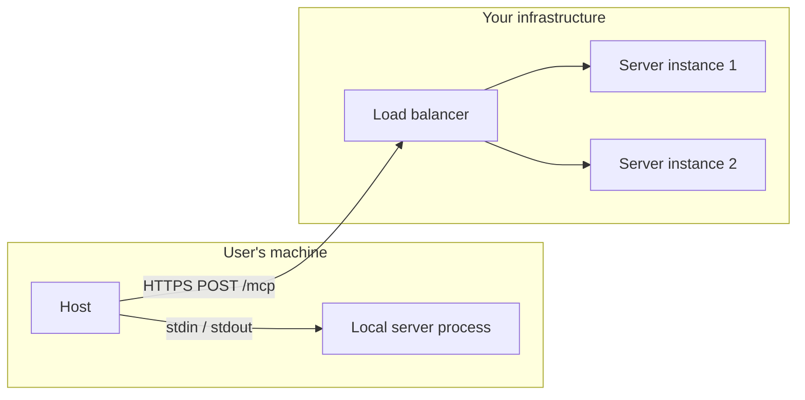
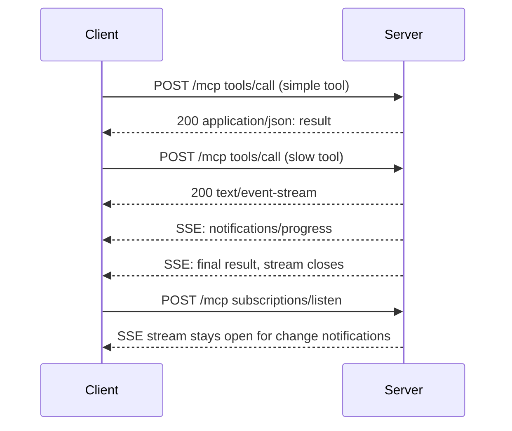

# MCP Transports

## Introduction

The MCP data layer (tools, resources, prompts, JSON-RPC messages) is the same everywhere. The **transport** is how those messages physically travel between client and server. MCP defines two standard transports:

- **stdio:** the host starts the server as a child process and talks to it through standard input and output
- **Streamable HTTP:** the server is a web service, and each message is an HTTP POST

Choosing a transport is mostly a **deployment decision**: who runs the server, where it runs, how many people use it, and how it is secured. Because the data layer does not change, you can develop over stdio and deploy over HTTP without touching your tools.

:::tip Analogy
stdio is like a private intercom between two rooms in the same house: simple, fast, and nobody else can listen in, but it only works inside that house. Streamable HTTP is like a phone number: anyone with the number can call from anywhere, so you need a receptionist (authentication) to decide who gets through.
:::

## Choosing a Transport

| Question | stdio | Streamable HTTP |
| --- | --- | --- |
| Where does the server run? | On the same machine as the host | Anywhere reachable over the network |
| Who starts it? | The host, one process per client | You, as a long-running service |
| How many users per server process? | One | Many |
| How is it secured? | OS process isolation; credentials from environment variables | TLS plus OAuth 2.1 bearer tokens |
| How is it updated? | On every user's machine | Once, centrally |
| Typical use | Local files, local dev tools, CLIs, pilots | SaaS integrations, shared company servers |



## The stdio Transport

### How it works

1. The client launches the server executable as a subprocess.
2. The client writes JSON-RPC messages to the server's **stdin**, one message per line.
3. The server writes JSON-RPC messages to its **stdout**, one message per line.
4. The server may write anything it likes to **stderr**. Hosts usually capture it into a log file.
5. To shut down, the client closes the server's stdin and waits. If the server does not exit, the client terminates it (on POSIX, first with `SIGTERM`, then `SIGKILL`).

The rules are strict and simple:

- Messages are newline-delimited and **must not contain embedded newlines**. JSON serializers escape newlines inside strings, so this only matters if you write raw messages by hand.
- The server **must not** write anything to stdout that is not a valid MCP message.
- There are no HTTP headers. The protocol version, client info, and capabilities travel in each request's `_meta`.
- To cancel a request, the client sends a `notifications/cancelled` message referencing the request ID.

You can drive a stdio server with nothing but Python's `subprocess` module. This is not how you would write a real client, but it shows that there is no magic:

```python
import json
import subprocess
import sys

proc = subprocess.Popen(
    [sys.executable, "helpdesk_server.py"],
    stdin=subprocess.PIPE, stdout=subprocess.PIPE, stderr=subprocess.DEVNULL, text=True,
)

meta = {
    "io.modelcontextprotocol/protocolVersion": "2026-07-28",
    "io.modelcontextprotocol/clientInfo": {"name": "raw-client", "version": "0.1"},
    "io.modelcontextprotocol/clientCapabilities": {},
}

request = {
    "jsonrpc": "2.0",
    "id": 1,
    "method": "tools/call",
    "params": {"name": "get_ticket", "arguments": {"ticket_id": "T-100"}, "_meta": meta},
}
proc.stdin.write(json.dumps(request) + "\n")
proc.stdin.flush()

response = json.loads(proc.stdout.readline())
print(response["result"]["structuredContent"])

proc.stdin.close()  # graceful shutdown signal
proc.wait()
```

Output:

```text
{'id': 'T-100', 'status': 'open', 'priority': 'high', 'customer': 'Globex', 'subject': 'Cannot log in after password reset'}
```

### Strengths and limits of stdio

- **Secure by default.** Only the parent process can talk to the server. There is no port to scan and nothing for a malicious website to reach.
- **Zero infrastructure.** No hosting, TLS, or auth server.
- **Per-user credentials.** The server reads tokens from environment variables set by the user's own configuration. The authorization spec says stdio servers should get credentials from the environment rather than run OAuth.
- **But** every user must install the server and its runtime (Python, Node, and so on), updates are slow to roll out, and you get no central logging.

## The Streamable HTTP Transport

### How it works in the current revision

In protocol revision `2026-07-28`:

- The server exposes **one endpoint**, for example `https://mcp.example.com/mcp`, that accepts **POST**.
- **Every JSON-RPC request is its own POST.** There is no session ID and no long-lived connection required.
- The server answers each POST with either a **single JSON object** (`Content-Type: application/json`) or a **Server-Sent Events stream** scoped to that request (`Content-Type: text/event-stream`). The SSE form lets the server send progress notifications before the final result.
- The client must send `Accept: application/json, text/event-stream` and support both response types.
- **Closing the response stream cancels the request.** No separate cancel message is needed.
- For change notifications (such as "the tool list changed"), the client opens a long-lived `subscriptions/listen` POST whose SSE response stays open.



### Required headers

The transport mirrors key fields from the JSON body into HTTP headers, so load balancers, gateways, and web application firewalls can route and filter without parsing JSON:

| Header | Value | Required for |
| --- | --- | --- |
| `MCP-Protocol-Version` | e.g. `2026-07-28` (must match `_meta`) | Every POST |
| `Mcp-Method` | The JSON-RPC `method` | Every request |
| `Mcp-Name` | `params.name` or `params.uri` | `tools/call`, `resources/read`, `prompts/get` |
| `Authorization` | `Bearer <token>` | Every request to a protected server |

The server **must reject** requests where a header does not match the body, with HTTP 400 and JSON-RPC error code `-32020` (`HeaderMismatch`). Otherwise an attacker could get a gateway to apply one policy (based on the header) while the server executes something else (based on the body).

Tool authors can also mark individual parameters with an `x-mcp-header` schema property so that their values are mirrored into `Mcp-Param-...` headers, for example to route by region. Never mark sensitive values this way, because headers are visible to every proxy along the path.

### Deprecated: HTTP+SSE

The original 2024 remote transport used two endpoints (a GET for an SSE stream and a POST for messages). It was replaced by Streamable HTTP in 2025 and is now formally deprecated. You will still see `/sse` URLs in older documentation and some hosted servers. New servers should not use it.

## Running a Server over HTTP

### The quick way

The same `MCPServer` can serve HTTP instead of stdio. Change only the `run` call:

```python
if __name__ == "__main__":
    mcp.run(transport="streamable-http", host="127.0.0.1", port=8000)
```

The endpoint is `http://127.0.0.1:8000/mcp`. Connect to it with `Client("http://127.0.0.1:8000/mcp")` or with `claude mcp add --transport http helpdesk http://127.0.0.1:8000/mcp`.

### Mounting inside a web application

In production you usually want the MCP endpoint inside an existing ASGI application, alongside health checks and other routes. The server's `streamable_http_app()` returns a Starlette app you can mount. The host application's lifespan **must** run the server's session manager, or requests fail with a "Task group is not initialized" error.

```python
# app.py
import contextlib

from starlette.applications import Starlette
from starlette.responses import JSONResponse
from starlette.routing import Mount, Route

from helpdesk_server import mcp


async def health(request):
    return JSONResponse({"status": "ok"})


@contextlib.asynccontextmanager
async def lifespan(app: Starlette):
    async with mcp.session_manager.run():
        yield


app = Starlette(
    routes=[
        Route("/healthz", health),
        Mount("/", app=mcp.streamable_http_app()),
    ],
    lifespan=lifespan,
)
```

Run it with `uvicorn app:app --host 127.0.0.1 --port 8000`. The same pattern works with FastAPI, which is built on Starlette.

### Looking at the raw HTTP

With the app running, you can call a tool with `curl`. Note the mirrored headers:

```bash
curl -s -X POST http://127.0.0.1:8000/mcp \
  -H 'Content-Type: application/json' \
  -H 'Accept: application/json, text/event-stream' \
  -H 'MCP-Protocol-Version: 2026-07-28' \
  -H 'Mcp-Method: tools/call' \
  -H 'Mcp-Name: get_ticket' \
  -d '{"jsonrpc":"2.0","id":1,"method":"tools/call","params":{"name":"get_ticket","arguments":{"ticket_id":"T-102"},"_meta":{"io.modelcontextprotocol/protocolVersion":"2026-07-28","io.modelcontextprotocol/clientInfo":{"name":"curl","version":"1.0"},"io.modelcontextprotocol/clientCapabilities":{}}}}'
```

Example output (abridged):

```text
{"jsonrpc":"2.0","id":1,"result":{"content":[...],"isError":false,"resultType":"complete","structuredContent":{"id":"T-102","status":"open","priority":"medium","customer":"Globex","subject":"CSV export times out"},"_meta":{...}}}
```

If you change the `Mcp-Name` header to `search_tickets` while the body still says `get_ticket`, the server answers `400 Bad Request` with:

```text
{"jsonrpc":"2.0","id":1,"error":{"code":-32020,"message":"mcp-name header does not match the request body's 'name' parameter"}}
```

And if you add a foreign `Origin` header such as `https://evil.example`, the server returns `403 Forbidden`. That is the DNS rebinding protection described next.

## Securing an HTTP Server

The transport specification lists three baseline requirements:

1. **Validate the `Origin` header** on every request and reject invalid origins with 403. This blocks **DNS rebinding** attacks, where a malicious web page tricks your browser into sending requests to a server on `localhost`.
2. **Bind local servers to `127.0.0.1`**, not `0.0.0.0`, so they are not reachable from the network.
3. **Authenticate every connection** for anything beyond local development.

The Python SDK enables Origin and Host checking by default when you bind to localhost. For authentication, a remote MCP server acts as an **OAuth 2.1 resource server**: it accepts bearer tokens issued by an authorization server and validates them on every request. The SDK lets you plug in a token verifier:

```python
from mcp.server.auth.provider import AccessToken, TokenVerifier
from mcp.server.auth.settings import AuthSettings
from mcp.server.mcpserver import MCPServer


class MyTokenVerifier(TokenVerifier):
    async def verify_token(self, token: str) -> AccessToken | None:
        # In production: validate a JWT signature and claims, or call your
        # authorization server's token introspection endpoint.
        claims = await validate_with_identity_provider(token)  # your code
        if claims is None:
            return None
        return AccessToken(
            token=token,
            client_id=claims["client_id"],
            scopes=claims["scope"].split(),
            resource=claims["aud"],  # who the token was issued for
            subject=claims["sub"],
        )


mcp = MCPServer(
    "helpdesk",
    token_verifier=MyTokenVerifier(),
    auth=AuthSettings(
        issuer_url="https://auth.example.com",            # your authorization server
        resource_server_url="https://mcp.example.com/mcp",  # this server's canonical URL
        required_scopes=["tickets:read"],
        validate_token_resource=True,  # reject tokens issued for other servers
    ),
)
```

With this configuration, a request without a valid token gets `401 Unauthorized` with a `WWW-Authenticate` header that points to the server's **Protected Resource Metadata** document. That document tells clients which authorization server to use, so an MCP client can start the OAuth login flow automatically. [MCP Security](./8-agents-mcp-security.mdx) walks through the complete flow and the attacks it prevents.

## Deploying Streamable HTTP in Production

Because the current protocol is stateless, an MCP server deploys like any other HTTP API:

- **Containers and autoscaling:** run several identical instances behind a load balancer. No sticky sessions are needed.
- **TLS everywhere:** terminate HTTPS at the load balancer or ingress.
- **Reverse proxies and SSE:** proxies such as nginx buffer responses by default, which delays streamed progress. The spec recommends that servers send `X-Accel-Buffering: no` on SSE responses, and you should disable buffering for the MCP route in your proxy configuration.
- **Timeouts:** set idle timeouts on proxies long enough for your slowest tool, or move slow work to the Tasks extension or a job queue.
- **Health checks:** expose a plain `/healthz` route, as in the example above.
- **Observability:** propagate trace context (`traceparent` in `_meta`) and log tool name, caller, latency, and outcome for every call. See [Tracing Agent Runs](../11-agents-evaluation-and-testing/8-agents-tracing.mdx).

### Custom transports

The spec allows custom transports as long as they carry the same JSON-RPC messages. The stdio framing (one JSON message per line) works over Unix domain sockets or TCP too. Custom transports are rarely needed. Prefer the standard ones so every host can connect.

## Troubleshooting Transport Problems

Most "MCP is broken" reports are transport problems. This table maps common symptoms to causes:

| Symptom | Likely cause | Fix |
| --- | --- | --- |
| Host says the server "disconnected" right after start | The server crashed at import time, or printed to stdout | Run the start command in a terminal; check host logs for stderr; log to stderr only |
| Works in your terminal, fails in the host | Different working directory, Python, or missing environment variables | Use absolute paths, `uv run --directory`, and pass needed variables explicitly |
| `400 Bad Request` with code `-32020` | A header (`Mcp-Name`, `Mcp-Method`, `MCP-Protocol-Version`) does not match the body | Use an SDK client, or fix the custom client's headers |
| `400` with an unsupported-version error | Client and server share no protocol version | Upgrade one side; the error lists supported versions |
| `401` with `WWW-Authenticate` | Missing or expired token | Run the host's OAuth login (for example `/mcp` in Claude Code) |
| `403 Forbidden` on every request | `Origin` or `Host` validation rejected the request | Configure allowed origins and hosts instead of disabling the check |
| `421 Misdirected Request` | Host header does not match what the server expects, often behind a proxy | Configure the server's allowed hosts for your public hostname |
| Progress arrives all at once | A proxy is buffering SSE | Disable buffering for the MCP route |
| Old client cannot connect to a new server | Client only speaks the legacy handshake | Upgrade the client, or run a dual-era server |

When in doubt, point the MCP Inspector at the server. If the Inspector works and the host does not, the problem is in the host configuration.

## Real-World Scenario

Your company piloted the helpdesk MCP server with ten engineers using stdio (see [Building Your First MCP Server](./2-agents-mcp-first-server.mdx)). It was a success, and now 400 support agents, who do not have Python installed, should use it from Claude Desktop and a web-based assistant.

### The solution

1. Keep the same `MCPServer` code. Mount `streamable_http_app()` in a Starlette app with a health check.
2. Deploy three containers behind the company's HTTPS load balancer at `https://helpdesk-mcp.internal.example.com/mcp`.
3. Configure the server as an OAuth resource server that trusts the company identity provider. Each agent signs in once through the host's OAuth flow. The server maps the token's subject to the agent's helpdesk permissions.
4. Turn off proxy buffering for `/mcp` and send logs and traces to the existing observability stack.
5. Keep the stdio entry point for local development and CI tests.

### Why this approach

Support agents need zero local installation, updates ship once, every call is attributable to a person, and the stateless protocol lets the service scale like any other web API.

### When to use it, and when not to

Move to HTTP when the server has many users, non-technical users, or needs central control. Stay with stdio for servers that must touch the user's local machine (local files, local Git, a local browser), because a remote server cannot reach those anyway.

### Alternatives and trade-offs

| Approach | Pros | Cons | Best for |
| --- | --- | --- | --- |
| stdio, installed per user | No infrastructure, strong isolation | Installs and updates on every machine | Local tools, small pilots |
| Streamable HTTP, self-hosted | Central control, scaling, auth, logging | You run and secure a service | Company-internal shared servers |
| Streamable HTTP on a managed platform | Less ops work | Platform lock-in, data leaves your network | Small teams, public servers |
| stdio server wrapped by a local HTTP proxy | Reuses a stdio server remotely | Extra moving part; a proxy that spawns processes is a classic attack path | Temporary migration only |
| Deprecated HTTP+SSE | Works with very old clients | Deprecated; two endpoints; harder to scale | Nothing new |

## Common Mistakes

- **Binding a development HTTP server to `0.0.0.0`.** It becomes reachable from your whole network. Bind to `127.0.0.1` unless you mean to expose it, and then add authentication.
- **Disabling Origin checks to "make it work".** That reopens DNS rebinding attacks. Configure allowed origins and hosts explicitly instead.
- **Forgetting the lifespan when mounting.** Without `mcp.session_manager.run()` in the host app's lifespan, every request fails.
- **Assuming sticky sessions.** Under the current protocol, consecutive requests can land on different instances. Keep state in a shared store, keyed by an explicit handle and user.
- **Proxy buffering SSE.** Progress updates arrive all at once at the end, or connections time out. Disable buffering on the MCP route.
- **Putting secrets in `x-mcp-header` parameters or URLs.** Headers and URLs end up in proxy logs.
- **Using the old `/sse` transport for new work.** Use Streamable HTTP.

## Summary

- MCP has two standard transports: **stdio** for local subprocess servers and **Streamable HTTP** for remote services.
- stdio is newline-delimited JSON-RPC over stdin and stdout. Logs go to stderr. Credentials come from environment variables.
- Streamable HTTP uses one endpoint and one POST per request. Responses are JSON or a per-request SSE stream. There are no sessions in the current revision.
- HTTP requests carry `MCP-Protocol-Version`, `Mcp-Method`, and `Mcp-Name` headers that must match the body.
- Validate `Origin`, bind local servers to localhost, and require OAuth bearer tokens for remote servers.
- Deploy HTTP servers like stateless web APIs: containers, load balancers, TLS, health checks, and tracing.

## Exercises

1. Run the helpdesk server with `transport="streamable-http"` and connect to it from both the Python `Client` and Claude Code (`claude mcp add --transport http ...`).
2. Send the `curl` request from this page three times: once correctly, once with a mismatched `Mcp-Name`, and once with no `MCP-Protocol-Version` header. Record the status code and error for each.
3. Add a slow tool that sleeps for five seconds and reports progress every second. Call it with a client that prints progress, then put nginx in front with buffering on and off and compare.
4. Write a short decision record (see [Deployment Architectures](../13-agents-production/1-agents-deployment-architectures.mdx)) for moving one of your own stdio servers to HTTP.

**Next:** [Connecting MCP Servers to LLM APIs](./6-agents-mcp-with-llm-apis.mdx) connects these servers to a model and runs a full agent loop.
