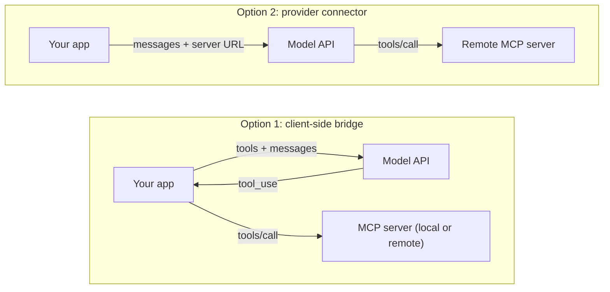

# Connecting MCP Servers to LLM APIs

## Introduction

An MCP server by itself does nothing. Something has to show its tools to a model, run the calls the model asks for, and feed the results back. Hosts like Claude Code do this for you. When you build **your own agent**, you have two main options:

1. **Client-side bridge.** Your code runs an MCP client, converts MCP tools into the model API's tool format, and runs the agent loop. Works with any model provider, any transport (including local stdio servers), and gives you full control.
2. **Provider-side connector.** You pass the MCP server's URL to the model API, and the provider connects to the server and runs the tool calls for you. Less code, but only for remote, publicly reachable servers, and with less control.

This page builds both with the Claude API and explains when to use which. If you have not built a tool-use loop before, read [Building a Manual Agent Loop](../2-agents-tool-use/3-agents-manual-agent-loop.mdx) first. The bridge below is the same loop with MCP plugged in.



## Option 1: A Client-Side Bridge

The bridge has three jobs:

1. **Discover** tools with `tools/list` and convert each one into the provider's tool definition format.
2. **Loop:** send messages and tools to the model. When the model returns `tool_use` blocks, call the matching MCP tools.
3. **Convert results** from MCP content blocks into the provider's `tool_result` format, keeping the error flag.

### The conversion is small

MCP tool definitions and Claude tool definitions carry the same information:

| MCP `Tool` (Python SDK attribute) | Claude API tool field |
| --- | --- |
| `name` | `name` |
| `description` | `description` |
| `input_schema` (JSON Schema) | `input_schema` (JSON Schema) |

MCP results map onto `tool_result` blocks the same way:

| MCP result | Claude `tool_result` |
| --- | --- |
| `content` text blocks | `content` text blocks |
| `content` image blocks (base64 + MIME type) | `content` image blocks with a base64 `source` |
| `is_error` | `is_error` |

OpenAI, Gemini, and open-model servers such as Ollama or vLLM use very similar JSON-Schema-based tool formats, so the same bridge adapts to them by changing only these two conversion functions.

### The complete bridge

This agent connects to the helpdesk server from [Building Your First MCP Server](./2-agents-mcp-first-server.mdx) over stdio and answers questions with Claude:

```python
import asyncio
import sys

import anthropic
from mcp import Client, MCPError, StdioServerParameters

MODEL = "claude-opus-5-5"
MAX_TURNS = 10

SYSTEM = (
    "You are a support assistant for Acme Inc. Use the helpdesk tools to look up "
    "tickets before answering. Never guess ticket details."
)


def mcp_tool_to_claude(tool) -> dict:
    """Convert an MCP Tool into a Claude API tool definition."""
    return {
        "name": tool.name,
        "description": tool.description or "",
        "input_schema": tool.input_schema,
    }


def mcp_result_to_claude(result) -> list[dict]:
    """Convert MCP result content blocks into Claude tool_result content blocks."""
    blocks = []
    for item in result.content:
        if item.type == "text":
            blocks.append({"type": "text", "text": item.text})
        elif item.type == "image":
            blocks.append({
                "type": "image",
                "source": {"type": "base64", "media_type": item.mime_type, "data": item.data},
            })
        else:
            blocks.append({"type": "text", "text": f"[unsupported {item.type} content omitted]"})
    return blocks or [{"type": "text", "text": "(no output)"}]


async def run_tool(client: Client, block) -> dict:
    """Execute one tool_use block through MCP and build the matching tool_result."""
    try:
        result = await client.call_tool(block.name, block.input)
        return {
            "type": "tool_result",
            "tool_use_id": block.id,
            "content": mcp_result_to_claude(result),
            "is_error": bool(result.is_error),
        }
    except MCPError as exc:
        return {
            "type": "tool_result",
            "tool_use_id": block.id,
            "content": f"MCP error {exc.code}: {exc.message}",
            "is_error": True,
        }


async def run_agent(question: str) -> str:
    claude = anthropic.AsyncAnthropic()  # reads ANTHROPIC_API_KEY
    server = StdioServerParameters(command=sys.executable, args=["helpdesk_server.py"])

    async with Client(server, read_timeout_seconds=60) as mcp_client:
        tools = [mcp_tool_to_claude(t) for t in (await mcp_client.list_tools()).tools]
        messages = [{"role": "user", "content": question}]

        for _ in range(MAX_TURNS):
            response = await claude.messages.create(
                model=MODEL,
                max_tokens=16000,
                system=SYSTEM,
                tools=tools,
                messages=messages,
            )
            # Always keep the full assistant turn, including tool_use blocks.
            messages.append({"role": "assistant", "content": response.content})

            if response.stop_reason == "tool_use":
                calls = [b for b in response.content if b.type == "tool_use"]
                for call in calls:
                    print(f"  -> {call.name}({call.input})")
                # Run independent calls concurrently; return ALL results in one user message.
                results = await asyncio.gather(*(run_tool(mcp_client, c) for c in calls))
                messages.append({"role": "user", "content": list(results)})
                continue

            text = "".join(b.text for b in response.content if b.type == "text")
            if response.stop_reason == "max_tokens":
                return text + "\n[Answer cut off: max_tokens reached]"
            if response.stop_reason == "refusal":
                return "The model declined to answer this request."
            return text  # end_turn or stop_sequence

        return "Stopped: the agent hit its turn limit."


if __name__ == "__main__":
    answer = asyncio.run(run_agent("Does Globex have any open high-priority tickets?"))
    print(answer)
```

Example output (the wording of the final answer will vary):

```text
  -> search_tickets({'customer': 'Globex', 'status': 'open'})
Yes. Globex has one open high-priority ticket: T-100, "Cannot log in after password reset".
They also have a medium-priority ticket, T-102, about CSV exports timing out.
```

### Why each detail matters

- **The MCP client stays open for the whole conversation.** Starting a stdio server per tool call would be slow.
- **The assistant turn is appended in full**, including `tool_use` blocks. Dropping them breaks the next request.
- **All `tool_result` blocks go back in one user message**, one per `tool_use` ID. `asyncio.gather` runs independent calls concurrently. See [Parallel Tool Calls](../2-agents-tool-use/5-agents-parallel-tool-calls.mdx).
- **`is_error` is preserved.** If the server says a call failed, the model must know, so it can retry or explain.
- **Protocol errors are caught** and turned into error results, so one bad call does not crash the loop.
- **Every stop reason is handled**, and `MAX_TURNS` guarantees the loop ends. See [Stopping Conditions and Budgets](../6-agents-planning-and-reasoning/10-agents-stopping-conditions.mdx).

### Multiple servers

To use several servers, replace the single `Client` with the `MultiServerClient` from [Building an MCP Client](./4-agents-mcp-client.mdx). Build the tool list from its prefixed names (for example `helpdesk__get_ticket`), and in `run_tool` route the call through its routing table. The loop itself does not change.

### Using the SDK's MCP helpers

The Anthropic Python SDK includes helpers that do the conversion for you and plug MCP tools directly into its (beta) **tool runner**, which runs the loop automatically. Install them with `pip install "anthropic[mcp]"`:

```python
import asyncio
import sys

from anthropic import AsyncAnthropic
from anthropic.lib.tools.mcp import async_mcp_tool
from mcp import Client, StdioServerParameters


async def main() -> None:
    claude = AsyncAnthropic()
    server = StdioServerParameters(command=sys.executable, args=["helpdesk_server.py"])

    async with Client(server) as mcp_client:
        mcp_tools = (await mcp_client.list_tools()).tools
        runner = claude.beta.messages.tool_runner(
            model="claude-opus-5-5",
            max_tokens=16000,
            tools=[async_mcp_tool(t, mcp_client) for t in mcp_tools],
            messages=[{"role": "user", "content": "Summarize Globex's open tickets."}],
        )
        async for message in runner:
            for block in message.content:
                if block.type == "text":
                    print(block.text)


asyncio.run(main())
```

The same module has `mcp_message` (convert an MCP prompt's messages into API messages) and `mcp_resource_to_content` (attach an MCP resource as a content block). Use the runner for straightforward agents. Keep a manual loop when you need custom approval steps, logging, or routing. See [Using an SDK Tool Runner](../2-agents-tool-use/4-agents-tool-runner.mdx).

## Option 2: The Claude API MCP Connector

The **MCP connector** lets the Claude API connect to a **remote** MCP server for you. You add the server to the request, and Anthropic's infrastructure performs the `tools/list` and `tools/call` requests. There is no MCP client in your code and no loop for MCP tools: the tool calls and their results come back inside a single response.

The connector is a **beta** feature. At the time of writing it requires the beta header `mcp-client-2025-11-20` and two request fields that must be used **together**:

- **`mcp_servers`**: connection details for each server (`type`, `url`, `name`, and an optional `authorization_token`)
- **`tools`**: one **`mcp_toolset`** entry per server, whose `mcp_server_name` matches a `name` in `mcp_servers`

```python
import os

import anthropic

client = anthropic.Anthropic()

response = client.beta.messages.create(
    model="claude-opus-5-5",
    max_tokens=16000,
    betas=["mcp-client-2025-11-20"],
    mcp_servers=[
        {
            "type": "url",
            "url": "https://helpdesk-mcp.example.com/mcp",
            "name": "helpdesk",
            "authorization_token": os.environ["HELPDESK_MCP_TOKEN"],
        }
    ],
    tools=[
        {
            "type": "mcp_toolset",
            "mcp_server_name": "helpdesk",
            # Allowlist mode: disable everything, then enable only what this app needs.
            "default_config": {"enabled": False},
            "configs": {
                "get_ticket": {"enabled": True},
                "search_tickets": {"enabled": True},
            },
        }
    ],
    messages=[{"role": "user", "content": "Does Globex have any open high-priority tickets?"}],
)

for block in response.content:
    if block.type == "mcp_tool_use":
        print(f"[called {block.server_name}.{block.name} with {block.input}]")
    elif block.type == "mcp_tool_result":
        print(f"[result, is_error={block.is_error}]")
    elif block.type == "text":
        print(block.text)
```

Example output (wording will vary):

```text
[called helpdesk.search_tickets with {'customer': 'Globex', 'status': 'open'}]
[result, is_error=False]
Yes. Globex has one open high-priority ticket, T-100 ("Cannot log in after password reset").
```

:::warning Both fields are required
Passing `mcp_servers` without a matching `mcp_toolset` entry in `tools` is rejected as a validation error. Every server must be referenced by exactly one toolset, and every toolset must name a server that exists. Also make sure you call `client.beta.messages.create` (not `client.messages.create`) so the `betas` argument is accepted.
:::

### Toolset configuration

The `mcp_toolset` entry controls which of the server's tools Claude may use:

| Pattern | How | Use when |
| --- | --- | --- |
| Enable all | Just the `type` and `mcp_server_name` | You trust the server and want every tool |
| Allowlist | `default_config` with `enabled: False`, then enable specific tools in `configs` | Production apps (recommended) |
| Denylist | Enable by default, set `enabled: False` for specific tools | Hiding a few write or destructive tools |
| Deferred loading | `defer_loading: True` on tools, plus the tool search tool | Servers with many tools |

You can mix your own client-side tools and server-side tools in the same `tools` list alongside one or more `mcp_toolset` entries.

### Connector limitations

Check the [MCP connector documentation](https://platform.claude.com/docs/en/agents-and-tools/mcp-connector) for the current state, but at the time of writing:

- **Only tools** are supported. Resources and prompts are not.
- **Only remote servers** reachable over public HTTPS (Streamable HTTP or the legacy SSE transport). Local stdio servers cannot be used.
- **You handle OAuth.** The API accepts an access token in `authorization_token`, but your application must run the OAuth flow and refresh tokens itself.
- **Data handling.** The feature is listed as not eligible for zero data retention, and tool inputs and outputs pass through Anthropic's infrastructure. Check this against your data policies.
- **Tool list drift.** A server can change its tools between turns. A newer beta header, `mcp-client-2026-09-15`, adds the ability to pin a server's tool list for a conversation. It replaces (and includes) the `2025-11-20` header.

### Other providers

Other providers offer similar features. For example, OpenAI's Responses API has a remote MCP tool with a server URL, an allowed-tools list, and an approval setting, and several agent frameworks include MCP adapters (see [Agent Framework Landscape](../9-agents-frameworks/0-agents-framework-landscape.mdx)). Names and options differ and change often, so check each provider's current documentation. The client-side bridge from Option 1 works with every provider, which is one of its main advantages.

## Choosing Between the Options

| Concern | Client-side bridge | Provider connector |
| --- | --- | --- |
| Local stdio servers | Yes | No |
| Servers on a private network | Yes | Only if publicly reachable |
| Resources and prompts | Yes | Tools only (Claude connector, at time of writing) |
| Any model provider | Yes | Provider-specific |
| Custom approval, logging, filtering per call | Full control | Limited to toolset configuration |
| Lines of code | More | Fewer |
| Latency | Extra round trips through your app | Calls happen inside the provider's request |
| Where tool data flows | Through your app only | Through the provider's infrastructure |

A practical rule: start with the **connector** for prototypes and for public SaaS servers you trust. Use a **bridge** when servers are local or internal, when you need per-call approval or auditing, or when you might switch providers.

## Real-World Scenario

Your company builds a sales assistant web app. It needs two kinds of tools:

- A **public SaaS CRM** that offers an official remote MCP server with OAuth
- An **internal pricing server** that runs inside your private network and must log every call for compliance

### The solution

You combine both options in one request flow:

1. The app runs the OAuth flow for each salesperson's CRM account and stores tokens server-side.
2. Each Claude request includes the CRM server through the **MCP connector**, with an allowlist of read-only tools (`search_accounts`, `get_opportunity`).
3. The internal pricing server is connected through a **client-side bridge** inside your backend. Its tools are passed as ordinary client tools. Your loop logs every `get_price_quote` call with the user ID before executing it.

When Claude calls a CRM tool, the result appears in the response as `mcp_tool_use` and `mcp_tool_result` blocks. When it calls a pricing tool, the response stops with `tool_use`, and your loop runs it through MCP.

### Why this approach

The connector removes MCP client code for the public server, where you have nothing to add. The bridge keeps the private server private and gives you the audit trail compliance requires.

### When to use it, and when not to

Mixing both is worth it only when you have both kinds of servers. If everything is internal, use a bridge. If everything is public and trusted, the connector alone is simpler.

### Alternatives and trade-offs

| Approach | Pros | Cons | Best for |
| --- | --- | --- | --- |
| Manual bridge | Any server, any provider, full control | Most code to maintain | Internal servers, auditing, multi-provider apps |
| SDK tool runner with MCP helpers | Little code, still client-side | Beta; less control over each step | Simple agents over local or internal servers |
| Provider MCP connector | Least code, no MCP client | Remote public servers only, tools only, provider-specific | Prototypes, trusted SaaS servers |
| Agent framework MCP adapters | Integrates with framework features | Framework lock-in, extra abstraction | Teams already using that framework |
| A managed agent platform | Hosting, sandboxes, credential vaults | Platform-specific | Teams that want hosted agents (see [Managed Agent Platforms](../9-agents-frameworks/9-agents-managed-agent-platforms.mdx)) |

## Common Mistakes

- **Forgetting the `mcp_toolset` entry.** With the Claude connector, `mcp_servers` alone is a validation error.
- **Using the connector with a local server.** `localhost` and stdio servers are not reachable by the provider. Use a bridge.
- **Dropping `is_error` in the bridge.** The model then believes a failed action succeeded.
- **Exposing every tool from every server.** Use allowlists (connector) or filter the tool list (bridge). Fewer tools means better tool selection and fewer tokens.
- **Treating MCP results as trusted instructions.** Tool results can contain prompt injection. Your system prompt and approval gates still matter. See [MCP Security](./8-agents-mcp-security.mdx).
- **No turn limit.** A confused model can call tools forever. Always cap turns and cost.
- **Sending long-lived tokens in requests without thinking.** Tokens passed in `authorization_token` grant whatever scopes they carry. Use short-lived, narrowly scoped tokens.

## Summary

- MCP servers become useful when a host shows their tools to a model and runs the calls the model requests.
- A **client-side bridge** converts MCP tools to API tool definitions, runs the agent loop, and converts results back. It works with any provider and any server.
- The Anthropic SDK's `anthropic.lib.tools.mcp` helpers (`async_mcp_tool`, `mcp_message`, `mcp_resource_to_content`) shorten this, especially with the tool runner.
- The **Claude API MCP connector** (beta header `mcp-client-2025-11-20`) connects to remote servers for you. It needs both `mcp_servers` and an `mcp_toolset` entry in `tools`, and returns `mcp_tool_use` and `mcp_tool_result` blocks.
- Choose the connector for trusted, public, remote servers and quick builds. Choose a bridge for local or internal servers, custom approval and logging, and provider independence.

## Exercises

1. Run the bridge agent against the helpdesk server and ask a question that needs two tool calls. Print the full `messages` list at the end and identify each `tool_use` and `tool_result` pair.
2. Modify `run_tool` so that any tool whose MCP annotations set `destructive_hint=True` requires a `y` from the terminal before it runs. (You will need to keep the `Tool` objects from `list_tools`.)
3. Convert the bridge to use the `MultiServerClient` from [Building an MCP Client](./4-agents-mcp-client.mdx) with two servers.
4. Deploy the helpdesk server over HTTPS (or use a tunnel for testing), then call it through the MCP connector with an allowlist that enables only `get_ticket`. Ask a question that would need `search_tickets` and observe what Claude does.

**Next:** [Wrapping an Existing API with MCP](./7-agents-mcp-wrapping-existing-apis.mdx) shows how to turn a real REST API into a well-designed MCP server.
