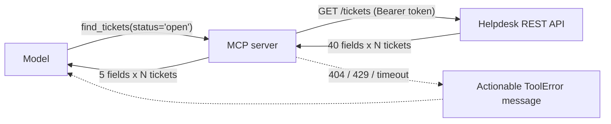

# Wrapping an Existing API with MCP

## Introduction

The most common MCP server in the real world is a **wrapper around an API that already exists**: a ticketing system, a CRM, a billing service, an internal microservice. The tempting approach is to create one MCP tool per REST endpoint. That is usually the wrong design.

REST APIs are designed for **programs**: they are fine-grained, return every field, paginate with cursors, and expect the caller to combine several requests. Models are a different kind of caller. They pay for every token they read, they get confused by dozens of similar tools, and they need errors explained in plain language.

This page shows how to wrap a REST API so that a model can use it well. You will build a server for a fictional "Acme Helpdesk" API, test it without touching the real API, and learn the design decisions that matter.

:::tip Analogy
A REST API is a warehouse with labeled shelves. A good MCP server is a shop counter in front of it. Customers (models) do not walk the aisles. They ask for "the latest SSO tickets from Globex", and the clerk (your server) fetches the right items from several shelves, trims the packaging, and hands over exactly what was asked for.
:::

## The API We Are Wrapping

Assume the helpdesk exposes these endpoints (similar to many real ticketing APIs):

| Endpoint | Purpose |
| --- | --- |
| `GET /tickets?q=&status=&requester=&per_page=&sort=` | Search tickets. Returns about 40 fields per ticket. |
| `GET /tickets/{id}` | One ticket with all fields |
| `GET /tickets/{id}/comments` | The full comment history, often long |
| `POST /tickets/{id}/comments` | Add a public reply or private note |
| `PUT /tickets/{id}` | Update status, priority, assignee, tags |
| `DELETE /tickets/{id}` | Permanently delete a ticket |
| ...and 30 more | Users, groups, macros, SLAs, webhooks |

## Design Before Code

### 1. Start from tasks, not endpoints

List what users will actually ask the assistant to do:

- "Find recent tickets about SSO from Globex."
- "What is going on with ticket 4821?"
- "Add a note to 4821 summarizing what we found."

Those three tasks need three tools, not 36:

| Tool | Endpoints it combines | Why |
| --- | --- | --- |
| `find_tickets` | `GET /tickets` | Returns short summaries only |
| `get_ticket_details` | `GET /tickets/{id}` + `GET /tickets/{id}/comments` | One call gives the model everything it needs to understand a ticket |
| `add_internal_note` | `POST /tickets/{id}/comments` with `public: false` | Private notes only. The model cannot reply to customers. |

Notice what is **not** exposed: deleting tickets, public replies, user management, and webhooks. Every tool you add is something a confused or manipulated model might call. Expose only what the use case needs, and add more later when there is demand. [Tool Design Principles](../2-agents-tool-use/7-agents-tool-design-principles.mdx) covers these ideas for tools in general.

### 2. Return less, on purpose

A raw ticket from the API can be several kilobytes of JSON: internal IDs, URLs, custom fields, and metadata. Pick the fields that help the model reason, and cap long text. Tell the model when something was cut off (`comments_truncated: true`) so it can ask for more.

### 3. Turn errors into instructions

A model cannot do anything useful with `HTTP 404` or a stack trace. It can do something with "Not found. Check the ticket ID or search with find_tickets." Map every predictable upstream failure to a clear, actionable message.

### 4. Keep credentials on the server

The API token lives in the server's environment. The model never sees it, and tool arguments never contain it.



## Step 1: A Shared HTTP Client with a Lifespan

Creating a new HTTP client for every tool call wastes time on new connections and TLS handshakes. Instead, create one client when the server starts and close it when it stops. `MCPServer` accepts a `lifespan` function for exactly this, and tools reach the result through `ctx.request_context.lifespan_context`.

Install the HTTP library first with `pip install httpx` (or `uv add httpx`).

```python
"""MCP server that wraps the Acme Helpdesk REST API."""
import os
from collections.abc import AsyncIterator
from contextlib import asynccontextmanager
from dataclasses import dataclass
from typing import Annotated, Any, Literal

import httpx
from pydantic import BaseModel, Field
from mcp.server.mcpserver import Context, MCPServer
from mcp.server.mcpserver.exceptions import ToolError
from mcp.types import ToolAnnotations

API_URL = os.environ.get("HELPDESK_API_URL", "https://helpdesk.example.com/api/v2")
MAX_TEXT = 1500  # characters of any single comment returned to the model


def make_http_client() -> httpx.AsyncClient:
    """One shared HTTP client: connection pooling, auth header, and timeouts in one place."""
    return httpx.AsyncClient(
        base_url=API_URL,
        headers={"Authorization": f"Bearer {os.environ['HELPDESK_API_TOKEN']}"},
        timeout=httpx.Timeout(10.0, connect=5.0),
    )


@dataclass
class AppContext:
    http: httpx.AsyncClient


@asynccontextmanager
async def lifespan(server: MCPServer) -> AsyncIterator[AppContext]:
    async with make_http_client() as http:
        yield AppContext(http=http)


mcp = MCPServer(
    "acme-helpdesk",
    instructions="Read and annotate Acme Helpdesk tickets. Use find_tickets first, then get_ticket_details.",
    lifespan=lifespan,
)
```

The `instructions` string is returned to clients in `server/discover`, and hosts may include it in the model's context. Use it for short, server-wide guidance such as which tool to call first.

## Step 2: One Place for API Calls and Error Mapping

Every tool goes through a single helper. It handles timeouts, network errors, and HTTP status codes, and raises `ToolError` with a message the model can act on.

```python
async def call_api(ctx: Context, method: str, path: str, **kwargs: Any) -> Any:
    """Call the REST API and translate failures into messages a model can act on."""
    http: httpx.AsyncClient = ctx.request_context.lifespan_context.http
    try:
        response = await http.request(method, path, **kwargs)
    except httpx.TimeoutException:
        raise ToolError("The helpdesk API timed out. Try again with a narrower search.") from None
    except httpx.HTTPError:
        raise ToolError("Could not reach the helpdesk API. Try again later.") from None

    if response.status_code == 404:
        raise ToolError("Not found. Check the ticket ID (format: 12345) or search with find_tickets.")
    if response.status_code == 429:
        retry = response.headers.get("Retry-After", "a few")
        raise ToolError(f"Rate limited by the helpdesk API. Wait {retry} seconds before retrying.")
    if response.status_code in (401, 403):
        raise ToolError("The server's API credentials cannot access this ticket.")
    if response.status_code >= 400:
        raise ToolError(f"Helpdesk API error {response.status_code}. Do not retry the same request.")
    return response.json()
```

Why these choices:

- **404** suggests a next step (search) instead of just failing.
- **429** passes the `Retry-After` value through, so an agent loop can back off.
- **401 and 403** do not reveal whether the ticket exists, and do not leak credential details.
- **Other 4xx and 5xx** tell the model not to hammer the API with the same request.
- **Raw response bodies are never returned.** Upstream error bodies can contain internal details or even injected text.

## Step 3: Task-Shaped Tools with Compact Output

```python
class TicketSummary(BaseModel):
    id: int
    subject: str
    status: str
    priority: str
    updated_at: str


class Comment(BaseModel):
    author: str
    public: bool
    created_at: str
    body: str


class TicketDetails(TicketSummary):
    requester_email: str
    tags: list[str]
    comments: list[Comment]
    comments_truncated: bool


@mcp.tool(annotations=ToolAnnotations(read_only_hint=True, open_world_hint=False))
async def find_tickets(
    ctx: Context,
    text: Annotated[str | None, Field(description="Words to search for in subject and description")] = None,
    status: Annotated[Literal["new", "open", "pending", "solved"] | None, Field(description="Ticket status")] = None,
    requester_email: Annotated[str | None, Field(description="Exact email of the customer")] = None,
    limit: Annotated[int, Field(ge=1, le=25)] = 10,
) -> list[TicketSummary]:
    """Search tickets and return short summaries, newest first.

    Use get_ticket_details for the full conversation of one ticket.
    """
    params = {"per_page": limit, "sort": "-updated_at"}
    if text:
        params["q"] = text
    if status:
        params["status"] = status
    if requester_email:
        params["requester"] = requester_email
    data = await call_api(ctx, "GET", "/tickets", params=params)
    return [
        TicketSummary(id=t["id"], subject=t["subject"], status=t["status"],
                      priority=t.get("priority") or "normal", updated_at=t["updated_at"])
        for t in data["tickets"][:limit]
    ]


@mcp.tool(annotations=ToolAnnotations(read_only_hint=True, open_world_hint=False))
async def get_ticket_details(
    ticket_id: int,
    ctx: Context,
    max_comments: Annotated[int, Field(ge=0, le=20, description="Most recent comments to include")] = 5,
) -> TicketDetails:
    """Get one ticket with its most recent comments (oldest first)."""
    ticket = (await call_api(ctx, "GET", f"/tickets/{ticket_id}"))["ticket"]
    comments = (await call_api(ctx, "GET", f"/tickets/{ticket_id}/comments"))["comments"]
    recent = comments[-max_comments:] if max_comments else []
    return TicketDetails(
        id=ticket["id"],
        subject=ticket["subject"],
        status=ticket["status"],
        priority=ticket.get("priority") or "normal",
        updated_at=ticket["updated_at"],
        requester_email=ticket["requester"]["email"],
        tags=ticket.get("tags", []),
        comments=[
            Comment(author=c["author"]["name"], public=c["public"], created_at=c["created_at"],
                    body=c["body"][:MAX_TEXT])
            for c in recent
        ],
        comments_truncated=len(comments) > len(recent),
    )


@mcp.tool(annotations=ToolAnnotations(read_only_hint=False, destructive_hint=False, idempotent_hint=False))
async def add_internal_note(
    ticket_id: int,
    note: Annotated[str, Field(min_length=1, max_length=4000)],
    ctx: Context,
) -> str:
    """Add a private note to a ticket. The customer never sees internal notes."""
    body = {"comment": {"body": f"[AI assistant] {note}", "public": False}}
    await call_api(ctx, "POST", f"/tickets/{ticket_id}/comments", json=body)
    return f"Internal note added to ticket {ticket_id}."


if __name__ == "__main__":
    mcp.run()
```

Design details worth copying:

- **`Literal` for enums.** The model cannot invent a status like `"in progress"`. Invalid values are rejected by schema validation before any API call.
- **Bounded `limit` and `max_comments`.** The model cannot accidentally request 10,000 records.
- **Docstrings point to the next tool.** `find_tickets` tells the model to use `get_ticket_details` for the full conversation.
- **The write tool is narrow.** `add_internal_note` hard-codes `public: False` and prefixes notes with `[AI assistant]`, so humans can tell where a note came from. The model has no parameter that could turn it into a public reply.
- **Annotations** mark the read-only tools, so hosts can skip confirmation prompts for them and ask before the write.

## Step 4: Test Without the Real API

You do not want tests that depend on the real helpdesk being up, or that create notes in production. `httpx.MockTransport` lets you replace the upstream API with a function, and the in-process `Client` exercises the real MCP path:

```python
import asyncio
import os

import httpx
from mcp import Client

os.environ.setdefault("HELPDESK_API_TOKEN", "test-token")
import helpdesk_api_server as srv  # noqa: E402

FAKE_TICKETS = [
    {"id": 4821, "subject": "SSO login loop", "status": "open", "priority": "high",
     "updated_at": "2026-10-09T08:00:00Z", "requester": {"email": "ops@globex.com"}, "tags": ["sso"]},
]
FAKE_COMMENTS = [
    {"author": {"name": f"User {i}"}, "public": True, "created_at": f"2026-10-0{i}T10:00:00Z", "body": "x" * 3000}
    for i in range(1, 8)
]


def fake_api(request: httpx.Request) -> httpx.Response:
    assert request.headers["Authorization"] == "Bearer test-token"
    path = request.url.path
    if path.endswith("/tickets") and request.method == "GET":
        return httpx.Response(200, json={"tickets": FAKE_TICKETS})
    if path.endswith("/tickets/4821"):
        return httpx.Response(200, json={"ticket": FAKE_TICKETS[0]})
    if path.endswith("/tickets/4821/comments") and request.method == "GET":
        return httpx.Response(200, json={"comments": FAKE_COMMENTS})
    if path.endswith("/tickets/4821/comments") and request.method == "POST":
        return httpx.Response(201, json={"ok": True})
    if path.endswith("/tickets/9999"):
        return httpx.Response(404, json={"error": "RecordNotFound"})
    return httpx.Response(429, headers={"Retry-After": "30"})


def make_fake_client() -> httpx.AsyncClient:
    return httpx.AsyncClient(
        base_url="https://helpdesk.test/api/v2",
        headers={"Authorization": "Bearer test-token"},
        transport=httpx.MockTransport(fake_api),
    )


async def main() -> None:
    srv.make_http_client = make_fake_client  # swap in the fake upstream API
    async with Client(srv.mcp) as client:
        r = await client.call_tool("find_tickets", {"status": "open"})
        print("find_tickets:", r.structured_content["result"])

        r = await client.call_tool("get_ticket_details", {"ticket_id": 4821, "max_comments": 3})
        d = r.structured_content
        print("comments:", len(d["comments"]), "truncated:", d["comments_truncated"],
              "body length:", len(d["comments"][0]["body"]))

        r = await client.call_tool("get_ticket_details", {"ticket_id": 9999})
        print("missing:", r.is_error, r.content[0].text)

        r = await client.call_tool("add_internal_note", {"ticket_id": 1, "note": "hi"})
        print("rate limited:", r.is_error, r.content[0].text)


asyncio.run(main())
```

Output (server log lines on stderr omitted):

```text
find_tickets: [{'id': 4821, 'subject': 'SSO login loop', 'status': 'open', 'priority': 'high', 'updated_at': '2026-10-09T08:00:00Z'}]
comments: 3 truncated: True body length: 1500
missing: True Error executing tool get_ticket_details: Not found. Check the ticket ID (format: 12345) or search with find_tickets.
rate limited: True Error executing tool add_internal_note: Rate limited by the helpdesk API. Wait 30 seconds before retrying.
```

The `lifespan` runs when the in-process `Client` connects, so it picks up the replaced `make_http_client`. The tests check the things that matter for a model: compact output, truncation flags, and error messages.

:::caution Watch your logs
`httpx` logs every request URL at `INFO` level, including query strings. If search terms or customer emails are sensitive, raise the `httpx` logger to `WARNING` in production, and never log the `Authorization` header.
:::

## Generating Servers from OpenAPI

If your API has an OpenAPI (Swagger) specification, some tools can generate an MCP server from it automatically. For example, the standalone [FastMCP](https://gofastmcp.com) project (a separate package from the official SDK) can build a server from an OpenAPI document. Generation is great for **exploration and internal prototypes**, but the result usually has the problems this page warns about: one tool per endpoint, verbose responses, and raw HTTP errors. A good middle path is to generate a server, observe which tools models actually use, and then hand-write task-shaped tools for those.

## Real-World Scenario

Your support team wants the AI assistant from the earlier pages to work against the real helpdesk SaaS. The vendor does not offer an MCP server yet, but has a mature REST API with 36 endpoints.

### The solution

You build exactly the three-tool server on this page:

- Read tools return compact summaries and capped comment histories.
- The only write tool adds private, labeled notes.
- The server runs remotely over Streamable HTTP with OAuth (see [MCP Transports](./5-agents-mcp-transports.mdx)). Each support agent's token is exchanged for their **own** helpdesk API credentials, so the assistant can never see tickets the agent cannot see.
- Contract tests with `MockTransport` run in CI. A small evaluation set of real questions checks that the model picks the right tools (see [Building Evaluation Datasets](../11-agents-evaluation-and-testing/1-agents-building-eval-sets.mdx)).

After two weeks, logs show that agents often ask "which tickets are about to breach SLA?". You add a fourth tool, `find_sla_risks`, that combines the SLA endpoint with ticket search, instead of exposing the SLA endpoint directly.

### Why this approach

Task-shaped tools keep the toolset small and the context lean, error mapping lets the model recover on its own, and the narrow write tool limits the damage from a mistaken or manipulated call. Growing the toolset from observed usage keeps it focused.

### When to use it, and when not to

Hand-written wrappers are worth it for APIs that agents use daily. If the vendor ships an official MCP server, evaluate it first: it will be maintained as the API changes. If you only need one read-only call in one agent, plain function calling is simpler.

### Alternatives and trade-offs

| Approach | Pros | Cons | Best for |
| --- | --- | --- | --- |
| One tool per endpoint | Fast to build, complete coverage | Too many tools, verbose output, poor tool selection | Quick experiments |
| Generated from OpenAPI | Almost no code | Same problems as above; descriptions are only as good as the spec | Exploration, internal prototypes |
| **Task-shaped hand-written tools** | Small, clear toolset; compact output; good errors | More design work; must track API changes | Production use |
| Vendor's official MCP server | Maintained by the vendor | You do not control design or scope | Popular SaaS products |
| A generic "call any endpoint" tool | One tool covers everything | Huge security risk; the model must know the API | Almost never |

## Common Mistakes

- **Mirroring the REST API one to one.** Thirty similar tools make tool selection worse and expose dangerous endpoints. Design for tasks.
- **Returning raw API responses.** Large, noisy JSON wastes tokens and buries the important fields. Select and cap fields.
- **Leaking upstream error bodies.** They can contain internal details or injected text. Map status codes to your own messages.
- **Creating an HTTP client per call.** Use a lifespan-managed shared client with timeouts.
- **A shared admin token for all users.** Every user then has admin power through the model. Use per-user credentials (see [MCP Security](./8-agents-mcp-security.mdx)).
- **Write tools with too much freedom.** A `update_ticket(fields: dict)` tool lets the model change anything. Prefer narrow tools such as `set_priority(ticket_id, priority)`.
- **No pagination limits.** Always bound result sizes with schema constraints.

## Summary

- Wrap APIs around **user tasks**, not endpoints. Combine calls where the model would otherwise need several.
- Return **compact, structured** results with explicit truncation flags.
- Map upstream failures to **actionable `ToolError` messages**, and never pass raw error bodies through.
- Manage a **shared HTTP client** with the server's `lifespan`, and keep credentials on the server.
- Expose only the **minimum set of tools**, with narrow write tools and correct annotations.
- Test against a **mocked upstream** with `httpx.MockTransport` and an in-process `Client`.

## Exercises

1. Add a `set_ticket_priority(ticket_id, priority)` tool that uses `PUT /tickets/{id}`. Restrict `priority` with `Literal`, choose its annotations, and add a test for the 403 case.
2. Make `call_api` retry once on 502, 503, and 504 responses with a short delay, but never retry `POST` requests. Explain why.
3. Measure the size (in characters) of a raw ticket response versus your `TicketSummary`. Estimate the token savings for a search returning 10 tickets.
4. Pick a public API you know (for example GitHub or a weather API). Write down the three tasks a user would ask an assistant to do with it, and design the tools (names, arguments, return fields) before writing any code.

**Next:** [MCP Security](./8-agents-mcp-security.mdx) covers the threats every MCP server and client must defend against.
