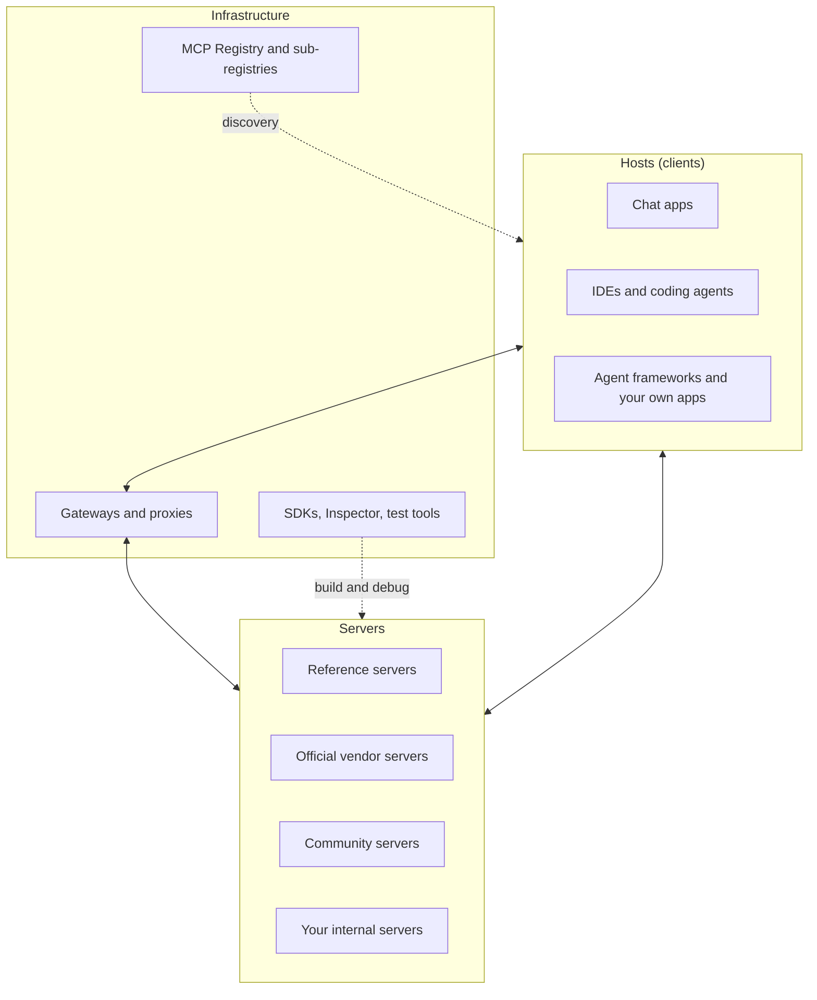
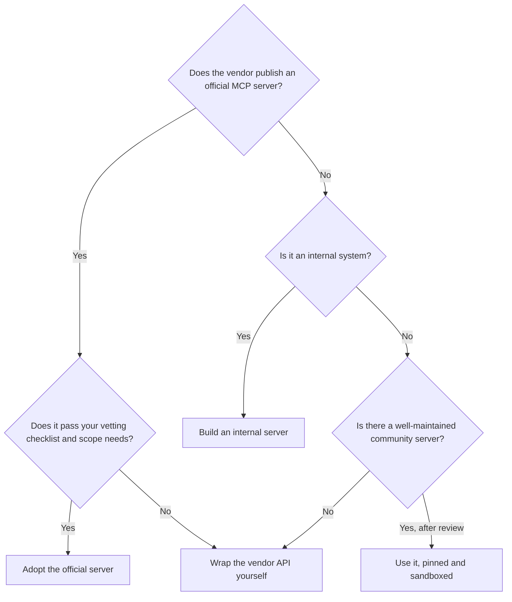

# The MCP Ecosystem

## Introduction

A protocol is only as useful as the things that speak it. Part of MCP's appeal is the size of its ecosystem: many AI applications can act as hosts, thousands of servers exist, and official SDKs cover the major programming languages. That size is also a risk. Anyone can publish a server, quality varies enormously, and listings change weekly.

This page gives you a map of the ecosystem and, more importantly, a method for **choosing, vetting, and operating** servers you did not write. Exact product lists and numbers change constantly, so treat the names here as examples and check the linked sources for the current state.

:::tip Analogy
The MCP ecosystem resembles a package ecosystem such as npm or PyPI. There is an official index (the MCP Registry), well-known publishers, and countless community packages. You would not `pip install` a random package into production without checking who maintains it. Treat MCP servers the same way, with extra caution, because they run with access to your data and act on a model's instructions.
:::

## The Map



## Hosts

Hosts are where users meet MCP. Broad categories:

| Category | Examples (at the time of writing) | Notes |
| --- | --- | --- |
| Chat assistants | Claude (desktop, web, and mobile apps, where remote servers are called connectors), ChatGPT | Mostly remote servers with OAuth; some support local servers on desktop |
| Coding tools | Claude Code, VS Code with GitHub Copilot, Cursor, and many other editors and terminal agents | Local stdio servers are common; project-level config files |
| Agent frameworks and SDKs | Claude Agent SDK, OpenAI Agents SDK, LangChain and LangGraph adapters, LlamaIndex, Pydantic AI, Google's Agent Development Kit | Use MCP servers as tool sources in your own agents |
| Model APIs | Claude API MCP connector, OpenAI Responses API remote MCP tool | The provider connects to remote servers for you |

Hosts differ in **which features they support**. Nearly all support tools. Support for resources, prompts, elicitation, and extensions such as MCP Apps varies. Before you design a server around resources or prompts, check what your target hosts actually do with them. The official site's [client list](https://modelcontextprotocol.io/clients) and each host's documentation are the places to check.

## Servers

### Reference servers

The [modelcontextprotocol/servers](https://github.com/modelcontextprotocol/servers) repository maintains a small set of **reference servers**: Everything (a test server that exercises every feature), Fetch, Filesystem, Git, Memory, Sequential Thinking, and Time. Its README describes them as **educational examples**, not production-ready solutions. Several early servers (GitHub, Slack, PostgreSQL, and others) were moved to an archive, and some were replaced by official vendor servers.

The **Everything** server is especially useful when you build a client: it lets you test tools, resources, prompts, and other features against a known-good implementation.

### Official vendor servers

Many SaaS companies now publish and host their own MCP servers, usually as remote Streamable HTTP endpoints with OAuth. Examples include issue trackers, source hosting, payments, documentation tools, monitoring, and CRMs. A vendor-maintained server is usually the best choice when one exists, because it tracks API changes and is backed by the vendor's security team.

### Community servers

There are thousands of community servers for every imaginable system. Some are excellent. Many are weekend projects, unmaintained, or thin wrappers that expose an entire API. A few are malicious. Never assume a server is safe because it is popular or listed in a directory.

## Finding Servers: The MCP Registry

The **[official MCP Registry](https://registry.modelcontextprotocol.io)** is a community-run metadata index of publicly available servers. Key facts:

- It stores **metadata, not code**: a `server.json` describing the server's name, version, description, source repository, and how to run it (an npm, PyPI, Docker, or other **package**, or a **remote** URL).
- Server names are **namespaced** (for example `io.github.username/server-name` or a reverse domain name), and publishers must prove they control the namespace, through GitHub login or DNS and HTTP verification for domains.
- It is designed to feed **sub-registries**: marketplaces and enterprise catalogs that add curation, ratings, or security scanning on top.
- At the time of writing it is still labeled a **preview**, so check its documentation for current guarantees.

The registry has a public REST API. This script searches it and summarizes how each server is distributed:

```python
import sys

import httpx

REGISTRY = "https://registry.modelcontextprotocol.io/v0.1/servers"


def search(term: str, limit: int = 5) -> None:
    resp = httpx.get(REGISTRY, params={"search": term, "limit": limit}, timeout=20)
    resp.raise_for_status()
    for entry in resp.json()["servers"]:
        server = entry["server"]
        kinds = [f"package:{p.get('registryType')}" for p in server.get("packages", [])]
        kinds += [f"remote:{r.get('type')}" for r in server.get("remotes", [])]
        repo = server.get("repository", {}).get("url", "no repository listed")
        print(f"{server['name']} v{server.get('version', '?')}")
        print(f"    {server.get('description', '')[:90]}")
        print(f"    install: {', '.join(kinds) or 'unknown'} | source: {repo}")


if __name__ == "__main__":
    search(sys.argv[1] if len(sys.argv) > 1 else "postgres")
```

Example output (results change daily):

```text
ai.getvda/kafka-and-postgres-monitoring-stack v1.0.0
    Kafka and Postgres Monitoring Stack
    install: remote:streamable-http | source: no repository listed
ai.getvda/minio-postgres-redis-stack-generator v1.0.0
    MinIO + Postgres + Redis Stack Generator
    install: remote:streamable-http | source: no repository listed
```

Notice the first lesson of the registry: a search for "postgres" does not necessarily return a Postgres database server, and some entries list no source repository at all. **Being listed is not an endorsement.** The registry verifies who owns a namespace, not whether the server is good or safe.

## Building and Debugging

| Tool | What it does |
| --- | --- |
| **Official SDKs** | TypeScript, Python, C#, Go, Rust, Ruby, Java, Swift, PHP, and Kotlin, classified into maturity tiers on the [SDK page](https://modelcontextprotocol.io/docs/sdk) |
| **MCP Inspector** | Browser UI to connect to any server, list capabilities, and call tools by hand (`npx @modelcontextprotocol/inspector`, or `mcp dev` in Python) |
| **Everything server** | A known-good server for testing clients |
| **In-process clients** | `Client(mcp)` in Python for fast unit tests (see [Building Your First MCP Server](./2-agents-mcp-first-server.mdx)) |
| **Higher-level frameworks** | Projects such as the standalone [FastMCP](https://gofastmcp.com) add features like server composition, proxying, and OpenAPI generation on top of the protocol |

:::note Naming confusion: FastMCP
"FastMCP" refers to two things. Version 1 of the official Python SDK included a class called `FastMCP` (renamed `MCPServer` in version 2). Separately, the **standalone `fastmcp` package** is an independent project with its own API and release cycle. Check which one a tutorial uses before copying code.
:::

## Extensions

The `2026-07-28` revision formalized **extensions**: optional features that both client and server must opt into. Notable ones:

- **Tasks** (`io.modelcontextprotocol/tasks`): long-running operations that return a handle the client polls, instead of holding a request open for minutes.
- **MCP Apps** (`io.modelcontextprotocol/ui`): servers provide interactive UI (forms, charts, viewers) that hosts render inside the conversation.
- **Skills over MCP:** structured agent instructions discovered through MCP, developed in a community working group.
- **Authorization extensions:** additional auth mechanisms, for example for enterprise identity providers.

Extensions let the ecosystem experiment without bloating the core protocol. Before depending on one, confirm that your target hosts support it.

## Gateways and Enterprise Operation

As organizations connect dozens of servers, they often put an **MCP gateway** between hosts and servers. Gateways (offered by cloud providers, API management vendors, container platforms, and open-source projects) typically provide:

- A **curated allowlist** of approved servers and tools per team
- **Centralized authentication**, mapping corporate identity to per-server credentials
- **Policy enforcement**, such as blocking destructive tools or requiring approval
- **Audit logging and tracing** of every tool call
- **Tool definition pinning**, so upstream changes require review

The stateless `2026-07-28` protocol and its mirrored HTTP headers (`Mcp-Method`, `Mcp-Name`) were designed partly to make this kind of infrastructure easier to build.

## Governance

MCP was created at Anthropic and, in December 2025, donated to the **Agentic AI Foundation (AAIF)**, a directed fund under the Linux Foundation. The A2A protocol joined the same foundation in 2026, so the two most widely used agent protocols now share neutral governance. Changes to the spec go through **Specification Enhancement Proposals (SEPs)** reviewed in public on GitHub, and working groups own areas such as transports, security, and the registry. Since `2026-07-28`, there is a formal **feature lifecycle** with at least twelve months' notice before deprecated features are removed. To follow changes, watch the [specification repository](https://github.com/modelcontextprotocol/modelcontextprotocol) and the [changelog](https://modelcontextprotocol.io/specification/latest/changelog).

## Vetting a Third-Party Server

Before connecting a server you did not write, work through this checklist:

| Question | Good sign | Red flag |
| --- | --- | --- |
| Who publishes it? | The vendor of the underlying service, or a known organization | Anonymous publisher, no repository |
| Is the source available? | Public repository, readable code, recent commits | Closed binary, obfuscated install script |
| What does it run? | A pinned package version or a vendor-hosted HTTPS URL | Piping a downloaded script into a shell, unpinned `latest` versions, extra shell commands |
| What tools does it expose? | A few task-shaped tools, honest annotations | Dozens of tools, generic "execute" or "run command" tools |
| What do the descriptions say? | Plain descriptions of behavior | Hidden instructions, references to other servers' tools |
| How does it authenticate? | OAuth with minimal scopes, or per-user tokens | Asks for an admin key or your password |
| Where does data go? | Only to the service it wraps | Unexplained network calls, telemetry to third parties |
| Which protocol version? | Current revision, or a clear upgrade plan | Only the deprecated HTTP+SSE transport |

Then apply the controls from [MCP Security](./8-agents-mcp-security.mdx): run local servers sandboxed, pin tool definitions, and allowlist only the tools you need.

## Build, Adopt, or Wrap?

When you need an AI integration with some system, there are usually three options. This flowchart captures the typical decision:



- **Adopt** when a trustworthy official server covers your use case. You get maintenance for free.
- **Wrap** when the official server exposes too much (for example, destructive tools you cannot disable), too little, or does not exist. Follow [Wrapping an Existing API with MCP](./7-agents-mcp-wrapping-existing-apis.mdx).
- **Build** for internal systems. Nobody else will.

## Sharing Configuration with Your Team

Most coding hosts read a project-level configuration file, so a team can commit the list of servers a repository uses. Claude Code, for example, reads `.mcp.json` from the project root (created with `claude mcp add --scope project ...`) and asks each user to approve project servers before first use:

```json
{
  "mcpServers": {
    "helpdesk": {
      "type": "http",
      "url": "https://helpdesk-mcp.internal.example.com/mcp"
    },
    "kb": {
      "type": "stdio",
      "command": "uvx",
      "args": ["acme-kb-mcp==1.4.2"],
      "env": {"KB_INDEX_DIR": "${KB_INDEX_DIR:-/tmp/kb}"}
    }
  }
}
```

Good habits for shared configuration:

- **Pin versions** of package-based servers (`acme-kb-mcp==1.4.2`, not `latest`).
- **Never commit secrets.** Use environment variable expansion such as `${VAR}`, and let remote servers use OAuth so each person signs in with their own account.
- **Prefer remote servers** for shared systems, so updates and access control happen in one place.
- **Review changes** to the configuration file in pull requests, like any other dependency change.

Other hosts use similar `mcpServers` structures, but field names and file locations differ. Check each host's documentation.

## Keeping an Inventory

Once a team uses more than a handful of servers, it helps to know what each one actually exposes and which protocol revision it speaks. This script reads a `.mcp.json`-style file, connects to each server, and prints a summary. A server that fails to start is reported instead of stopping the run.

```python
"""Inventory the MCP servers in a .mcp.json file: protocol version, identity, and tools."""
import asyncio
import json
import sys

from mcp import Client, StdioServerParameters


def to_target(cfg: dict):
    if cfg.get("type", "stdio") == "stdio":
        command = sys.executable if cfg["command"] in ("python", "python3") else cfg["command"]
        return StdioServerParameters(command=command, args=cfg.get("args", []), env=cfg.get("env"))
    return cfg["url"]  # remote server (add auth headers for protected servers)


async def inspect(name: str, cfg: dict) -> None:
    try:
        async with asyncio.timeout(15):  # Python 3.11+
            async with Client(to_target(cfg)) as client:
                tools = (await client.list_tools()).tools
                info = client.server_info
                print(f"{name:10} protocol={client.protocol_version} "
                      f"server={info.name if info else '?'} tools={len(tools)}")
                for tool in tools:
                    flags = tool.annotations
                    ro = flags.read_only_hint if flags else None
                    print(f"{'':10}   - {tool.name} (read_only_hint={ro})")
    except Exception as exc:  # report and keep going
        print(f"{name:10} FAILED: {type(exc).__name__}")


async def main(path: str) -> None:
    with open(path) as f:
        servers = json.load(f)["mcpServers"]
    for name, cfg in servers.items():
        await inspect(name, cfg)


if __name__ == "__main__":
    asyncio.run(main(sys.argv[1] if len(sys.argv) > 1 else ".mcp.json"))
```

Example output for a file listing the helpdesk server, the small knowledge-base server from [Building an MCP Client](./4-agents-mcp-client.mdx), and a misconfigured entry:

```text
helpdesk   protocol=2026-07-28 server=helpdesk tools=2
             - get_ticket (read_only_hint=None)
             - search_tickets (read_only_hint=None)
kb         protocol=2026-07-28 server=kb tools=1
             - search (read_only_hint=None)
broken     FAILED: ExceptionGroup
```

Two things stand out even in this tiny example. The misconfigured server would silently disappear from a host, and none of the tools declare `read_only_hint`, so a careful host has to treat them all as potentially writing data. Run an inventory like this in CI and diff it over time to spot new tools, removed tools, and protocol upgrades.

## Real-World Scenario

Your engineering organization has 300 developers using AI coding tools. Developers have been installing community MCP servers on their own: three different "Jira" servers, a "Postgres" server that can run any SQL against production, and a server whose source nobody can find. Security asks for a policy.

### The solution

1. **Inventory.** Collect MCP configurations (`.mcp.json` files and host settings) from developer machines and repositories.
2. **Prefer official servers.** Replace the three Jira servers with the vendor's official remote server, using OAuth with each developer's own account.
3. **Build internal servers for internal systems.** Replace the production Postgres server with an internal read-only analytics server that runs against a replica, with row limits and audit logging (see [Wrapping an Existing API with MCP](./7-agents-mcp-wrapping-existing-apis.mdx)).
4. **Publish an internal catalog.** Run a private sub-registry listing approved servers, with pinned versions and pinned tool definitions, behind an MCP gateway.
5. **Enforce in hosts.** Use host-level managed settings, where your tools support them, to allow only catalog servers.

### Why this approach

It keeps the productivity benefits of MCP while removing unknown code, shared credentials, and dangerous capabilities. Official servers reduce maintenance, internal servers cover internal systems, and the gateway gives security one place to enforce policy and audit.

### When to use it, and when not to

A full catalog and gateway are worth it for organizations with many developers and sensitive systems. A small team can get most of the benefit with a short written allowlist, a committed `.mcp.json` per project, and a habit of reviewing new servers.

### Alternatives and trade-offs

| Approach | Pros | Cons | Best for |
| --- | --- | --- | --- |
| Anything goes | Maximum flexibility | Unknown code, credential sprawl, no audit | Personal experiments only |
| Written allowlist plus code review | Lightweight | Relies on discipline; no enforcement | Small teams |
| Internal catalog (private sub-registry) | Discoverable, versioned approvals | Needs an owner to curate | Medium to large organizations |
| Gateway with policy and audit | Central enforcement, logging, pinning | Another critical service to run | Regulated or large organizations |
| Build everything in-house | Full control | Slow; duplicates vendor work | Highly sensitive environments |

## Common Mistakes

- **Treating registry listings or star counts as security reviews.** Listings verify namespace ownership, not safety.
- **Using reference servers in production unchanged.** They are educational examples.
- **Installing multiple overlapping servers.** Three servers with `search` tools confuse the model and multiply risk.
- **Ignoring host feature support.** A server built around prompts and resources may look empty in a host that only supports tools.
- **Copying old configuration snippets.** Old guides use the deprecated SSE transport, v1 SDK imports, or archived servers.
- **Forgetting updates.** Pin versions, but also schedule reviews and upgrades, because servers fix security issues too.
- **Letting configuration drift.** Different developers end up with different server versions and settings. Commit shared configuration and run an inventory in CI.
- **Assuming every server speaks the latest protocol.** Many servers still use the `2025-11-25` handshake. Use clients that support both eras until your inventory shows everything has upgraded.

## Summary

- The ecosystem includes **hosts** (chat apps, IDEs, frameworks, model APIs), **servers** (reference, vendor, community, internal), and **infrastructure** (registry, gateways, SDKs, Inspector).
- **Reference servers** are learning examples. **Vendor servers** are usually the best choice when they exist.
- The **MCP Registry** indexes public servers with namespace verification, but listing is not endorsement.
- **Extensions** such as Tasks and MCP Apps add optional features. Check host support before relying on them.
- MCP is governed by the **Agentic AI Foundation** through public SEPs and a formal deprecation policy.
- Vet every third-party server: publisher, source, install method, tools, descriptions, auth, and data flows.
- Decide per system whether to **adopt**, **wrap**, or **build**, share configuration through version control, and keep an **inventory** of what each server exposes.

## Exercises

1. Run the registry search script for a system your team uses. For the top three results, fill in the vetting checklist table.
2. Start the reference Everything server with the MCP Inspector and list which features it exposes that the helpdesk server from this section does not.
3. Find out which MCP features (tools, resources, prompts, elicitation) two hosts you use actually support. How would that change your server design?
4. Write a one-page MCP policy for a five-person team: which servers are allowed, how new ones are approved, and where credentials live.
5. Run the inventory script against your own `.mcp.json` (or a copy of it). Which tools lack annotations, and which servers fail to start?

**Next:** [Agent-to-Agent (A2A) Protocol](./10-agents-a2a-protocol.mdx) looks at the protocol for connecting agents to other agents, and how it complements MCP.
