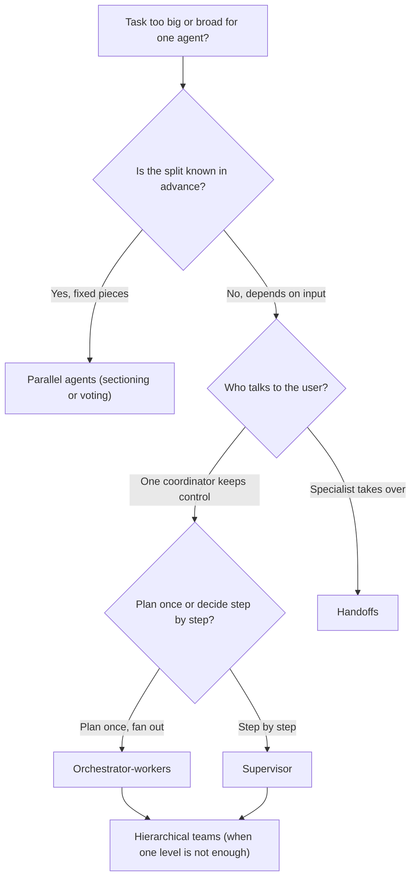
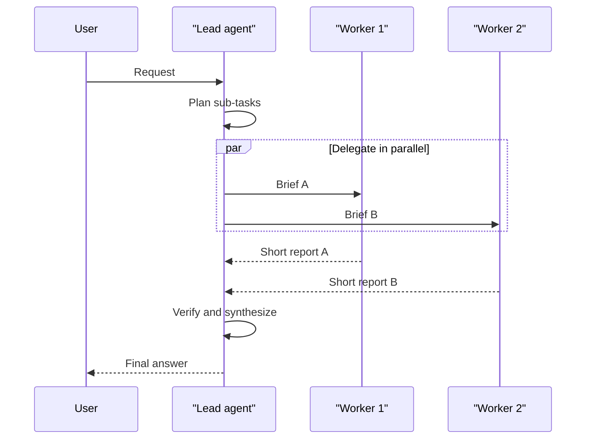

# Multi-Agent Systems Introduction

## Introduction

So far in this tutorial, you have built **single agents**: one model, one system prompt, one conversation history, and a loop that calls tools until the task is done. That design takes you surprisingly far. Sooner or later, though, you meet tasks where one agent starts to struggle:

- A research question needs 40 web pages read, and the conversation fills up with raw search results long before the agent writes its answer.
- A code review should check security, performance, and test coverage. Each check needs different instructions, and running them one after another is slow.
- A customer support bot has to handle billing, technical problems, and account changes. One giant prompt that covers all three gets confusing and hard to maintain.

A **multi-agent system** splits the work across several LLM-driven agents that cooperate. Each agent has its own instructions, its own tools, and, most importantly, **its own context window**. One agent might plan and delegate, several might do research in parallel, and another might check the result.

A useful analogy is a small consulting team. A lead consultant talks to the client, breaks the engagement into pieces, and hands each piece to an analyst. The analysts dig through documents and come back with short memos, not their entire browser history. The lead combines the memos into a recommendation. The team can cover more ground than one person, but it also costs more and needs coordination. Hand-offs can lose information, two analysts can duplicate work, and someone has to check the final report.

This section teaches you to build these systems from scratch in plain Python, so you can see exactly how they work. It also helps you decide when they are worth it. Spoiler: less often than the hype suggests.

:::info What you need first
This section assumes you are comfortable with the [agent loop](../0-agents-fundamentals/4-agents-agent-loop.mdx), [tool use](../2-agents-tool-use/0-agents-tool-use-introduction.mdx), and [context management](../4-agents-memory-and-context/0-agents-context-engineering.mdx). The code uses the Anthropic Python SDK (`pip install anthropic`). OpenAI, Google Gemini, and open-source models served with Ollama or vLLM all support the same building blocks (tool calling, system prompts, structured outputs), so the patterns carry over directly.
:::

## What Counts as a "Multi-Agent" System?

The term gets stretched to cover almost anything with more than one LLM call. A practical definition:

> A multi-agent system is a program in which **two or more LLM agents, each with its own context**, work on parts of a task, and at least one agent's output becomes another agent's input.

Two details in that definition matter:

1. **Separate contexts.** Two prompts that share one message history are one agent wearing two hats. Agents become separate when each one sees a different conversation.
2. **Agents, not just calls.** A fixed chain of three prompts is a *workflow* (see [Agents vs Workflows](../0-agents-fundamentals/3-agents-vs-workflows.mdx)). It becomes multi-agent when at least one participant can decide what to do next, such as which tool to call, which agent to delegate to, or when to stop.

In practice the line is blurry, and that is fine. Many production systems mix fixed code-driven steps with a few agentic decision points.

### Key vocabulary

| Term | Meaning |
| --- | --- |
| **Orchestrator / lead agent** | An agent that plans the work, delegates sub-tasks, and combines results. |
| **Worker / subagent** | An agent that receives one focused task, runs its own loop, and reports back. |
| **Supervisor** | An orchestrator that decides turn by turn which worker acts next, looking at each result before choosing. |
| **Handoff** | Transferring control of the conversation from one agent to another, so the new agent talks to the user directly. |
| **Brief** | The task description an orchestrator writes for a worker. Often the *only* context the worker gets. |
| **Shared state** | Any data that several agents can read or write, such as a scratchpad, a file system, or a database. |
| **Context isolation** | Keeping one agent's intermediate work (tool calls, raw documents) out of another agent's context window. |

## Why Build Multi-Agent Systems?

There are four real benefits. Notice that "it feels more like a team" is not one of them.

### 1. Context isolation

Every agent has a limited context window, and models generally reason less reliably as that window fills with irrelevant material. A worker can read tens of thousands of tokens of search results or source code, then return a 1,000-token summary. Anthropic's [context engineering guide](https://www.anthropic.com/engineering/effective-context-engineering-for-ai-agents) describes exactly this: subagents explore extensively and hand back a condensed result, often 1,000 to 2,000 tokens, so the lead agent's context stays clean.

### 2. Parallelism

Independent sub-tasks can run at the same time. Five research questions that each take 60 seconds finish in about 60 seconds instead of 5 minutes. In [Anthropic's write-up of their Research feature](https://www.anthropic.com/engineering/multi-agent-research-system), running subagents in parallel (and having each subagent call tools in parallel) cut research time by up to 90% on complex queries.

### 3. Specialization

Each agent gets a short, focused system prompt and only the tools it needs. A "security reviewer" with read-only file tools is easier to prompt, test, and trust than a generalist with every tool in your codebase. This also supports [least privilege](../12-agents-safety-and-security/2-agents-least-privilege.mdx).

### 4. Model tiering

Different agents can use different models. A capable model such as `claude-opus-5-5` does the planning and the final synthesis. Cheaper, faster models such as `claude-sonnet-5-5` or `claude-haiku-5-5` do the high-volume reading and extraction. Most of the tokens in a research task are input tokens spent reading, so moving that reading to a cheaper model can cut the bill substantially.

## The Cost: Read This Before You Start

Multi-agent systems are **expensive**, and they **fail in new ways**.

- **Tokens.** Anthropic reported that, in their data, agents used about 4 times as many tokens as chat interactions, and multi-agent systems used about **15 times** as many. Every worker re-reads its own system prompt, tool definitions, and brief, and the orchestrator re-reads every worker's report.
- **Coordination failures.** The [MAST study](https://arxiv.org/abs/2503.13657) ("Why Do Multi-Agent LLM Systems Fail?") analyzed over 1,600 traces from 7 open-source multi-agent frameworks. It found 14 distinct failure modes, from agents ignoring each other's input to stopping before the task was verified. It also found that the gains of many multi-agent systems over single-agent baselines on popular benchmarks were often minimal.
- **Lost context.** Cognition, the team behind the Devin coding agent, argues in ["Don't Build Multi-Agents"](https://cognition.com/blog/dont-build-multi-agents) that agents working in parallel make hidden decisions that conflict. Their example: one subagent builds a Mario-style background and another builds a bird that doesn't match it, because neither could see the other's choices.

So the honest summary is: **multi-agent designs pay off when a task is valuable, broad, and splits into mostly independent pieces.** For tightly coupled work, such as most code changes, a single agent with good context management usually wins. The final page of this section, [Single Agent vs Multi-Agent](./10-agents-single-vs-multi-agent.mdx), turns this into a decision framework.

## The Patterns in This Section



| Pattern | One-line idea | Page |
| --- | --- | --- |
| Orchestrator-workers | A lead plans sub-tasks at runtime, workers run them, the lead synthesizes. | [Orchestrator-Workers Pattern](./1-agents-orchestrator-workers.mdx) |
| Supervisor | A coordinator calls worker agents as tools, one decision at a time. | [Supervisor Pattern](./2-agents-supervisor-pattern.mdx) |
| Handoffs | The active agent changes, and the new specialist owns the conversation. | [Agent Handoffs](./3-agents-handoffs.mdx) |
| Parallel agents | Independent agents run concurrently, and code merges the results. | [Parallel Agents](./4-agents-parallel-agents.mdx) |
| Hierarchical teams | Supervisors of supervisors, for very large tasks. | [Hierarchical Agent Teams](./5-agents-hierarchical-agents.mdx) |
| Debate and consensus | Several agents answer, critique, and vote. | [Debate and Consensus](./6-agents-debate-and-consensus.mdx) |

Three cross-cutting pages explain how to make any of these patterns work: [Shared State Between Agents](./7-agents-shared-state.mdx), [Subagents and Context Isolation](./8-agents-subagents-and-context-isolation.mdx), and [Multi-Agent Failure Modes](./9-agents-multi-agent-failure-modes.mdx).

## Your First Multi-Agent Program

You don't need a framework to build a multi-agent system. An "agent" can be as simple as a function that sends a request with its own system prompt and its own message list. Here are two agents, a cheap **worker** that extracts facts and a capable **lead** that writes the answer:

```python
from anthropic import Anthropic

client = Anthropic()  # reads ANTHROPIC_API_KEY from the environment

LEAD_MODEL = "claude-opus-5-5"     # planning and synthesis
WORKER_MODEL = "claude-haiku-5-5"  # cheap, fast, high-volume reading


def text_of(response) -> str:
    """Join all text blocks in a response."""
    return "".join(block.text for block in response.content if block.type == "text")


def worker_agent(document: str, question: str) -> str:
    """Reads one document and returns only the relevant facts."""
    response = client.messages.create(
        model=WORKER_MODEL,
        max_tokens=1024,
        system=(
            "You extract facts. Return at most 5 bullet points that help answer "
            "the question. Quote numbers exactly. If nothing is relevant, say 'NONE'."
        ),
        messages=[{
            "role": "user",
            "content": f"Question: {question}\n\nDocument:\n{document}",
        }],
    )
    return text_of(response)


def lead_agent(question: str, documents: list[str]) -> str:
    """Delegates reading to workers, then writes the answer from their notes."""
    notes = [worker_agent(doc, question) for doc in documents]
    briefing = "\n\n".join(f"Notes from document {i + 1}:\n{n}" for i, n in enumerate(notes))
    response = client.messages.create(
        model=LEAD_MODEL,
        max_tokens=2048,
        system="You write concise, well-sourced answers from analysts' notes.",
        messages=[{
            "role": "user",
            "content": f"Question: {question}\n\n{briefing}\n\nAnswer in one paragraph and cite document numbers.",
        }],
    )
    return text_of(response)


if __name__ == "__main__":
    docs = [
        "Q3 report: revenue grew 12% to $4.1M. Churn fell to 2.1%.",
        "Support log: ticket volume rose 30% after the September pricing change.",
        "Team memo: the new onboarding flow launched on August 15.",
    ]
    print(lead_agent("How did the business change in Q3?", docs))
```

Example output:

```text
In Q3, revenue grew 12% to $4.1M and churn fell to 2.1% (document 1), likely helped by
the new onboarding flow launched on August 15 (document 3). The September pricing change
had a cost: support ticket volume rose 30% (document 2).
```

This tiny program already shows the main ideas:

- **Separate contexts.** The lead never sees the raw documents, only the workers' notes. With three short strings that hardly matters. With 300 long PDFs it is the difference between fitting in context and not.
- **Model tiering.** The bulk reading happens on the cheap model, and the expensive model only reads the condensed notes.
- **A brief.** Each worker receives exactly the question and one document. If the brief is vague, the notes will be vague, and the lead cannot fix that.

It also shows the weakness: the workers run **one at a time**, and the plan ("one worker per document") is hard-coded. The next pages fix both. [Parallel Agents](./4-agents-parallel-agents.mdx) adds concurrency, and [Orchestrator-Workers](./1-agents-orchestrator-workers.mdx) lets the lead decide the plan.

## Measure the Token Multiplier Yourself

Before you trust anyone's numbers, including the ones on this page, measure your own system. Every response carries a `usage` object, so it takes only a few lines to record tokens per agent and per model:

```python
from collections import defaultdict
from dataclasses import dataclass, field


@dataclass
class UsageLedger:
    """Collects token usage per agent so you can see where the cost goes."""
    input_tokens: dict = field(default_factory=lambda: defaultdict(int))
    output_tokens: dict = field(default_factory=lambda: defaultdict(int))
    calls: dict = field(default_factory=lambda: defaultdict(int))

    def record(self, agent_name: str, response) -> None:
        self.input_tokens[agent_name] += response.usage.input_tokens
        self.output_tokens[agent_name] += response.usage.output_tokens
        self.calls[agent_name] += 1

    def report(self) -> str:
        lines = [f"{'agent':<10}{'calls':>6}{'input':>10}{'output':>10}"]
        for name in sorted(self.calls):
            lines.append(
                f"{name:<10}{self.calls[name]:>6}"
                f"{self.input_tokens[name]:>10}{self.output_tokens[name]:>10}"
            )
        total_in = sum(self.input_tokens.values())
        total_out = sum(self.output_tokens.values())
        lines.append(f"{'TOTAL':<10}{sum(self.calls.values()):>6}{total_in:>10}{total_out:>10}")
        return "\n".join(lines)


ledger = UsageLedger()
# Inside worker_agent: ledger.record("worker", response)
# Inside lead_agent:   ledger.record("lead", response)
```

After a run with 20 longer documents, the report might look like this:

```text
agent      calls     input    output
lead           1      6120       410
worker        20     84300      5900
TOTAL         21     90420      6310
```

Two lessons usually jump out. First, the workers consume the overwhelming majority of input tokens, which is exactly why they should run on a cheaper model. Second, the total is much larger than a single call with the same question would use, because every worker pays for its own system prompt and brief. Whether that is a good deal depends on whether the answer is better, which you can only tell with [evaluations](../11-agents-evaluation-and-testing/0-agents-evaluation-introduction.mdx).

:::tip Model prices change
Exact per-token prices change over time and differ by model tier, so keep prices in a config file rather than in code, and check the official pricing page. The ratio between tiers matters more than the absolute number: if the worker model is several times cheaper than the lead model, moving reading to workers saves money even after the extra overhead.
:::

## Anatomy of a Good Brief

Because a worker usually sees **only** the brief, the brief is the most important prompt in a multi-agent system. Anthropic's research team found that short instructions such as "research the semiconductor shortage" led subagents to misread the task or duplicate each other's searches. Their fix was to have the lead write detailed briefs. A good brief contains:

| Part | Example |
| --- | --- |
| **Objective** | "Find Acme Corp's main cloud provider and database technologies." |
| **Why it matters** | "A sales engineer will use this to tailor a demo." |
| **Output format** | "Return at most 8 bullets, each with a source URL." |
| **Tools and sources** | "Use the job-postings tool first; engineering blogs second. Ignore SEO listicles." |
| **Boundaries** | "Do not research financials or news; other agents cover those." |
| **Stopping rule** | "Stop after 6 tool calls or when you have 3 independent sources." |

You will see this structure again in every pattern in this section.

## How Agents Talk to Each Other

Every multi-agent system answers three questions: who decides what runs next, how information moves between agents, and who talks to the user.



There are three common mechanisms for moving information:

1. **Return values (message passing).** The worker's final text becomes part of the caller's next prompt. This is the simplest option and the default in this section.
2. **Agents as tools.** The orchestrator's LLM calls a tool such as `research(question)`, and your code runs a worker agent to produce the tool result. The orchestrator decides *when* to delegate. See the [Supervisor Pattern](./2-agents-supervisor-pattern.mdx).
3. **Shared state.** Agents read and write a common store, such as files, a database table, or a graph state object, and pass around lightweight references. See [Shared State Between Agents](./7-agents-shared-state.mdx).

## How Frameworks Express This

Every major framework has multi-agent primitives. Under the hood they all do what the plain Python above does: separate message lists, tool calls that trigger other agents, and code that merges results.

| Framework | Main multi-agent primitives |
| --- | --- |
| Claude Agent SDK | `AgentDefinition` subagents that the main agent calls through its `Agent` tool, with per-subagent tools and model. |
| Claude Managed Agents | A coordinator agent with a `multiagent` roster of other agents, each running in its own context-isolated thread (beta at the time of writing). |
| OpenAI Agents SDK | `handoffs=[...]` for transferring control, and `agent.as_tool(...)` for manager-style delegation. |
| LangGraph / LangChain | Graph nodes, `Send` for fan-out, `Command(goto=...)` for handoffs, and subagents wrapped as tools. |
| CrewAI | `Crew` with `Process.sequential` or `Process.hierarchical` and a manager agent. |
| AutoGen / Microsoft Agent Framework | Group chats and orchestration patterns. AutoGen is in maintenance mode, and Microsoft points new projects to Microsoft Agent Framework. |

Framework APIs change quickly, so check the official docs before you rely on a specific class name. The [Agent Frameworks](../9-agents-frameworks/0-agents-framework-landscape.mdx) section covers each one in depth.

## Real-World Scenario

**Your team runs a B2B analytics SaaS.** Sales engineers spend hours before each enterprise call researching the prospect: their tech stack (from job postings and engineering blogs), recent news, public financials, and any support tickets from existing contacts. You are asked to build an assistant that produces a two-page prospect brief.

**A sketch of the solution:**

1. A **lead agent** on `claude-opus-5-5` reads the request ("Brief me on Acme Corp before Thursday's call") and plans four independent research tracks.
2. Four **worker agents** on `claude-sonnet-5-5` run in parallel. Each has only the tools it needs: web search for news, a job-postings API for tech stack, a financial-data API, and a read-only CRM tool for tickets. Each one returns a short, sourced report.
3. The lead checks the reports for contradictions, asks one follow-up question if something is missing, and writes the brief.

**Why this approach fits:**

- The tracks are **independent**. The news worker doesn't need to know what the CRM worker found.
- The task is **read-heavy and wide**. Dozens of pages and tickets would swamp one context window.
- The output is **valuable**. A good brief saves an engineer hours, so a higher token bill is easy to justify.
- **Least privilege** comes for free. The worker that reads the CRM has no web access, so an injected instruction on a web page cannot reach customer data.

**When not to use it:** if the brief only needs one CRM lookup and a news search, a single agent with two tools is cheaper, faster, and easier to debug. Multi-agent pays off with breadth, not depth.

### Alternatives and trade-offs

| Approach | Pros | Cons | Best for |
| --- | --- | --- | --- |
| Single agent with all tools | Simplest. One context, so no information lost between agents. Cheapest. | Context fills with raw results. Sequential, so slower. One large prompt. | Narrow tasks, tightly coupled steps, most coding tasks |
| Fixed workflow (code runs four lookups, one LLM summarizes) | Predictable cost and latency. Easy to test. | Cannot adapt when a track turns up something unexpected. | Repeated reports with a stable shape |
| Orchestrator-workers (above) | Parallel, isolated contexts, cheap workers, adaptive plan. | Several times more tokens. Coordination bugs. Harder to trace. | Broad, valuable research |
| Handoff-based assistant | Each specialist talks to the user directly. | Not parallel. Context passes between agents in full. | Conversational routing such as support desks |

## Common Mistakes

1. **Starting multi-agent.** Build the single-agent version first and measure where it fails. Many teams find that better [tool design](../2-agents-tool-use/7-agents-tool-design-principles.mdx) or [compaction](../4-agents-memory-and-context/2-agents-compaction-and-summarization.mdx) solves the problem.
2. **Splitting by job title instead of by context.** "Planner agent, coder agent, tester agent" sounds tidy, but if each needs everything the others know, you've only added hand-offs. Split where the contexts can actually be separate.
3. **Vague briefs.** "Research the market" produces overlapping, shallow work. A brief needs an objective, an output format, guidance on sources and tools, and clear boundaries.
4. **No budget.** Agents that spawn agents can multiply costs quickly. Cap the number of workers, the turns per worker, and the total tokens. See [Stopping Conditions and Budgets](../6-agents-planning-and-reasoning/10-agents-stopping-conditions.mdx).
5. **No tracing.** When five agents run at once, `print` debugging is hopeless. Give every agent run an ID and log its inputs, outputs, and token usage. See [Tracing Agent Runs](../11-agents-evaluation-and-testing/8-agents-tracing.mdx).
6. **Trusting worker output blindly.** A worker that read a malicious web page can carry a prompt injection up to the orchestrator. Treat worker reports as data, not instructions.
7. **Using the expensive model everywhere.** If every agent runs on the top model, you pay the multi-agent token multiplier at the highest price. Put the strongest model where judgment matters (planning, verification, synthesis) and cheaper ones where the work is reading and extracting.

## Summary

- A multi-agent system is two or more LLM agents with **separate contexts** cooperating on a task.
- The real benefits are **context isolation, parallelism, specialization, and model tiering**.
- The real costs are **many more tokens** (Anthropic reported about 15 times chat usage) and **new coordination failures**.
- Core patterns: orchestrator-workers, supervisor, handoffs, parallel agents, hierarchical teams, and debate.
- Agents exchange information through return values, agents-as-tools, or shared state.
- Start with one agent. Move to many only when a task is broad, splits cleanly, and is worth the cost.

## Exercises

1. Run the two-agent example above with five documents. Then put all five documents into a single prompt to the lead model and compare answer quality and `response.usage` token counts.
2. Change `worker_agent` to return JSON with `facts` and `source_quote` fields, using [structured outputs](../1-agents-llm-apis/6-agents-structured-outputs.mdx). How does that change what the lead can verify?
3. List three tasks from your own work. For each one, decide whether its pieces are independent enough for parallel agents, and explain why or why not.
4. Add the `UsageLedger` to the two-agent example and run it once with `claude-haiku-5-5` workers and once with `claude-opus-5-5` workers. Compare the token counts (they will be similar) with the quality of the notes, and then estimate the cost difference using the current prices on the official pricing page.

:::note Where to go next
If you only read three pages in this section, read [Orchestrator-Workers](./1-agents-orchestrator-workers.mdx), [Multi-Agent Failure Modes](./9-agents-multi-agent-failure-modes.mdx), and [Single Agent vs Multi-Agent](./10-agents-single-vs-multi-agent.mdx).
:::

**Next:** [Orchestrator-Workers Pattern](./1-agents-orchestrator-workers.mdx) shows how to let the lead agent plan its own sub-tasks at runtime and run the workers in parallel.
