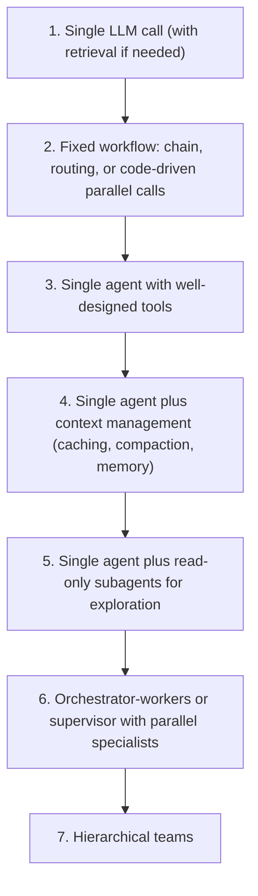
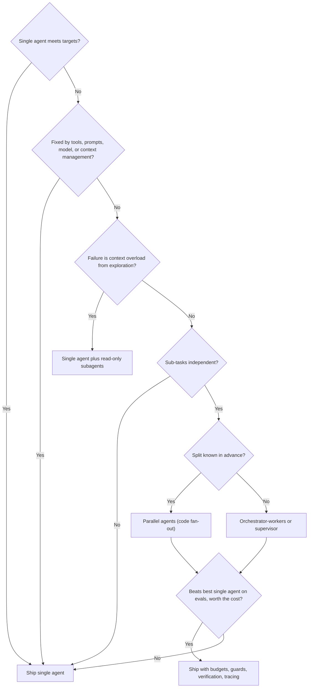

# Single Agent vs Multi-Agent

## Introduction

You have now seen the main multi-agent patterns: orchestrator-workers, supervisors, handoffs, parallel agents, hierarchies, and debate. They're powerful, and they're expensive. This final page answers the question that matters most in practice: **for this task, should you build one agent or several?**

The short answer: **start with a single agent, and move to multiple agents only when you can name the specific limit the single agent is hitting, and show that more agents fix it.**

An analogy: a small startup doesn't create departments on day one. One capable person handles sales, support, and billing until the work becomes too broad for one head, or too slow because it's sequential. Then the startup hires, and immediately pays for meetings, hand-offs, and miscommunication. Agent systems follow the same economics. Agents don't get tired, but they do run out of context, and they do miscommunicate.

## What the Evidence Says

The public evidence points in two directions, and both are useful.

**For multi-agent, on the right task:**

- Anthropic's multi-agent Research system (Opus lead, Sonnet subagents) outperformed a single Opus agent by **90.2%** on their internal research evaluation. Breadth-first queries that can be split into many independent directions benefited most. ([Source](https://www.anthropic.com/engineering/multi-agent-research-system))
- In the same analysis, on the BrowseComp browsing benchmark, **token usage alone explained 80% of the performance variance**, and token usage, number of tool calls, and model choice together explained 95%. In other words, a large part of the benefit comes from multi-agent systems letting you **spend more tokens in parallel, in separate context windows**.

**Against multi-agent, by default:**

- The same Anthropic post reports that multi-agent systems used about **15 times** the tokens of chat, and says the pattern is a poor fit for tasks where agents must share the same context or have many dependencies between them, which includes most coding tasks.
- Cognition's ["Don't Build Multi-Agents"](https://cognition.com/blog/dont-build-multi-agents) argues that parallel agents make conflicting implicit decisions, and recommends a single-threaded agent with good context management as the default.
- The [MAST study](https://arxiv.org/abs/2503.13657) found that many open-source multi-agent systems showed only minimal gains over single-agent baselines on popular benchmarks, and catalogued 14 ways they fail.
- Research on multi-agent debate ([Smit et al., ICML 2024](https://arxiv.org/abs/2311.17371)) found it did not reliably beat simpler single-model strategies such as self-consistency.

These views are less contradictory than they sound. Everyone agrees on the conditions: multi-agent designs help when work is **broad, parallelizable, read-heavy, and valuable**, and hurt when work is **coupled, write-heavy, and needs shared context**.

In one sentence: **multi-agent systems are a way to spend more tokens, in parallel, in separate context windows.** When the extra tokens buy coverage the task needs, they pay off. When the task needs one consistent line of reasoning, they mostly buy coordination problems.

## Comparing the Two Designs

| Dimension | Single agent | Multi-agent |
| --- | --- | --- |
| **Token count** | Usually lowest for the same work, especially with prompt caching | Usually several times higher in practice (overlapping exploration, repeated prompts, briefs and reports) |
| **Cost per token** | One model's price | Can be lower overall with cheap workers |
| **Latency** | Sequential steps | Lower for parallel work; higher for hierarchies and relays |
| **Context** | One window fills up over time | Each agent has a fresh window; the lead stays small |
| **Consistency** | One mind, one set of decisions | Risk of conflicting implicit decisions |
| **Information flow** | Nothing lost between agents | Hand-offs and summaries lose details |
| **Debugging** | One transcript | A tree of transcripts; needs tracing |
| **Prompts** | One large prompt | Several small, focused prompts |
| **Permissions** | One tool set for everything | Per-agent least privilege |
| **Testing** | One unit to evaluate | Each agent plus the whole system |

## Estimating the Cost Difference

Before building, estimate. The function below compares a single agent that reads everything itself with an orchestrator plus workers. The numbers are assumptions you should replace with measurements from your own traces.

```python
# Prices per million tokens at the time of writing (October 2026). They change:
# keep them in config and check the official pricing page.
PRICES = {
    "claude-opus-5-5": (4.00, 20.00),
    "claude-sonnet-5-5": (2.00, 10.00),
    "claude-haiku-5-5": (0.10, 0.50),
}


def cost(model: str, input_tokens: int, output_tokens: int) -> float:
    price_in, price_out = PRICES[model]
    return (input_tokens * price_in + output_tokens * price_out) / 1_000_000


def single_agent_cost(turns: int, tokens_read_per_turn: int, output_per_turn: int,
                      model: str = "claude-opus-5-5") -> float:
    # Each turn re-sends the growing conversation, so input grows with every turn.
    total_input = sum(t * tokens_read_per_turn for t in range(1, turns + 1))
    return cost(model, total_input, turns * output_per_turn)


def multi_agent_cost(workers: int, worker_turns: int, tokens_read_per_turn: int,
                     report_tokens: int, worker_model: str,
                     lead_model: str = "claude-opus-5-5", lead_overhead: int = 8_000) -> float:
    per_worker_input = sum(t * tokens_read_per_turn for t in range(1, worker_turns + 1))
    worker_total = workers * cost(worker_model, per_worker_input, worker_turns * 500)
    lead_input = lead_overhead + workers * report_tokens * 2  # read reports in review and synthesis
    lead_total = cost(lead_model, lead_input, 4_000)
    return worker_total + lead_total


if __name__ == "__main__":
    single = single_agent_cost(turns=30, tokens_read_per_turn=4_000, output_per_turn=400)
    multi_haiku = multi_agent_cost(5, 6, 4_000, 1_500, "claude-haiku-5-5")
    multi_sonnet = multi_agent_cost(5, 6, 4_000, 1_500, "claude-sonnet-5-5")
    multi_opus = multi_agent_cost(5, 6, 4_000, 1_500, "claude-opus-5-5")
    print(f"Single Opus agent, 30 turns:        ${single:.2f}")
    print(f"Opus lead + 5 Haiku workers:        ${multi_haiku:.2f}")
    print(f"Opus lead + 5 Sonnet workers:       ${multi_sonnet:.2f}")
    print(f"Opus lead + 5 Opus workers:         ${multi_opus:.2f}")
```

Output:

```text
Single Opus agent, 30 turns:        $7.68
Opus lead + 5 Haiku workers:        $0.22
Opus lead + 5 Sonnet workers:       $1.16
Opus lead + 5 Opus workers:         $2.15
```

Both designs read the same 120,000 tokens of new material (30 turns of 4,000 tokens, or 5 workers times 6 turns of 4,000 tokens). Even so, the results differ a lot, and three effects explain why:

1. **Long single-agent sessions re-read their history.** Each turn re-sends the whole conversation, so the single agent's input grows roughly with the square of the number of turns. Five short worker contexts avoid most of that re-reading. This is the economic side of context isolation. But context management narrows the gap a lot: [prompt caching](../4-agents-memory-and-context/4-agents-prompt-caching.mdx) bills repeated prefixes at a fraction of the normal input price, and compaction or context editing shrinks the history. Model those before you decide (exercise 4 below).
2. **Model tiering dominates the multi-agent bill.** Haiku workers cost about a tenth of Opus workers in this example. The architecture alone saves some money. Tiering saves much more.
3. **The model is optimistic about multi-agent reading.** It assumes the workers read exactly what the single agent would. Real multi-agent systems usually read **more**, through overlapping searches, broader exploration (because they can afford it), and repeated system prompts and briefs. That is where the "about 15 times chat" figure comes from, and why your measured multi-agent cost will be higher than this estimate.

Treat this as a back-of-the-envelope tool. Real runs vary widely, and the only numbers you should trust are ones measured from your own traces with your own evaluation set.

## The Escalation Ladder

Instead of a binary choice, think of a ladder. Climb one rung at a time, and only when the current rung has a measured problem the next rung fixes.



| Rung | Move up when... | Typical evidence |
| --- | --- | --- |
| 1 to 2 | One call can't do the whole job reliably | Quality improves when you split steps |
| 2 to 3 | The steps depend on the input in ways you can't hard-code | Too many branches to write by hand |
| 3 to 4 | Long sessions slow down or lose focus | Context near the limit; quality drops late in runs |
| 4 to 5 | Exploration floods the context | Most context tokens are search results and file contents |
| 5 to 6 | Independent sub-tasks take too long in sequence, or need different tools and permissions | Latency targets missed; the prompt covers too many domains |
| 6 to 7 | One coordinator can't manage the number of specialists | Routing mistakes grow with the size of the tool list |

Most production agents live on rungs 3 to 5. Rung 5 (subagents for read-only exploration) gets much of the context benefit of multi-agent design with little of the coordination risk.

## Running a Fair Comparison

Architecture debates are settled by experiments, but only fair ones. When you compare a single agent with a multi-agent design, hold everything else constant:

1. **Same evaluation set**, drawn from real requests, including the hard and broad ones. See [Building Evaluation Datasets](../11-agents-evaluation-and-testing/1-agents-building-eval-sets.mdx).
2. **Same tools and data access.** If the workers can search the web, so can the single agent.
3. **A tuned single agent.** Give it a good prompt, context management, and the best model you would actually use. Comparing a tuned multi-agent system with a naive single agent proves nothing.
4. **Same grading.** Use the same rubric or judge for both, blind to which system produced the answer. See [Grading Methods](../11-agents-evaluation-and-testing/2-agents-grading-methods.mdx).
5. **Several runs.** LLM outputs vary, so run each question more than once and compare averages and spread.
6. **Record cost and latency per question**, not just accuracy, and look at the distribution: multi-agent systems often have long tails.

Fill in a table like this for your own system:

| Metric | Single agent | Multi-agent | Notes |
| --- | --- | --- | --- |
| Accuracy on the eval set | | | |
| Accuracy on broad questions only | | | Where multi-agent should win |
| Median and 95th-percentile latency | | | |
| Median and 95th-percentile cost per question | | | |
| Failure rate (crashes, timeouts, budget stops) | | | |
| Engineering time to build and maintain | | | Often forgotten |

Re-run the comparison when you change models. As models get better at long contexts and at long, focused work, some multi-agent workarounds stop paying off, and the reverse can happen as cheaper models get more capable.

## Signals to Watch For

Traces tell you which way to move. These signals are worth checking for in your own runs:

| Signal in your traces | What it suggests |
| --- | --- |
| Most of the context is raw search results or file contents | Add read-only subagents or context editing |
| Quality drops late in long runs | Context management first, subagents second |
| Users wait on independent lookups that run one after another | Parallel agents or parallel tool calls |
| One prompt covers several unrelated domains with different tools | Specialists (supervisor or handoffs) |
| Workers return overlapping findings | Tighter briefs, a task board, or fewer workers |
| Pieces of the output don't fit together | Coupled work was split; merge it back into one agent |
| The lead re-delegates the same question | Reports are too thin; fix the report format |
| Multi-agent and single-agent score the same on evals | Remove agents |

## Hybrid: Pay for Multi-Agent Only When Needed

Many workloads are mixed. Most questions are simple, and a few are broad. Instead of choosing one architecture for everything, put a cheap router in front. This mirrors the effort-scaling rules Anthropic described for their lead agent (one agent for simple fact-finding, several for broad research), but enforces them in code.

```python
from typing import Literal

from anthropic import Anthropic
from pydantic import BaseModel

client = Anthropic()


class Triage(BaseModel):
    shape: Literal["simple", "deep", "broad"]
    reason: str


ROUTER_SYSTEM = """Classify the user's request by the work it needs:
- simple: one lookup or a short answer from known sources
- deep: one line of investigation that builds step by step (keep in one agent)
- broad: several independent topics or sources that can be researched separately"""


def route(question: str) -> Triage:
    response = client.messages.parse(
        model="claude-haiku-5-5",  # routing is a cheap classification
        max_tokens=1000,
        system=ROUTER_SYSTEM,
        messages=[{"role": "user", "content": question}],
        output_format=Triage,
    )
    return response.parsed_output


def answer(question: str) -> str:
    triage = route(question)
    if triage.shape == "broad":
        return run_orchestrator_workers(question)   # from the orchestrator-workers page
    return run_single_agent(question)               # simple and deep both stay single-agent


def run_orchestrator_workers(question: str) -> str:
    raise NotImplementedError("See the Orchestrator-Workers Pattern page")


def run_single_agent(question: str) -> str:
    raise NotImplementedError("See Building a Manual Agent Loop")
```

Notice that "deep" questions go to the **single** agent. Depth means each step depends on the last, which is exactly the coupled work multi-agent designs handle badly. Measure the router's accuracy too. A misrouted broad question gets a shallow answer, and a misrouted simple question costs several times more than necessary.

## Real-World Scenario

**Your company wants an AI assistant for the finance team** that answers questions such as "Why did gross margin drop in Q3, and which product lines drove it?" The data lives in a warehouse, plus quarterly board decks and a wiki of accounting policies. Two engineers propose different designs: a single agent with SQL, document search, and wiki tools, or a supervisor with SQL, documents, and policy specialists.

**How to decide, step by step:**

1. **Build the single agent first** (`claude-opus-5-5` with three tools). Build an evaluation set of 40 real questions with answers checked by an analyst. See [Building Evaluation Datasets](../11-agents-evaluation-and-testing/1-agents-building-eval-sets.mdx).
2. **Measure and diagnose.** Suppose it scores 80%. Reading the failed traces shows two causes: on broad questions the context fills with SQL results and board-deck text (long runs, drifting focus), and a few answers misapply an accounting policy.
3. **Climb one rung.** Add context editing for old query results, and a read-only document subagent (`claude-haiku-5-5`) that searches the board decks and returns short, quoted summaries. Re-run the evaluation. Suppose accuracy rises to 88% and cost per question falls.
4. **Test the bigger design honestly.** Build the supervisor version and run the same evaluation. If it scores about the same while costing more and being harder to debug, keep the simpler design. If it clearly wins on the broad multi-domain questions, consider routing only those questions to the supervisor.

**Why this approach fits:** each change is tied to a diagnosed failure and checked against the same evaluation set. The team doesn't have to win an argument about architecture. The data decides.

**When the answer is multi-agent:** if the finance team later wants a monthly "variance report" covering 30 cost centers, the work becomes broad, parallel, and read-heavy. That's a natural orchestrator-workers job, with one worker per group of cost centers.

### Alternatives and trade-offs

| Approach | Pros | Cons | Best for |
| --- | --- | --- | --- |
| Single agent | Cheapest; one context; easiest to debug | Context pressure; sequential | Most tasks, especially coupled ones |
| Single agent plus subagents for exploration | Clean context; little coordination risk | Brief-writing overhead | Large codebases and document sets |
| Orchestrator-workers or supervisor | Parallel breadth; per-agent models and permissions | Token multiplier; coordination failures | Broad, valuable, separable work |
| Hybrid routing (cheap path for simple questions, multi-agent for broad ones) | Pays the multiplier only when needed | Two systems to maintain; router can misroute | Mixed workloads |

## Common Mistakes

1. **Choosing by architecture diagram.** A multi-agent diagram looks impressive in a design review. The evaluation set decides, not the diagram.
2. **Comparing against a weak single agent.** Give the single agent the same tools, a good prompt, and context management before comparing. Otherwise you are measuring prompt quality, not architecture.
3. **Ignoring the cost of coordination code.** Multi-agent systems need budgets, tracing, partial-failure handling, and more tests. Count that engineering time.
4. **Splitting coupled work.** If agents need each other's decisions, they'll conflict. Keep coupled work in one context.
5. **Never revisiting the decision.** Models improve. A multi-agent workaround for a small context window or a weak model may become unnecessary. Re-run the comparison when you [migrate models](../13-agents-production/8-agents-model-migration.mdx).
6. **Going all-in at once.** Jumping from one agent straight to a five-agent hierarchy makes it impossible to tell which change helped. Climb one rung at a time and re-run the evaluation after each step.
7. **Forgetting the user's wait.** A multi-agent answer that is 5% better but takes three minutes instead of thirty seconds may be worse for an interactive product. Put latency targets into the decision, not just accuracy.

## The Decision Framework

Work through these questions in order. Stop at the first one that gives a clear answer.

**1. Does a single agent already meet your quality, latency, and cost targets on a real evaluation set?**
Yes: **ship the single agent.** You're done. No: continue, and write down *why* it fails, using its traces.

**2. Can a cheaper single-agent fix address the failure?**
Check better tools, better prompts, a stronger model or higher effort, retrieval, prompt caching, compaction, or context editing. If one of these fixes it: **stay single-agent.**

**3. Is the failure caused by context overload from exploration (searching, reading, summarizing)?**
Yes: **add read-only subagents** for exploration, and keep decisions and edits in the main agent. See [Subagents and Context Isolation](./8-agents-subagents-and-context-isolation.mdx).

**4. Does the task split into sub-tasks that are independent, so no sub-task needs another's intermediate results or decisions?**
No: **stay single-agent** (with subagents for exploration at most). Coupled work split across agents produces conflicting decisions.
Yes: continue.

**5. Is the split known in advance?**
Yes: use **[parallel agents](./4-agents-parallel-agents.mdx)** with a fixed fan-out in code.
No, it depends on the input: use **[orchestrator-workers](./1-agents-orchestrator-workers.mdx)**, or a **[supervisor](./2-agents-supervisor-pattern.mdx)** if each step depends on the last result.

**6. Should a specialist talk to the user directly, one topic at a time?**
Yes: use **[handoffs](./3-agents-handoffs.mdx)**.

**7. Is the task valuable enough to pay several times the tokens?**
Estimate cost per task with tiered models (strong lead, cheaper workers) and compare it with the value of a better answer. If it doesn't pay off: **go back to the single agent** or reduce scope.

**8. Does the multi-agent version clearly beat the best single-agent version on the same evaluation set?**
Yes: **ship it**, with a global budget, loop guards, verification, and tracing ([Multi-Agent Failure Modes](./9-agents-multi-agent-failure-modes.mdx)).
No: **ship the single agent.**



:::tip Write the decision down
Record the answers to these questions, the evaluation results, and the cost estimate in a short architecture decision record. When models, prices, or requirements change, you can re-run the same questions instead of re-arguing the design from scratch.
:::

### Quick reference

| If your task is... | Choose |
| --- | --- |
| A single question with known sources | One LLM call, or a single agent with retrieval |
| Coupled, write-heavy work (most coding, editing one document) | Single agent with context management |
| Single-agent work drowning in search output | Single agent plus read-only subagents |
| Known, independent aspects (security, performance, style) | Parallel agents |
| Broad research whose shape depends on the question | Orchestrator-workers with a strong lead and cheaper workers |
| Investigations where each step depends on the last | Supervisor with specialists as tools |
| Conversations that move between specialist domains | Handoffs |
| Many specialists in distinct domains | Hierarchical teams, only after a flat design fails |
| High-stakes judgment with a checkable answer | Self-consistency voting with human escalation; debate only if it wins on your evals |

## Summary

- **Default to a single agent.** Move to multi-agent only for a diagnosed limit that more agents fix.
- Multi-agent designs win on **broad, parallelizable, read-heavy, valuable** tasks, and lose on **coupled, write-heavy** tasks that need shared context.
- Expect **several times the tokens**. Model tiering (strong lead, cheap workers) is what makes the economics work.
- Climb the **escalation ladder** one rung at a time. Read-only subagents give much of the benefit at little risk.
- Decide with **your own evaluation set**, comparing against the **best** single-agent version.
- If you ship multi-agent, ship it with **budgets, loop guards, verification, and tracing**.

## Exercises

1. Pick a task from your work and walk it through the eight decision questions. Write one sentence of justification for each answer.
2. Replace the assumptions in the cost estimator with numbers from a real trace (turns, tokens per turn, report size). How many workers can you afford before the multi-agent design costs more than the single agent?
3. Build both a single agent and an orchestrator-workers version for a research task, run them on 20 questions, and fill in the comparison table on this page with your own measurements.
4. Add prompt caching to the single-agent cost estimate (assume 80% of input tokens are cache reads at about a tenth of the input price). Does the conclusion change?

5. Implement the hybrid router above with real `run_single_agent` and `run_orchestrator_workers` functions. Label 30 questions as simple, deep, or broad yourself, and measure how often the router agrees with you.

**Related pages:** [When Should You Build an Agent?](../0-agents-fundamentals/7-agents-when-to-build.mdx), [Agents vs Workflows](../0-agents-fundamentals/3-agents-vs-workflows.mdx), [Choosing an Agent Framework](../9-agents-frameworks/10-agents-choosing-a-framework.mdx), [Cost Optimization](../13-agents-production/4-agents-cost-optimization.mdx).
