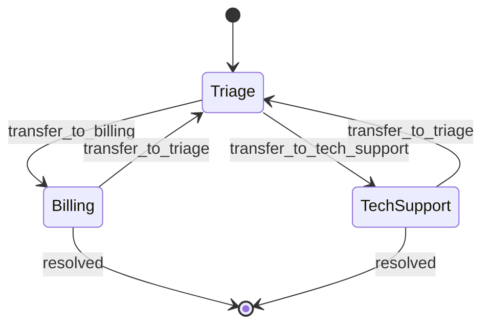

# Agent Handoffs

## Introduction

A **handoff** transfers control of a conversation from one agent to another. After the handoff, the new agent talks to the user directly, with its own instructions and tools, until it finishes or hands off again.

Calling a company's support line is the classic analogy. The receptionist asks what you need and transfers you to billing. The billing specialist now owns the call: they can see your account and issue refunds, which the receptionist cannot. If you suddenly ask about a technical problem, billing transfers you to tech support. Nobody in the middle relays messages back and forth. Each specialist speaks to you directly.

Compare that with the [supervisor pattern](./2-agents-supervisor-pattern.mdx), where the supervisor stays in charge and specialists report back to it:

| | Agents as tools (supervisor) | Handoffs |
| --- | --- | --- |
| Who talks to the user | Always the supervisor | Whichever agent is currently active |
| After the specialist finishes | Control returns to the supervisor | The specialist keeps control (or hands off) |
| What the specialist sees | Only the task the supervisor writes | Usually the conversation history |
| Combining several specialists' work | Easy: the supervisor synthesizes | Awkward: no central place to merge |
| Extra LLM calls per user turn | Supervisor call plus specialist calls | One call per active agent, plus the routing decision |
| Typical use | Research, analysis, multi-part tasks | Customer support, conversational routing, multi-step forms |

The OpenAI Agents SDK docs summarize the choice well: use agents-as-tools when one agent should own the final answer or combine outputs from several specialists, and use handoffs when the specialist should respond directly. You can also mix them. A specialist that received a handoff can still call other agents as tools.

## How Handoffs Work

Under the hood, a handoff is just a tool call that your code interprets as "switch the active agent". Each agent gets one tool per allowed destination, conventionally named `transfer_to_<agent_name>`. When the model calls it, your loop changes which system prompt, tools, and model it uses for the next request.



Three design questions come up with every handoff system:

1. **Who can hand off to whom?** A graph of allowed transfers. Fewer edges mean fewer routing mistakes.
2. **What history does the new agent see?** Everything, a filtered version, or a summary.
3. **What stops endless transfers?** Agents can bounce a user back and forth, so you need a guard.

## Building Handoffs in Plain Python

### Step 1: Agent definitions

```python
from dataclasses import dataclass, field
from typing import Callable

from anthropic import Anthropic

client = Anthropic()


@dataclass
class Agent:
    name: str
    model: str
    instructions: str
    handoff_description: str                 # tells OTHER agents when to transfer here
    tools: list = field(default_factory=list)
    handlers: dict[str, Callable[..., str]] = field(default_factory=dict)
    handoffs: list[str] = field(default_factory=list)  # names of agents it may transfer to


def lookup_invoice(customer_id: str) -> str:
    return f"Customer {customer_id}: last invoice INV-881, $120.00, charged twice on Oct 2."


def issue_refund(invoice_id: str, amount: float) -> str:
    # In production: require human approval above a threshold.
    return f"Refund of ${amount:.2f} for {invoice_id} submitted."


def check_status_page(service: str) -> str:
    return f"{service}: degraded performance since 09:40 UTC, fix in progress."


AGENTS = {
    "triage": Agent(
        name="triage",
        model="claude-haiku-5-5",  # routing is a light classification task
        instructions="You greet customers and route them. Ask at most one clarifying "
                     "question, then transfer to the right specialist. Do not solve problems yourself.",
        handoff_description="General questions or anything that doesn't fit a specialist.",
        handoffs=["billing", "tech_support"],
    ),
    "billing": Agent(
        name="billing",
        model="claude-sonnet-5-5",
        instructions="You handle invoices, charges and refunds. Verify the invoice before refunding.",
        handoff_description="Invoices, double charges, refunds, plan changes.",
        tools=[
            {"name": "lookup_invoice", "description": "Get the latest invoice for a customer.",
             "input_schema": {"type": "object", "properties": {"customer_id": {"type": "string"}},
                              "required": ["customer_id"], "additionalProperties": False}},
            {"name": "issue_refund", "description": "Refund an amount on an invoice.",
             "input_schema": {"type": "object",
                              "properties": {"invoice_id": {"type": "string"}, "amount": {"type": "number"}},
                              "required": ["invoice_id", "amount"], "additionalProperties": False}},
        ],
        handlers={"lookup_invoice": lookup_invoice, "issue_refund": issue_refund},
        handoffs=["triage"],
    ),
    "tech_support": Agent(
        name="tech_support",
        model="claude-sonnet-5-5",
        instructions="You troubleshoot outages and errors. Check the status page first.",
        handoff_description="Errors, outages, slow performance, login problems.",
        tools=[
            {"name": "check_status_page", "description": "Get current status of a service.",
             "input_schema": {"type": "object", "properties": {"service": {"type": "string"}},
                              "required": ["service"], "additionalProperties": False}},
        ],
        handlers={"check_status_page": check_status_page},
        handoffs=["triage"],
    ),
}
```

Each agent declares **where it may go** (`handoffs`) and **when others should send users to it** (`handoff_description`). Billing and tech support can only go back to triage. That keeps the routing graph small and makes "billing sent the user to tech support, who sent them to billing" impossible without passing through triage.

Model choice follows the work: triage is a lightweight routing decision, so a fast model like `claude-haiku-5-5` is enough, while specialists that take actions get `claude-sonnet-5-5`. Check this choice with your evaluations. If triage misroutes often, a stronger model there might save more than it costs.

### Step 2: Generate handoff tools

```python
def handoff_tools(agent: Agent) -> list[dict]:
    tools = []
    for target_name in agent.handoffs:
        target = AGENTS[target_name]
        tools.append({
            "name": f"transfer_to_{target_name}",
            "description": f"Transfer the customer to the {target_name} agent. "
                           f"Use for: {target.handoff_description}",
            "input_schema": {
                "type": "object",
                "properties": {
                    "reason": {"type": "string", "description": "Why you are transferring"},
                    "summary": {"type": "string",
                                "description": "What the customer needs and facts gathered so far"},
                },
                "required": ["reason", "summary"],
                "additionalProperties": False,
            },
        })
    return tools
```

The `summary` argument is a **handoff note**. Even when the next agent sees the full conversation, a short note ("customer 4471 was double-charged on Oct 2, wants a refund") helps it start in the right place.

### Step 3: The handoff loop

The loop keeps two kinds of history:

- `conversation`: the user-visible turns (user messages and agents' final replies), shared by all agents.
- `scratch`: the active agent's tool calls during the current turn, private to that agent.

When a handoff happens, the new agent receives the shared conversation plus the handoff note, but **not** the previous agent's tool calls. This is a deliberate **history filter**. The new agent doesn't have the old agent's tools, so showing it those tool calls would only confuse it.

```python
def text_of(response) -> str:
    return "".join(b.text for b in response.content if b.type == "text")


class HandoffSession:
    def __init__(self, start: str = "triage", max_handoffs_per_turn: int = 3):
        self.active = start
        self.conversation: list[dict] = []
        self.handoff_note = ""
        self.max_handoffs = max_handoffs_per_turn

    def send(self, user_text: str) -> str:
        self.conversation.append({"role": "user", "content": user_text})
        scratch: list[dict] = []
        handoffs_this_turn = []

        for _ in range(12):  # hard cap on LLM calls per user turn
            agent = AGENTS[self.active]
            system = agent.instructions
            if self.handoff_note:
                system += f"\n\nHandoff note from the previous agent: {self.handoff_note}"
            tools = agent.tools + handoff_tools(agent)

            response = client.messages.create(
                model=agent.model, max_tokens=2000, system=system,
                tools=tools, messages=self.conversation + scratch,
            )
            if response.stop_reason != "tool_use":
                reply = text_of(response)
                self.conversation.append({"role": "assistant", "content": reply})
                return f"[{agent.name}] {reply}"

            transfer = next((b for b in response.content
                             if b.type == "tool_use" and b.name.startswith("transfer_to_")), None)
            if transfer:
                target = transfer.name.removeprefix("transfer_to_")
                handoffs_this_turn.append(target)
                if len(handoffs_this_turn) > self.max_handoffs or handoffs_this_turn.count(target) > 1:
                    msg = "Sorry, I'm having trouble routing your request. A human agent will follow up."
                    self.conversation.append({"role": "assistant", "content": msg})
                    return f"[system] {msg}"
                print(f"  (handoff {agent.name} -> {target}: {transfer.input['reason']})")
                self.active = target
                self.handoff_note = transfer.input["summary"]
                scratch = []  # history filter: drop the old agent's tool calls
                continue

            scratch.append({"role": "assistant", "content": response.content})
            results = []
            for b in response.content:
                if b.type == "tool_use":
                    output = agent.handlers[b.name](**b.input)
                    results.append({"type": "tool_result", "tool_use_id": b.id, "content": output})
            scratch.append({"role": "user", "content": results})

        return "[system] Turn limit reached."
```

Some details to notice:

- **The model sees a clean history.** Every request contains only user turns, final assistant replies, and the current agent's own tool calls. The transcript never ends with an assistant message, which current Claude models reject as prefill.
- **The loop guard is code, not prompt.** If one user turn produces more than three handoffs, or visits the same agent twice, we stop and escalate to a human. Ping-pong routing is one of the most common handoff bugs.
- **Handoffs stay inside one user turn.** After the transfer, the new agent answers right away. The user doesn't have to repeat themselves.

### Step 4: Try it

```python
if __name__ == "__main__":
    session = HandoffSession()
    print(session.send("Hi, I think I was charged twice this month. Customer id 4471."))
    print(session.send("Yes please refund the duplicate."))
    print(session.send("Also, your dashboard is super slow right now."))
```

Example output:

```text
  (handoff triage -> billing: Customer reports a duplicate charge)
[billing] I found invoice INV-881 for $120.00, and it was charged twice on Oct 2.
Would you like me to refund the duplicate $120.00 charge?
[billing] Done. A refund of $120.00 for INV-881 has been submitted and should appear in 5-10 business days.
  (handoff billing -> triage: Customer has a new, technical issue)
  (handoff triage -> tech_support: Dashboard performance problem)
[tech_support] Thanks for flagging this. Our status page shows degraded dashboard
performance since 09:40 UTC, and a fix is in progress.
```

The last turn shows a cost of strict routing graphs: billing had to go back through triage to reach tech support, which is one extra LLM call. Allowing a direct `billing -> tech_support` edge would save that call but make the graph harder to reason about. That's a typical handoff trade-off.

## Choosing What History to Pass

The history filter is the most important design decision in a handoff system.

| Strategy | What the new agent sees | Pros | Cons |
| --- | --- | --- | --- |
| Full history | Everything, including old tool calls | Nothing is lost | Large contexts; foreign tool calls confuse the new agent; leaks data across agents |
| Visible turns only (our default) | User messages and final replies | Clean and small | Loses evidence that only appeared in tool results |
| Visible turns plus handoff note | The above, plus a model-written summary | Good balance | The note can omit or distort facts |
| Summary only | A fresh conversation seeded with a summary | Smallest context | Highest risk of losing details |

Two practical rules:

1. **Make important facts visible.** If billing needs the order number that triage found with a tool, either triage says it to the user ("I see order 1182...") or it goes in the handoff note.
2. **Think about privacy.** If tech support should not see payment details, don't pass billing's tool results to it. History filtering is also a data-access control. See [Data Privacy and PII](../12-agents-safety-and-security/5-agents-data-privacy.mdx).

## How Frameworks Express Handoffs

**OpenAI Agents SDK.** Handoffs are a first-class concept. You pass agents (or `handoff(...)` objects) to `handoffs=[...]`, and the SDK exposes them to the model as `transfer_to_<agent_name>` tools. By default the receiving agent sees the full conversation. An `input_filter` changes that, and `agents.extensions.handoff_filters` includes a `remove_all_tools` helper. The SDK also ships a `RECOMMENDED_PROMPT_PREFIX` that explains handoffs to the model.

```python
from agents import Agent, Runner, handoff
from agents.extensions import handoff_filters
from agents.extensions.handoff_prompt import RECOMMENDED_PROMPT_PREFIX

billing_agent = Agent(
    name="Billing agent",
    instructions=f"{RECOMMENDED_PROMPT_PREFIX}\nYou handle invoices and refunds.",
    handoff_description="Invoices, double charges, refunds.",
)
tech_agent = Agent(
    name="Tech support agent",
    instructions=f"{RECOMMENDED_PROMPT_PREFIX}\nYou troubleshoot outages and errors.",
    handoff_description="Errors, outages, slow performance.",
)
triage_agent = Agent(
    name="Triage agent",
    instructions=f"{RECOMMENDED_PROMPT_PREFIX}\nRoute the customer to the right specialist.",
    handoffs=[
        billing_agent,
        handoff(tech_agent, input_filter=handoff_filters.remove_all_tools),
    ],
)

result = Runner.run_sync(triage_agent, "I was charged twice this month.")
print(result.final_output)
print(result.last_agent.name)  # which agent ended up answering
```

Note two SDK caveats from its docs: handoffs happen within a single run, and input guardrails apply only to the first agent in the chain while output guardrails apply only to the agent that produces the final output.

**LangGraph.** A node returns `Command(goto="billing", update={...})` to move control to another node and update shared state at the same time. LangChain's docs describe a "handoffs" pattern where tool calls update a state variable that switches the active agent. Swarm-style designs, where agents hand off directly to each other, are built the same way.

**Claude Agent SDK and Claude Code** generally use the subagent (agents-as-tools) model rather than peer-to-peer handoffs: the main agent stays in control and subagents report back.

## Real-World Scenario

**Your company sells a project-management SaaS** and wants an in-app support assistant. Conversations often move between topics: a user asks about an invoice, then about an import error, then about upgrading their plan.

**Solution:** a handoff system with a cheap triage agent and three specialists: billing (can look up and refund invoices, with a human approval gate above $200), technical (can read logs and the status page), and sales (can quote plans, cannot change them). Each specialist answers the user directly in its own voice. The handoff note carries the account ID and the problem summary, and tool results stay private to the agent that produced them.

**Why this approach fits:**

- Support conversations are **sequential and conversational**. Only one topic is active at a time, so parallelism doesn't help.
- Each specialist needs **different tools and permissions**. A single agent with refund, log, and pricing tools would be a much bigger security and prompting problem.
- A **relay through a supervisor** would add latency to every message and risk the telephone game on detailed technical answers.

**When not to use it:** if one request needs information from several specialists at once ("Compare my usage to my plan limits and tell me whether the import failure is related to the billing hold"), handoffs struggle because nobody combines the pieces. A supervisor fits that better. And if you have only two or three topics with small tool sets, a single agent with all the tools and a well-structured prompt is simpler. LangChain's own comparison found that stateful patterns such as handoffs save model calls on repeated requests within the same topic, while subagent-style patterns do better on multi-domain requests.

### Alternatives and trade-offs

| Approach | Pros | Cons | Best for |
| --- | --- | --- | --- |
| Single agent, all tools | No routing errors; one context | Big prompt; broad permissions | Few topics, small tool sets |
| [Routing](../6-agents-planning-and-reasoning/2-agents-routing.mdx) (classifier picks an agent per message) | Cheap and predictable | Re-classifies every message; no mid-turn transfer | Stateless Q&A with clear categories |
| Handoffs | Specialists own the conversation; per-agent tools and privacy | Routing loops; context loss on transfer; no synthesis | Support desks, guided multi-step flows |
| [Supervisor](./2-agents-supervisor-pattern.mdx) | Central control; combines specialists | Extra relay call per step; telephone game | Multi-part questions needing synthesis |

## Common Mistakes

1. **Overlapping handoff descriptions.** If "billing" and "account management" both mention plan changes, routing becomes a coin flip. Make each description distinct and test routing with an evaluation set.
2. **Fully connected graphs.** Letting every agent transfer to every other agent invites ping-pong. Start with a hub (triage) and add direct edges only when data shows they're needed.
3. **No loop guard.** Detect repeated transfers in code and escalate to a human.
4. **Losing key facts.** Facts that lived only in tool results disappear after a filtered handoff. Use handoff notes, and test multi-turn conversations, not just single messages.
5. **Leaking data through history.** Passing the full history gives every specialist every previous tool result, including PII. Filter deliberately.
6. **Forgetting the user notices.** Abrupt changes of tone or repeated questions ("What's your customer ID?" again) feel broken. Give agents a consistent persona, and pass known facts in the note.

## Summary

- A handoff **transfers control**: the new agent talks to the user directly until it finishes or transfers again.
- Implement it as `transfer_to_<agent>` tools plus a loop that switches the active agent's prompt, tools, and model.
- The **history filter** decides what the next agent sees. Visible turns plus a handoff note is a good default.
- Guard against **ping-pong** with code-level limits and a human escalation path.
- Use handoffs for conversational, one-topic-at-a-time flows. Use agents-as-tools when one agent must combine several specialists' work.

## Exercises

1. Add a `sales` agent and a direct `billing -> sales` handoff. Write five test conversations and measure routing accuracy and number of LLM calls with and without the direct edge.
2. Change the history filter to pass **full** history (including tool calls). What errors or odd behavior do you see when the new agent lacks the old agent's tools?
3. Add a human approval gate to `issue_refund` for amounts over $100. See [Human Approval Gates](../12-agents-safety-and-security/7-agents-approval-gates.mdx).
4. Persist `HandoffSession` (active agent, conversation, note) between HTTP requests. See [Session Persistence](../4-agents-memory-and-context/10-agents-session-persistence.mdx).

**Related pages:** [Routing](../6-agents-planning-and-reasoning/2-agents-routing.mdx), [OpenAI Agents SDK](../9-agents-frameworks/3-agents-openai-agents-sdk.mdx), [Project: Customer Support Agent](../14-agents-projects/0-agents-project-customer-support.mdx).
