# Parallel Agents

## Introduction

**Parallel agents** run at the same time on parts of a task, and code combines their results. It's the simplest multi-agent pattern and often the most useful, because the coordination is done by ordinary code, not by another LLM.

Anthropic's [Building Effective Agents](https://www.anthropic.com/engineering/building-effective-agents) describes two flavors of parallelization:

- **Sectioning**: split a task into **independent sub-tasks** and run them in parallel. Example: one agent reviews a pull request for security, another for performance, another for test coverage.
- **Voting**: run the **same task several times** and combine the answers. Example: five independent classifiers decide whether a message violates policy, and you act on the majority.

Picture an exam board grading a stack of essays. With sectioning, each grader takes one criterion (grammar, argument, sources) for every essay. With voting, three graders each grade the whole essay independently, and a disagreement triggers a closer look.

The difference from the [orchestrator-workers pattern](./1-agents-orchestrator-workers.mdx) is that here **the split is decided in advance by your code**, not at runtime by an LLM. That makes parallel agents cheaper (no planning call), more predictable, and easier to test. Use them whenever you know the sub-tasks ahead of time.

## Latency vs Cost

Parallelism changes **latency**, not **cost**:

- Sequential latency is roughly the **sum** of all agents' times. Parallel latency is roughly the **slowest** agent's time plus aggregation.
- Total tokens are about the **same either way**, because every agent still reads its inputs and writes its outputs. In practice the total is often a bit higher, because each agent repeats a shared preamble (system prompt, tool definitions, the code under review).

```mermaid
gantt
    title Three 20-second reviewers
    dateFormat ss
    axisFormat %S s
    section Sequential
    Security    :a1, 00, 20s
    Performance :a2, after a1, 20s
    Tests       :a3, after a2, 20s
    section Parallel
    Security    :b1, 00, 20s
    Performance :b2, 00, 20s
    Tests       :b3, 00, 20s
```



So the question to ask is not "is parallel cheaper?" (it isn't), but "**is the faster answer, or the extra perspective, worth the tokens?**" For user-facing features where people wait, often yes. For nightly jobs, a sequential run or the discounted [Message Batches API](https://platform.claude.com/docs/en/build-with-claude/batch-processing) may be better.

## asyncio Basics for Agents

The Anthropic SDK has an async client, `AsyncAnthropic`, whose methods you `await`. Combined with `asyncio.gather`, you can run many agents at once from a single thread, since agents spend almost all their time waiting on the network.

```python
import asyncio
import time

from anthropic import AsyncAnthropic

client = AsyncAnthropic()


async def ask(prompt: str, model: str = "claude-haiku-5-5") -> str:
    response = await client.messages.create(
        model=model,
        max_tokens=500,
        messages=[{"role": "user", "content": prompt}],
    )
    return "".join(b.text for b in response.content if b.type == "text")


async def main():
    prompts = [
        "Give one tip for writing readable Python.",
        "Give one tip for writing fast SQL.",
        "Give one tip for writing secure web forms.",
    ]
    start = time.perf_counter()
    answers = await asyncio.gather(*(ask(p) for p in prompts))
    print(f"{len(answers)} answers in {time.perf_counter() - start:.1f}s")
    for a in answers:
        print("-", a[:80])

asyncio.run(main())
```

Example output:

```text
3 answers in 2.3s
- Use descriptive names: a variable called `retry_count` explains itself; `rc` doesn't.
- Index the columns you filter and join on, and check the plan with EXPLAIN.
- Validate input on the server, never only in the browser.
```

`asyncio.gather` returns results **in the same order** as the inputs, regardless of which finished first. That makes it easy to pair results with their tasks.

## Sectioning: A Parallel Code Review

Let's build something realistic: three reviewer agents examine a diff at the same time, each with its own focus, and return structured findings that code can merge.

### The reviewers

```python
import asyncio
from typing import Literal

from anthropic import AsyncAnthropic
from pydantic import BaseModel

client = AsyncAnthropic()


class Finding(BaseModel):
    file: str
    line: int
    severity: Literal["low", "medium", "high"]
    issue: str
    suggestion: str


class Review(BaseModel):
    findings: list[Finding]


REVIEWERS = {
    "security": ("claude-sonnet-5-5",
                 "You review code ONLY for security problems: injection, authz, secrets, unsafe deserialization."),
    "performance": ("claude-haiku-5-5",
                    "You review code ONLY for performance problems: N+1 queries, needless loops, blocking I/O."),
    "tests": ("claude-haiku-5-5",
              "You review code ONLY for missing or weak tests of the changed behavior."),
}


async def run_reviewer(name: str, diff: str) -> list[Finding]:
    model, focus = REVIEWERS[name]
    response = await client.messages.parse(
        model=model,
        max_tokens=4000,
        system=focus + " Report only real issues in the diff. An empty list is a fine answer.",
        messages=[{"role": "user", "content": f"Review this diff:\n\n{diff}"}],
        output_format=Review,
    )
    return response.parsed_output.findings
```

Model choice follows risk. A missed security issue is expensive, so that reviewer gets `claude-sonnet-5-5`. Performance and test checks are more pattern-like, so `claude-haiku-5-5` is a reasonable first choice. Confirm both choices with an evaluation set of diffs with known issues.

### Fan-out with limits, timeouts, and partial failure

Real systems need three safeguards around `gather`:

1. **A concurrency limit**, so 50 parallel agents don't trip your API rate limits.
2. **A timeout per agent**, so one slow agent doesn't hold up the whole result.
3. **Per-agent error handling**, so one failure doesn't discard the others' work.

```python
import anthropic

LIMIT = asyncio.Semaphore(5)  # at most 5 requests in flight


async def guarded(name: str, diff: str, timeout: float = 120) -> tuple[str, list[Finding] | None, str]:
    async with LIMIT:
        try:
            findings = await asyncio.wait_for(run_reviewer(name, diff), timeout)
            return name, findings, "ok"
        except asyncio.TimeoutError:
            return name, None, "timeout"
        except anthropic.RateLimitError:
            return name, None, "rate_limited"  # the SDK already retried with backoff
        except anthropic.APIStatusError as exc:
            return name, None, f"api_error_{exc.status_code}"
        except anthropic.APIConnectionError:
            return name, None, "connection_error"


async def review_diff(diff: str) -> dict:
    results = await asyncio.gather(*(guarded(n, diff) for n in REVIEWERS))
    merged, failed = [], []
    for name, findings, status in results:
        if findings is None:
            failed.append(f"{name} ({status})")
            continue
        merged.extend((name, f) for f in findings)

    order = {"high": 0, "medium": 1, "low": 2}
    merged.sort(key=lambda pair: (order[pair[1].severity], pair[1].file, pair[1].line))
    return {"findings": merged, "failed": failed}
```

Each worker is wrapped so it **always returns** a status instead of raising. The alternative, `asyncio.gather(..., return_exceptions=True)`, also works, but you then have to check each result's type. Python 3.11's `asyncio.TaskGroup` is the opposite: it cancels all siblings when one fails, which is right when the results are useless without every part, and wrong for a review where two out of three reviewers is still valuable.

### Aggregation

```python
DIFF = '''
--- a/app/users.py
+++ b/app/users.py
@@ def find_user(name):
-    return db.execute("SELECT * FROM users WHERE name = ?", (name,))
+    return db.execute(f"SELECT * FROM users WHERE name = '{name}'")
+
+def all_orders(users):
+    return [db.execute("SELECT * FROM orders WHERE user_id = ?", (u.id,)) for u in users]
'''


async def main():
    report = await review_diff(DIFF)
    for reviewer, f in report["findings"]:
        print(f"[{f.severity.upper():6}] {reviewer:<11} {f.file}:{f.line}  {f.issue}")
    if report["failed"]:
        print("Incomplete review, failed reviewers:", ", ".join(report["failed"]))

asyncio.run(main())
```

Example output:

```text
[HIGH  ] security    app/users.py:3  SQL injection: user input interpolated into query string
[MEDIUM] performance app/users.py:6  N+1 queries: one SELECT per user inside a list comprehension
[MEDIUM] tests       app/users.py:3  No test covers names containing quotes or SQL metacharacters
```

Merging here is plain code: concatenate and sort. That's a strength of sectioning. When the outputs are structured, you often don't need another LLM to combine them. Add an LLM aggregator only when merging requires judgment, such as deduplicating findings that describe the same problem in different words, or writing a single narrative summary.

## Voting: Several Opinions on the Same Task

Voting runs the same task several times and combines the answers. It's useful when a single judgment is noisy and mistakes are costly, as in content moderation, risky classification, or "is this a real bug?" triage.

```python
from collections import Counter

PERSPECTIVES = [
    "You are a strict trust-and-safety reviewer.",
    "You are a reviewer who weighs context and intent carefully.",
    "You are a reviewer focused on legal and privacy risks.",
]


class Verdict(BaseModel):
    label: Literal["allow", "review", "block"]
    reason: str


async def vote_with_perspective(system: str, message: str) -> Verdict:
    response = await client.messages.parse(
        model="claude-haiku-5-5",
        max_tokens=1000,
        system=system + " Classify the user-submitted message for a community forum.",
        messages=[{"role": "user", "content": message}],
        output_format=Verdict,
    )
    return response.parsed_output


async def moderate(message: str) -> str:
    verdicts = await asyncio.gather(*(vote_with_perspective(p, message) for p in PERSPECTIVES))
    counts = Counter(v.label for v in verdicts)
    label, votes = counts.most_common(1)[0]
    if votes == len(verdicts):
        return label                    # unanimous: act automatically
    return "review"                     # any disagreement: send to a human
```

Three things to understand about voting:

- **Correlated errors.** Three calls to the same model with the same prompt tend to make the **same** mistake. Voting helps most when the voters differ: different prompts or perspectives (as above), different models, or different evidence. Some current models, including `claude-haiku-5-5`, reject non-default sampling parameters such as a custom `temperature`, so vary the prompt rather than the sampling settings.
- **Disagreement is a signal.** The most valuable output of voting is often "the voters disagree", which is a cheap, reliable trigger for human review.
- **Cost scales linearly.** Five voters cost five times as much. For many tasks, a single call with higher `effort` or a better model is cheaper and just as good. Measure before you multiply. [Debate and Consensus](./6-agents-debate-and-consensus.mdx) goes deeper into when voting and debate actually help.

## Practical Concerns

### Rate limits

Your API organization has limits on requests and tokens per minute. Twenty agents launched at once can hit those limits immediately. The SDK retries `429` and `5xx` errors with exponential backoff (twice by default), but sustained overload will still fail. Use a semaphore sized to your limits, and for large fan-outs consider a queue with workers. See [Scaling and Concurrency](../13-agents-production/2-agents-scaling.mdx). For high-concurrency async workloads, the SDK also offers an aiohttp-based HTTP backend (`pip install "anthropic[aiohttp]"`).

### Prompt caching across parallel agents

Parallel agents often share a long prefix, such as the same system prompt and diff. [Prompt caching](../4-agents-memory-and-context/4-agents-prompt-caching.mdx) can make the repeated prefix much cheaper, but only if the prefix is byte-for-byte identical and the cache entry exists when the other requests arrive. If you launch all agents at the same instant, they may all miss the cache. A common trick is to send the first request alone, then launch the rest once it returns. Put the shared content (the diff) first and the per-agent instructions after it, so the shared part is a true prefix.

### Ordering and determinism

Agents finish in unpredictable order, and LLM outputs vary between runs. Sort merged results by a stable key (severity, file, line), as above, so reports don't shuffle between runs. Snapshot tests of exact text will be flaky. Test structure and key facts instead. See [Unit Testing Agent Code](../11-agents-evaluation-and-testing/4-agents-unit-testing.mdx).

### Streaming partial results

For user-facing features, show results as they arrive instead of waiting for the slowest agent. Use `asyncio.as_completed` to process each agent's result when it finishes:

```python
async def stream_reviews(diff: str):
    tasks = [asyncio.create_task(guarded(n, diff)) for n in REVIEWERS]
    for next_done in asyncio.as_completed(tasks):
        name, findings, status = await next_done
        count = len(findings) if findings is not None else 0
        print(f"{name} finished ({status}) with {count} findings")
```

## How Frameworks Express Parallel Agents

- **OpenAI Agents SDK**: its multi-agent guide recommends plain `asyncio.gather` over several `Runner.run(...)` calls for independent agents.
- **LangGraph**: a node can return several `Send("reviewer", {...})` objects to fan out, and a reducer such as `Annotated[list, operator.add]` merges the outputs into graph state. Static parallel branches (edges from one node to several) also run concurrently.
- **Claude Agent SDK**: the main agent can launch several subagents at once (for example `style-checker`, `security-scanner`, and `test-coverage`), and they run concurrently. Spawning is decided by the model, so set concurrency and spend limits.
- **CrewAI**: tasks can be marked for asynchronous execution within a crew. Check the current CrewAI docs for the exact flags.

Frameworks save boilerplate, but the decisions on this page (concurrency limits, timeouts, partial failure, merge logic) are still yours.

## Real-World Scenario

**Your team maintains a large open-source library** and gets 40 pull requests a week. Maintainers want an automated first-pass review posted as a PR comment within two minutes of each push.

**Solution:** a CI job runs three reviewer agents in parallel (security on `claude-sonnet-5-5`, performance and tests on `claude-haiku-5-5`), each returning structured findings. Code merges and sorts the findings, drops low-severity ones if there are more than ten, and posts a single comment. If any reviewer fails, the comment says which checks didn't run. See [Agents in CI/CD Pipelines](../10-agents-integration/9-agents-in-ci-cd.mdx).

**Why this approach fits:** the review aspects are **known in advance** and **independent**, so no planner is needed. The two-minute target rules out sequential runs. Structured findings let code do the merging, so the result is deterministic in shape and cheap to aggregate.

**When not to use it:** if reviews must reason across aspects ("this performance fix introduces a security hole"), independent reviewers will miss the interaction. Add a final `claude-opus-5-5` pass that reads the diff and all findings, or use one strong reviewer instead. And for a tiny project with a few PRs a month, one reviewer agent with a checklist prompt is cheaper and good enough.

### Alternatives and trade-offs

| Approach | Pros | Cons | Best for |
| --- | --- | --- | --- |
| One agent with a checklist | Cheapest; sees interactions between aspects | Slower; long prompt; may skim some aspects | Small projects, short diffs |
| Parallel sectioning (this page) | Fast; focused prompts; per-aspect models | Misses cross-aspect issues; repeated prefix tokens | Known, independent aspects |
| Parallel voting | Catches noisy single judgments; disagreement flags uncertainty | Cost multiplies with voters; correlated errors | High-stakes classification |
| [Orchestrator-workers](./1-agents-orchestrator-workers.mdx) | Adapts the split to the input | Extra planning call; less predictable | Splits that depend on the input |
| Batch API | Discounted price; no rate-limit juggling | Results arrive later, not interactively | Offline, high-volume jobs |

## Common Mistakes

1. **Using `gather` without error handling.** One exception discards everything. Wrap each agent or use `return_exceptions=True`.
2. **No concurrency limit.** A loop that launches one agent per row of a 2,000-row file will hit rate limits immediately. Use a semaphore or a queue.
3. **Parallelizing dependent work.** If agent B needs agent A's output, running them together just means B guesses. Use a chain or a supervisor.
4. **Expecting voting to fix systematic errors.** Identical voters share blind spots. Diversify prompts or models, or don't vote.
5. **Parallel writes to shared resources.** Agents that edit the same file or record will overwrite each other. Keep parallel agents read-only, or see [Shared State Between Agents](./7-agents-shared-state.mdx).
6. **Forgetting the cost.** Parallel is faster, not cheaper. Track tokens per agent.

## Summary

- Parallel agents run **known, independent** sub-tasks concurrently, and **code** merges the results.
- **Sectioning** splits a task by aspect. **Voting** repeats a task for reliability.
- Parallelism reduces **latency** to roughly the slowest agent, while **cost** stays roughly the sum of all agents.
- Use `AsyncAnthropic` with `asyncio.gather`, a **semaphore**, **timeouts**, and **per-agent error handling**.
- Prefer structured outputs so aggregation is plain code. Add an LLM aggregator only when merging needs judgment.
- Voting helps only when voters are diverse, and its best output is often the disagreement signal.

## Exercises

1. Time the code review sequentially and in parallel on the same diff, and compare total tokens. Is the token count really the same?
2. Add an optional `claude-opus-5-5` "lead reviewer" that reads the diff plus all findings, removes duplicates, and flags cross-aspect issues. Measure how often it changes the outcome.
3. Build a moderation evaluation set of 30 messages with known labels. Compare one `claude-haiku-5-5` call, three-voter Haiku voting, and one `claude-sonnet-5-5` call on accuracy and cost.
4. Rewrite `review_diff` with `asyncio.TaskGroup`. What behavior changes when one reviewer raises?

**Related pages:** [Parallel Tool Calls](../2-agents-tool-use/5-agents-parallel-tool-calls.mdx), [Latency Optimization](../13-agents-production/3-agents-latency-optimization.mdx), [Cost Optimization](../13-agents-production/4-agents-cost-optimization.mdx).
