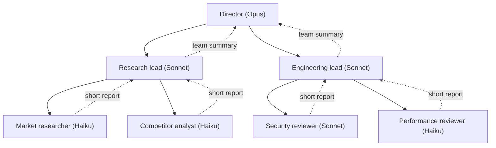

# Hierarchical Agent Teams

## Introduction

A **hierarchical agent team** is a tree of agents: a top-level lead delegates to team leads, and each team lead delegates to its own workers. It's the [supervisor pattern](./2-agents-supervisor-pattern.mdx) applied recursively, so a "worker" can itself be a whole team.

The analogy is an organization chart. A CTO doesn't assign tickets to individual engineers. They ask the platform lead and the product lead for outcomes, and each lead breaks the request down for their own team. Each level sees a summary of the level below, not every detail.

Hierarchies solve a specific problem: a **flat supervisor with too many specialists**. If one supervisor has 15 specialist tools, its tool list is long, its routing decisions get worse, and its context fills with 15 different kinds of reports. Grouping specialists into teams, each with a lead who understands its domain, keeps every individual agent's job small.

They also have specific costs. Every level adds **LLM calls, latency, and a summarization step where information can be lost**. A three-level hierarchy is a game of telephone with three hops. This page shows how to build one in plain Python, how to keep it under control, and how to decide whether you need one at all. Usually you don't.

## The Structure



Each level has a different job, which suggests a different model:

| Level | Job | Typical model |
| --- | --- | --- |
| Director | Understand the goal, split it by domain, make the final judgment | `claude-opus-5-5` |
| Team lead | Split the domain task, check workers' reports, summarize for the director | `claude-sonnet-5-5` (or Opus for high-stakes domains) |
| Worker | Do one narrow job with a few tools | `claude-haiku-5-5` or `claude-sonnet-5-5` |

The deeper the level, the more calls it makes and the more routine the work tends to be. That's where cheaper models save the most.

## Building a Hierarchy in Plain Python

The trick is a single interface for both workers and teams. If a team lead calls a member through the same `run(task)` method whether the member is a leaf agent or another team, the tree can be any shape.

### Step 1: A shared budget

Trees multiply cost. One director call can create two team leads, each of which creates three workers, each of which makes several tool calls. Give the **whole tree** one budget, and check it before every LLM call.

```python
from dataclasses import dataclass


class BudgetExceeded(Exception):
    pass


@dataclass
class Budget:
    max_tokens: int
    max_calls: int
    used_tokens: int = 0
    used_calls: int = 0

    def charge(self, response) -> None:
        self.used_calls += 1
        self.used_tokens += response.usage.input_tokens + response.usage.output_tokens

    def check(self) -> None:
        if self.used_tokens >= self.max_tokens or self.used_calls >= self.max_calls:
            raise BudgetExceeded(f"budget spent: {self.used_tokens} tokens, {self.used_calls} calls")
```

This tracks raw tokens. In production you would convert tokens to money using each model's price, because a Haiku token and an Opus token cost very different amounts.

### Step 2: A leaf worker

```python
from anthropic import Anthropic

client = Anthropic()


def text_of(response) -> str:
    return "".join(b.text for b in response.content if b.type == "text")


@dataclass
class Worker:
    name: str
    description: str
    system: str
    model: str = "claude-haiku-5-5"

    def run(self, task: str, budget: Budget, depth: int = 0) -> str:
        budget.check()
        response = client.messages.create(
            model=self.model,
            max_tokens=2000,
            system=self.system + " Keep your report under 200 words.",
            messages=[{"role": "user", "content": task}],
        )
        budget.charge(response)
        return text_of(response)
```

To keep the example short, workers here make one call and have no tools. In a real system a worker would run its own tool loop, as in the [orchestrator-workers page](./1-agents-orchestrator-workers.mdx).

### Step 3: A team that delegates to members

A `Team` is a supervisor whose members can be `Worker` or `Team` objects.

```python
@dataclass
class Team:
    name: str
    description: str
    goal: str
    members: list  # list of Worker or Team
    model: str = "claude-sonnet-5-5"
    max_steps: int = 6

    def tools(self) -> list[dict]:
        return [{
            "name": f"delegate_to_{m.name}",
            "description": m.description + " It sees only the task text you send.",
            "input_schema": {"type": "object", "properties": {"task": {"type": "string"}},
                             "required": ["task"], "additionalProperties": False},
        } for m in self.members]

    def run(self, task: str, budget: Budget, depth: int = 0, max_depth: int = 2) -> str:
        if depth > max_depth:
            return f"[{self.name}] refused: hierarchy deeper than {max_depth} levels."
        by_name = {m.name: m for m in self.members}
        system = (
            f"You lead the {self.name}. Goal: {self.goal}\n"
            "Delegate to your members, check their reports for gaps or contradictions, "
            "then reply with a concise summary for your manager: key findings, evidence, open risks."
        )
        messages = [{"role": "user", "content": task}]
        indent = "  " * depth

        for _ in range(self.max_steps):
            budget.check()
            response = client.messages.create(
                model=self.model, max_tokens=4000, system=system,
                tools=self.tools(), messages=messages,
            )
            budget.charge(response)
            if response.stop_reason != "tool_use":
                return text_of(response)

            messages.append({"role": "assistant", "content": response.content})
            results = []
            for block in response.content:
                if block.type != "tool_use":
                    continue
                member = by_name[block.name.removeprefix("delegate_to_")]
                print(f"{indent}{self.name} -> {member.name}")
                try:
                    report = member.run(block.input["task"], budget, depth + 1)
                except BudgetExceeded as exc:
                    report = f"Not done: {exc}. Summarize what you have."
                results.append({"type": "tool_result", "tool_use_id": block.id, "content": report})
            messages.append({"role": "user", "content": results})

        return f"[{self.name}] step limit reached; partial work only."
```

Three safety rails are built in:

- **A shared `Budget`**: every call anywhere in the tree is charged to the same object.
- **`max_depth`**: a team refuses to run below a fixed depth, so a misconfigured tree cannot recurse forever.
- **`max_steps`** per team: no team lead can loop indefinitely.

When the budget runs out inside a worker, the team lead gets a "not done" tool result and can still write a partial summary. This **graceful degradation** is usually better than crashing the whole tree and losing everything.

### Step 4: Assemble and run the tree

```python
research = Team(
    name="research_team",
    description="Researches market demand and competitors for a product idea.",
    goal="Assess demand and competition with evidence.",
    members=[
        Worker("market_researcher", "Estimates demand and target customers.",
               "You are a market researcher. Be concrete and note uncertainty."),
        Worker("competitor_analyst", "Lists competitors, pricing and gaps.",
               "You are a competitor analyst. Name real categories of competitors."),
    ],
)

engineering = Team(
    name="engineering_team",
    description="Assesses technical feasibility, security and performance risks.",
    goal="Find the biggest technical risks and rough effort.",
    members=[
        Worker("security_reviewer", "Identifies security and privacy risks.",
               "You are a security architect.", model="claude-sonnet-5-5"),
        Worker("performance_reviewer", "Identifies scaling and latency risks.",
               "You are a performance engineer."),
    ],
)

director = Team(
    name="director",
    description="Top-level decision maker.",
    goal="Produce a go/no-go recommendation with reasons.",
    members=[research, engineering],
    model="claude-opus-5-5",
)

if __name__ == "__main__":
    budget = Budget(max_tokens=200_000, max_calls=40)
    answer = director.run(
        "Should we add real-time collaborative editing to our note-taking app this quarter?",
        budget,
    )
    print(answer)
    print(f"\nUsed {budget.used_calls} calls and {budget.used_tokens} tokens")
```

Example output:

```text
director -> research_team
  research_team -> market_researcher
  research_team -> competitor_analyst
director -> engineering_team
  engineering_team -> security_reviewer
  engineering_team -> performance_reviewer
Recommendation: GO, but as a limited beta for team workspaces only.
- Demand: strongest among small teams; collaboration is a top-requested feature.
- Competition: most direct competitors already offer it, so it's table stakes.
- Risks: per-document access control and CRDT/OT sync complexity; WebSocket
  fan-out cost at scale. Engineering estimates one quarter for a beta.
Open question: pricing tier for collaboration (not researched).

Used 13 calls and 41850 tokens
```

Look at the call count: **13 LLM calls** for a question a single strong model might answer reasonably well in one or two. Each team lead needed at least two calls (delegate, then summarize), and the director needed three. That overhead is structural, and it grows with every level you add.

## Tracing a Tree of Agents

With 13 calls spread over three levels, you need to know which call produced which report. The simplest approach is to give every agent run an ID and record its parent's ID, so you can rebuild the tree afterwards:

```python
import uuid
from contextvars import ContextVar

current_run: ContextVar[str | None] = ContextVar("current_run", default=None)
TRACE: list[dict] = []


def start_span(agent_name: str, task: str) -> tuple[str, object]:
    """Record that an agent started, linked to whichever agent called it."""
    run_id = uuid.uuid4().hex[:8]
    TRACE.append({"run_id": run_id, "parent": current_run.get(),
                  "agent": agent_name, "task": task[:120]})
    token = current_run.set(run_id)
    return run_id, token


def end_span(token, report: str, tokens_used: int) -> None:
    run_id = current_run.get()
    for span in TRACE:
        if span["run_id"] == run_id:
            span.update(report=report[:200], tokens=tokens_used)
    current_run.reset(token)
```

Call `start_span` at the top of `Worker.run` and `Team.run`, and `end_span` before returning. When the director's answer is wrong, walk the trace from the root and read each level's report to find where the information was lost or invented. `ContextVar` also works with `asyncio`, so this keeps working when team leads run their members in parallel. In production, use OpenTelemetry spans instead of a list. See [OpenTelemetry for Agents](../11-agents-evaluation-and-testing/9-agents-opentelemetry.mdx).

## Information Loss Between Levels

Each level **summarizes** the level below. Summaries are the point, because they keep the director's context small, but each one also drops details. Suppose the security reviewer writes "access control is risky **because shared links currently bypass workspace permissions**". The engineering lead might shorten that to "access control complexity", and the director might drop it completely.

Ways to reduce loss:

1. **Structured reports.** Require each level to return fields such as `findings`, `evidence`, `risks`, and `open_questions`, and require leads to pass `risks` up **unchanged**.
2. **Severity escalation.** Instruct every lead: "Any finding marked critical must be quoted verbatim in your summary."
3. **References instead of copies.** Workers write full reports to shared storage and pass up an ID, so the director can read the original when it needs to. See [Shared State Between Agents](./7-agents-shared-state.mdx).
4. **Fewer levels.** The most reliable fix. Two levels lose less than three.

## When Hierarchy Helps, and When It Doesn't

Hierarchies make sense when:

- **There are many specialists** (roughly 8 or more), falling into clear domains, so a flat supervisor's tool list becomes unwieldy.
- **Domains need their own context.** The engineering lead benefits from engineering-specific instructions that would only distract the director.
- **Teams can work independently.** The research team doesn't need engineering's intermediate results.
- **The task is big and valuable** enough to absorb the extra calls.

They hurt when:

- The task is small. Most questions don't need a director, team leads, and workers.
- Teams need each other's details. Cross-team questions must climb up to the director and back down, slowly and lossily.
- You need predictable latency. Sequential levels add their latencies together, and nested delegation is hard to parallelize fully.
- You can't trace it. Debugging a wrong answer means finding which of 13 calls went wrong. Without [tracing](../11-agents-evaluation-and-testing/8-agents-tracing.mdx), you can't.

A useful rule: **add a level only when a flat design has measurably failed**, for example when the supervisor picks the wrong specialist too often, or its context overflows.

## How Frameworks Express Hierarchies

- **LangGraph**: a compiled graph can be used as a node or agent inside another graph, so a supervisor can manage other supervisors. The `langgraph-supervisor` README showed exactly this: `create_supervisor([...]).compile(name="research_team")` used as a member of a top-level supervisor. That library is now archived, and LangChain recommends building supervisors with tools, but the nesting idea is the same: subgraphs inside graphs.
- **CrewAI**: `Process.hierarchical` adds a manager agent (set via `manager_llm` or `manager_agent`) that delegates to crew members and validates their work. That is one level of hierarchy. For deeper structures, check the CrewAI docs on composing multiple crews (for example with Flows).
- **Claude Agent SDK**: subagents can spawn their own subagents. The SDK caps this with `CLAUDE_CODE_MAX_SUBAGENT_SPAWN_DEPTH` (3 levels below the main agent by default; set it to 1 to prevent nesting), a concurrent-subagent limit, and a `max_budget_usd` option for the whole query. Those are exactly the depth, concurrency, and spend rails you built by hand above.
- **Claude Managed Agents**: the coordinator's roster can include other agents, each running in its own thread. Check the current docs for nesting rules, since this API was in beta at the time of writing.

## Real-World Scenario

**Your company is preparing a vendor security assessment.** Before signing with a new SaaS vendor, procurement must review their security questionnaire (300 questions), SOC 2 report, privacy policy, data processing agreement, and penetration test summary. Today a security analyst spends two days on it.

**Solution:**

- A **director** (`claude-opus-5-5`) produces the final risk rating and the list of required contract changes.
- A **compliance team lead** (`claude-sonnet-5-5`) manages three workers (`claude-haiku-5-5`), each covering one third of the questionnaire and flagging weak answers with quotes.
- A **legal team lead** (`claude-sonnet-5-5`) manages two workers (`claude-sonnet-5-5`, since legal nuance needs judgment), one for the DPA and one for the privacy policy.
- A **technical team lead** (`claude-sonnet-5-5`) cross-checks the SOC 2 exceptions against the pen test summary.

Each lead returns a structured summary with a `critical_findings` list that must be passed up verbatim. Workers store full annotated notes in shared storage, and summaries reference them by ID so the analyst can audit any finding.

**Why this approach fits:** the documents are large (they won't fit comfortably in one context alongside careful analysis), the domains (compliance, legal, technical) need different instructions, the teams can work independently, and the outcome is valuable. A human analyst still reviews the result. The system cuts the work from two days to a few hours of review, rather than replacing the analyst.

**When not to use it:** for a low-risk vendor with a short questionnaire, a single agent with the documents and a checklist is enough. And if your evaluation shows the flat version (one `claude-opus-5-5` supervisor with six workers) is as accurate, ship the flat version. It's cheaper and easier to debug.

### Alternatives and trade-offs

| Approach | Pros | Cons | Best for |
| --- | --- | --- | --- |
| Single agent | Cheapest; no information loss | Context limits; long mixed prompt | Small document sets |
| Flat supervisor (one level) | Simple; one summarization hop | Long tool list; supervisor context grows | Up to roughly 5-8 specialists |
| [Orchestrator-workers](./1-agents-orchestrator-workers.mdx) with parallel workers | Fast; one hop | Planner must understand every domain | Broad, single-domain research |
| Hierarchical teams | Scales to many specialists; domain-specific leads | Most calls; multi-hop information loss; slow; hard to debug | Large, multi-domain, high-value tasks |

## Common Mistakes

1. **Copying the org chart.** Real companies have managers because people have limited bandwidth and need career paths. Agents don't. Add a level only for context or routing reasons.
2. **No global budget.** Per-agent limits don't stop a tree from multiplying. Share one budget object across the whole tree.
3. **Unbounded depth.** Agents that can create agents need a depth cap enforced in code.
4. **Lossy summaries.** Without required fields and verbatim escalation of critical items, important findings vanish on the way up.
5. **Cross-team chatter through the top.** If teams constantly need each other's details, your team boundaries are wrong. Regroup the specialists.
6. **Testing only the top-level answer.** Evaluate each team lead's summary separately too. Otherwise you can't tell which level lost the information. See [Evaluating Agent Trajectories](../11-agents-evaluation-and-testing/3-agents-trajectory-evaluation.mdx).

## Summary

- A hierarchical team is a **supervisor of supervisors**, so a member can be an agent or a whole team.
- A shared `run(task)` interface makes trees of any shape easy to build.
- Every level adds **calls, latency, and a lossy summarization step**.
- Use **one shared budget**, a **depth limit**, and **step limits**, all enforced in code.
- Use **structured, verbatim-escalating reports** to limit information loss.
- Prefer flat designs. Add levels only when a flat supervisor has measurably failed.

## Exercises

1. Run the example with `Budget(max_calls=6)`. How does the director's answer change? Is the partial answer still useful?
2. Rewrite the same task as a flat supervisor with four workers. Compare calls, tokens, and quality.
3. Make workers return a `Report` with `findings` and `critical` lists via structured outputs, and make team leads pass `critical` through unchanged. Write a test that checks a planted critical finding reaches the director.
4. Let team leads run their members in parallel with `AsyncAnthropic`. Which parts of the tree still have to be sequential?

**Related pages:** [Supervisor Pattern](./2-agents-supervisor-pattern.mdx), [Stopping Conditions and Budgets](../6-agents-planning-and-reasoning/10-agents-stopping-conditions.mdx), [Multi-Agent Failure Modes](./9-agents-multi-agent-failure-modes.mdx).
