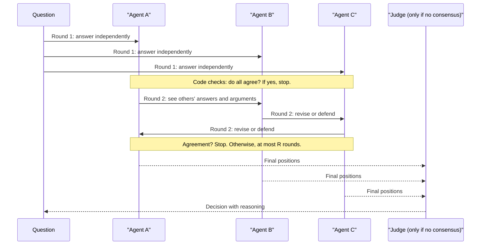

# Debate and Consensus

## Introduction

Most multi-agent patterns split **work** across agents. Debate and consensus patterns do something different: several agents work on the **same question**, and their answers are compared, challenged, and combined. The hope is that, like a panel of experts, the group catches mistakes any single member would make.

There are three main variants:

1. **Voting (self-consistency).** Ask the same question several times independently and take the majority answer.
2. **Debate.** Agents answer, read each other's answers, and revise over several rounds, ideally converging on a better answer.
3. **Judge or adjudicator.** Agents argue for different positions, and a separate judge agent decides.

These ideas come from research. [Du et al. (2023)](https://arxiv.org/abs/2305.14325) reported that having multiple model instances propose and debate their answers over several rounds improved mathematical reasoning and factual accuracy compared with a single model. But later work is more sobering. [Smit et al. (ICML 2024)](https://arxiv.org/abs/2311.17371) benchmarked several multi-agent debate methods and found that, in their current form, they **did not reliably outperform** simpler strategies such as self-consistency (majority voting over several samples). They also found debate methods to be sensitive to settings such as how strongly agents are pushed to agree. A 2025 follow-up, ["If Multi-Agent Debate is the Answer, What is the Question?"](https://arxiv.org/abs/2502.08788), reported similar results across nine benchmarks.

So this page takes a practical stance: **voting is the baseline, and debate has to beat it on your own evaluation set before you ship it.** Both multiply your token bill.

:::caution Cost
Voting with N agents costs about N times a single call. Debate with N agents and R rounds costs about N times R calls, and each later round has longer prompts because it includes the other agents' answers. A judge adds more on top. Before reaching for any of these, try the cheaper levers first: a stronger model, higher `effort`, better context, or a self-check instruction.
:::

## How Debate Works



## Step 1: The Baseline, Self-Consistency Voting

Always build the cheap baseline first. Here, several independent agents answer a question, and code takes the majority. Structured outputs keep the answers comparable.

```python
import asyncio
from collections import Counter

from anthropic import AsyncAnthropic
from pydantic import BaseModel, Field

client = AsyncAnthropic()


class Position(BaseModel):
    answer: str = Field(description="Short canonical answer, e.g. 'B' or '42' or 'yes'")
    confidence: float = Field(description="From 0.0 (guess) to 1.0 (certain)")
    key_argument: str = Field(description="The single strongest reason, in 1-3 sentences")


PERSPECTIVES = [
    "Solve carefully, step by step.",
    "First look for a counterexample or trap in the question, then solve.",
    "Solve by estimating first, then computing exactly, and compare.",
]


async def answer_once(question: str, perspective: str, model: str) -> Position:
    response = await client.messages.parse(
        model=model,
        max_tokens=4000,
        system=f"You answer questions precisely. {perspective}",
        messages=[{"role": "user", "content": question}],
        output_format=Position,
    )
    return response.parsed_output


async def self_consistency(question: str, model: str = "claude-sonnet-5-5") -> tuple[str, float]:
    positions = await asyncio.gather(*(answer_once(question, p, model) for p in PERSPECTIVES))
    counts = Counter(p.answer.strip().lower() for p in positions)
    answer, votes = counts.most_common(1)[0]
    return answer, votes / len(positions)  # answer and agreement ratio
```

The **agreement ratio** is as useful as the answer. Unanimous answers can usually be trusted more than split ones, which makes the ratio a cheap trigger for escalation to a stronger model or a human.

Why different perspectives instead of the same prompt three times? Identical prompts to the same model tend to produce **correlated** answers, so voting adds little. Varying the approach (or the model, or the evidence each voter sees) makes the votes more independent. Some current models, including `claude-haiku-5-5`, reject non-default sampling parameters like a raised `temperature`, so prompt variation is also the practical way to get diversity.

## Step 2: Multi-Round Debate

Debate adds rounds in which each agent sees the others' positions and may revise. The prompt for later rounds is where most of the design work goes.

```python
def format_others(positions: list[Position], skip: int) -> str:
    lines = []
    for i, p in enumerate(positions):
        if i == skip:
            continue
        lines.append(f"- Another agent answered '{p.answer}' "
                     f"(confidence {p.confidence:.1f}): {p.key_argument}")
    return "\n".join(lines)


async def revise(question: str, mine: Position, others: str, model: str) -> Position:
    prompt = (
        f"Question: {question}\n\n"
        f"Your previous answer: '{mine.answer}'. Your argument: {mine.key_argument}\n\n"
        f"Other agents' positions:\n{others}\n\n"
        "Re-examine the question. Change your answer ONLY if another agent gave an "
        "argument that shows a specific error in your reasoning. Agreement alone, or "
        "higher stated confidence, is not a reason to change. Return your current position."
    )
    response = await client.messages.parse(
        model=model, max_tokens=4000,
        messages=[{"role": "user", "content": prompt}],
        output_format=Position,
    )
    return response.parsed_output


async def debate(question: str, rounds: int = 3,
                 models: tuple[str, ...] = ("claude-sonnet-5-5", "claude-sonnet-5-5", "claude-haiku-5-5")):
    positions = list(await asyncio.gather(
        *(answer_once(question, PERSPECTIVES[i], m) for i, m in enumerate(models))
    ))
    for r in range(1, rounds):
        answers = {p.answer.strip().lower() for p in positions}
        print(f"Round {r}: {[p.answer for p in positions]}")
        if len(answers) == 1:
            return positions, "consensus"
        positions = list(await asyncio.gather(
            *(revise(question, positions[i], format_others(positions, i), m)
              for i, m in enumerate(models))
        ))
    final = {p.answer.strip().lower() for p in positions}
    return positions, "consensus" if len(final) == 1 else "no_consensus"
```

Key design choices:

- **Early stopping.** If everyone agrees after round 1, stop. On easy questions this makes debate cost the same as voting.
- **Anti-conformity instruction.** LLMs tend to defer to peers, especially confident ones. That's the same tendency as sycophancy toward users. Without the "change only for a specific error" rule, debates often converge on whichever answer was stated most confidently, right or wrong.
- **Show arguments, not just answers.** Seeing "3 agents said B" invites copying. Seeing *why* invites checking.
- **Mixed models.** Using different models (or even different providers) reduces shared blind spots. Here two Sonnet agents and one Haiku agent are used. In your own system, test whether a mixed panel beats a uniform one.

## Step 3: A Judge for Unresolved Debates

When agents still disagree, a judge reads the final positions and decides. The judge should be at least as capable as the debaters, so `claude-opus-5-5` is a natural fit.

```python
import random


class Ruling(BaseModel):
    answer: str
    reasoning: str
    winning_argument_id: int


async def judge(question: str, positions: list[Position]) -> Ruling:
    order = list(range(len(positions)))
    random.shuffle(order)  # reduce position bias: don't always show agent 0 first
    listing = "\n\n".join(
        f"Argument {i}: answer '{positions[i].answer}'\n{positions[i].key_argument}"
        for i in order
    )
    response = await client.messages.parse(
        model="claude-opus-5-5",
        max_tokens=8000,
        output_config={"effort": "high"},
        system=(
            "You are an impartial judge. Decide the correct answer to the question. "
            "Evaluate arguments on correctness, not on length, confidence, or how many "
            "agents hold them. You may reject all arguments and give your own answer."
        ),
        messages=[{"role": "user", "content": f"Question: {question}\n\n{listing}"}],
        output_format=Ruling,
    )
    return response.parsed_output


async def debate_with_judge(question: str) -> str:
    positions, status = await debate(question)
    if status == "consensus":
        return positions[0].answer
    ruling = await judge(question, positions)
    return ruling.answer


if __name__ == "__main__":
    q = ("A bat and a ball cost $1.10 in total. The bat costs $1.00 more than the ball. "
         "How much does the ball cost, in cents?")
    print(asyncio.run(debate_with_judge(q)))
```

Example output:

```text
Round 1: ['5', '5', '10']
Round 2: ['5', '5', '5']
5
```

In this run, the Haiku agent first gave the intuitive wrong answer (10 cents), read the others' argument ("if the ball is 10, the bat is 110, total 120"), found its own error, and switched. No judge was needed. On many runs all three will agree in round 1, and the debate stops immediately.

Known judge biases to design around: **position bias** (favoring the first or last argument), **verbosity bias** (favoring longer arguments), and **self-preference** (favoring outputs from its own model family). Shuffling, length limits on arguments, and a judge from a different model family help. These are the same issues covered in [Grading Methods: Code, Rubrics and LLM Judges](../11-agents-evaluation-and-testing/2-agents-grading-methods.mdx).

## Step 4: Prove It Helps on Your Data

Given the mixed research results, the most important code on this page might be the comparison harness. Run each strategy on a labeled evaluation set and record accuracy **and** cost. The harness below measures accuracy and wall-clock time. Token counts come from each response's `usage` field.

```python
import time
from dataclasses import dataclass


@dataclass
class StrategyResult:
    name: str
    correct: int
    total: int
    seconds: float

    @property
    def accuracy(self) -> float:
        return self.correct / self.total if self.total else 0.0


async def single_call(question: str) -> str:
    position = await answer_once(question, PERSPECTIVES[0], "claude-opus-5-5")
    return position.answer


async def voting(question: str) -> str:
    answer, _agreement = await self_consistency(question)
    return answer


async def evaluate(strategies: dict, dataset: list[tuple[str, str]]) -> list[StrategyResult]:
    results = []
    for name, strategy in strategies.items():
        start = time.perf_counter()
        correct = 0
        for question, expected in dataset:
            try:
                got = await strategy(question)
            except Exception as exc:  # count failures as wrong, but keep going
                print(f"{name} failed on {question[:30]!r}: {exc}")
                continue
            correct += got.strip().lower() == expected.strip().lower()
        results.append(StrategyResult(name, correct, len(dataset), time.perf_counter() - start))
    return results


DATASET = [
    ("A bat and a ball cost $1.10 in total. The bat costs $1.00 more than the ball. "
     "How much does the ball cost, in cents?", "5"),
    ("If 5 machines make 5 widgets in 5 minutes, how many minutes do 100 machines "
     "need to make 100 widgets?", "5"),
    # ... at least 30-50 questions that resemble your real workload
]

strategies = {"single_opus": single_call, "vote_sonnet_x3": voting, "debate_judge": debate_with_judge}
# for r in asyncio.run(evaluate(strategies, DATASET)):
#     print(f"{r.name:<15} accuracy={r.accuracy:.0%}  time={r.seconds:.0f}s")
```

Example output on a 40-question set (your numbers will differ):

```text
single_opus     accuracy=93%  time=210s
vote_sonnet_x3  accuracy=90%  time=140s
debate_judge    accuracy=93%  time=520s
```

In this illustrative run, debate matched the single strong call while taking more than twice as long and spending several times as many tokens. That's a common outcome, and exactly the kind of result you need to see before shipping a debate system. Add the token totals from a usage ledger (see the [introduction](./0-agents-multi-agent-introduction.mdx)) to compare cost as well. See [Building Evaluation Datasets](../11-agents-evaluation-and-testing/1-agents-building-eval-sets.mdx) for how to build the question set.

## Variants Worth Knowing

| Variant | How it works | Good for |
| --- | --- | --- |
| Self-consistency | N independent answers, majority vote | Questions with a checkable final answer (numbers, labels) |
| Debate | Rounds of reading and revising | Reasoning problems where errors can be argued about |
| Proposer and critic | One agent proposes, another only attacks; repeat | Plans, designs, code: see [Evaluator-Optimizer Loops](../6-agents-planning-and-reasoning/7-agents-evaluator-optimizer.mdx) |
| Advocates and judge | Agents assigned opposing sides, a judge decides | Decisions with real trade-offs (build vs buy) |
| Red team and blue team | One agent tries to break a solution, another defends | Security reviews, policy loopholes |
| Ensemble of models | Same prompt to different models or providers | Reducing single-model blind spots |

A practical observation: the **proposer and critic** variant is often more useful in products than symmetric debate, because the critic has a clear, different job. When everyone has the same job, you mostly pay for the same answer several times.

## How Frameworks Express Debate

- **AutoGen / Microsoft Agent Framework**: group chats where several agents take turns on a shared conversation, with a manager choosing the next speaker. AutoGen is now in maintenance mode, and Microsoft directs new projects to Microsoft Agent Framework, so check its current orchestration docs.
- **LangGraph**: debate is a loop in a graph. Debater nodes run in parallel, a conditional edge checks for consensus and either loops back or goes to a judge node.
- **OpenAI Agents SDK**: its multi-agent guide describes an evaluator loop, where one agent produces and another gives feedback until criteria pass. That is the proposer and critic variant.

Since debate is mostly control flow (rounds, consensus checks, a judge), plain Python like the code above is usually the clearest implementation.

## Real-World Scenario

**Your fintech company reviews expense reports** for policy violations. About 95% are clear-cut, but 5% are ambiguous: a "client dinner" with no client listed, a hotel upgrade during a conference. Wrong rejections annoy employees, and wrong approvals cost money and audit findings. The team proposes "three agents debate each report".

**Walking through the decision:**

1. **Baseline first.** A single `claude-sonnet-5-5` call with the policy document and the report classifies each expense as `approve`, `reject`, or `needs_info`. On a labeled set of 200 past reports, measure its accuracy, especially on the ambiguous 5%.
2. **Cheap reliability signal.** Add self-consistency with three differently-prompted voters ("strict auditor", "employee advocate", "policy literalist"). Unanimous `approve` or `reject` is applied automatically, and anything else goes to a human. On the labeled set, compare the error rate on auto-applied decisions and the share sent to humans.
3. **Debate only for the remainder.** For the split cases, try a two-round debate plus a `claude-opus-5-5` judge, and compare against simply sending those cases to a human. If debate resolves split cases accurately, it saves reviewer time. If not, humans review them.

**Why this approach fits:** voting gives a **calibrated escalation signal** cheaply, and debate is reserved for the small slice where it might help. Cost stays bounded, because the 3x voting cost applies to every report and the debate cost only to the split ones.

**When not to use it:** if the single-model baseline is already accurate enough on ambiguous cases, any multi-agent layer is wasted money. And if a decision can be checked deterministically (an amount over a limit, a missing receipt), check it in code. Don't ask a committee of LLMs.

### Alternatives and trade-offs

| Approach | Pros | Cons | Best for |
| --- | --- | --- | --- |
| Single call, higher effort or stronger model | Cheapest; often enough | No built-in uncertainty signal | Most tasks |
| Self-consistency voting | Simple; agreement ratio flags uncertainty | N times cost; correlated errors | Labels and numeric answers |
| Multi-round debate | Can fix individual reasoning errors | N times R cost; conformity; research shows mixed results | Hard reasoning, after it beats voting in your evals |
| Proposer plus critic | Clear roles; improves drafts | Can loop; critic may nitpick | Plans, code, writing |
| Human review on disagreement | Highest accuracy on hard cases | Slow; costs people's time | High-stakes, low-volume decisions |

## Common Mistakes

1. **Skipping the baseline.** Always compare debate against a single strong call and against self-consistency at similar cost. The research says debate often doesn't win.
2. **Identical agents.** Same model, same prompt, same context gives correlated answers. Diversify, or don't bother.
3. **Rewarding conformity.** Without anti-conformity instructions, agents follow the most confident voice. Require specific errors as the reason to change.
4. **Free-text answers.** "Five cents" and "$0.05" won't match in a vote. Use structured outputs with a canonical answer field.
5. **Unbounded rounds.** Cap rounds, and stop early on consensus.
6. **Trusting the judge blindly.** Judges have position, length, and self-preference biases. Shuffle arguments and evaluate the judge itself.
7. **Using debate for facts nobody has.** If none of the agents knows the fact, debate produces confident consensus on a guess. Give agents [retrieval](../5-agents-rag/0-agents-rag-introduction.mdx) instead.

## Summary

- Debate and consensus run several agents on the **same question** and combine their answers.
- **Self-consistency voting** is the baseline. It's simple, parallel, and gives an agreement signal for escalation.
- **Debate** adds revision rounds. Research shows it often does **not** beat voting at equal cost, so prove it on your own data.
- A **judge** resolves disagreements, but has its own biases.
- Diversity (prompts, models, evidence) and **anti-conformity** instructions are what make multiple agents worth more than one.
- Costs scale with agents times rounds. Try stronger models or higher effort first.

## Exercises

1. Build an evaluation set of 30 tricky arithmetic and logic questions. Compare one `claude-haiku-5-5` call, five-vote Haiku self-consistency, three-agent Haiku debate, and one `claude-opus-5-5` call on accuracy and total tokens.
2. Remove the anti-conformity sentence from `revise` and plant one confidently wrong agent (prompt it to argue for a specific wrong answer). How often does the group follow it, with and without the sentence?
3. Implement the proposer and critic variant for writing SQL queries, where the critic runs the query against a test database before critiquing. Is a tool-using critic better than a debating one?
4. Test the judge for position bias: give it the same two arguments in both orders across 20 questions and count how often its decision flips.

**Related pages:** [Reflection and Self-Critique](../6-agents-planning-and-reasoning/6-agents-reflection.mdx), [Tree-of-Thoughts and Search-Based Planning](../6-agents-planning-and-reasoning/8-agents-tree-search.mdx), [Parallel Agents](./4-agents-parallel-agents.mdx).
