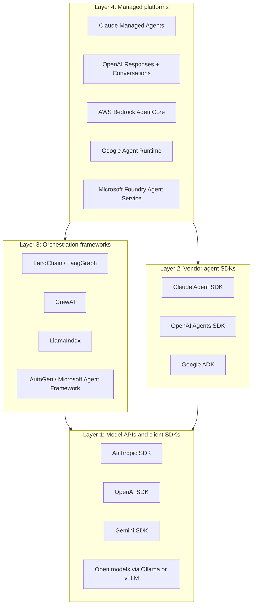
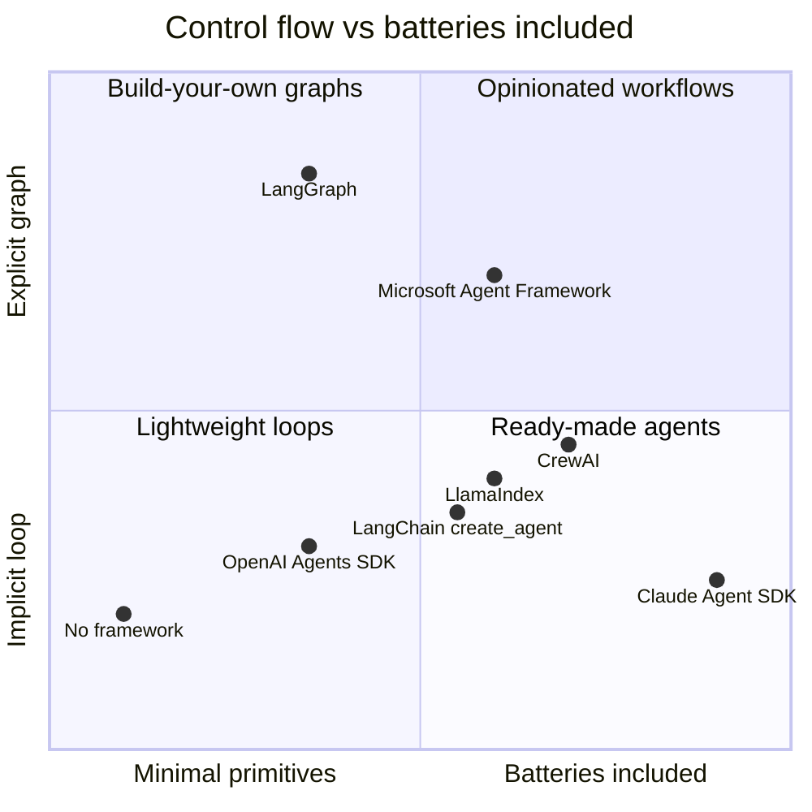
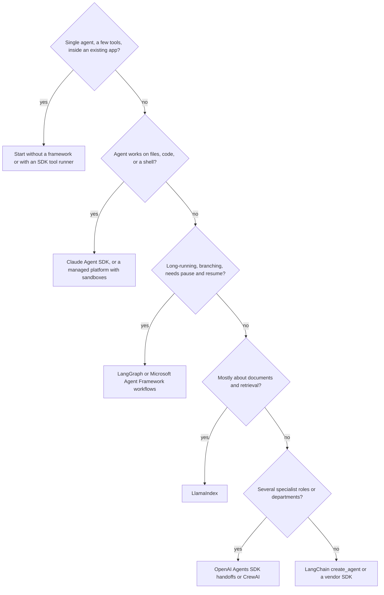

# Agent Framework Landscape

## Introduction

By now you know how an agent works: a model, some tools, and a loop (see [The Agent Loop](../0-agents-fundamentals/4-agents-agent-loop.mdx)). You could build every agent from that loop alone. Yet there are dozens of frameworks promising to make agents easier, and new ones appear every month. Which ones matter, what do they actually do, and how do they relate to each other?

This page is a map. It sorts the landscape into a few layers, explains what each layer gives you, and compares the major options fairly. The following pages then build **the same small support agent** in each framework, so you can judge them on equal terms, and the last page, [Choosing an Agent Framework](./10-agents-choosing-a-framework.mdx), turns this map into a decision process.

An analogy: choosing an agent framework is like choosing how to get around a new city. You can walk (raw API), rent a bike (a lightweight SDK), take a guided tour bus (a full framework with opinions about the route), or hire a car service (a managed platform). None is "best"; it depends on the distance, your budget, and how much you want to steer.

:::info A fast-moving field
Framework APIs, names, and even ownership change often. Two recent examples: Microsoft moved AutoGen into maintenance mode in favor of Microsoft Agent Framework, and Google rebranded Vertex AI as the Gemini Enterprise Agent Platform. Everything on these pages was checked against official docs at the time of writing; always confirm against the current docs before you commit.
:::

## What a Framework Actually Does

Strip away the marketing, and an agent framework provides some subset of these capabilities:

| Capability | What it means | Without a framework you would... |
|------------|---------------|----------------------------------|
| Model abstraction | One interface for many providers | Call each provider's SDK directly |
| Tool definition | Turn functions into tool schemas | Write JSON Schema by hand |
| Agent loop | Call model, run tools, repeat | Write a `while` loop (about 50 lines) |
| State and memory | Keep conversations and facts across turns | Store message lists yourself |
| Control flow | Branching, graphs, routing, handoffs | Write `if` statements and functions |
| Multi-agent | Several agents cooperating | Call one agent from another's tool |
| Human-in-the-loop | Pause for approval and resume later | Serialize state and build a resume path |
| Durability | Survive restarts mid-run | Build checkpointing |
| Observability | Traces of every step | Add structured logging or OpenTelemetry |
| Built-in tools | File editing, shell, web search, code execution | Implement and sandbox them yourself |
| Deployment | Hosting, scaling, isolation | Run containers and autoscalers |

The first few rows are easy to build yourself, which is why a hand-written loop is a legitimate choice (see [Building Agents Without a Framework](./1-agents-no-framework.mdx)). The lower rows (durability, human-in-the-loop, built-in sandboxed tools, deployment) are where frameworks and platforms save real engineering time.

## The Four Layers



The layers are not strict. Managed platforms often host code written with Layer 2 or 3 frameworks, and several Layer 2 SDKs support other vendors' models. But the layering is a useful first sort.

### Layer 1: Model APIs and client SDKs

The foundation. You send messages and tool definitions; the model replies with text or tool calls. Client SDKs (such as `anthropic` or `openai`) add retries, typed responses, streaming helpers, and sometimes a simple **tool runner** that drives the loop. Everything else is built on this layer.

- **Pros:** full control, minimal dependencies, easiest to debug.
- **Cons:** you write the loop, state, and tracing yourself.

### Layer 2: Vendor agent SDKs

Agent toolkits published by model providers. They are usually lighter than general frameworks and closely track the provider's newest model features.

| SDK | Publisher | Signature idea | Page |
|-----|-----------|----------------|------|
| Claude Agent SDK | Anthropic | Claude Code's harness as a library: built-in file, shell, and web tools, permissions, hooks, subagents | [Claude Agent SDK](./2-agents-claude-agent-sdk.mdx) |
| OpenAI Agents SDK | OpenAI | Small set of primitives: agents, tools, handoffs, guardrails, sessions, tracing | [OpenAI Agents SDK](./3-agents-openai-agents-sdk.mdx) |
| Agent Development Kit (ADK) | Google | Code-first agents, deploys to Google's Agent Runtime, A2A support | Not covered in depth; see the ADK docs |

### Layer 3: Orchestration frameworks

Model-agnostic frameworks focused on composing agents, tools, data, and workflows.

| Framework | Signature idea | Page |
|-----------|----------------|------|
| LangChain | Huge integration catalog; `create_agent` with middleware | [LangChain Agents](./4-agents-langchain.mdx) |
| LangGraph | Agents as explicit state graphs with checkpoints and interrupts | [LangGraph](./5-agents-langgraph.mdx) |
| CrewAI | Role-based crews of agents working through tasks; Flows for control | [CrewAI](./6-agents-crewai.mdx) |
| LlamaIndex | Data-centric agents; query engines over documents as tools | [LlamaIndex Agents](./8-agents-llamaindex.mdx) |
| AutoGen / Microsoft Agent Framework | Conversational multi-agent teams; successor adds graph workflows and enterprise features | [AutoGen](./7-agents-autogen.mdx) |

Other frameworks you will meet include **Pydantic AI** (type-safe agents from the Pydantic team), **smolagents** (Hugging Face's minimal, code-writing agents), **Strands Agents** (an AWS-originated open-source SDK), **AG2** (a community continuation of classic AutoGen), and in TypeScript, the **Vercel AI SDK** and **Mastra**. The concepts on these pages transfer directly to them.

### Layer 4: Managed platforms

Services that run agents for you: the loop, sandboxes, sessions, memory, identity, scaling, and observability. They come in two flavors: **configured agents** (you define instructions and tools; the provider runs the loop) and **hosted runtimes** (you bring framework code; the provider runs it). See [Managed Agent Platforms](./9-agents-managed-agent-platforms.mdx).

## The Same Agent, Eight Ways

To compare fairly, every framework page in this section builds the same **customer support agent** with two tools:

- `get_order(order_id)`: returns status, total, and days since delivery.
- `issue_refund(order_id, reason)`: refunds delivered orders within 30 days.

Here is how the core ideas map across frameworks:

| Framework | Define a tool | Run the agent | Multi-turn memory | Human approval |
|-----------|---------------|---------------|-------------------|----------------|
| No framework | JSON Schema dict + function | Your `while` loop | Your `messages` list | Check in your executor |
| Claude Agent SDK | `@tool` + `create_sdk_mcp_server` | `query()` / `ClaudeSDKClient` | `ClaudeSDKClient` session, `resume` | `PreToolUse` hooks, permissions |
| OpenAI Agents SDK | `@function_tool` | `Runner.run()` | `SQLiteSession` and other sessions | `needs_approval=True` + resume state |
| LangChain | `@tool` | `create_agent(...).invoke()` | Checkpointer + `thread_id` | `HumanInTheLoopMiddleware` |
| LangGraph | `@tool` + `ToolNode` | `graph.invoke()` | Checkpointer + `thread_id` | `interrupt()` + `Command(resume=...)` |
| CrewAI | `@tool("Name")` | `crew.kickoff(inputs=...)` | Crew memory options | `human_input=True` on a task |
| AutoGen AgentChat | Plain function | `agent.run(task=...)` | Agent model context | Teams with a reviewer or user proxy |
| Microsoft Agent Framework | Plain function or `@tool` | `agent.run(...)` | `agent.create_session()` | `approval_mode="always_require"` |
| LlamaIndex | Plain function | `agent.run(user_msg=...)` | `Context` | `ctx.wait_for_event(...)` |

The table hides a lot of nuance, but it shows something important: **the concepts are the same everywhere**. Once you understand tools, loops, state, and approvals, switching frameworks is mostly learning new names.

### The same tool in four styles

The differences are easiest to see in code. Here is `get_order` written for four frameworks. The function body is identical; only the wrapper changes.

```python
import json

ORDERS = {"A1001": {"status": "delivered", "total": 59.99, "delivered_days_ago": 3}}


def lookup(order_id: str) -> str:
    order = ORDERS.get(order_id.upper())
    return json.dumps(order) if order else "Error: order not found"


# 1. No framework: you write the JSON Schema yourself
GET_ORDER_SCHEMA = {
    "name": "get_order",
    "description": "Look up an order by ID.",
    "input_schema": {"type": "object",
                     "properties": {"order_id": {"type": "string"}},
                     "required": ["order_id"]},
}

# 2. OpenAI Agents SDK: decorator reads type hints and docstring
from agents import function_tool


@function_tool
def get_order_oai(order_id: str) -> str:
    """Look up an order by ID."""
    return lookup(order_id)


# 3. LangChain / LangGraph: same idea, different decorator
from langchain.tools import tool


@tool
def get_order_lc(order_id: str) -> str:
    """Look up an order by ID."""
    return lookup(order_id)


# 4. LlamaIndex, AutoGen, Microsoft Agent Framework: a plain function is enough
def get_order(order_id: str) -> str:
    """Look up an order by ID."""
    return lookup(order_id)
```

The lesson: keep the real logic (`lookup`) in a plain, tested function, and treat each framework's wrapper as a thin adapter. Switching frameworks then means rewriting a few decorators, not your business logic.

## Design Philosophies

Beyond features, frameworks differ in *how much they decide for you*. Three spectrums capture most of it:

| Spectrum | One end | Other end |
|----------|---------|-----------|
| Control flow | **Implicit**: the model drives the loop (OpenAI Agents SDK, `create_agent`, CrewAI crews) | **Explicit**: you draw the graph (LangGraph, CrewAI Flows, Microsoft Agent Framework workflows) |
| Opinions | **Batteries included**: built-in tools, prompts, defaults (Claude Agent SDK, CrewAI) | **Minimal primitives**: you assemble pieces (OpenAI Agents SDK, no framework) |
| Model coupling | **Vendor-tuned**: built around one provider's models and features | **Provider-neutral**: adapters for many providers (LangChain, LlamaIndex, CrewAI) |

Neither end is better. Implicit control flow is faster to build and handles open-ended tasks well; explicit control flow is easier to audit and test. Vendor-tuned SDKs get new model features first; provider-neutral frameworks make it easier to switch or mix models.



The positions are a rough, subjective sketch to help you build intuition, not a measurement.

## Interoperability Standards

A few open standards cut across all frameworks and reduce lock-in:

- **Model Context Protocol (MCP)** for tools and data. Most frameworks on these pages can consume MCP servers, so a tool written once as an MCP server works everywhere. See [MCP Introduction](../7-agents-mcp/0-agents-mcp-introduction.mdx).
- **Agent-to-Agent (A2A)** for agents built in different frameworks to call each other. See [Agent-to-Agent (A2A) Protocol](../7-agents-mcp/10-agents-a2a-protocol.mdx).
- **OpenTelemetry** for traces, with emerging semantic conventions for generative AI. Several frameworks and platforms emit or accept OpenTelemetry data. See [OpenTelemetry for Agents](../11-agents-evaluation-and-testing/9-agents-opentelemetry.mdx).

When two options are otherwise close, prefer the one with better support for these standards.

## Signals of a Healthy Framework

Before adopting any framework, spend 15 minutes checking:

| Signal | Where to look | Warning sign |
|--------|---------------|--------------|
| Release activity | GitHub releases, PyPI history | No releases for many months |
| Official status | README, docs banners | "Maintenance mode" or "deprecated" notices |
| Breaking changes | Changelog, migration guides | Major API rewrites every few months with no migration path |
| Issue handling | Open issues and response times | Security issues left open |
| License and governance | LICENSE file, foundation or company ownership | Unclear license, single unpaid maintainer for a critical dependency |
| Model support | Docs on providers | New models from your provider unsupported for long periods |

## Comparing the Major Options

The table below summarizes trade-offs. "Model flexibility" means how easily you can use models from several providers.

| Option | Abstraction level | Model flexibility | Multi-agent | Durable execution | Learning curve | Best known for |
|--------|------------------|-------------------|-------------|-------------------|----------------|----------------|
| No framework | Lowest | Any (you write adapters) | DIY | DIY | Low | Control and transparency |
| Claude Agent SDK | High (batteries included) | Claude models | Subagents | Sessions, resume | Low to medium | Coding, file, and ops agents |
| OpenAI Agents SDK | Medium | OpenAI first; others via adapters | Handoffs, agents as tools | Sessions, resumable approvals | Low | Specialist routing, guardrails |
| LangChain | Medium | Very broad | Via LangGraph | Via checkpointers | Medium | Integrations, middleware |
| LangGraph | Low to medium (explicit graphs) | Very broad | First-class | First-class checkpoints | Medium to high | Complex, auditable workflows |
| CrewAI | High (role metaphor) | Broad | First-class crews | Flow state | Low | Role-based pipelines |
| AutoGen AgentChat | Medium | Broad | Conversational teams | Limited | Medium | Legacy and research (maintenance mode) |
| Microsoft Agent Framework | Medium | Broad | Workflows | Checkpointed workflows | Medium | .NET and Azure ecosystems |
| LlamaIndex | Medium | Broad | `AgentWorkflow` | Serializable `Context` | Medium | Document and RAG agents |
| Managed platforms | Highest | Varies by platform | Varies | Provider-managed sessions | Low to medium | Operations offloaded |

These are generalizations. Each framework is improving quickly, and a weakness listed here may be fixed by the time you read this.

## A Quick Orientation Flowchart

The full decision process is on [Choosing an Agent Framework](./10-agents-choosing-a-framework.mdx). As a first orientation:



## Framework Vocabulary Decoder

Each framework names the same ideas differently. Keep this table handy while reading the next pages:

| General idea | Claude Agent SDK | OpenAI Agents SDK | LangChain / LangGraph | CrewAI | LlamaIndex | Microsoft Agent Framework |
|--------------|------------------|-------------------|-----------------------|--------|------------|---------------------------|
| Agent definition | `ClaudeAgentOptions` | `Agent` | `create_agent` / graph | `Agent` | `FunctionAgent` | `Agent` |
| Run | `query()` | `Runner.run()` | `invoke()` / `stream()` | `kickoff()` | `run()` | `run()` |
| Conversation state | Session | Session | Checkpointer thread | Crew memory | `Context` | `AgentSession` |
| Intercept steps | Hooks | Hooks, guardrails | Middleware | Callbacks, guardrails | Workflow events | Middleware |
| Delegate to another agent | Subagent | Handoff, agent as tool | Subgraph, supervisor | Hierarchical process | `AgentWorkflow` handoff | Workflow, agent as tool |
| Fixed workflow | (your code) | (your code) | `StateGraph` | Flow | `Workflow` | Workflow |
| Human approval | Hooks, permissions | `needs_approval` | `interrupt()`, HITL middleware | `human_input` | `wait_for_event` | `approval_mode` |

## Real-World Scenario

You are the tech lead at a 60-person e-commerce company. Three teams independently started agent projects last quarter: support built a refund bot with a hand-written loop, marketing prototyped a content pipeline in CrewAI, and the platform team built a CI "fix the flaky test" agent with the Claude Agent SDK. Leadership asks whether you should standardize on one framework.

**How to think about it with this map:**

- The three projects sit in **different layers for good reasons**. The refund bot is a single agent in an existing Django app (Layer 1 fits). The content pipeline is a role-based multi-step workflow (Layer 3 fits). The CI agent needs file editing and a shell (Layer 2 with built-in tools fits).
- Forcing all three onto one framework would make at least two of them worse.
- What you **should** standardize is the layer *underneath and around* the frameworks: tools exposed as MCP servers or plain tested functions, a shared evaluation harness, OpenTelemetry tracing, a secrets policy, and an approved list of model providers.

**Why this approach fits:** frameworks are replaceable; tools, evaluations, and observability are the long-lived assets. Standardizing those lets each team use the right framework while keeping governance consistent.

**When to standardize on one framework anyway:** small teams that share code heavily, or organizations where one framework's managed platform provides compliance features you need everywhere.

**Alternatives and trade-offs:**

| Approach | Pros | Cons | Best for |
|----------|------|------|----------|
| One framework for everything | Shared knowledge, shared utilities | Poor fit for some projects, big migration risk | Small teams, uniform use cases |
| Right tool per project, shared standards | Best fit per project, portable assets | More frameworks to know | Most organizations |
| No frameworks at all | Maximum control and transparency | Reinventing durability, HITL, tracing | Teams with simple agents and strong platform skills |
| Managed platform for everything | Less ops work, consistent governance | Platform lock-in, less control | Teams with limited infrastructure capacity |

## Common Mistakes

1. **Choosing by popularity.** GitHub stars measure attention, not fit. Evaluate against your own requirements with a small prototype.
2. **Adopting a framework before understanding the loop.** If you cannot explain what the framework does on each step, debugging will be painful. Build the [no-framework version](./1-agents-no-framework.mdx) once.
3. **Assuming multi-agent is better.** Many tasks are solved more cheaply and reliably by one agent with good tools. See [Single Agent vs Multi-Agent](../8-agents-multi-agent-systems/10-agents-single-vs-multi-agent.mdx).
4. **Ignoring maintenance status.** Check release activity and official status notices. AutoGen's move to maintenance mode is a reminder that frameworks can change direction.
5. **Mixing up similarly named products.** "Claude Agent SDK" vs the Anthropic client SDK, "AutoGen" vs "AG2" vs "Microsoft Agent Framework", "Agent Engine" vs "Agent Runtime": check which product a tutorial or job posting actually means.
6. **Overlooking the platform layer.** Teams often spend weeks building sandboxes and session storage that a managed platform would provide, or the reverse: adopt a platform for a two-tool bot that needed none of it.
7. **Coupling business logic to the framework.** Keep tools as plain functions or MCP servers so you can switch frameworks later.

## Summary

- The agent ecosystem has four rough layers: model APIs and client SDKs, vendor agent SDKs, orchestration frameworks, and managed platforms.
- Frameworks mostly provide the same capabilities (tools, loop, state, control flow, multi-agent, approvals, durability, observability) with different styles and defaults.
- The same support agent is built in each framework on the following pages so you can compare them directly.
- Concepts transfer across frameworks; the long-lived assets are your tools, evaluations, and observability.
- Verify names and APIs against current docs, because this landscape changes quickly.

## Further Learning

1. **Build the baseline.** Work through [Building Agents Without a Framework](./1-agents-no-framework.mdx) before any framework page.
2. **Compare two.** Pick two framework pages and list every concept that has a different name for the same idea.
3. **Map your project.** Write down which capabilities from the "What a Framework Actually Does" table your next agent needs, then see which layer covers them.
4. **Decide.** Use [Choosing an Agent Framework](./10-agents-choosing-a-framework.mdx) to run a structured comparison.

**Related pages:**

- [Agents vs Workflows](../0-agents-fundamentals/3-agents-vs-workflows.mdx)
- [When Should You Build an Agent?](../0-agents-fundamentals/7-agents-when-to-build.mdx)
- [The MCP Ecosystem](../7-agents-mcp/9-agents-mcp-ecosystem.mdx)
- [Managed Agent Platforms](./9-agents-managed-agent-platforms.mdx)
