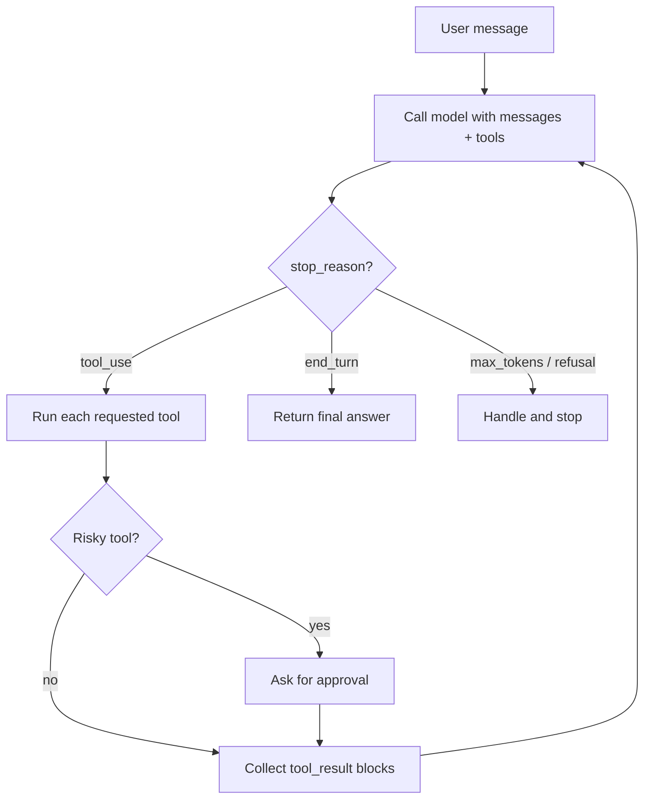

# Building Agents Without a Framework

## Introduction

Every agent framework in this section is, at its core, a wrapper around the same small loop: send messages to a model, run the tools it asks for, send the results back, and stop when it is done. Before you adopt LangGraph, CrewAI, or an agent SDK, it pays to build that loop yourself once. You will understand exactly what the frameworks do for you, and you may discover you do not need one at all.

Think of it like learning to cook before buying a meal kit. The kit is convenient, but if you know what goes into the dish, you can tell when the kit is saving you time and when it is just adding packaging.

In this page you will build a small **customer support agent** with two tools, `get_order` and `issue_refund`, using only the Anthropic Python SDK and the standard library. The same agent appears on every framework page in this section, so you can compare them side by side:

| Page | Same agent built with |
|------|-----------------------|
| This page | Plain Python + Anthropic SDK |
| [Claude Agent SDK](./2-agents-claude-agent-sdk.mdx) | `claude-agent-sdk` |
| [OpenAI Agents SDK](./3-agents-openai-agents-sdk.mdx) | `openai-agents` |
| [LangChain Agents](./4-agents-langchain.mdx) | `langchain` `create_agent` |
| [LangGraph](./5-agents-langgraph.mdx) | `langgraph` `StateGraph` |
| [CrewAI](./6-agents-crewai.mdx) | `crewai` |
| [AutoGen](./7-agents-autogen.mdx) | `autogen-agentchat` and Microsoft Agent Framework |
| [LlamaIndex Agents](./8-agents-llamaindex.mdx) | `llama-index` `FunctionAgent` |

:::info Other providers
The pattern on this page works with any provider that supports tool calling. OpenAI, Google Gemini, and open models served through Ollama or vLLM all expose a similar "model returns a tool call, you return a tool result" protocol. Only the field names change.
:::

## What a Framework Would Do for You

Before writing code, list the jobs an agent runtime has to do. This is the checklist we will implement by hand:

1. **Tool registry**: map tool names to Python functions and JSON schemas.
2. **The loop**: call the model, detect tool calls, execute them, append results, repeat.
3. **Stop conditions**: finish on a final answer, and also on turn limits, token limits, or refusals.
4. **Error handling**: turn tool exceptions into results the model can read and recover from.
5. **Guardrails and approvals**: block or pause risky actions such as refunds.
6. **State**: keep the conversation so the user can ask follow-up questions.
7. **Observability**: log what happened on each step.



## Step 1: The Tools

Start with plain Python functions. They know nothing about LLMs, which keeps them easy to test.

```python
# support_tools.py
ORDERS = {
    "A1001": {"status": "delivered", "total": 59.99, "delivered_days_ago": 3, "refunded": False},
    "A1002": {"status": "shipped", "total": 120.00, "delivered_days_ago": None, "refunded": False},
    "A1003": {"status": "delivered", "total": 35.50, "delivered_days_ago": 45, "refunded": False},
}

REFUND_WINDOW_DAYS = 30


def get_order(order_id: str) -> dict:
    """Return order details or raise KeyError if the order does not exist."""
    order = ORDERS.get(order_id.upper())
    if order is None:
        raise KeyError(f"Order {order_id} not found")
    return {"order_id": order_id.upper(), **order}


def issue_refund(order_id: str, reason: str) -> dict:
    """Refund a delivered order inside the refund window."""
    order = get_order(order_id)
    if order["status"] != "delivered":
        raise ValueError("Only delivered orders can be refunded")
    if order["delivered_days_ago"] > REFUND_WINDOW_DAYS:
        raise ValueError(f"Outside the {REFUND_WINDOW_DAYS}-day refund window")
    if order["refunded"]:
        raise ValueError("Order was already refunded")
    ORDERS[order["order_id"]]["refunded"] = True
    return {"order_id": order["order_id"], "refunded_amount": order["total"], "reason": reason}
```

Notice that the business rules (refund window, delivered-only) live in code, not in the prompt. The model decides *when* to call `issue_refund`; your code decides whether the refund is *allowed*. This split matters in every framework.

## Step 2: Tool Schemas and a Registry

The model needs a name, description, and JSON Schema for each tool. Your code needs a way to find the function by name. A dictionary handles both.

```python
# registry.py
from support_tools import get_order, issue_refund

TOOLS = [
    {
        "name": "get_order",
        "description": "Look up an order by ID. Returns status, total in USD, "
                       "days since delivery, and whether it was refunded.",
        "input_schema": {
            "type": "object",
            "properties": {"order_id": {"type": "string", "description": "Order ID such as A1001"}},
            "required": ["order_id"],
            "additionalProperties": False,
        },
    },
    {
        "name": "issue_refund",
        "description": "Refund a delivered order in full. Only call after get_order "
                       "confirms the order is delivered and eligible.",
        "input_schema": {
            "type": "object",
            "properties": {
                "order_id": {"type": "string"},
                "reason": {"type": "string", "description": "Short reason shown to finance"},
            },
            "required": ["order_id", "reason"],
            "additionalProperties": False,
        },
    },
]

TOOL_FUNCTIONS = {"get_order": get_order, "issue_refund": issue_refund}
RISKY_TOOLS = {"issue_refund"}
```

Writing schemas by hand is the most tedious part of going frameworkless. Every framework on the following pages generates them from type hints and docstrings. You can do the same with Pydantic's `model_json_schema()` if the boilerplate grows. See [Tool Input Schemas](../2-agents-tool-use/2-agents-tool-input-schemas.mdx) for details.

## Step 3: Executing Tools Safely

A tool call can fail for many reasons: a bad order ID, a policy violation, a network timeout. The model can often recover, but only if it *sees* the error. Wrap every call and return failures with `is_error: True`.

```python
# executor.py
import json
from registry import TOOL_FUNCTIONS, RISKY_TOOLS


def approve(tool_name: str, tool_input: dict) -> bool:
    """Human approval gate. Replace input() with a ticket UI or Slack button."""
    answer = input(f"Approve {tool_name} with {tool_input}? [y/N] ")
    return answer.strip().lower() == "y"


def run_tool(block) -> dict:
    """Execute one tool_use block and return a tool_result block."""
    func = TOOL_FUNCTIONS.get(block.name)
    if func is None:
        return {"type": "tool_result", "tool_use_id": block.id,
                "content": f"Unknown tool: {block.name}", "is_error": True}

    if block.name in RISKY_TOOLS and not approve(block.name, block.input):
        return {"type": "tool_result", "tool_use_id": block.id,
                "content": "A human reviewer declined this action. Tell the customer "
                           "a specialist will follow up.", "is_error": True}
    try:
        result = func(**block.input)
        return {"type": "tool_result", "tool_use_id": block.id, "content": json.dumps(result)}
    except (KeyError, ValueError, TypeError) as exc:
        return {"type": "tool_result", "tool_use_id": block.id,
                "content": f"Error: {exc}", "is_error": True}
```

Two design choices are worth calling out:

- **Approval lives in the executor**, not in the prompt. A prompt can be ignored or injected. A code path cannot. See [Human Approval Gates](../12-agents-safety-and-security/7-agents-approval-gates.mdx).
- **Expected errors become tool results; unexpected ones crash.** We catch `KeyError` and `ValueError` because the model can act on them. A bug in your code should surface loudly, not be hidden from you.

## Step 4: The Agent Loop

Now the loop itself. It handles every `stop_reason` the API can return, caps the number of iterations, and returns all tool results in a single user message.

```python
# agent.py
from anthropic import Anthropic
from registry import TOOLS
from executor import run_tool

client = Anthropic()  # reads ANTHROPIC_API_KEY
MODEL = "claude-opus-5-5"
SYSTEM = (
    "You are a support agent for Acme Gadgets. Look up orders before answering. "
    "Refunds are allowed for delivered orders within 30 days. "
    "Be concise and friendly. Never promise anything a tool did not confirm."
)
MAX_TURNS = 10


def run_agent(messages: list) -> str:
    for turn in range(MAX_TURNS):
        response = client.messages.create(
            model=MODEL,
            max_tokens=16000,
            system=SYSTEM,
            tools=TOOLS,
            messages=messages,
        )
        # Always append the full content blocks, not just the text
        messages.append({"role": "assistant", "content": response.content})

        if response.stop_reason == "tool_use":
            results = [run_tool(b) for b in response.content if b.type == "tool_use"]
            messages.append({"role": "user", "content": results})
            continue

        if response.stop_reason == "pause_turn":
            continue  # server-side tool paused; send the conversation back as-is

        if response.stop_reason == "max_tokens":
            return "[stopped: response hit max_tokens]"

        if response.stop_reason == "refusal":
            return "[the model declined this request]"

        # end_turn or stop_sequence: return the final text
        return "".join(b.text for b in response.content if b.type == "text")

    return "[stopped: too many turns]"
```

And a small REPL so the conversation persists across user turns:

```python
# main.py
import anthropic
from agent import run_agent


def main() -> None:
    messages = []
    while True:
        user = input("You: ").strip()
        if user in {"quit", "exit"}:
            break
        messages.append({"role": "user", "content": user})
        try:
            print("Agent:", run_agent(messages))
        except anthropic.RateLimitError:
            print("Agent: We're busy right now, please retry in a moment.")
        except anthropic.APIStatusError as exc:
            print(f"Agent: API error {exc.status_code}")
        except anthropic.APIConnectionError:
            print("Agent: Network problem reaching the model.")


if __name__ == "__main__":
    main()
```

Example session:

```text
You: Hi, order A1001 arrived with a cracked screen. Can I get my money back?
Approve issue_refund with {'order_id': 'A1001', 'reason': 'Arrived with cracked screen'}? [y/N] y
Agent: I'm sorry about the cracked screen! I've refunded the full $59.99 for order
A1001. You should see it on your statement within a few business days.
You: What about A1003? Same problem.
Agent: I checked A1003. It was delivered 45 days ago, which is outside our 30-day
refund window, so I can't refund it automatically. I can connect you with a
specialist who can look at warranty options.
```

The second answer shows the split from Step 1 working. Whether the model tried the refund and got an error back, or read `delivered_days_ago` and decided not to try, the 30-day rule held because it is enforced in code.

:::caution Exceptions from the API
The SDK retries some transient errors for you, but your application still has to decide what to tell the user when retries run out. Catch the most specific exception first, as shown above. See [Error Handling and Retries](../1-agents-llm-apis/9-agents-api-error-handling.mdx).
:::

## Step 5: Add Lightweight Tracing

Frameworks advertise "built-in tracing." Here is the frameworkless version: a structured log line per step. It is enough to debug most issues and can later feed into OpenTelemetry (see [OpenTelemetry for Agents](../11-agents-evaluation-and-testing/9-agents-opentelemetry.mdx)).

```python
# tracing.py
import json
import time
import uuid


class Trace:
    def __init__(self):
        self.trace_id = uuid.uuid4().hex[:8]
        self.start = time.perf_counter()

    def log(self, event: str, **fields) -> None:
        record = {"trace": self.trace_id, "t": round(time.perf_counter() - self.start, 3),
                  "event": event, **fields}
        print(json.dumps(record))


# Usage inside run_agent:
# trace.log("model_call", turn=turn, stop_reason=response.stop_reason,
#           input_tokens=response.usage.input_tokens,
#           output_tokens=response.usage.output_tokens)
# trace.log("tool_call", name=b.name, input=b.input)
```

Example output:

```text
{"trace": "3f9a1c2e", "t": 1.84, "event": "model_call", "turn": 0, "stop_reason": "tool_use", "input_tokens": 812, "output_tokens": 61}
{"trace": "3f9a1c2e", "t": 1.85, "event": "tool_call", "name": "get_order", "input": {"order_id": "A1001"}}
{"trace": "3f9a1c2e", "t": 3.10, "event": "model_call", "turn": 1, "stop_reason": "tool_use", "input_tokens": 930, "output_tokens": 74}
```

## The Middle Ground: SDK Tool Runners

You do not have to choose between "write every line" and "adopt a framework." Most provider SDKs ship a small helper that runs the loop for you while keeping you close to the raw API. The Anthropic Python SDK has a beta **tool runner**:

```python
import json
from anthropic import Anthropic, beta_tool
from support_tools import get_order as _get_order, issue_refund as _issue_refund

client = Anthropic()


@beta_tool
def get_order(order_id: str) -> str:
    """Look up an order by ID.

    Args:
        order_id: Order ID such as A1001.
    """
    try:
        return json.dumps(_get_order(order_id))
    except KeyError as exc:
        return f"Error: {exc}"


@beta_tool
def issue_refund(order_id: str, reason: str) -> str:
    """Refund a delivered order in full.

    Args:
        order_id: Order ID to refund.
        reason: Short reason shown to finance.
    """
    try:
        return json.dumps(_issue_refund(order_id, reason))
    except (KeyError, ValueError) as exc:
        return f"Error: {exc}"


runner = client.beta.messages.tool_runner(
    model="claude-opus-5-5",
    max_tokens=16000,
    tools=[get_order, issue_refund],
    messages=[{"role": "user", "content": "Order A1001 arrived broken. Refund please."}],
)
for message in runner:
    for block in message.content:
        if block.type == "text":
            print(block.text)
```

The runner generates schemas from the docstrings, executes tools, and stops when the model is done. You give up a little control (for example, approvals now live inside the tool function). The tool runner page covers it in depth: [Using an SDK Tool Runner](../2-agents-tool-use/4-agents-tool-runner.mdx).

## Real-World Scenario

Your team runs a SaaS helpdesk product. Product management wants an "AI triage" feature: when a ticket arrives, an agent reads it, looks up the customer's plan and recent invoices, and drafts a reply for a human to send. The backend is a mature Django app with its own job queue, logging, and metrics. Two engineers will own the feature.

**The frameworkless solution:**

- Two to four tools (`get_customer`, `list_invoices`, `draft_reply`) written as normal service functions with unit tests.
- A `run_agent()` loop like the one above, about 60 lines, called from the existing Celery task.
- Approval is implicit: the agent only *drafts*; a human clicks send.
- Tracing uses the app's existing structured logger. Token usage is recorded per ticket for cost dashboards.

**Why this approach fits:**

- The workflow is a single agent with a handful of tools. That is exactly the loop you just wrote.
- The team already has queues, persistence, retries, and logging. A framework would duplicate them.
- Fewer dependencies means fewer surprise breaking changes. Agent frameworks are still young and change quickly.
- Debugging is simpler because there is no hidden prompt or extra abstraction between you and the API.

**When to use it / when not to:**

- Use it for single-agent tools-in-a-loop features, especially inside an existing codebase.
- Reconsider when you need durable multi-step workflows that survive restarts, branching graphs, many cooperating agents, or a visual debugger. Rebuilding checkpointing, interrupts, and replay by hand is real work, and the frameworks on the next pages have already done it.

**Alternatives and trade-offs:**

| Approach | Pros | Cons | Best for |
|----------|------|------|----------|
| Hand-written loop | Full control, minimal deps, transparent | You write schemas, retries, state, tracing | Small agents inside existing apps |
| SDK tool runner | Less boilerplate, still close to the API | Beta APIs, provider-specific | Quick single-agent features |
| Vendor agent SDK (Claude Agent SDK, OpenAI Agents SDK) | Built-in tools, handoffs, guardrails, tracing | Tied to one vendor's runtime conventions | Teams standardized on one provider |
| Orchestration framework (LangGraph, CrewAI, LlamaIndex) | Durable state, graphs, multi-agent, ecosystem | Learning curve, abstraction overhead | Complex or long-running workflows |
| Managed platform | Hosting, sandboxes, scaling handled for you | Less control, platform lock-in | Teams without infra capacity |

## Common Mistakes

1. **Appending only the text of the assistant turn.** You must append the full `response.content`, including `tool_use` blocks. Otherwise the next request fails because the `tool_result` has no matching `tool_use`.
2. **Sending one user message per tool result.** When the model calls several tools at once, return every `tool_result` in a single user message. See [Parallel Tool Calls](../2-agents-tool-use/5-agents-parallel-tool-calls.mdx).
3. **No turn limit.** A confused model can loop forever and burn money. Always cap turns, and consider a token or dollar budget too. See [Stopping Conditions and Budgets](../6-agents-planning-and-reasoning/10-agents-stopping-conditions.mdx).
4. **Swallowing every exception.** Catch only the errors the model can act on. Let real bugs crash so you notice them.
5. **Business rules in the prompt only.** "Never refund after 30 days" in the system prompt is a hint; the same rule in `issue_refund()` is a guarantee.
6. **Forced tool choice.** On current Claude models, `tool_choice` values that force a specific tool return an error. Use `auto` with clear instructions instead.
7. **Rewriting a framework by accident.** If you find yourself building checkpoint storage, graph routing, and a replay UI, stop and evaluate the frameworks on the next pages.

## Summary

- An agent is a loop: call the model, run requested tools, return results, repeat until a final answer.
- Without a framework you write the tool registry, schemas, loop, error handling, approvals, state, and tracing yourself, which is roughly 100 to 200 lines for a small agent.
- Keep business rules and approvals in code; let the model decide *when* to act, not *whether* it is allowed.
- SDK tool runners are a middle ground that remove boilerplate without adding a framework.
- Going frameworkless is a strong default for single agents inside existing apps; frameworks earn their keep on durable, branching, or multi-agent workflows.

## Exercises

1. **Add a third tool.** Implement `escalate_to_human(order_id, summary)` and update the system prompt so the agent escalates refunds outside the window instead of just apologizing.
2. **Token budget.** Track `response.usage.input_tokens + output_tokens` across turns and stop the loop with a friendly message when the total passes 20,000.
3. **Swap the provider.** Port `run_agent()` to another provider's SDK that supports tool calling. List every field name you had to change.
4. **Test without the API.** Write a unit test that feeds a fake response object with a `tool_use` block into the loop and asserts that `issue_refund` is never called when `approve()` returns `False`. See [Mocking LLM Calls in Tests](../11-agents-evaluation-and-testing/5-agents-mocking-llm-calls.mdx).

**Related pages:**

- [Building a Manual Agent Loop](../2-agents-tool-use/3-agents-manual-agent-loop.mdx)
- [The Agent Loop](../0-agents-fundamentals/4-agents-agent-loop.mdx)
- [Agent Framework Landscape](./0-agents-framework-landscape.mdx)
- [Choosing an Agent Framework](./10-agents-choosing-a-framework.mdx)
