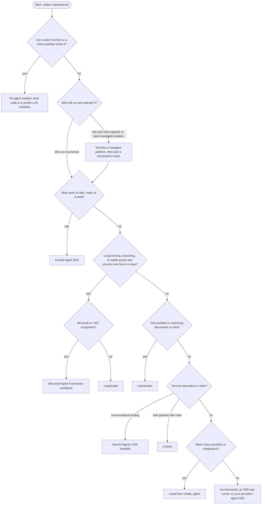
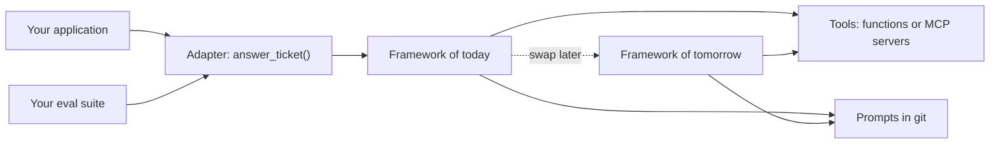

# Choosing an Agent Framework

## Introduction

You have now seen the same support agent built with a hand-written loop, two vendor SDKs, four orchestration frameworks, and several managed platforms. They all worked. So how do you choose?

The honest answer is that **the requirements of your project choose for you**, if you write them down. Most bad framework decisions come from skipping that step: picking whatever was trending, or whatever the first tutorial used, and then fighting it for months.

This page gives you a repeatable process:

1. Write down requirements using a short list of criteria.
2. Use a decision flowchart to shortlist two or three options.
3. Run a small, time-boxed bake-off on your own task with your own evaluation set.
4. Decide, and design for an exit so the decision is reversible.

An analogy: choosing a framework is like choosing a database. Nobody picks PostgreSQL vs DynamoDB vs Redis by popularity alone. You ask about data shape, consistency needs, scale, and team skills. Agent frameworks deserve the same discipline.

## Step 1: The Criteria

Score each criterion for your project as **must have**, **nice to have**, or **not needed**.

| Criterion | Questions to ask |
|-----------|-----------------|
| **Task shape** | Single agent with a few tools? Fixed pipeline? Open-ended exploration? Several specialists? |
| **Control vs convenience** | Do you need to control every step, or do you want sensible defaults? |
| **Model flexibility** | One provider, or must you switch or mix providers? Any local or open models? |
| **Built-in tools** | Do you need file editing, a shell, a browser, or code execution out of the box? |
| **Durability** | Will runs last minutes, hours, or days? Must they survive restarts? |
| **Human-in-the-loop** | Do actions need approval? Can approvals arrive much later? |
| **Data and retrieval** | Is the core problem searching documents or databases? |
| **Observability** | What tracing do you need? Must it go to your existing stack (OpenTelemetry)? |
| **Language and ecosystem** | Python, TypeScript, .NET? Which cloud? |
| **Deployment and operations** | Who runs it? Do you need sandboxes, autoscaling, isolation? |
| **Team skills** | What does the team already know? Who maintains it in a year? |
| **Maturity and governance** | Release cadence, maintenance status, license, security response, vendor terms |
| **Lock-in tolerance** | How painful would it be to switch in a year? |

:::tip Keep it short
You do not need a 40-row spreadsheet. Five to eight "must have" items usually narrow the field to two or three options.
:::

## Step 2: How the Options Compare

The table summarizes the framework pages in this section. Ratings are relative and approximate, and they change as projects evolve, so confirm against current docs.

| Option | Task shape it fits best | Control | Model flexibility | Built-in local tools | Durability | Multi-agent |
|--------|------------------------|---------|-------------------|----------------------|------------|-------------|
| [No framework](./1-agents-no-framework.mdx) | Single agent, few tools | Full | Any (DIY) | None | DIY | DIY |
| [Claude Agent SDK](./2-agents-claude-agent-sdk.mdx) | Coding, file, research, ops agents | Medium (hooks, permissions) | Claude models | Extensive (files, shell, web) | Sessions and resume | Subagents |
| [OpenAI Agents SDK](./3-agents-openai-agents-sdk.mdx) | Conversational agents with specialists | Medium | OpenAI first, others via adapters | Few local; hosted tools on OpenAI | Sessions, resumable approvals | Handoffs, agents as tools |
| [LangChain](./4-agents-langchain.mdx) | Standard tool agents with many integrations | Medium (middleware) | Very broad | Some via integrations | Checkpointers | Through LangGraph |
| [LangGraph](./5-agents-langgraph.mdx) | Branching, long-running, auditable workflows | High | Very broad | Via LangChain tools | Strong (checkpoints, interrupts) | First-class |
| [CrewAI](./6-agents-crewai.mdx) | Role-based pipelines | Medium (Flows add more) | Broad | Tool library available | Flow state | First-class crews |
| [AutoGen](./7-agents-autogen.mdx) | Existing projects, research | Medium | Broad | Code executors | Limited | Conversational teams |
| [Microsoft Agent Framework](./7-agents-autogen.mdx) | Enterprise agents and workflows, .NET or Python | Medium to high | Broad | Harness features | Checkpointed workflows | Workflows |
| [LlamaIndex](./8-agents-llamaindex.mdx) | Document and data agents | Medium | Broad | Data loaders, query engines | Serializable context | `AgentWorkflow` |
| [Managed platforms](./9-agents-managed-agent-platforms.mdx) | Teams that want ops offloaded | Varies | Varies | Managed sandboxes | Provider-managed | Varies |

And from the operational side:

| Option | Ecosystem fit | Main strength | Main trade-off |
|--------|--------------|---------------|----------------|
| No framework | Anything | Transparency, zero dependencies | You build every feature beyond the loop |
| Claude Agent SDK | Python, TypeScript | Production harness with real tools | Tied to Claude models |
| OpenAI Agents SDK | Python, TypeScript | Minimal primitives, guardrails, tracing | Best experience on OpenAI models |
| LangChain / LangGraph | Python, TypeScript | Integrations and explicit control | Abstraction layers, fast-moving APIs |
| CrewAI | Python | Fastest multi-agent prototypes | Less fine-grained loop control |
| AutoGen | Python, .NET | Mature conversational patterns | Maintenance mode |
| Microsoft Agent Framework | Python, .NET (Go preview) | Enterprise features, Azure integration | Newer, still evolving |
| LlamaIndex | Python, TypeScript | Retrieval quality and data tooling | Agent layer secondary to data layer |
| Managed platforms | Specific clouds or vendors | Isolation, scaling, identity handled | Lock-in, less runtime control |

## Step 3: The Decision Flowchart

Use this to produce a **shortlist**, not a final answer.



A few notes on the flowchart:

- The first question is deliberately "do you need an agent at all?" Many problems are better solved with a fixed workflow. See [Agents vs Workflows](../0-agents-fundamentals/3-agents-vs-workflows.mdx) and [When Should You Build an Agent?](../0-agents-fundamentals/7-agents-when-to-build.mdx).
- Branches are not exclusive. A LangGraph graph can contain a LlamaIndex query engine as a tool; a managed platform can host a CrewAI crew. Combining is normal.
- Where the flowchart names a vendor SDK, the equivalent SDK from your chosen model provider is often a reasonable substitute. Pick based on the models you plan to use.

## Step 4: Run a Bake-Off

A shortlist of two or three is the input to a short, evidence-based comparison. Time-box it to a few days.

1. **Write 15 to 30 test cases** from real data: typical requests, edge cases, and a few adversarial ones. See [Building Evaluation Datasets](../11-agents-evaluation-and-testing/1-agents-building-eval-sets.mdx).
2. **Implement the same tools once** as plain functions or an MCP server, and wire them into each candidate. This keeps the comparison about the framework, not the tools.
3. **Use the same model** in every candidate where possible, so you compare frameworks, not models.
4. **Measure:** task success rate, number of model calls and tokens, latency, how easy failures were to debug, and lines of code.
5. **Try one change request** in each, for example "add an approval step before refunds." How long did it take?

A tiny harness keeps the comparison honest:

```python
import json
import time
from dataclasses import dataclass, field
from typing import Callable


@dataclass
class CaseResult:
    case_id: str
    passed: bool
    seconds: float
    error: str = ""


@dataclass
class BakeOff:
    cases: list[dict]
    results: dict[str, list[CaseResult]] = field(default_factory=dict)

    def run(self, name: str, agent_fn: Callable[[str], str]) -> None:
        """agent_fn takes the user message and returns the final answer text."""
        rows = []
        for case in self.cases:
            start = time.perf_counter()
            try:
                answer = agent_fn(case["input"])
                passed = all(s.lower() in answer.lower() for s in case["must_contain"])
                rows.append(CaseResult(case["id"], passed, time.perf_counter() - start))
            except Exception as exc:  # record the failure and continue
                rows.append(CaseResult(case["id"], False, time.perf_counter() - start, str(exc)))
        self.results[name] = rows

    def report(self) -> None:
        for name, rows in self.results.items():
            passed = sum(r.passed for r in rows)
            avg = sum(r.seconds for r in rows) / len(rows)
            print(f"{name:<20} {passed}/{len(rows)} passed, avg {avg:.2f}s")


cases = [
    {"id": "refund-ok", "input": "A1001 arrived broken, refund please", "must_contain": ["59.99"]},
    {"id": "too-old", "input": "Refund A1003 please", "must_contain": ["30"]},
]

# Example wiring with stub agents (replace with real framework calls):
bake = BakeOff(cases)
bake.run("stub-a", lambda msg: "Refunded $59.99" if "A1001" in msg else "Outside 30-day window")
bake.run("stub-b", lambda msg: "Done!")
bake.report()
```

Output:

```text
stub-a               2/2 passed, avg 0.00s
stub-b               0/2 passed, avg 0.00s
```

Substring checks are crude. For real bake-offs, add rubric or LLM-judge grading and trajectory checks, as described in [Grading Methods: Code, Rubrics and LLM Judges](../11-agents-evaluation-and-testing/2-agents-grading-methods.mdx) and [Evaluating Agent Trajectories](../11-agents-evaluation-and-testing/3-agents-trajectory-evaluation.mdx).

## Step 5: Design for an Exit

Whatever you choose, assume you may switch within a year or two. These habits keep that cheap:

- **Tools as plain functions or MCP servers.** Every framework on these pages can call them. See [MCP Introduction](../7-agents-mcp/0-agents-mcp-introduction.mdx).
- **Prompts in version control**, not only in a framework's config format. See [Versioning and Managing Prompts](../3-agents-prompt-engineering/8-agents-prompt-versioning.mdx).
- **Evaluations owned by you**, framework-independent, run in CI. See [Regression Testing for Agents](../11-agents-evaluation-and-testing/6-agents-regression-testing.mdx).
- **OpenTelemetry for tracing** where possible, so your observability survives a framework change. See [OpenTelemetry for Agents](../11-agents-evaluation-and-testing/9-agents-opentelemetry.mdx).
- **A thin adapter** between your app and the agent: `answer_ticket(ticket) -> Reply`. The rest of your app should not import framework classes.



### The adapter in code

The adapter is just an interface your application depends on. Each framework gets a small implementation behind it.

```python
from dataclasses import dataclass
from typing import Protocol


@dataclass
class Reply:
    text: str
    refunded: bool
    model_calls: int


class SupportAgent(Protocol):
    def answer_ticket(self, ticket_text: str) -> Reply: ...


class NoFrameworkSupportAgent:
    """Wraps the hand-written loop from the no-framework page."""

    def answer_ticket(self, ticket_text: str) -> Reply:
        # messages = [{"role": "user", "content": ticket_text}]
        # text = run_agent(messages)
        text = "Refunded $59.99 for A1001"  # placeholder for the real call
        return Reply(text=text, refunded="Refunded" in text, model_calls=2)


def handle_ticket(agent: SupportAgent, ticket_text: str) -> str:
    reply = agent.answer_ticket(ticket_text)
    if reply.refunded:
        print("notify finance")
    return reply.text


print(handle_ticket(NoFrameworkSupportAgent(), "A1001 arrived broken"))
```

Output:

```text
notify finance
Refunded $59.99 for A1001
```

Adding a `LangGraphSupportAgent` or `ClaudeAgentSDKSupportAgent` later means one new class; `handle_ticket` and the rest of your app do not change. The bake-off harness above can call `agent.answer_ticket` too, so every candidate is measured through the same door.

## Total Cost of Ownership

The license is free for every open-source framework on these pages. The real costs are elsewhere:

| Cost | What drives it | How to keep it low |
|------|----------------|--------------------|
| Model tokens | Number of model calls per task, context size | Fewer agents, tighter tools, caching (see [Prompt Caching](../4-agents-memory-and-context/4-agents-prompt-caching.mdx)) |
| Engineering time | Learning curve, debugging through abstractions | Pick what your team can debug; prototype first |
| Upgrades | Breaking changes in fast-moving frameworks | Pin versions, keep the adapter thin, run evals on upgrade |
| Infrastructure | Sandboxes, state stores, queues, tracing | Reuse what you have, or a managed platform |
| Platform fees | Per-session or per-call charges on managed platforms | Compare with self-hosting at your expected volume |
| Lock-in | Platform-only features in core logic | MCP tools, prompts in git, own evals |

A framework that saves two weeks of building but doubles model calls per task can easily cost more within a few months at scale. Measure calls and tokens in your bake-off.

## Red Flags During a Bake-Off

Watch for these while prototyping; any one of them deserves a serious discussion before committing:

- You cannot find out **what prompt** the framework actually sent to the model.
- A simple change (add a tool, add an approval) requires reading framework source code.
- Failures surface as generic exceptions with no trace of which step failed.
- The framework silently retries or loops, and you cannot cap turns, tokens, or cost.
- Your provider's newest model or feature is unsupported, with no timeline.
- The examples in the docs do not run against the current release.

## Migrating Between Frameworks

If you do need to switch, a calm migration looks like this:

1. **Freeze behavior**: build or extend the eval suite so it captures what "working" means today.
2. **Extract tools**: move tool logic into plain functions or an MCP server if it is not there already.
3. **Port one agent at a time** behind the adapter, keeping prompts as close to the original as possible at first.
4. **Run both side by side** on the eval suite and on a slice of shadow traffic.
5. **Switch traffic gradually**, watching success rate, cost, and latency.
6. **Only then refactor** prompts and structure to use the new framework's strengths.

The [AutoGen](./7-agents-autogen.mdx) page walks through this process for moving to Microsoft Agent Framework, and [Migrating to a New Model](../13-agents-production/8-agents-model-migration.mdx) covers the closely related problem of switching models.

## Real-World Scenarios

Four short cases show the process in action. Each lists the deciding requirements, not just the answer.

**1. Startup adding an "explain this invoice" button.** One agent, two read-only tools, Python monolith, one engineer. Must-haves: low dependency risk, fast to ship. **Choice:** no framework, or the provider SDK's tool runner. A framework would add more than it saves.

**2. Platform team automating dependency upgrades across 200 repos.** Agent must read and edit files, run tests, open PRs; runs in CI containers; strict rules about never touching secrets. **Choice:** Claude Agent SDK, with `PreToolUse` hooks for path and command rules and budgets per run. Built-in file and shell tools save weeks.

**3. Bank's loan-document review.** Multi-day process, compliance sign-off, full audit trail, must survive deploys, team uses several model providers. **Choice:** LangGraph with a Postgres checkpointer and interrupts, possibly hosted on a cloud agent runtime for isolation. If the bank were a Microsoft shop on .NET, Microsoft Agent Framework workflows would be the equivalent choice.

**4. Agency producing weekly research briefs.** Role-based pipeline (researcher, analyst, writer), quality matters more than latency, prompt iteration speed is key. **Choice:** CrewAI crews inside a Flow, or OpenAI Agents SDK agents-as-tools if the team prefers that style. A two-day bake-off between them on five real briefs settles it.

**Why this approach works:** in every case the deciding factors were task shape, operations, and constraints, not which framework is "best." Different projects in the same company can reasonably pick different answers.

**Alternatives and trade-offs for the decision process itself:**

| Approach | Pros | Cons | Best for |
|----------|------|------|----------|
| Requirements + flowchart + bake-off | Evidence-based, defensible | Takes a few days | Anything going to production |
| Pick the most popular | Fast, lots of tutorials | Popularity is not fit | Learning and hackathons |
| Use what the team knows | Fast delivery, low risk | May not fit new requirements | Small, similar projects |
| Company-wide mandate | Consistency, shared tooling | Poor fit for outlier projects | Highly regulated or very small orgs |

## Frequently Asked Questions

**Should beginners start with a framework?** Build the [no-framework loop](./1-agents-no-framework.mdx) once first. It takes an afternoon and makes every framework easier to understand and debug. Then use a framework when a project needs what it offers.

**Can I mix frameworks in one system?** Yes, and it is common. A LangGraph workflow can call a LlamaIndex query engine as a tool; a CrewAI Flow can call a Claude Agent SDK agent in one step; agents in different frameworks can talk over A2A. Keep the boundaries clean with adapters and shared MCP tools.

**Does the framework affect answer quality?** Mostly indirectly. Quality comes primarily from the model, prompts, tools, and context. Frameworks influence it through the prompts they add, how they manage context, and how much control they give you to fix problems. That is why a bake-off with your own eval set matters more than general benchmarks.

**What if my framework is abandoned or changes direction?** With tools in MCP servers, prompts in git, framework-independent evals, and a thin adapter, a migration is a contained project rather than a rewrite.

## Common Mistakes

1. **Skipping the "do we need an agent" question.** A fixed workflow is cheaper, faster, and more predictable when the steps are known.
2. **Comparing frameworks with different models.** You end up measuring the model, not the framework.
3. **Judging on hello-world demos.** Every framework looks good on a one-tool demo. Test the hard parts: approvals, failures, long runs, and a change request.
4. **Ignoring maintenance and governance.** Check release cadence, open issue response, license, and official status notices before committing.
5. **Letting the framework leak everywhere.** Without an adapter layer, switching later means touching your whole codebase.
6. **Treating the decision as permanent.** Re-evaluate when requirements change or a framework changes direction.

## Summary

- Write requirements first: task shape, control, model flexibility, built-in tools, durability, approvals, data needs, observability, ecosystem, operations, team skills, maturity, and lock-in.
- Use the comparison tables and decision flowchart to shortlist two or three options.
- Run a short bake-off with your own tools, one model, and a real evaluation set; include a change request.
- Design for an exit: tools as functions or MCP servers, prompts in git, framework-independent evals, OpenTelemetry, and a thin adapter.
- Different projects can reasonably choose different frameworks; standardize the assets around them instead.

## Exercises

1. **Requirements sheet.** For an agent you want to build, fill in the criteria table with must have, nice to have, or not needed.
2. **Shortlist.** Walk the decision flowchart and write one sentence justifying each branch you took.
3. **Bake-off.** Wire the support agent from two framework pages into the `BakeOff` harness and add five test cases of your own, including one where the refund must be refused.
4. **Exit plan.** Write the adapter function signature for your agent and list every framework import that would need to change if you switched.

**Related pages:**

- [Agent Framework Landscape](./0-agents-framework-landscape.mdx)
- [Building Agents Without a Framework](./1-agents-no-framework.mdx)
- [Managed Agent Platforms](./9-agents-managed-agent-platforms.mdx)
- [Production Readiness Checklist](../13-agents-production/0-agents-production-readiness.mdx)
