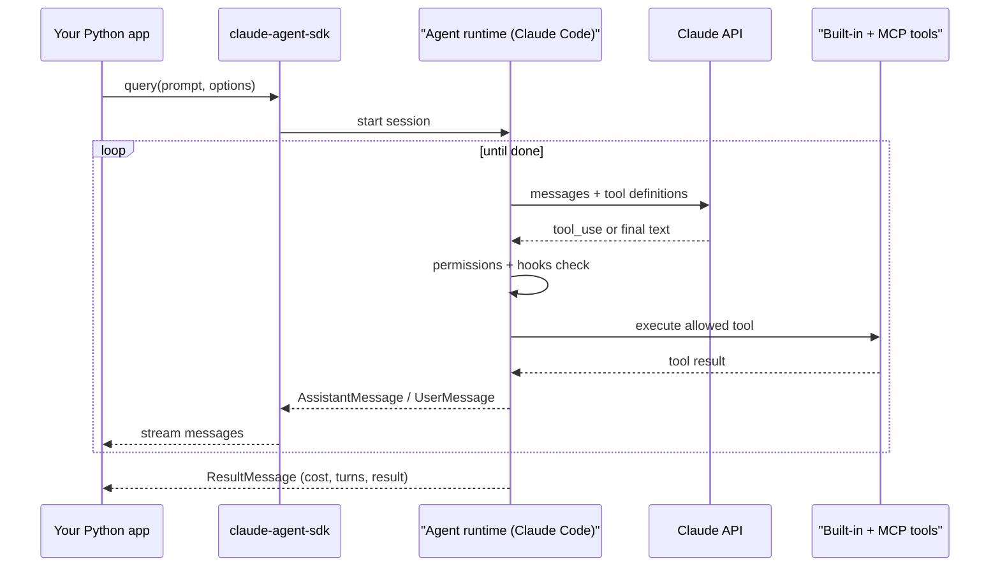

# Claude Agent SDK

## Introduction

The **Claude Agent SDK** gives you the same agent harness that powers Claude Code, packaged as a Python and TypeScript library. Instead of writing the loop yourself, you hand the SDK a prompt and a set of options. It runs the loop, executes tools, manages context, and streams messages back to you.

What makes it different from most frameworks is what comes in the box. Out of the gate, the agent can read and edit files, search a codebase, run shell commands, and fetch web pages, because those are Claude Code's built-in tools. You add your own tools through MCP, control what is allowed through permissions and hooks, and split work across subagents.

An analogy: a framework like LangGraph hands you parts to build a car. The Claude Agent SDK hands you a car that is already built (engine, brakes, dashboard) and lets you choose where it may drive and what to put in the trunk.

:::note Not the same as the API tool runner
The Anthropic **Client SDK** (`pip install anthropic`) talks to the Messages API directly. You write the loop yourself or use its beta tool runner (see [Using an SDK Tool Runner](../2-agents-tool-use/4-agents-tool-runner.mdx)). The **Claude Agent SDK** (`pip install claude-agent-sdk`) is a separate product that runs the Claude Code agent runtime inside your process.
:::

| You want to | Use | What you get |
|-------------|-----|--------------|
| Call the model and own the loop | Client SDK (`anthropic`) | Messages API, optional tool runner |
| Embed a ready-made agent harness in your app | **Claude Agent SDK** (`claude-agent-sdk`) | Built-in tools, permissions, hooks, sessions, subagents |
| Have Anthropic host the agent and sandbox | Claude Managed Agents | Hosted loop and containers, see [Managed Agent Platforms](./9-agents-managed-agent-platforms.mdx) |
| Work interactively in a terminal | Claude Code CLI | The interactive tool itself |

## How It Works

The Python package bundles the Claude Code runtime and talks to it under the hood. Your code sends a prompt and options; the runtime runs the agent loop and streams typed messages back.



## Installation and Setup

```bash
python -m venv .venv
source .venv/bin/activate
pip install claude-agent-sdk
export ANTHROPIC_API_KEY="your-api-key"
```

The SDK supports Python and TypeScript. Package names, option fields, and defaults change between releases, so check the [Agent SDK overview](https://code.claude.com/docs/en/agent-sdk/overview) and the [Python reference](https://code.claude.com/docs/en/agent-sdk/python) for the version you install.

:::caution Authentication for products you ship
Use API key authentication for applications you build on the Agent SDK. Anthropic's terms do not allow third-party products to offer claude.ai login or its rate limits unless previously approved.
:::

## Your First Query

`query()` is an async generator. Each call starts a fresh session, runs the agent until it finishes, and yields messages along the way. The last message is a `ResultMessage` with the final text, cost, and turn count.

```python
import asyncio
from claude_agent_sdk import query, ClaudeAgentOptions, AssistantMessage, TextBlock, ResultMessage


async def main():
    options = ClaudeAgentOptions(
        model="claude-opus-5-5",
        allowed_tools=["Read", "Glob", "Grep"],  # read-only built-in tools
        max_turns=10,
    )
    async for message in query(
        prompt="List the Python files in this folder and summarize what each one does.",
        options=options,
    ):
        if isinstance(message, AssistantMessage):
            for block in message.content:
                if isinstance(block, TextBlock):
                    print(block.text)
        elif isinstance(message, ResultMessage):
            print(f"\n[{message.subtype}] turns={message.num_turns} cost=${message.total_cost_usd}")


asyncio.run(main())
```

Example output:

```text
I'll look for Python files in the current directory.
There are three Python files:
- support_tools.py: in-memory order data plus get_order and issue_refund helpers
- registry.py: tool schemas and a name-to-function map
- agent.py: a hand-written agent loop using the Anthropic SDK

[success] turns=3 cost=$0.0412
```

You never wrote a tool definition. `Read`, `Glob`, and `Grep` are built in. The `allowed_tools` list *pre-approves* them so they run without a permission prompt.

:::tip Built-in tools
Common built-in tools include `Read`, `Write`, `Edit`, `Glob`, `Grep`, `Bash`, `WebFetch`, `WebSearch`, and `Agent` (for subagents). The full list is in the [tools reference](https://code.claude.com/docs/en/tools-reference).
:::

## The Support Agent with Custom Tools

Now the running example from [Building Agents Without a Framework](./1-agents-no-framework.mdx). Custom tools in the Agent SDK are **in-process MCP tools**: you decorate an async function with `@tool`, bundle tools into a server with `create_sdk_mcp_server`, and pass the server in `mcp_servers`.

```python
import asyncio
import json
from typing import Any
from claude_agent_sdk import (
    tool, create_sdk_mcp_server, query, ClaudeAgentOptions, ResultMessage,
)

ORDERS = {
    "A1001": {"status": "delivered", "total": 59.99, "delivered_days_ago": 3},
    "A1003": {"status": "delivered", "total": 35.50, "delivered_days_ago": 45},
}


@tool("get_order", "Look up an order by ID. Returns status, total and days since delivery.",
      {"order_id": str})
async def get_order(args: dict[str, Any]) -> dict[str, Any]:
    order = ORDERS.get(args["order_id"].upper())
    if order is None:
        return {"content": [{"type": "text", "text": "Order not found"}], "is_error": True}
    return {"content": [{"type": "text", "text": json.dumps(order)}]}


@tool("issue_refund", "Refund a delivered order within 30 days of delivery.",
      {"order_id": str, "reason": str})
async def issue_refund(args: dict[str, Any]) -> dict[str, Any]:
    order = ORDERS.get(args["order_id"].upper())
    if order is None or order["delivered_days_ago"] > 30:
        return {"content": [{"type": "text", "text": "Not eligible for refund"}], "is_error": True}
    return {"content": [{"type": "text",
                         "text": f"Refunded ${order['total']} for {args['order_id']}"}]}


support_server = create_sdk_mcp_server(name="support", version="1.0.0",
                                       tools=[get_order, issue_refund])


async def main():
    options = ClaudeAgentOptions(
        model="claude-opus-5-5",
        system_prompt="You are a concise, friendly support agent for Acme Gadgets.",
        mcp_servers={"support": support_server},
        tools=[],  # remove all built-in tools: this agent only needs our two
        allowed_tools=["mcp__support__get_order", "mcp__support__issue_refund"],
        max_turns=8,
    )
    async for message in query(
        prompt="Order A1001 arrived with a cracked screen. Can I get my money back?",
        options=options,
    ):
        if isinstance(message, ResultMessage) and message.subtype == "success":
            print(message.result)


asyncio.run(main())
```

Example output:

```text
I'm sorry your screen arrived cracked! I've refunded the full $59.99 for order
A1001. You should see it on your statement within a few business days.
```

Three details to notice:

- **Tool naming.** MCP tools are addressed as `mcp__<server key>__<tool name>`. The server key is the dictionary key in `mcp_servers` (`"support"`), not the `name` you passed to `create_sdk_mcp_server`.
- **`tools` vs `allowed_tools`.** `tools` controls *availability* (which built-ins are in the model's context). `allowed_tools` controls *permission* (which calls run without asking). Passing `tools=[]` keeps a support bot from ever seeing `Bash`.
- **Errors.** Returning `"is_error": True` lets you write the message Claude reads. An uncaught exception is also converted to an error result, but with a less helpful raw message.

## Permissions and Hooks

Permissions decide whether a tool call may run. There are several layers:

| Mechanism | What it does |
|-----------|--------------|
| `allowed_tools` / `disallowed_tools` | Pre-approve or block tools by name (scoped rules such as `Bash(rm *)` are also supported) |
| `permission_mode` | Global behavior: `"default"`, `"acceptEdits"`, `"plan"`, `"dontAsk"`, `"bypassPermissions"`, `"auto"` |
| `can_use_tool` | An async callback your app uses to decide each call at runtime |
| Hooks | Callbacks at lifecycle events such as `PreToolUse`, `PostToolUse`, `Stop`, `SubagentStop` |

**Hooks** are the most flexible. A `PreToolUse` hook sees the tool name and input before the call and can allow, deny, ask, or rewrite it. Here is a hook that blocks refunds above a limit, no matter what the model decides:

```python
from claude_agent_sdk import ClaudeAgentOptions, HookMatcher

REFUND_LIMIT = 100.00
ORDER_TOTALS = {"A1001": 59.99, "A1004": 450.00}


async def limit_refunds(input_data, tool_use_id, context):
    order_id = input_data["tool_input"].get("order_id", "").upper()
    if ORDER_TOTALS.get(order_id, 0) > REFUND_LIMIT:
        return {
            "hookSpecificOutput": {
                "hookEventName": input_data["hook_event_name"],
                "permissionDecision": "deny",
                "permissionDecisionReason": f"Refunds over ${REFUND_LIMIT} need a manager. "
                                            "Offer to escalate instead.",
            }
        }
    return {}  # empty dict means "no objection"


async def audit_log(input_data, tool_use_id, context):
    print(f"[audit] {input_data['tool_name']} {input_data['tool_input']}")
    return {}


options = ClaudeAgentOptions(
    model="claude-opus-5-5",
    hooks={
        "PreToolUse": [
            HookMatcher(matcher="mcp__support__issue_refund", hooks=[limit_refunds]),
            HookMatcher(hooks=[audit_log]),  # no matcher: runs for every tool
        ]
    },
)
```

The `permissionDecisionReason` goes back to the model, which then explains the situation to the customer instead of retrying. When several hooks apply, `deny` wins over everything else.

:::warning Avoid bypassPermissions in production
`permission_mode="bypassPermissions"` skips permission checks. It is convenient in a throwaway sandbox but dangerous anywhere an agent can touch real files, credentials, or money. Prefer narrow `allowed_tools`, hooks, and sandboxing. See [Least Privilege for Agent Tools](../12-agents-safety-and-security/2-agents-least-privilege.mdx).
:::

## Multi-Turn Conversations with ClaudeSDKClient

`query()` starts a new session each time. For a chat-style experience where the agent remembers earlier turns, use `ClaudeSDKClient` as an async context manager.

```python
import asyncio
from claude_agent_sdk import ClaudeSDKClient, ClaudeAgentOptions, AssistantMessage, TextBlock


async def chat():
    options = ClaudeAgentOptions(model="claude-opus-5-5", tools=[], max_turns=5)
    async with ClaudeSDKClient(options=options) as client:
        for user_text in ["My order number is A1001.", "Which order did I mention?"]:
            await client.query(user_text)
            async for message in client.receive_response():
                if isinstance(message, AssistantMessage):
                    for block in message.content:
                        if isinstance(block, TextBlock):
                            print(f"Agent: {block.text}")


asyncio.run(chat())
```

Example output:

```text
Agent: Thanks! I've noted order A1001. How can I help with it?
Agent: You mentioned order A1001.
```

Sessions are also persisted. You can capture `session_id` from a `ResultMessage` and pass `resume=session_id` in a later `ClaudeAgentOptions` to continue a conversation in a new process. See [Session Persistence](../4-agents-memory-and-context/10-agents-session-persistence.mdx) for the general idea.

## Subagents

Subagents are separate agent instances the main agent can delegate to through the built-in `Agent` tool. Each one starts with a fresh context, so it can read many files or call many tools without filling the parent's context. Only its final report comes back.

```python
from claude_agent_sdk import AgentDefinition, ClaudeAgentOptions

options = ClaudeAgentOptions(
    model="claude-opus-5-5",
    allowed_tools=["Read", "Grep", "Glob", "Agent"],  # "Agent" lets the main agent delegate
    agents={
        "policy-checker": AgentDefinition(
            description="Checks refund requests against the policy documents in ./policies.",
            prompt="You read policy files and answer whether a request is allowed, citing the file.",
            tools=["Read", "Grep", "Glob"],  # read-only
            model="haiku",                   # cheaper model for a narrow job
        ),
    },
    max_budget_usd=2.00,  # hard spend cap for the whole query, subagents included
)
```

Python `AgentDefinition` fields use camelCase for multi-word names (for example `disallowedTools`, `maxTurns`) to match the wire format. Subagents can spawn their own subagents, so use `max_budget_usd` and the depth and concurrency limits described in the [subagents guide](https://code.claude.com/docs/en/agent-sdk/subagents). The pattern is covered in [Subagents and Context Isolation](../8-agents-multi-agent-systems/8-agents-subagents-and-context-isolation.mdx).

## Connecting External MCP Servers

Besides in-process tools, you can connect any MCP server (local process or remote HTTP). The same `mcp__<server>__<tool>` naming applies.

```python
from claude_agent_sdk import ClaudeAgentOptions

options = ClaudeAgentOptions(
    model="claude-opus-5-5",
    mcp_servers={
        "tickets": {"type": "stdio", "command": "python", "args": ["ticket_mcp_server.py"]},
    },
    allowed_tools=["mcp__tickets__*"],  # wildcard: every tool on this server
)
```

That means the MCP server you build in [Building Your First MCP Server](../7-agents-mcp/2-agents-mcp-first-server.mdx) plugs straight into this SDK, and into most other frameworks on these pages.

## Real-World Scenario

Your platform team wants an **internal "repo janitor" agent** that runs nightly in CI. It scans a monorepo for outdated dependency pins, edits the files, runs the test suite, and opens a summary for a human reviewer. It must never touch `.env` files or push to `main`.

**Solution with the Claude Agent SDK:**

- Built-in `Read`, `Grep`, `Glob`, `Edit`, and `Bash` cover almost all the work. No custom tools needed for file handling.
- `permission_mode="acceptEdits"` lets it edit files without prompting in the CI sandbox.
- A `PreToolUse` hook denies `Edit` or `Write` on paths ending in `.env`, and denies `Bash` commands containing `git push`.
- A `test-runner` subagent with only `Bash` and `Read` runs tests and reports failures, keeping noisy test logs out of the main context.
- `max_turns` and `max_budget_usd` cap runaway runs. The `ResultMessage` cost is posted to the PR summary.

**Why this approach fits:** the task is "do what a developer does in a repo", which is precisely what Claude Code's harness was built for. Writing robust file-edit, grep, and shell tools yourself would take weeks to match.

**When to use it / when not to:**

- Use it for coding agents, file and document processing, ops automation, research agents that browse and write files, and any task that benefits from a real working directory.
- Think twice if you need to run several model providers side by side (the SDK is built for Claude models), if you want an explicit graph you can visualize and checkpoint step by step, or if the agent is a tiny two-tool chatbot where a [hand-written loop](./1-agents-no-framework.mdx) is simpler.

**Alternatives and trade-offs:**

| Approach | Pros | Cons | Best for |
|----------|------|------|----------|
| Claude Agent SDK | Production harness, built-in file and shell tools, hooks, subagents | Claude models only, runs a bundled runtime process | Coding, ops, and file-heavy agents |
| Client SDK + tool runner | Lightweight, direct API control | You build file and shell tools and safety yourself | Small tool-calling features |
| OpenAI Agents SDK | Handoffs, guardrails, tracing, multi-provider via adapters | Different conventions, fewer built-in local tools | Teams on OpenAI models |
| LangGraph | Explicit graphs, checkpoints, any model | More code for file and shell tooling | Complex branching workflows |
| Claude Managed Agents | Anthropic hosts the loop and sandbox | Beta, less control over runtime | Long-running hosted agents |

## Best Practices

1. **Start read-only.** Begin with `Read`, `Grep`, `Glob` in `allowed_tools`, then add write tools once you trust the behavior.
2. **Use `tools=[]` for narrow agents.** A support bot does not need `Bash`. Removing tools reduces both risk and prompt size.
3. **Enforce rules in hooks, not prompts.** Prompts guide; hooks guarantee.
4. **Always set limits.** `max_turns` and `max_budget_usd` turn a runaway loop into a clean `error_max_turns` or `error_max_budget_usd` result.
5. **Run in a sandbox.** An agent with `Bash` should run in a container or VM with no production credentials. See [Sandboxing Agent Execution](../12-agents-safety-and-security/3-agents-sandboxing.mdx).
6. **Check the result subtype.** `ResultMessage.subtype` is `"success"` or an `error_*` value. Do not assume `result` is set.
7. **Do not `break` out of the message loop early.** The docs warn this can cause asyncio cleanup problems. Let the iterator finish.

## Summary

- The Claude Agent SDK embeds Claude Code's agent harness in your Python or TypeScript app.
- `query()` runs one-off tasks; `ClaudeSDKClient` keeps a multi-turn session.
- Built-in tools (`Read`, `Edit`, `Bash`, `Grep`, `WebFetch`, and more) work out of the box; custom tools are in-process MCP tools made with `@tool` and `create_sdk_mcp_server`.
- `tools` controls availability, `allowed_tools` controls permission, and hooks enforce rules at runtime.
- Subagents isolate context for focused subtasks; budgets and turn limits keep runs bounded.

## Exercises

1. **Escalation tool.** Add an `escalate` tool to the support server and a `PreToolUse` hook that writes every escalation to a local JSON file.
2. **Read-only reviewer.** Build a `code-reviewer` subagent with `tools=["Read", "Grep", "Glob"]` and ask the main agent to review a folder. Print every `ToolUseBlock` named `Agent` to confirm delegation happened.
3. **Budget test.** Set `max_budget_usd=0.01` on a long task and handle the `error_max_budget_usd` result gracefully.
4. **Compare.** Re-implement the same support agent with the [OpenAI Agents SDK](./3-agents-openai-agents-sdk.mdx) and list three differences in how tools and permissions are expressed.

**Related pages:**

- [Bash and File Editing Tools](../2-agents-tool-use/9-agents-bash-and-file-tools.mdx)
- [Connecting MCP Servers to LLM APIs](../7-agents-mcp/6-agents-mcp-with-llm-apis.mdx)
- [Project: Coding Agent](../14-agents-projects/2-agents-project-coding-agent.mdx)
- [Managed Agent Platforms](./9-agents-managed-agent-platforms.mdx)
