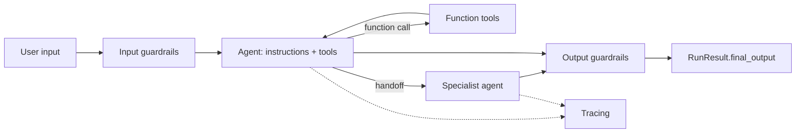

# OpenAI Agents SDK

## Introduction

The **OpenAI Agents SDK** (`pip install openai-agents`, imported as `agents`) is OpenAI's open-source, lightweight framework for building agents in Python (a TypeScript version also exists). It grew out of OpenAI's earlier experimental "Swarm" project and keeps a deliberately small set of building blocks:

- **Agents**: an LLM with instructions, tools, and optional structured output.
- **Tools**: any Python function, turned into a tool with a decorator.
- **Handoffs**: one agent passing control of the conversation to another.
- **Agents as tools**: one agent calling another like a function and getting a result back.
- **Guardrails**: checks on input and output that can stop a run early.
- **Sessions**: automatic conversation memory.
- **Tracing**: a record of every model call, tool call, and handoff.

If the [Claude Agent SDK](./2-agents-claude-agent-sdk.mdx) is "a finished car", the OpenAI Agents SDK is closer to a well-designed kit: a few primitives, plain Python, and a `Runner` that runs the loop for you.

:::info Provider support
The SDK is optimized for OpenAI models and the Responses API, but it is not locked to them. You can plug in other providers, including Claude, through OpenAI-compatible endpoints or the LiteLLM and any-llm adapters. We show this later on the page.
:::

## Core Concepts



The `Runner` drives the loop. On each turn it calls the current agent's model. If the model returns a final output, the run ends. If it requests tools, the runner executes them and loops. If it requests a handoff, the runner switches the "current agent" and continues. A `max_turns` limit (default 10) stops runaway runs with a `MaxTurnsExceeded` exception.

## Installation

```bash
pip install openai-agents
export OPENAI_API_KEY="your-openai-key"
```

When you do not set `model` on an agent, the SDK uses its current default OpenAI model. That default changes between releases, so check the [models documentation](https://openai.github.io/openai-agents-python/models/) or set the model explicitly.

## Hello, Agent

```python
from agents import Agent, Runner

agent = Agent(name="Assistant", instructions="You are a concise assistant.")
result = Runner.run_sync(agent, "Explain what an AI agent is in one sentence.")
print(result.final_output)
```

Example output:

```text
An AI agent is a program that uses a language model to decide which actions to take,
calls tools to carry them out, and repeats until it reaches a goal.
```

`Runner.run_sync` is a convenience wrapper. In real applications use `await Runner.run(...)` (async) or `Runner.run_streamed(...)` for streaming.

## The Support Agent with Function Tools

Here is the same two-tool support agent from [Building Agents Without a Framework](./1-agents-no-framework.mdx). The `@function_tool` decorator reads the function's type hints and docstring to build the JSON schema, so you write no schema by hand.

```python
import asyncio
import json
from agents import Agent, Runner, function_tool

ORDERS = {
    "A1001": {"status": "delivered", "total": 59.99, "delivered_days_ago": 3},
    "A1003": {"status": "delivered", "total": 35.50, "delivered_days_ago": 45},
}


@function_tool
def get_order(order_id: str) -> str:
    """Look up an order by ID.

    Args:
        order_id: The order ID, such as A1001.
    """
    order = ORDERS.get(order_id.upper())
    return json.dumps(order) if order else "Error: order not found"


@function_tool
def issue_refund(order_id: str, reason: str) -> str:
    """Refund a delivered order within 30 days of delivery.

    Args:
        order_id: The order to refund.
        reason: Short reason shown to finance.
    """
    order = ORDERS.get(order_id.upper())
    if not order or order["delivered_days_ago"] > 30:
        return "Error: order is not eligible for a refund"
    return f"Refunded ${order['total']} for {order_id}"


support_agent = Agent(
    name="Support agent",
    instructions="You help Acme Gadgets customers. Look up orders before answering. "
                 "Be concise and friendly.",
    tools=[get_order, issue_refund],
)


async def main():
    result = await Runner.run(support_agent, "Order A1001 arrived broken. Refund please.")
    print(result.final_output)


asyncio.run(main())
```

Example output:

```text
Sorry your order arrived damaged! I've refunded the full $59.99 for order A1001.
You'll see it on your statement within a few business days.
```

:::tip Tool errors
If a function tool raises an exception, the SDK by default sends an error message back to the model rather than crashing the run. You can customize this with `failure_error_function` on `@function_tool`. Returning a clear error string, as above, gives the model the best chance to recover.
:::

## Handoffs: Routing to Specialists

A **handoff** transfers the conversation to another agent. The SDK exposes each handoff to the model as a tool named something like `transfer_to_billing_agent`, and the model picks it when appropriate.

```python
from agents import Agent

billing_agent = Agent(
    name="Billing agent",
    handoff_description="Handles refunds, charges and invoices.",
    instructions="You handle refunds. Always check the order before refunding.",
    tools=[get_order, issue_refund],
)

shipping_agent = Agent(
    name="Shipping agent",
    handoff_description="Handles delivery status and lost packages.",
    instructions="You answer shipping questions using get_order.",
    tools=[get_order],
)

triage_agent = Agent(
    name="Triage agent",
    instructions="Decide whether the customer needs billing or shipping help and hand off. "
                 "Do not answer the question yourself.",
    handoffs=[billing_agent, shipping_agent],
)

# result = await Runner.run(triage_agent, "Where is my order A1002?")
# print(result.last_agent.name)  -> "Shipping agent"
```

`result.last_agent` tells you which agent produced the final answer, which is useful for analytics and for continuing the conversation with the right specialist. For more control, wrap an agent in `handoff(agent, on_handoff=..., input_type=...)` to run a callback or collect structured data at handoff time. See [Agent Handoffs](../8-agents-multi-agent-systems/3-agents-handoffs.mdx) for the pattern.

### Handoffs vs agents as tools

Sometimes you do not want to give away control. `agent.as_tool()` lets a manager agent call a specialist like a function and keep talking to the user itself:

```python
from agents import Agent

translator = Agent(name="Translator", instructions="Translate the text to Spanish.")

manager = Agent(
    name="Manager",
    instructions="Answer the customer. If they write in Spanish, reply in Spanish "
                 "using the translate tool.",
    tools=[translator.as_tool(tool_name="translate",
                              tool_description="Translate English text to Spanish")],
)
```

| Pattern | Who talks to the user next | Use when |
|---------|---------------------------|----------|
| Handoff | The specialist | Different departments, long specialist conversations |
| Agent as tool | The original agent | The specialist does a sub-task and returns a result |

## Guardrails

Guardrails are checks that run alongside an agent. An **input guardrail** inspects the user's message; if its `tripwire_triggered` is true, the run raises `InputGuardrailTripwireTriggered` and the main agent's output is discarded. A common trick is to use a small, fast agent as the checker.

```python
from pydantic import BaseModel
from agents import (
    Agent, GuardrailFunctionOutput, InputGuardrailTripwireTriggered,
    RunContextWrapper, Runner, TResponseInputItem, input_guardrail,
)


class OffTopicCheck(BaseModel):
    is_off_topic: bool
    reasoning: str


checker = Agent(
    name="Topic checker",
    instructions="Decide if the message is unrelated to Acme Gadgets orders or products.",
    output_type=OffTopicCheck,
)


@input_guardrail
async def off_topic_guardrail(
    ctx: RunContextWrapper[None], agent: Agent, input: str | list[TResponseInputItem]
) -> GuardrailFunctionOutput:
    result = await Runner.run(checker, input, context=ctx.context)
    return GuardrailFunctionOutput(
        output_info=result.final_output,
        tripwire_triggered=result.final_output.is_off_topic,
    )


guarded_agent = Agent(
    name="Support agent",
    instructions="Help Acme Gadgets customers.",
    input_guardrails=[off_topic_guardrail],
)


async def handle(message: str) -> str:
    try:
        result = await Runner.run(guarded_agent, message)
        return result.final_output
    except InputGuardrailTripwireTriggered:
        return "I can only help with Acme Gadgets orders and products."
```

There are also output guardrails (`@output_guardrail`) and per-tool guardrails. Guardrails are a layer, not a guarantee: keep hard rules (like the 30-day refund window) inside the tool code. See [Input and Output Guardrails](../12-agents-safety-and-security/6-agents-guardrails.mdx).

## Sessions: Built-in Memory

Without a session, each `Runner.run` starts from scratch unless you pass the previous items yourself. A session stores the history for you.

```python
from agents import Agent, Runner, SQLiteSession

agent = Agent(name="Support agent", instructions="Be concise.")
session = SQLiteSession("customer_42", "conversations.db")  # file-backed


async def demo():
    await Runner.run(agent, "My order number is A1001.", session=session)
    result = await Runner.run(agent, "What order number did I give you?", session=session)
    print(result.final_output)
```

Example output:

```text
You gave me order number A1001.
```

`SQLiteSession("customer_42")` with no file path keeps history in memory only. Other session backends (for example Redis or OpenAI's hosted Conversations API) are listed in the [sessions documentation](https://openai.github.io/openai-agents-python/sessions/).

## Human Approval for Risky Tools

Mark a tool with `needs_approval=True` and the run **pauses** instead of executing it. The result contains `interruptions`; you approve or reject each one and resume from a saved state.

```python
from agents import Agent, Runner, function_tool


@function_tool(needs_approval=True)
def issue_refund_gated(order_id: str, reason: str) -> str:
    """Refund an order. Requires human approval."""
    return f"Refunded order {order_id}"


agent = Agent(name="Support agent", instructions="Help customers.", tools=[issue_refund_gated])


async def run_with_approval(message: str) -> str:
    result = await Runner.run(agent, message)
    while result.interruptions:
        state = result.to_state()
        for item in result.interruptions:
            if input(f"Approve {item}? [y/N] ").lower() == "y":
                state.approve(item)
            else:
                state.reject(item)
        result = await Runner.run(agent, state)
    return result.final_output
```

Because the state can be serialized, the approval does not have to happen in the same process. A web app can store it, show a button to a supervisor, and resume hours later. See [Human-in-the-Loop](../6-agents-planning-and-reasoning/9-agents-human-in-the-loop.mdx).

## Tracing

Tracing is on by default. Each run produces a trace with spans for model calls, tool calls, handoffs, and guardrails, viewable in the OpenAI dashboard. You can group several runs into one trace:

```python
from agents import Agent, Runner, trace


async def handle_ticket(ticket_id: str, text: str):
    with trace(workflow_name="support_ticket", group_id=ticket_id):
        first = await Runner.run(triage_agent_placeholder, text)
        return first.final_output


triage_agent_placeholder = Agent(name="Triage", instructions="Summarize the ticket.")
```

You can also add your own trace processors to send spans to other observability tools, or disable tracing with `set_tracing_disabled(True)`. See [Tracing Agent Runs](../11-agents-evaluation-and-testing/8-agents-tracing.mdx).

## Using Claude and Other Models

The SDK supports non-OpenAI models through adapters. One option is LiteLLM (a beta integration at the time of writing):

```bash
pip install "openai-agents[litellm]"
export ANTHROPIC_API_KEY="your-anthropic-key"
```

```python
from agents import Agent, Runner, set_tracing_disabled
from agents.extensions.models.litellm_model import LitellmModel

set_tracing_disabled(True)  # traces upload to OpenAI by default; disable without an OpenAI key

claude_support = Agent(
    name="Support agent",
    instructions="Help Acme Gadgets customers. Be concise.",
    model=LitellmModel(model="anthropic/claude-opus-5-5"),
    tools=[get_order, issue_refund],
)
```

Other options include any OpenAI-compatible endpoint through `OpenAIChatCompletionsModel` with a custom `AsyncOpenAI(base_url=...)` client, and the any-llm adapter. Feature parity varies by provider (for example, hosted tools like OpenAI's web search only work with OpenAI models), so test the features you depend on.

## Real-World Scenario

Your company runs an e-commerce help center with three human teams: billing, shipping, and returns. You want an AI front door that answers simple questions and routes complex ones, plus a dashboard that shows which team handled what.

**Solution with the OpenAI Agents SDK:**

- A `Triage agent` with `handoffs=[billing_agent, shipping_agent, returns_agent]`, each specialist with only the tools it needs.
- An input guardrail that rejects off-topic or abusive messages before any specialist spends tokens.
- `needs_approval=True` on `issue_refund`, with paused states saved to the database and surfaced in the support console.
- An `SQLiteSession` (or a Redis-backed session in production) keyed by customer ID.
- `trace(group_id=ticket_id)` so supervisors can open a ticket and see every step.

**Why this approach fits:** the problem *is* routing between specialists, which is what handoffs model directly. Guardrails, approvals, and tracing come built in with very little code.

**When to use it / when not to:**

- Use it for conversational agents with a few specialists, especially if your team already uses OpenAI models.
- Consider alternatives if you need long-running workflows with explicit branching and checkpoint replay (look at [LangGraph](./5-agents-langgraph.mdx)), heavy local file and shell work (the [Claude Agent SDK](./2-agents-claude-agent-sdk.mdx)), or full control with zero dependencies ([no framework](./1-agents-no-framework.mdx)).

**Alternatives and trade-offs:**

| Approach | Pros | Cons | Best for |
|----------|------|------|----------|
| OpenAI Agents SDK | Small API, handoffs, guardrails, approvals, tracing | Best experience on OpenAI models; tracing defaults to OpenAI | Routing and specialist chat agents |
| LangGraph supervisor | Explicit graph, checkpoints, any model | More code and concepts | Complex, durable workflows |
| CrewAI | Role-based crews, quick prototypes | Less fine-grained control of the loop | Task pipelines with defined roles |
| Hand-written router | No dependency, transparent | You build tracing, sessions, approvals | One or two specialists |

## Common Mistakes

1. **Forgetting the turn limit.** `max_turns` defaults to 10. Long tasks may hit it and raise `MaxTurnsExceeded`; set it deliberately with `Runner.run(..., max_turns=...)`.
2. **Treating guardrails as security boundaries.** A model-based guardrail can be fooled. Enforce real rules in code and permissions.
3. **Handoff loops.** Two agents that can hand off to each other may bounce forever. Give each handoff a clear `handoff_description` and keep the graph a tree when possible.
4. **Missing OpenAI key with other providers.** Tracing uploads to OpenAI by default. Without an OpenAI key you may see tracing errors; disable tracing or configure another processor.
5. **Resuming with the wrong agent.** When resuming after an approval interruption, pass the state to the original top-level agent.

## Summary

- The OpenAI Agents SDK provides a small set of primitives: `Agent`, `Runner`, `@function_tool`, handoffs, guardrails, sessions, and tracing.
- Tools are plain Python functions; schemas come from type hints and docstrings.
- Handoffs transfer control to specialists; `as_tool()` keeps the caller in charge.
- `needs_approval=True` pauses runs for human review with resumable state.
- It works best with OpenAI models but supports others, including Claude, through adapters.

## Exercises

1. **Returns specialist.** Add a `Returns agent` with a `create_return_label` tool and register it as a third handoff on the triage agent.
2. **Output guardrail.** Write an `@output_guardrail` that trips if the final answer promises a refund amount that does not appear in any tool result.
3. **Streaming.** Use `Runner.run_streamed` and print tool calls as they happen.
4. **Provider swap.** Run the support agent on a Claude model through `LitellmModel` and compare the trace output with the default model.

**Related pages:**

- [Agent Handoffs](../8-agents-multi-agent-systems/3-agents-handoffs.mdx)
- [Routing](../6-agents-planning-and-reasoning/2-agents-routing.mdx)
- [Claude Agent SDK](./2-agents-claude-agent-sdk.mdx)
- [Choosing an Agent Framework](./10-agents-choosing-a-framework.mdx)
