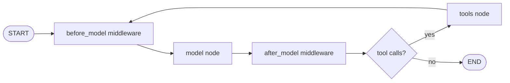

# LangChain Agents

## Introduction

**LangChain** is one of the oldest and most widely used open-source frameworks for LLM applications. Its biggest strength is breadth: integrations with dozens of model providers, vector stores, document loaders, and tools, all behind common interfaces. If you need to swap Claude for another model, or plug in a new vector database, LangChain usually has an adapter.

LangChain's agent story has changed a lot over the years. Older tutorials use `AgentExecutor`, `initialize_agent`, or hand-written ReAct prompts. **LangChain v1** replaced those with a single function, `create_agent`, which builds an agent on top of [LangGraph](./5-agents-langgraph.mdx). The legacy APIs moved to a separate `langchain-classic` package. If you find a blog post with `AgentExecutor`, it is describing the old approach.

An analogy: LangChain is like a universal adapter kit for travel. Whatever outlet (model provider) or device (vector store, tool) you have, there is probably a plug that fits. `create_agent` is the power strip that ties them together.

In this page you will rebuild the two-tool support agent from [Building Agents Without a Framework](./1-agents-no-framework.mdx), running on Claude through `langchain-anthropic`.

## How create_agent Works

`create_agent` returns a compiled LangGraph graph with two main nodes: a **model** node that calls the LLM, and a **tools** node that runs requested tools. The graph loops between them until the model stops asking for tools.



**Middleware** (new in v1) lets you hook into each step: summarize long histories before the model call, pause for human approval before a tool runs, retry failed calls, cap the number of model calls, and more. It is LangChain's answer to "I need control without writing my own graph."

## Installation

```bash
pip install langchain langchain-anthropic
export ANTHROPIC_API_KEY="your-api-key"
```

Each provider has its own integration package, for example `langchain-openai`, `langchain-google-genai`, or `langchain-ollama`. Versions move quickly, so pin them in `requirements.txt` and check the [LangChain agents docs](https://docs.langchain.com/oss/python/langchain/agents) when upgrading.

## The Support Agent

Tools are plain functions decorated with `@tool`. The docstring becomes the description, and the type hints become the schema.

```python
import json
from langchain.agents import create_agent
from langchain.tools import tool
from langchain_anthropic import ChatAnthropic

ORDERS = {
    "A1001": {"status": "delivered", "total": 59.99, "delivered_days_ago": 3},
    "A1003": {"status": "delivered", "total": 35.50, "delivered_days_ago": 45},
}


@tool
def get_order(order_id: str) -> str:
    """Look up an order by ID. Returns status, total and days since delivery."""
    order = ORDERS.get(order_id.upper())
    return json.dumps(order) if order else "Error: order not found"


@tool
def issue_refund(order_id: str, reason: str) -> str:
    """Refund a delivered order within 30 days of delivery."""
    order = ORDERS.get(order_id.upper())
    if not order or order["delivered_days_ago"] > 30:
        return "Error: order is not eligible for a refund"
    return f"Refunded ${order['total']} for {order_id}"


model = ChatAnthropic(model="claude-opus-5-5", max_tokens=4096)

agent = create_agent(
    model=model,
    tools=[get_order, issue_refund],
    system_prompt="You are a concise, friendly support agent for Acme Gadgets. "
                  "Look up orders before answering.",
)

result = agent.invoke(
    {"messages": [{"role": "user", "content": "Order A1001 arrived broken. Refund please."}]}
)
print(result["messages"][-1].content)
```

Example output:

```text
I'm sorry your order arrived damaged! I've refunded the full $59.99 for order A1001.
```

The result is the final **state** of the graph: a dict whose `messages` list holds the whole conversation, including tool calls and tool results. That makes it easy to inspect what the agent did.

:::tip Model strings
Instead of constructing `ChatAnthropic` yourself, you can pass a string such as `model="anthropic:claude-opus-5-5"`. LangChain resolves it with `init_chat_model`. Building the object explicitly is handy when you want to set parameters like `max_tokens`.
:::

### Inspecting the trajectory

```python
for msg in result["messages"]:
    kind = type(msg).__name__
    if getattr(msg, "tool_calls", None):
        print(kind, "->", [(c["name"], c["args"]) for c in msg.tool_calls])
    else:
        print(kind, ":", str(msg.content)[:70])
```

Example output:

```text
HumanMessage : Order A1001 arrived broken. Refund please.
AIMessage -> [('get_order', {'order_id': 'A1001'})]
ToolMessage : {"status": "delivered", "total": 59.99, "delivered_days_ago": 3}
AIMessage -> [('issue_refund', {'order_id': 'A1001', 'reason': 'Arrived broken'})]
ToolMessage : Refunded $59.99 for A1001
AIMessage : I'm sorry your order arrived damaged! I've refunded the full $59.99 fo
```

This list is exactly what you would evaluate in [Evaluating Agent Trajectories](../11-agents-evaluation-and-testing/3-agents-trajectory-evaluation.mdx).

## Streaming Progress

Because the agent is a LangGraph graph, it supports LangGraph's streaming modes. `stream_mode="updates"` yields one chunk per node as it finishes, which is perfect for showing "Looking up your order..." in a UI.

```python
for chunk in agent.stream(
    {"messages": [{"role": "user", "content": "Is order A1003 refundable?"}]},
    stream_mode="updates",
):
    for node_name, update in chunk.items():
        last = update["messages"][-1]
        print(f"[{node_name}] {type(last).__name__}")
```

Example output:

```text
[model] AIMessage
[tools] ToolMessage
[model] AIMessage
```

Use `stream_mode="messages"` to stream individual tokens. See [Streaming Agent Output to a Frontend](../10-agents-integration/2-agents-streaming-to-frontend.mdx).

## Memory with a Checkpointer

By default each `invoke` is independent. Add a **checkpointer** and pass a `thread_id`, and the agent remembers the conversation for that thread.

```python
from langchain.agents import create_agent
from langgraph.checkpoint.memory import InMemorySaver

memory_agent = create_agent(
    model="anthropic:claude-opus-5-5",
    tools=[get_order, issue_refund],
    checkpointer=InMemorySaver(),
)

config = {"configurable": {"thread_id": "customer-42"}}
memory_agent.invoke({"messages": [{"role": "user", "content": "My order is A1001."}]}, config)
reply = memory_agent.invoke(
    {"messages": [{"role": "user", "content": "What's its status?"}]}, config
)
print(reply["messages"][-1].content)
```

Example output:

```text
Order A1001 has been delivered (3 days ago). Total was $59.99.
```

`InMemorySaver` is for development. In production use a persistent checkpointer such as the Postgres or SQLite savers from the LangGraph ecosystem. See [Agent State Management](../4-agents-memory-and-context/9-agents-state-management.mdx).

## Structured Output

When your application needs data rather than prose, for example to fill a ticket form, pass a Pydantic model as `response_format`. The result then includes a `structured_response`.

```python
from pydantic import BaseModel, Field
from langchain.agents import create_agent


class TicketSummary(BaseModel):
    order_id: str
    issue: str = Field(description="One-line description of the problem")
    refund_issued: bool


summary_agent = create_agent(
    model="anthropic:claude-opus-5-5",
    tools=[get_order, issue_refund],
    response_format=TicketSummary,
)

out = summary_agent.invoke(
    {"messages": [{"role": "user", "content": "A1001 came with a cracked screen, refund it."}]}
)
print(out["structured_response"])
```

Example output:

```text
order_id='A1001' issue='Item arrived with a cracked screen' refund_issued=True
```

## Middleware: Approvals, Limits and Summaries

Middleware is how you add production behavior without dropping to a custom graph. LangChain ships several built-ins:

| Middleware | What it does |
|------------|--------------|
| `HumanInTheLoopMiddleware` | Pauses before chosen tools so a person can approve, edit, or reject |
| `ModelCallLimitMiddleware` | Caps model calls per run or per thread |
| `ToolCallLimitMiddleware` | Caps calls to a specific tool |
| `SummarizationMiddleware` | Summarizes old messages when the history grows too long |
| `ModelRetryMiddleware` / `ToolRetryMiddleware` | Retries failed model or tool calls |
| `ModelFallbackMiddleware` | Falls back to another model if the first one fails |
| `PIIMiddleware` | Detects and redacts personal data |

Here is the support agent with an approval step on refunds and a hard cap on model calls:

```python
from langchain.agents import create_agent
from langchain.agents.middleware import HumanInTheLoopMiddleware, ModelCallLimitMiddleware
from langgraph.checkpoint.memory import InMemorySaver
from langgraph.types import Command

gated_agent = create_agent(
    model="anthropic:claude-opus-5-5",
    tools=[get_order, issue_refund],
    middleware=[
        HumanInTheLoopMiddleware(
            interrupt_on={
                "issue_refund": {"allowed_decisions": ["approve", "reject"]},
                "get_order": False,  # read-only, no review needed
            }
        ),
        ModelCallLimitMiddleware(run_limit=8),
    ],
    checkpointer=InMemorySaver(),  # required so the run can pause and resume
)

config = {"configurable": {"thread_id": "ticket-981"}}
paused = gated_agent.invoke(
    {"messages": [{"role": "user", "content": "Refund A1001, it arrived broken."}]},
    config=config,
    version="v2",
)
print(paused.interrupts)  # shows the pending issue_refund call for review

final = gated_agent.invoke(
    Command(resume={"decisions": [{"type": "approve"}]}),
    config=config,  # same thread_id
    version="v2",
)
print(final.value["messages"][-1].content)
```

With `version="v2"`, `invoke` returns an object with `.value` (the state) and `.interrupts` (pending reviews). The decisions list has one entry per pending action, in order. A rejected call can include a `message` that explains the decision to the model.

### Writing your own middleware

For custom rules, decorators such as `@before_model`, `@after_model`, and `@wrap_tool_call` let you write middleware as plain functions. A `@wrap_tool_call` function receives the pending tool call and a `handler` that executes it, so you can log, time, modify, block, or retry the call:

```python
import time
from langchain.agents import create_agent
from langchain.agents.middleware import wrap_tool_call
from langchain.messages import ToolMessage


@wrap_tool_call
def audit_and_block(request, handler):
    call = request.tool_call
    if call["name"] == "issue_refund" and call["args"].get("order_id", "").upper() == "A1004":
        # Block without running the tool; the model sees this as the tool result
        return ToolMessage(content="Blocked: this order is under fraud review.",
                           tool_call_id=call["id"])
    start = time.perf_counter()
    result = handler(request)  # run the real tool
    print(f"[audit] {call['name']} {call['args']} took {time.perf_counter() - start:.3f}s")
    return result


audited_agent = create_agent(
    model="anthropic:claude-opus-5-5",
    tools=[get_order, issue_refund],
    middleware=[audit_and_block],
)
```

Example output while the agent runs:

```text
[audit] get_order {'order_id': 'A1001'} took 0.001s
[audit] issue_refund {'order_id': 'A1001', 'reason': 'Arrived broken'} took 0.001s
```

Middleware runs in the order you list it, so put cheap checks (limits, blocks) before expensive ones (summarization). The [middleware documentation](https://docs.langchain.com/oss/python/langchain/middleware) lists every hook and its exact signature.

## Real-World Scenario

A mid-size insurance company has a claims portal. Claim documents live in a vector store, policies live in a SQL database, and the data science team experiments with several model providers to balance cost and quality. They want an agent that answers adjusters' questions ("Is water damage covered under policy P-2231?") by searching documents and querying the database.

**Solution with LangChain:**

- Retrieval tool built from an existing LangChain vector store integration; SQL tool from a LangChain database integration.
- `create_agent` with `model="anthropic:claude-opus-5-5"` in production, while an evaluation script runs the same agent with other provider strings for comparison.
- `SummarizationMiddleware` keeps long adjuster sessions within the context window; `PIIMiddleware` redacts policyholder data before it reaches logs.
- A Postgres checkpointer stores sessions so adjusters can resume the next day.

**Why this approach fits:** the team's main pain is *integration breadth* (vector stores, SQL, multiple model providers), which is LangChain's core strength. `create_agent` adds a sensible default loop, and middleware covers production needs without custom graph code.

**When to use it / when not to:**

- Use LangChain when you need many integrations, want to switch providers easily, or already use LangChain for RAG.
- Skip it if your agent is two tools on one provider (the [no-framework loop](./1-agents-no-framework.mdx) is simpler), or when you need fully custom control flow, in which case use [LangGraph](./5-agents-langgraph.mdx) directly.

**Alternatives and trade-offs:**

| Approach | Pros | Cons | Best for |
|----------|------|------|----------|
| LangChain `create_agent` | Huge integration catalog, middleware, LangGraph underneath | Abstraction layers, frequent API evolution | Multi-provider, integration-heavy agents |
| LangGraph directly | Full control over nodes, edges, state | More code to write | Custom workflows and multi-agent graphs |
| LlamaIndex agents | Strong data and RAG tooling | Smaller agent ecosystem than LangChain | Document-centric agents |
| Vendor SDKs | Tight model integration, fewer layers | Less provider flexibility | Single-provider teams |

## Common Mistakes

1. **Following outdated tutorials.** `AgentExecutor` and `initialize_agent` from older LangChain versions now live in `langchain-classic`, and LangGraph's prebuilt `create_react_agent` is deprecated in favor of `create_agent`. Use `langchain.agents.create_agent` for new code.
2. **Forgetting the checkpointer.** Human-in-the-loop interrupts and multi-turn memory both need a checkpointer and a `thread_id`.
3. **Unpinned versions.** LangChain packages release often. Pin `langchain`, `langchain-core`, and provider packages together.
4. **Vague tool docstrings.** The docstring *is* the tool description the model reads. "Gets order" is worse than "Look up an order by ID. Returns status, total and days since delivery." See [Tool Design Principles](../2-agents-tool-use/7-agents-tool-design-principles.mdx).
5. **Too many layers for a simple job.** If debugging means reading framework source, you may not need the framework for this agent.

## Summary

- LangChain v1 centers agents on `create_agent`, which builds a LangGraph graph with a model node and a tools node.
- Tools are `@tool`-decorated functions; Claude models come from `langchain-anthropic` via `ChatAnthropic` or `"anthropic:..."` strings.
- Checkpointers with a `thread_id` add memory; `response_format` adds structured output.
- Middleware adds approvals, limits, retries, summarization, and PII handling.
- LangChain's main advantage is integration breadth; its main cost is abstraction and fast-moving APIs.

## Exercises

1. **Tool limit.** Add `ToolCallLimitMiddleware(tool_name="issue_refund", run_limit=1)` and test a prompt that asks for two refunds.
2. **Provider comparison.** Run the support agent with two different model strings and compare the trajectories printed by the inspection snippet.
3. **Edit decision.** Allow the `"edit"` decision for `issue_refund` and resume with an edited `reason`.
4. **Custom middleware.** Write a `@wrap_tool_call` middleware that logs the tool name and how long it took.

**Related pages:**

- [LangGraph](./5-agents-langgraph.mdx)
- [Building a Retrieval Pipeline](../5-agents-rag/4-agents-retrieval-pipeline.mdx)
- [Compaction and Summarization](../4-agents-memory-and-context/2-agents-compaction-and-summarization.mdx)
- [Choosing an Agent Framework](./10-agents-choosing-a-framework.mdx)
