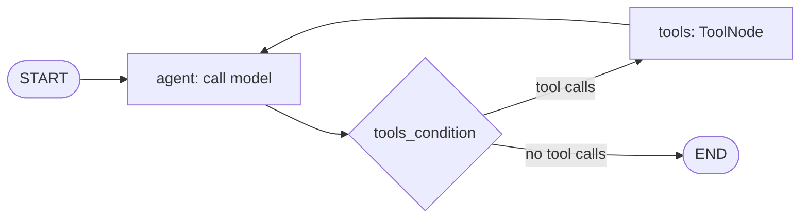
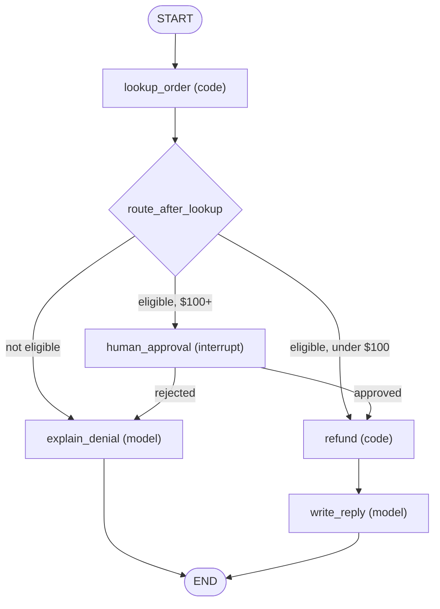

# LangGraph

## Introduction

**LangGraph** is a low-level orchestration library from the LangChain team for building agents and workflows as **graphs**. You define a shared **state**, a set of **nodes** (Python functions that read and update the state), and **edges** that decide which node runs next. LangGraph then runs the graph, saves the state after every step, and lets you pause, resume, replay, or branch.

Where most frameworks hide the agent loop, LangGraph makes it explicit. That is more code, but every decision point is visible and testable. It is the foundation under LangChain's `create_agent` (see [LangChain Agents](./4-agents-langchain.mdx)), and you drop down to it when the prebuilt loop is not enough.

An analogy: a prebuilt agent is like a GPS that picks the route for you. LangGraph is a subway map. You draw the stations and the lines, and the train can only travel where you drew track. The model still decides which branch to take at each junction, but it cannot leave the map.

LangGraph works with any chat model. We use Claude through `langchain-anthropic`.

## Core Concepts

| Concept | What it is | Example |
|---------|-----------|---------|
| **State** | A typed dict shared by all nodes | `messages`, `order_id`, `refund_approved` |
| **Node** | A function `state -> partial update` | "call the model", "run tools", "ask a human" |
| **Edge** | A fixed transition between nodes | after `tools`, always go back to `agent` |
| **Conditional edge** | A function that picks the next node | if the model requested tools, go to `tools`, else end |
| **Reducer** | How an update merges into state | append new messages instead of overwriting |
| **Checkpointer** | Saves state after each step | in-memory, SQLite, Postgres |
| **Interrupt** | Pauses the graph for outside input | human approval before a refund |

## Installation

```bash
pip install langgraph langchain-anthropic
export ANTHROPIC_API_KEY="your-api-key"
```

## Step 1: The Classic Tool Loop as a Graph

First, rebuild the support agent from [Building Agents Without a Framework](./1-agents-no-framework.mdx) as a two-node graph. This is the same loop you wrote by hand, now expressed as nodes and edges.



```python
import json
from langchain_anthropic import ChatAnthropic
from langchain_core.tools import tool
from langgraph.graph import StateGraph, MessagesState, START
from langgraph.prebuilt import ToolNode, tools_condition

ORDERS = {
    "A1001": {"status": "delivered", "total": 59.99, "delivered_days_ago": 3},
    "A1003": {"status": "delivered", "total": 35.50, "delivered_days_ago": 45},
}


@tool
def get_order(order_id: str) -> str:
    """Look up an order by ID. Returns status, total and days since delivery."""
    order = ORDERS.get(order_id.upper())
    return json.dumps(order) if order else "Error: order not found"


@tool
def issue_refund(order_id: str, reason: str) -> str:
    """Refund a delivered order within 30 days of delivery."""
    order = ORDERS.get(order_id.upper())
    if not order or order["delivered_days_ago"] > 30:
        return "Error: order is not eligible for a refund"
    return f"Refunded ${order['total']} for {order_id}"


tools = [get_order, issue_refund]
model = ChatAnthropic(model="claude-opus-5-5", max_tokens=4096).bind_tools(tools)

SYSTEM = {"role": "system", "content": "You are a concise support agent for Acme Gadgets."}


def agent(state: MessagesState) -> dict:
    response = model.invoke([SYSTEM] + state["messages"])
    return {"messages": [response]}  # the reducer appends this message


builder = StateGraph(MessagesState)
builder.add_node("agent", agent)
builder.add_node("tools", ToolNode(tools))
builder.add_edge(START, "agent")
builder.add_conditional_edges("agent", tools_condition)  # -> "tools" or END
builder.add_edge("tools", "agent")
graph = builder.compile()

result = graph.invoke({"messages": [{"role": "user", "content": "Is A1003 refundable?"}]})
print(result["messages"][-1].content)
```

Example output:

```text
Order A1003 was delivered 45 days ago, which is outside our 30-day refund window,
so it isn't eligible for an automatic refund. I can connect you with a specialist
to look at warranty options.
```

`MessagesState` is a prebuilt state with one key, `messages`, whose reducer appends new messages instead of replacing the list. `ToolNode` runs every tool call in the last AI message, and `tools_condition` routes to `"tools"` when there are tool calls and to `END` otherwise.

So far this is the same thing `create_agent` builds for you. The power of LangGraph shows up when you need a shape the prebuilt loop cannot express.

## Step 2: A Custom Graph with Deterministic Steps

Real support flows are not pure "model decides everything" loops. Suppose policy says:

1. Always look up the order first (deterministic, no model needed).
2. If the order is not refundable, skip straight to a polite explanation.
3. If it is refundable and the amount is over $100, require a human approval.
4. Otherwise let the model write the reply.

You can encode that policy as a graph, so the model only does the parts that need language.



```python
from typing import Literal, Optional, TypedDict
from langchain_anthropic import ChatAnthropic
from langgraph.graph import StateGraph, START, END
from langgraph.types import interrupt, Command
from langgraph.checkpoint.memory import InMemorySaver

ORDERS = {
    "A1001": {"status": "delivered", "total": 59.99, "delivered_days_ago": 3},
    "A1003": {"status": "delivered", "total": 35.50, "delivered_days_ago": 45},
    "A1004": {"status": "delivered", "total": 450.00, "delivered_days_ago": 5},
}
llm = ChatAnthropic(model="claude-opus-5-5", max_tokens=1024)


class TicketState(TypedDict):
    order_id: str
    complaint: str
    order: Optional[dict]
    eligible: bool
    approved: Optional[bool]
    reply: str


def lookup_order(state: TicketState) -> dict:
    order = ORDERS.get(state["order_id"].upper())
    eligible = bool(order) and order["status"] == "delivered" and order["delivered_days_ago"] <= 30
    return {"order": order, "eligible": eligible}


def route_after_lookup(state: TicketState) -> Literal["explain_denial", "refund", "human_approval"]:
    if not state["eligible"]:
        return "explain_denial"
    return "human_approval" if state["order"]["total"] >= 100 else "refund"


def human_approval(state: TicketState) -> Command[Literal["refund", "explain_denial"]]:
    decision = interrupt({"question": "Approve refund?", "order_id": state["order_id"],
                          "amount": state["order"]["total"]})
    approved = decision == "approve"
    return Command(update={"approved": approved},
                   goto="refund" if approved else "explain_denial")


def refund(state: TicketState) -> dict:
    # In production: call the payments API here, with an idempotency key.
    return {"approved": True}


def write_reply(state: TicketState) -> dict:
    msg = llm.invoke(f"Write a short, warm reply confirming a ${state['order']['total']} refund "
                     f"for order {state['order_id']}. Complaint: {state['complaint']}")
    return {"reply": msg.content}


def explain_denial(state: TicketState) -> dict:
    msg = llm.invoke(f"Politely explain that order {state['order_id']} can't be refunded "
                     f"automatically. Order data: {state['order']}. Offer a specialist.")
    return {"reply": msg.content}


builder = StateGraph(TicketState)
for name, fn in [("lookup_order", lookup_order), ("human_approval", human_approval),
                 ("refund", refund), ("write_reply", write_reply),
                 ("explain_denial", explain_denial)]:
    builder.add_node(name, fn)
builder.add_edge(START, "lookup_order")
builder.add_conditional_edges("lookup_order", route_after_lookup)
builder.add_edge("refund", "write_reply")
builder.add_edge("write_reply", END)
builder.add_edge("explain_denial", END)

ticket_graph = builder.compile(checkpointer=InMemorySaver())
```

Key ideas in this graph:

- **Code where code is enough.** `lookup_order`, routing, and `refund` are plain Python. They are fast, cheap, deterministic, and easy to unit test.
- **The model writes text, not policy.** The LLM only drafts replies. It cannot "decide" to refund a 45-day-old order because no path allows it.
- **`interrupt()` pauses the graph.** The value you pass is surfaced to the caller; whatever the caller resumes with becomes the return value of `interrupt()`.
- **`Command`** lets a node update state *and* choose the next node in one return value.

This style of "workflow with agentic steps" is discussed in [Agents vs Workflows](../0-agents-fundamentals/3-agents-vs-workflows.mdx).

## Step 3: Pausing and Resuming

Interrupts require a checkpointer and a `thread_id`, because the graph must save its state while it waits.

```python
config = {"configurable": {"thread_id": "ticket-2001"}}

first = ticket_graph.invoke(
    {"order_id": "A1004", "complaint": "Laptop won't power on"}, config, version="v2"
)
print(first.interrupts[0].value)

# ...later, maybe in another process, after a supervisor clicks "Approve"
final = ticket_graph.invoke(Command(resume="approve"), config, version="v2")
print(final.value["reply"])
```

Example output:

```text
{'question': 'Approve refund?', 'order_id': 'A1004', 'amount': 450.0}
I'm so sorry your laptop won't power on. We've approved a full refund of $450.00
for order A1004, and you'll see it on your statement within a few business days.
```

With a persistent checkpointer (SQLite or Postgres), the pause can last days, and the resume can happen on a different server. This is what LangGraph means by **durable execution**. One caveat: when a node resumes after an interrupt, LangGraph re-runs that node from the beginning, so keep side effects that happen *before* `interrupt()` idempotent.

:::tip Inspecting state
`ticket_graph.get_state(config)` returns the latest snapshot for a thread, including which node runs next. `get_state_history(config)` lists earlier checkpoints, which lets you debug or even "time travel" by resuming from an older state.
:::

## Streaming

Graphs stream in several modes. `"updates"` emits each node's output as it finishes; `"messages"` streams model tokens; `"values"` emits the full state after each step.

```python
for chunk in ticket_graph.stream(
    {"order_id": "A1001", "complaint": "Cracked screen"},
    {"configurable": {"thread_id": "ticket-2002"}},
    stream_mode="updates",
):
    print(list(chunk.keys()))
```

Example output:

```text
['lookup_order']
['refund']
['write_reply']
```

## Testing Nodes Without a Model

One underrated benefit of explicit graphs: the deterministic parts are ordinary functions, so you can unit test them without any API key, mocks, or network.

```python
# test_ticket_graph.py  (run with: pytest test_ticket_graph.py)
from ticket_graph import lookup_order, route_after_lookup


def test_recent_cheap_order_goes_straight_to_refund():
    state = {"order_id": "A1001", "complaint": "broken"}
    state.update(lookup_order(state))
    assert route_after_lookup(state) == "refund"


def test_expensive_order_needs_human():
    state = {"order_id": "A1004", "complaint": "broken"}
    state.update(lookup_order(state))
    assert route_after_lookup(state) == "human_approval"


def test_old_order_is_denied():
    state = {"order_id": "A1003", "complaint": "broken"}
    state.update(lookup_order(state))
    assert route_after_lookup(state) == "explain_denial"
```

Output:

```text
3 passed in 0.02s
```

These tests pin down the business policy. The LLM nodes still need evaluation (see [Unit Testing Agent Code](../11-agents-evaluation-and-testing/4-agents-unit-testing.mdx) and [Mocking LLM Calls in Tests](../11-agents-evaluation-and-testing/5-agents-mocking-llm-calls.mdx)), but the parts that move money are covered by fast, deterministic tests.

## Multi-Agent Graphs

Because nodes can be anything, a node can itself be a whole agent (for example, one built with `create_agent`) or a compiled subgraph. That makes LangGraph a common choice for the [Supervisor Pattern](../8-agents-multi-agent-systems/2-agents-supervisor-pattern.mdx) and [Hierarchical Agent Teams](../8-agents-multi-agent-systems/5-agents-hierarchical-agents.mdx): a supervisor node routes to specialist subgraphs, and shared state carries results between them. See [Shared State Between Agents](../8-agents-multi-agent-systems/7-agents-shared-state.mdx).

## The Wider LangGraph Ecosystem

- **LangSmith** (commercial, with a free tier): tracing, evaluation, and debugging for LangChain and LangGraph runs.
- **LangGraph Studio**: a visual debugger that shows the graph and lets you step through runs.
- **Deployment options**: LangChain offers a managed platform for running graphs as APIs; you can also run graphs in your own FastAPI or worker processes.

Product names and pricing in this ecosystem change, so check the [LangGraph documentation](https://docs.langchain.com/oss/python/langgraph/overview) for current options. The open-source `langgraph` library works without any of the commercial services.

## Real-World Scenario

A fintech startup processes **chargeback disputes**. Each dispute needs: fetch transaction data, gather merchant evidence, have an LLM draft a response letter, get a compliance officer's sign-off, then submit to the card network. Some disputes wait days for evidence. The process must survive deploys and server restarts, and auditors want to see exactly which step made which decision.

**Solution with LangGraph:**

- A `DisputeState` with transaction data, evidence list, draft letter, and approval fields.
- Deterministic nodes for fetching data and submitting; an LLM node for drafting; an `interrupt()` node for compliance approval; a second interrupt that waits for merchant evidence.
- A Postgres checkpointer so a dispute can wait a week and resume on any worker.
- `get_state_history` gives auditors a step-by-step record.

**Why this approach fits:** the process has a known shape with a few judgment calls, long waits, and strict audit needs. Explicit graphs plus durable checkpoints match that exactly; a free-running agent loop would be harder to audit and harder to resume.

**When to use it / when not to:**

- Use LangGraph for long-running or branching workflows, human-in-the-loop steps, multi-agent coordination, and anywhere you want to unit test individual steps.
- Do not reach for it for a single chat agent with two tools. `create_agent` or a [hand-written loop](./1-agents-no-framework.mdx) is faster to build and easier to read.

**Alternatives and trade-offs:**

| Approach | Pros | Cons | Best for |
|----------|------|------|----------|
| LangGraph | Explicit control, checkpoints, interrupts, any model | More boilerplate, graph concepts to learn | Durable, auditable workflows |
| LangChain `create_agent` | Fast to build, middleware for common needs | Fixed loop shape | Standard tool-using agents |
| CrewAI Flows | Event-driven steps with crews inside | Different mental model, smaller graph tooling | Role-based pipelines |
| Microsoft Agent Framework workflows | Graph workflows with checkpointing | Newer, Azure-leaning ecosystem | .NET and Azure shops |
| Temporal or a job queue plus a simple loop | Battle-tested durability | You wire LLM steps yourself | Teams already running Temporal |

## Common Mistakes

1. **Overwriting messages.** If you define your own state with a plain `messages: list`, each node replaces the list. Use `MessagesState` or an `Annotated` reducer such as `add_messages` so updates append.
2. **Interrupts without a checkpointer.** `interrupt()` needs a checkpointer and a `thread_id`, or there is nowhere to save the paused state.
3. **Non-idempotent code before an interrupt.** The node re-runs on resume. Do not charge a card and then call `interrupt()` in the same node.
4. **Graph spaghetti.** If every node can reach every other node, you have rebuilt an unconstrained agent with extra steps. Keep graphs small and purposeful.
5. **No recursion limit awareness.** LangGraph stops runaway graphs with a recursion limit; long loops can hit it. Set `recursion_limit` in the config deliberately.

## Summary

- LangGraph models agents as state plus nodes plus edges, with the model deciding only at the junctions you allow.
- `MessagesState`, `ToolNode`, and `tools_condition` recreate the classic tool loop in a few lines.
- Custom graphs mix deterministic code steps with LLM steps, making policy enforceable and testable.
- Checkpointers, `interrupt()`, and `Command(resume=...)` give durable, resumable, human-in-the-loop execution.
- Use it when you need control and durability; prefer simpler options for simple agents.

## Exercises

1. **Escalation path.** Add an `escalate` node for orders that are not found, and route to it from `lookup_order`.
2. **Persistent checkpoints.** Swap `InMemorySaver` for a SQLite checkpointer, pause a ticket, restart Python, and resume it.
3. **Test a node.** Write a pytest for `route_after_lookup` covering all three branches without calling any model.
4. **Supervisor.** Build a supervisor graph that routes between a "billing" subgraph (this page's ticket graph) and a "shipping" agent built with `create_agent`.

**Related pages:**

- [LangChain Agents](./4-agents-langchain.mdx)
- [Human-in-the-Loop](../6-agents-planning-and-reasoning/9-agents-human-in-the-loop.mdx)
- [Plan-and-Execute](../6-agents-planning-and-reasoning/4-agents-plan-and-execute.mdx)
- [Running Agents as Background Jobs](../10-agents-integration/3-agents-background-jobs.mdx)
