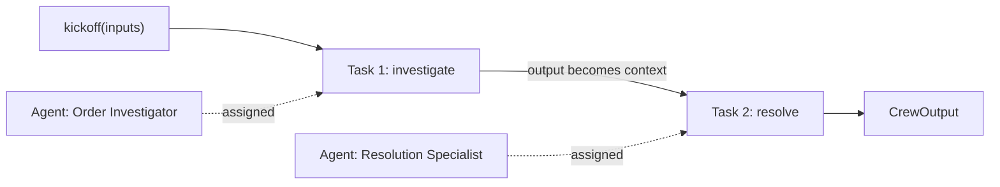

# CrewAI

## Introduction

**CrewAI** is an open-source Python framework built around a simple metaphor: a **crew** of AI agents, each with a **role**, a **goal**, and a **backstory**, working through a list of **tasks**. Instead of thinking in terms of loops and graphs, you think like a manager staffing a project: "I need a researcher, a writer, and an editor. Here are their assignments."

That metaphor makes CrewAI one of the fastest ways to prototype multi-agent pipelines such as research-then-write, triage-then-respond, or analyze-then-report. CrewAI also offers **Flows**, an event-driven layer for when you need precise, deterministic control around your crews.

An analogy: LangGraph asks you to draw the factory floor. CrewAI asks you to write job descriptions and a project plan, then lets the team figure out the hand-offs.

CrewAI is independent of LangChain and supports many model providers. We will use Claude through CrewAI's native Anthropic integration.

## Core Concepts

| Concept | What it is |
|---------|-----------|
| **Agent** | An LLM persona with `role`, `goal`, `backstory`, `tools`, and an `llm` |
| **Task** | A unit of work with a `description`, an `expected_output`, and an assigned `agent` |
| **Crew** | A team of agents plus a list of tasks and a `process` |
| **Process** | How tasks run: `sequential` (in order) or `hierarchical` (a manager delegates) |
| **Tool** | A function an agent can call, defined with `@tool` or a `BaseTool` subclass |
| **Flow** | Event-driven orchestration with `@start` and `@listen` steps and typed state |



In a sequential crew, each task's output is passed as context to the next task, so later agents build on earlier work.

## Installation

CrewAI supports recent Python 3 versions; check the [installation guide](https://docs.crewai.com/en/installation) for the current range.

```bash
pip install "crewai[anthropic]"
export ANTHROPIC_API_KEY="your-api-key"
```

CrewAI also ships a CLI (`crewai create crew my_project`) that scaffolds a project with config files for agents and tasks. This page uses plain Python so the examples are self-contained.

:::info Default model
If you do not pass an `llm`, CrewAI falls back to a default model (an OpenAI model at the time of writing) or the `MODEL` environment variable. Set the model explicitly so you know what you are paying for.
:::

## Choosing the Model

```python
from crewai import LLM

claude = LLM(
    model="anthropic/claude-opus-5-5",
    max_tokens=4096,  # CrewAI's docs mark this as required for Anthropic models
)
```

The `provider/model` string format is how CrewAI selects a provider. Other providers use the same pattern, for example `openai/...` or `ollama/...`. See the [LLM configuration docs](https://docs.crewai.com/en/concepts/llms).

## The Support Crew

Here is the support scenario from [Building Agents Without a Framework](./1-agents-no-framework.mdx), split across two agents. One investigates the order; the other decides on and executes the resolution.

```python
import json
from crewai import Agent, Crew, LLM, Process, Task
from crewai.tools import tool

ORDERS = {
    "A1001": {"status": "delivered", "total": 59.99, "delivered_days_ago": 3},
    "A1003": {"status": "delivered", "total": 35.50, "delivered_days_ago": 45},
}

claude = LLM(model="anthropic/claude-opus-5-5", max_tokens=4096)


@tool("Get order")
def get_order(order_id: str) -> str:
    """Look up an order by ID. Returns status, total and days since delivery."""
    order = ORDERS.get(order_id.upper())
    return json.dumps(order) if order else "Error: order not found"


@tool("Issue refund")
def issue_refund(order_id: str, reason: str) -> str:
    """Refund a delivered order within 30 days of delivery."""
    order = ORDERS.get(order_id.upper())
    if not order or order["delivered_days_ago"] > 30:
        return "Error: order is not eligible for a refund"
    return f"Refunded ${order['total']} for {order_id}"


investigator = Agent(
    role="Order Investigator",
    goal="Find the facts about the customer's order and summarize them accurately",
    backstory="You are meticulous and never guess. You always check the order system.",
    tools=[get_order],
    llm=claude,
)

resolver = Agent(
    role="Resolution Specialist",
    goal="Resolve the customer's issue within company policy and write a friendly reply",
    backstory="You know the refund policy: delivered orders, within 30 days, full refund.",
    tools=[issue_refund],
    llm=claude,
)

investigate = Task(
    description="Customer message: '{message}'. Look up order {order_id} and report "
                "its status, total, and days since delivery.",
    expected_output="A short factual summary of the order.",
    agent=investigator,
)

resolve = Task(
    description="Using the investigation, decide whether a refund is allowed. If so, issue it. "
                "Then write the reply to the customer.",
    expected_output="A 2-3 sentence customer reply stating exactly what was done.",
    agent=resolver,
)

crew = Crew(
    agents=[investigator, resolver],
    tasks=[investigate, resolve],
    process=Process.sequential,
    verbose=False,
)

result = crew.kickoff(inputs={"order_id": "A1001",
                              "message": "My order arrived with a cracked screen!"})
print(result.raw)
```

Example output:

```text
I'm so sorry your order arrived with a cracked screen! I've issued a full refund of
$59.99 for order A1001. You should see it on your statement within a few business days.
```

Notice the `{message}` and `{order_id}` placeholders in the task descriptions. `kickoff(inputs=...)` fills them in, which makes a crew reusable across tickets. The returned `CrewOutput` has `.raw` text, per-task outputs in `.tasks_output`, and `.token_usage` for cost tracking.

:::caution Is two agents better than one?
For this tiny task, a single agent with both tools would be cheaper and just as accurate. Splitting into roles pays off when roles need different tools, models, or instructions, or when you want a clear audit trail per step. See [Single Agent vs Multi-Agent](../8-agents-multi-agent-systems/10-agents-single-vs-multi-agent.mdx).
:::

## Inspecting Results and Usage

A crew run is several model calls across several agents, so look inside the result rather than only printing the final text:

```python
def summarize_run(result) -> None:
    for task_output in result.tasks_output:
        print(f"[{task_output.agent}] {task_output.raw[:60]}")
    usage = result.token_usage
    print(f"tokens: prompt={usage.prompt_tokens} completion={usage.completion_tokens} "
          f"requests={usage.successful_requests}")


# summarize_run(crew.kickoff(inputs={"order_id": "A1001", "message": "Cracked screen"}))
```

Example output:

```text
[Order Investigator] Order A1001: delivered 3 days ago, total $59.99.
[Resolution Specialist] I'm so sorry your order arrived with a cracked screen! I've is
tokens: prompt=4180 completion=412 requests=5
```

Logging this per run makes it easy to spot a crew that suddenly needs twice as many requests after a prompt change.

## Structured Task Output

Tasks can return Pydantic models instead of free text, which is useful when the output feeds another system.

```python
from pydantic import BaseModel
from crewai import Task


class Resolution(BaseModel):
    order_id: str
    refunded: bool
    amount: float
    customer_reply: str


resolve_structured = Task(
    description="Decide on and execute the resolution for order {order_id}.",
    expected_output="The resolution details.",
    agent=resolver,
    output_pydantic=Resolution,
)
# After kickoff: result.pydantic -> Resolution(order_id='A1001', refunded=True, ...)
```

## Hierarchical Process

In a **hierarchical** crew, CrewAI adds a manager that plans the work and delegates tasks to the agents it thinks fit best, then reviews their output.

```python
from crewai import Crew, Process

managed_crew = Crew(
    agents=[investigator, resolver],
    tasks=[investigate, resolve],
    process=Process.hierarchical,
    manager_llm=claude,  # or manager_agent=<a custom Agent>
)
```

| Process | How it works | Pros | Cons |
|---------|-------------|------|------|
| Sequential | Tasks run in the order listed | Predictable, cheaper | You define the order |
| Hierarchical | A manager LLM delegates and reviews | Adapts to the request | More LLM calls, less predictable |

The manager is itself an LLM making decisions, so hierarchical crews cost more and vary more between runs. This is the [Supervisor Pattern](../8-agents-multi-agent-systems/2-agents-supervisor-pattern.mdx) under a different name.

## A Single Agent Without a Crew

You do not always need a crew. An `Agent` can run on its own with `kickoff`, which is handy for one-off calls inside a larger app.

```python
from crewai import Agent

quick_agent = Agent(
    role="Support Agent",
    goal="Answer order questions accurately",
    backstory="You work for Acme Gadgets support.",
    tools=[get_order],
    llm=claude,
)
reply = quick_agent.kickoff("What is the status of order A1003?")
print(reply.raw)
```

Example output:

```text
Order A1003 was delivered 45 days ago. Its total was $35.50.
```

## Guardrails and Human Input

CrewAI gives you a few safety levers on tasks:

- `human_input=True` on a `Task` asks a human to review the agent's answer before the task completes (from the console by default).
- `guardrail=` on a `Task` takes a function (or a natural-language rule) that validates the output; failing outputs are sent back to the agent to retry, up to a retry limit.
- `max_iter` and `max_execution_time` on an `Agent` cap how long it can loop.

As with any framework, keep business-critical rules such as refund eligibility inside the tool functions too. See [Input and Output Guardrails](../12-agents-safety-and-security/6-agents-guardrails.mdx).

## Flows: Deterministic Control Around Crews

Crews are great when you want agents to collaborate freely. **Flows** are for when you want control: explicit steps, typed state, and branching, with crews or single LLM calls inside individual steps.

```python
from pydantic import BaseModel
from crewai.flow.flow import Flow, listen, router, start


class TicketState(BaseModel):
    order_id: str = ""
    eligible: bool = False
    reply: str = ""


class SupportFlow(Flow[TicketState]):
    @start()
    def check_eligibility(self):
        order = ORDERS.get(self.state.order_id.upper())
        self.state.eligible = bool(order) and order["delivered_days_ago"] <= 30

    @router(check_eligibility)
    def route(self):
        return "refund" if self.state.eligible else "deny"

    @listen("refund")
    def run_refund_crew(self):
        out = crew.kickoff(inputs={"order_id": self.state.order_id,
                                   "message": "Refund request"})
        self.state.reply = out.raw

    @listen("deny")
    def explain(self):
        self.state.reply = "This order is outside our 30-day refund window."


# flow = SupportFlow()
# flow.kickoff(inputs={"order_id": "A1003"})
# print(flow.state.reply)
```

The eligibility check and routing are plain Python, so they are fast, free, and testable. The crew only runs when language work is needed. This mirrors the "workflow with agentic steps" idea from [LangGraph](./5-agents-langgraph.mdx).

## Project Layout with the CLI

For anything beyond a prototype, the `crewai create` CLI scaffolds a project where agent and task definitions live in configuration files (with `{placeholders}` for inputs) and Python code holds tools and orchestration. Keeping prompts in config files makes them easy to review in pull requests and to tweak without touching code. The exact file format has changed across CrewAI releases (YAML in many existing projects, JSONC in newer scaffolds), so follow the [quickstart](https://docs.crewai.com/en/quickstart) for your installed version. The Python classes on this page work the same either way.

## Real-World Scenario

A B2B marketing agency produces **weekly competitor briefs** for 40 clients. Each brief needs: research recent news about the client's competitors, analyze pricing changes, and write a two-page summary in the client's tone. Today a junior analyst spends two days a week on it.

**Solution with CrewAI:**

- A `Researcher` agent with web search and scraping tools; an `Analyst` agent with a spreadsheet tool; a `Writer` agent with no tools but detailed style instructions.
- Three sequential tasks with `{client}` and `{competitors}` placeholders, so one crew definition serves all 40 clients via `kickoff(inputs=...)`.
- `output_pydantic` on the analysis task so pricing data is structured; `human_input=True` on the final task so an account manager approves each brief.
- A Flow wraps the crew to skip clients with no new competitor news, saving tokens.

**Why this approach fits:** the work naturally divides into roles with different tools and instructions, the process is a simple pipeline, and the team values fast iteration on prompts over low-level control.

**When to use it / when not to:**

- Use CrewAI for content pipelines, research and reporting, and other role-based workflows where a prototype in an afternoon matters.
- Look elsewhere when you need fine-grained control over each model call, durable pause-and-resume over days ([LangGraph](./5-agents-langgraph.mdx)), or a deep codebase-editing agent ([Claude Agent SDK](./2-agents-claude-agent-sdk.mdx)).

**Alternatives and trade-offs:**

| Approach | Pros | Cons | Best for |
|----------|------|------|----------|
| CrewAI crews | Intuitive roles and tasks, quick to prototype | Prompts partly generated by the framework, less loop control | Role-based pipelines |
| CrewAI Flows | Deterministic steps, typed state | Extra concepts on top of crews | Production pipelines with branches |
| LangGraph | Explicit control and durability | More code | Complex, long-running workflows |
| OpenAI Agents SDK handoffs | Simple routing between specialists | Conversation-centric rather than task-centric | Chat-based triage |
| Single agent loop | Cheapest, simplest | One prompt does everything | Small tasks |

## Common Mistakes

1. **Too many agents.** Each agent adds model calls and coordination overhead. Start with one or two and add roles only when they need different tools or instructions.
2. **Vague `expected_output`.** It is the contract for each task. "A report" invites rambling; "A 3-bullet summary with the order total" gets consistent results.
3. **Leaving the default model.** Set `llm=` explicitly on every agent (and `manager_llm` for hierarchical crews) so costs and behavior are predictable.
4. **Hierarchical by default.** The manager adds calls and variability. Use sequential unless you truly need dynamic delegation.
5. **Ignoring token usage.** Check `result.token_usage` during development; multi-agent crews can be surprisingly expensive. See [Cost Optimization](../13-agents-production/4-agents-cost-optimization.mdx).

## Summary

- CrewAI models multi-agent systems as crews of role-based agents working through tasks.
- `Agent`, `Task`, `Crew`, and `Process` are the core classes; `kickoff(inputs=...)` runs a crew with templated inputs.
- Claude models are configured with `LLM(model="anthropic/claude-opus-5-5", max_tokens=...)`.
- Sequential processes are predictable; hierarchical processes add an LLM manager that delegates.
- Flows add deterministic, event-driven control around crews.

## Exercises

1. **Escalation agent.** Add a third agent, `Escalation Writer`, that drafts a ticket for a human when the refund is denied, and make it run only when needed using a Flow router.
2. **Task guardrail.** Add a `guardrail` function to the resolve task that rejects replies longer than three sentences.
3. **Cost comparison.** Run the two-agent crew and a single-agent version on five tickets and compare `token_usage`.
4. **Hierarchical experiment.** Switch to `Process.hierarchical` and record how the manager's delegation differs across runs.

**Related pages:**

- [Multi-Agent Systems Introduction](../8-agents-multi-agent-systems/0-agents-multi-agent-introduction.mdx)
- [Project: Multi-Agent Content Pipeline](../14-agents-projects/7-agents-project-content-pipeline.mdx)
- [LangGraph](./5-agents-langgraph.mdx)
- [Choosing an Agent Framework](./10-agents-choosing-a-framework.mdx)
