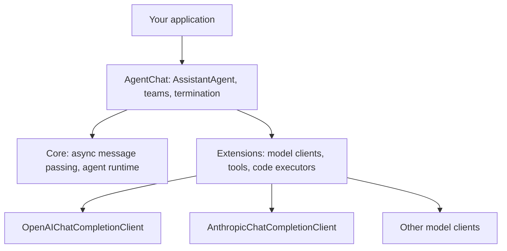

# AutoGen

## Introduction

**AutoGen** is Microsoft's open-source framework for multi-agent applications. It became famous for one idea: agents that solve problems by **talking to each other**. A "writer" agent drafts, a "critic" agent reviews, and they go back and forth until they agree. Many of today's multi-agent patterns were popularized by AutoGen.

Before writing any code, you need to know where AutoGen stands today, because it affects whether you should start a new project with it.

:::warning AutoGen is in maintenance mode
The AutoGen GitHub README states that AutoGen is in maintenance mode: it will not receive new features or enhancements and is community managed going forward. Microsoft recommends that **new users start with [Microsoft Agent Framework](https://github.com/microsoft/agent-framework)**, which it describes as the direct successor to both AutoGen and Semantic Kernel, built by the same teams. A migration guide from AutoGen is available in the [Agent Framework docs](https://learn.microsoft.com/en-us/agent-framework/overview/). Check the [AutoGen repository](https://github.com/microsoft/autogen) for the latest status.
:::

So this page does two things:

1. Teaches the **AutoGen AgentChat API** (version 0.4 and later), because many existing projects, tutorials, and research papers use it and you may need to maintain or migrate one.
2. Shows the same agent in **Microsoft Agent Framework**, the recommended path for new work.

## A Short History

Three different things are often called "AutoGen", which causes real confusion:

| Name | Package | What it is |
|------|---------|-----------|
| AutoGen 0.2 (legacy) | `pyautogen` (historically) | The original `AssistantAgent` + `UserProxyAgent` conversation API |
| AutoGen 0.4+ | `autogen-agentchat`, `autogen-core`, `autogen-ext` | A ground-up redesign: async, event-driven core plus a high-level AgentChat API. Now in maintenance mode |
| AG2 | `ag2` | A community fork led by some of AutoGen's original creators, continuing the 0.2-style API independently |
| Microsoft Agent Framework | `agent-framework` | Microsoft's successor to AutoGen and Semantic Kernel |

If you find a tutorial with `UserProxyAgent` and `initiate_chat`, it is the 0.2 style (or AG2). This page uses the 0.4+ AgentChat API.

## AutoGen's Architecture

AutoGen 0.4+ is layered:



- **Core** is an actor-style runtime where agents exchange messages asynchronously.
- **AgentChat** is the friendly API most people use: preset agents and "teams" with turn-taking rules.
- **Extensions** provide model clients, MCP tool support, and code execution.

## Installation

```bash
pip install autogen-agentchat "autogen-ext[anthropic]"
export ANTHROPIC_API_KEY="your-api-key"
```

The AutoGen README's quickstart uses `autogen-ext[openai]` with `OpenAIChatCompletionClient`. We use the Anthropic client to stay consistent with the rest of this section.

## The Support Agent in AutoGen AgentChat

Tools can be plain Python functions (sync or async). AutoGen builds the schema from the type hints and docstring.

```python
import asyncio
import json
from autogen_agentchat.agents import AssistantAgent
from autogen_core.models import ModelFamily, ModelInfo
from autogen_ext.models.anthropic import AnthropicChatCompletionClient

ORDERS = {
    "A1001": {"status": "delivered", "total": 59.99, "delivered_days_ago": 3},
    "A1003": {"status": "delivered", "total": 35.50, "delivered_days_ago": 45},
}


async def get_order(order_id: str) -> str:
    """Look up an order by ID. Returns status, total and days since delivery."""
    order = ORDERS.get(order_id.upper())
    return json.dumps(order) if order else "Error: order not found"


async def issue_refund(order_id: str, reason: str) -> str:
    """Refund a delivered order within 30 days of delivery."""
    order = ORDERS.get(order_id.upper())
    if not order or order["delivered_days_ago"] > 30:
        return "Error: order is not eligible for a refund"
    return f"Refunded ${order['total']} for {order_id}"


async def main():
    model_client = AnthropicChatCompletionClient(
        model="claude-opus-5-5",
        # AutoGen's built-in model table predates this model, so declare its capabilities.
        model_info=ModelInfo(vision=True, function_calling=True, json_output=False,
                             structured_output=False, family=ModelFamily.UNKNOWN,
                             multiple_system_messages=False),
    )
    agent = AssistantAgent(
        name="support",
        model_client=model_client,
        tools=[get_order, issue_refund],
        system_message="You are a concise, friendly support agent for Acme Gadgets.",
        max_tool_iterations=5,       # default is 1: only one round of tool calls
        reflect_on_tool_use=True,    # summarize tool results into a final answer
    )
    result = await agent.run(task="Order A1001 arrived broken. Refund please.")
    print(result.messages[-1].content)
    await model_client.close()


asyncio.run(main())
```

Example output:

```text
I'm sorry your order arrived damaged! I've refunded the full $59.99 for order A1001.
```

Two AutoGen-specific details are worth understanding:

- **`max_tool_iterations` defaults to 1.** Out of the box, an `AssistantAgent` makes one round of tool calls and then stops. Our agent needs two rounds (look up, then refund), so we raise it. This catches many newcomers.
- **`model_info` for newer models.** AutoGen keeps a table of known models and their capabilities. When a model is not in the table, it assumes conservative defaults, which can include "no function calling." Because AutoGen is in maintenance mode, newer models may never be added, so you declare capabilities yourself. This is a concrete example of the cost of building on a framework that is no longer actively developed.

## Teams: Agents That Talk to Each Other

AutoGen's signature feature is the **team**: several agents sharing a conversation, with rules for who speaks next and when to stop.

```python
from autogen_agentchat.agents import AssistantAgent
from autogen_agentchat.conditions import MaxMessageTermination, TextMentionTermination
from autogen_agentchat.teams import RoundRobinGroupChat
from autogen_agentchat.ui import Console


async def review_team(model_client):
    drafter = AssistantAgent(
        "drafter", model_client=model_client, tools=[get_order], max_tool_iterations=3,
        system_message="Draft a reply to the customer using the order data.",
    )
    reviewer = AssistantAgent(
        "reviewer", model_client=model_client,
        system_message="Review the draft for accuracy and tone. If it is good, reply APPROVE. "
                       "Otherwise list specific fixes.",
    )
    stop = TextMentionTermination("APPROVE") | MaxMessageTermination(8)
    team = RoundRobinGroupChat([drafter, reviewer], termination_condition=stop)
    await Console(team.run_stream(task="Customer asks if order A1003 can be refunded."))
```

Example output (abridged):

```text
---------- TextMessage (user) ----------
Customer asks if order A1003 can be refunded.
---------- ToolCallSummaryMessage (drafter) ----------
{"status": "delivered", "total": 35.5, "delivered_days_ago": 45}
---------- TextMessage (drafter) ----------
Hi! I checked order A1003. It was delivered 45 days ago, outside our 30-day window...
---------- TextMessage (reviewer) ----------
The draft is accurate and polite. APPROVE
```

| Team type | Who speaks next |
|-----------|-----------------|
| `RoundRobinGroupChat` | Agents take turns in a fixed order |
| `SelectorGroupChat` | An LLM picks the next speaker based on the conversation |
| `Swarm` | Agents hand off explicitly using handoff messages |

Termination conditions can be combined with `|` (or) and `&` (and). **Always include a hard limit** such as `MaxMessageTermination`; otherwise two agents can debate indefinitely. See [Debate and Consensus](../8-agents-multi-agent-systems/6-agents-debate-and-consensus.mdx) and [Multi-Agent Failure Modes](../8-agents-multi-agent-systems/9-agents-multi-agent-failure-modes.mdx).

## Structured Output

When downstream code needs fields rather than prose, give `AssistantAgent` a Pydantic model as `output_content_type`. The final message then carries a validated object.

```python
from pydantic import BaseModel
from autogen_agentchat.agents import AssistantAgent


class TicketDecision(BaseModel):
    order_id: str
    refund: bool
    reply: str


async def decide(model_client) -> TicketDecision:
    agent = AssistantAgent(
        "decider", model_client=model_client, tools=[get_order], max_tool_iterations=3,
        output_content_type=TicketDecision,
        system_message="Check the order and decide whether it qualifies for a refund.",
    )
    result = await agent.run(task="Customer wants a refund for A1003.")
    return result.messages[-1].content  # a TicketDecision instance
```

Structured output depends on the model client supporting it; with a hand-written `model_info`, set `structured_output` and `json_output` to match what the provider supports, and check the AutoGen docs for your client.

## Using MCP Servers as Tools

AutoGen can load tools from any MCP server through a **workbench**. This is also a good migration habit: tools that live in an MCP server move to any other framework unchanged.

```python
from autogen_agentchat.agents import AssistantAgent
from autogen_ext.tools.mcp import McpWorkbench, StdioServerParams


async def agent_with_mcp(model_client):
    params = StdioServerParams(command="python", args=["support_mcp_server.py"])
    async with McpWorkbench(server_params=params) as workbench:
        agent = AssistantAgent(
            "support", model_client=model_client, workbench=workbench,
            max_tool_iterations=5,
            system_message="Use the support tools to help the customer.",
        )
        result = await agent.run(task="Check order A1001.")
        return result.messages[-1].content
```

The MCP server itself could be the one built in [Building Your First MCP Server](../7-agents-mcp/2-agents-mcp-first-server.mdx).

## The Same Agent in Microsoft Agent Framework

Microsoft Agent Framework (MAF) combines AutoGen's simple agent abstractions with Semantic Kernel's enterprise features (sessions, middleware, telemetry, type safety) and adds graph-based **workflows** for explicit multi-agent orchestration. It supports Python and .NET (with Go in preview at the time of writing) and many model providers, including Microsoft Foundry, Azure OpenAI, OpenAI, Anthropic, and Ollama.

```bash
pip install agent-framework
export ANTHROPIC_API_KEY="your-api-key"
```

Some provider connectors ship as pre-release packages, so check the [provider list](https://learn.microsoft.com/en-us/agent-framework/overview/) for the one you need.

```python
import asyncio
import json
from typing import Annotated
from agent_framework import Agent, tool
from agent_framework.anthropic import AnthropicClient

ORDERS = {
    "A1001": {"status": "delivered", "total": 59.99, "delivered_days_ago": 3},
    "A1004": {"status": "delivered", "total": 450.00, "delivered_days_ago": 5},
}


def get_order(order_id: Annotated[str, "Order ID such as A1001"]) -> str:
    """Look up an order by ID. Returns status, total and days since delivery."""
    order = ORDERS.get(order_id.upper())
    return json.dumps(order) if order else "Error: order not found"


@tool(approval_mode="always_require")  # the run pauses for a human before this executes
def issue_refund(order_id: str, reason: str) -> str:
    """Refund a delivered order within 30 days of delivery."""
    order = ORDERS.get(order_id.upper())
    if not order or order["delivered_days_ago"] > 30:
        return "Error: order is not eligible for a refund"
    return f"Refunded ${order['total']} for {order_id}"


async def main():
    agent = Agent(
        client=AnthropicClient(model="claude-opus-5-5"),
        name="SupportAgent",
        instructions="You are a concise, friendly support agent for Acme Gadgets.",
        tools=[get_order, issue_refund],
    )
    result = await agent.run("What's the status of order A1001?")
    print(result.text)


asyncio.run(main())
```

Example output:

```text
Order A1001 was delivered 3 days ago. The total was $59.99.
```

When the model calls a tool marked `approval_mode="always_require"`, the run returns pending approval requests (`user_input_requests` on the response) instead of executing it. Your app approves or rejects them and continues. For multi-turn memory, create a session with `agent.create_session()` and pass `session=` to each `run` call. See the [Agent Framework docs](https://learn.microsoft.com/en-us/agent-framework/overview/) for the current approval and session APIs.

### Mapping AutoGen concepts to Agent Framework

| AutoGen AgentChat | Microsoft Agent Framework | Notes |
|-------------------|---------------------------|-------|
| `AssistantAgent` | `Agent` | Both take instructions, tools, and a model client |
| `autogen_ext` model clients | Chat clients (`OpenAIChatClient`, `AnthropicClient`, `FoundryChatClient`, ...) | One client per provider |
| Teams (`RoundRobinGroupChat`, `SelectorGroupChat`, `Swarm`) | Workflows and orchestration patterns (sequential, concurrent, handoff, group chat) | MAF workflows are explicit graphs with checkpointing |
| Termination conditions | Workflow edges and conditions | Control flow is explicit rather than message-pattern based |
| `model_context` / memory | Sessions and context providers | |
| (limited) | Middleware, OpenTelemetry, human-in-the-loop approvals | Inherited from Semantic Kernel |

Microsoft's own guidance for agents vs workflows is worth repeating: use an agent when the task is open-ended and needs autonomous tool use; use a workflow when the process has well-defined steps; and if you can write a plain function to handle the task, do that instead of using an AI agent.

## Real-World Scenario

Your company built an internal **"data analysis assistant"** on AutoGen 0.4 last year. A `planner` agent and a `coder` agent collaborate in a `SelectorGroupChat`, with a Docker code executor running the generated Python. It works, but the team wants to move to newer models and add approval steps and OpenTelemetry tracing.

**Recommended path:**

1. **Stabilize first.** Pin current AutoGen versions, add `model_info` for the newer model, and add `MaxMessageTermination` everywhere. Build an evaluation set of 20 real analysis requests (see [Building Evaluation Datasets](../11-agents-evaluation-and-testing/1-agents-building-eval-sets.mdx)).
2. **Port agents one-to-one.** Each `AssistantAgent` becomes a MAF `Agent` with the same instructions and tool functions. Tools that are plain functions usually move unchanged.
3. **Replace the team with a workflow.** The planner-coder conversation becomes an explicit workflow, with an approval step before code execution.
4. **Compare on the eval set** before switching traffic.

**Why this approach fits:** the existing system works, so a rushed rewrite is risky. But staying on a maintenance-mode framework means slower access to new model features and fewer fixes, so a planned migration with evals is the safe middle path.

**When to use AutoGen / when not to:**

- Use (or keep using) AutoGen AgentChat for existing projects, for research reproductions that depend on it, or to learn conversation-driven multi-agent ideas.
- Do not start new production projects on it. Choose Microsoft Agent Framework if you want Microsoft's stack, or another actively developed framework from this section.

**Alternatives and trade-offs:**

| Approach | Pros | Cons | Best for |
|----------|------|------|----------|
| AutoGen AgentChat | Mature conversational teams, many examples | Maintenance mode, model table may lag | Existing projects, research |
| Microsoft Agent Framework | Active successor, workflows, middleware, .NET and Python | Newer, APIs still evolving | New projects in Microsoft ecosystems |
| AG2 | Continues the classic AutoGen style | Separate community project, different API from 0.4 | Teams invested in 0.2-style code |
| LangGraph | Explicit graphs, durable execution | Different mental model | Complex workflows on any stack |
| CrewAI | Role-based multi-agent, fast prototypes | Less conversation-level control | Task pipelines |

## Common Mistakes

1. **Mixing 0.2 and 0.4 tutorials.** `UserProxyAgent.initiate_chat` and `AssistantAgent.run` belong to different APIs. Check which version a tutorial targets.
2. **Leaving `max_tool_iterations` at 1.** Multi-step tool use silently stops after the first round.
3. **No termination limit.** Group chats without `MaxMessageTermination` can loop and burn tokens.
4. **Assuming new models "just work".** Without correct `model_info`, AutoGen may disable function calling for an unknown model.
5. **Starting a greenfield project on AutoGen** without weighing its maintenance status.

## Summary

- AutoGen popularized conversation-driven multi-agent systems; its 0.4+ AgentChat API offers `AssistantAgent`, teams, and termination conditions.
- AutoGen is now in maintenance mode; Microsoft Agent Framework is the recommended successor for new work.
- In AgentChat, remember `max_tool_iterations`, `reflect_on_tool_use`, and `model_info` for newer models.
- Microsoft Agent Framework provides `Agent`, chat clients for many providers including Anthropic, tool approval, sessions, middleware, and graph workflows.
- Migrate deliberately: pin, evaluate, port agents one-to-one, then replace teams with workflows.

## Exercises

1. **SelectorGroupChat.** Rebuild the review team with `SelectorGroupChat` and three agents (drafter, policy checker, reviewer). Log which agent the selector picks each turn.
2. **Port a team.** Take the drafter-reviewer team and express it as a sequential workflow in Microsoft Agent Framework using its docs.
3. **Approval flow.** Run the MAF support agent with a refund request, inspect the pending approval request, and approve it programmatically.
4. **Model info experiment.** Remove `model_info` from the AutoGen client and observe how tool calling behaves. Explain what you see.

**Related pages:**

- [Multi-Agent Systems Introduction](../8-agents-multi-agent-systems/0-agents-multi-agent-introduction.mdx)
- [Agent Handoffs](../8-agents-multi-agent-systems/3-agents-handoffs.mdx)
- [Managed Agent Platforms](./9-agents-managed-agent-platforms.mdx) (Microsoft Foundry Agent Service)
- [Choosing an Agent Framework](./10-agents-choosing-a-framework.mdx)
