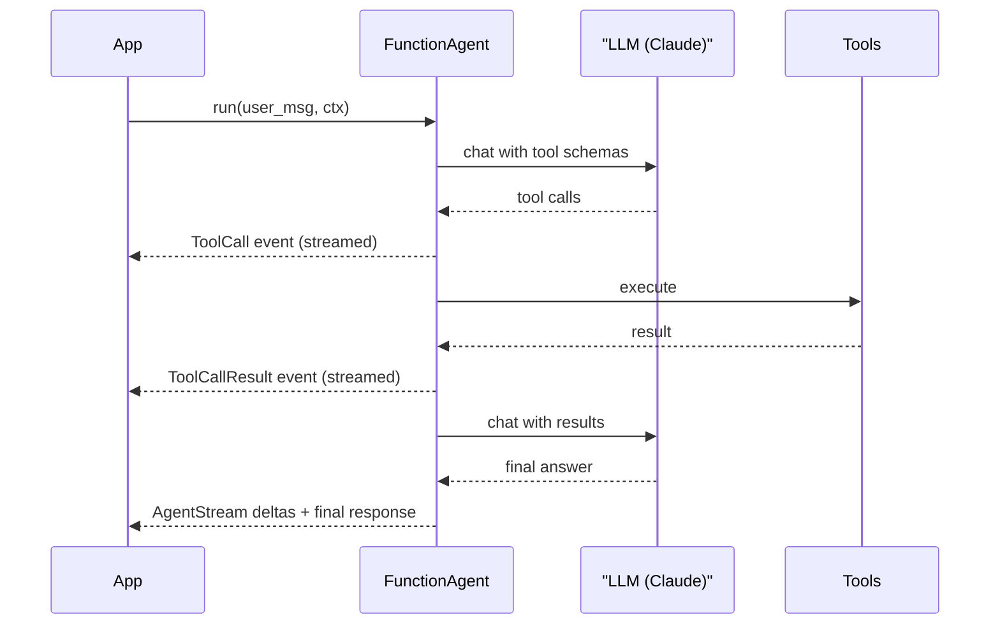

# LlamaIndex Agents

## Introduction

**LlamaIndex** started as a framework for connecting LLMs to your data: loading documents, splitting them into chunks, embedding them, and retrieving the right pieces at question time. That is still its center of gravity. Its agent layer builds on top, so the natural LlamaIndex agent is one that **reasons over your documents and data** while also calling ordinary tools.

Modern LlamaIndex agents run on **Workflows**, an event-driven, async-first orchestration system. You will mostly use three prebuilt classes:

- `FunctionAgent`: uses the model's native tool calling (the default choice for Claude and other tool-calling models).
- `ReActAgent`: uses a text-based Thought/Action/Observation prompt, useful for models without native tool calling.
- `AgentWorkflow`: coordinates several agents that can hand off to each other.

An analogy: if LangChain is a universal adapter kit, LlamaIndex is a research librarian. It is happiest when the job involves finding, reading, and citing the right documents, and it can also run errands with tools.

## How a LlamaIndex Agent Runs



`agent.run(...)` returns a **handler** immediately. You can `await` it for the final answer, or iterate `handler.stream_events()` to see tool calls and tokens as they happen.

## Installation

```bash
pip install llama-index-core llama-index-llms-anthropic
export ANTHROPIC_API_KEY="your-api-key"
```

LlamaIndex is split into many small packages: `llama-index-core` plus one package per integration (LLMs, embeddings, vector stores). The Workflows engine underneath agents is also published as its own package and installed automatically. Check the [LlamaIndex agent docs](https://developers.llamaindex.ai/python/framework/understanding/agent/) for the current layout.

## The Support Agent

Plain Python functions become tools automatically. LlamaIndex reads the function name, parameters, type hints, and docstring.

```python
import asyncio
import json
from llama_index.core.agent.workflow import FunctionAgent
from llama_index.llms.anthropic import Anthropic

ORDERS = {
    "A1001": {"status": "delivered", "total": 59.99, "delivered_days_ago": 3},
    "A1003": {"status": "delivered", "total": 35.50, "delivered_days_ago": 45},
}


def get_order(order_id: str) -> str:
    """Look up an order by ID. Returns status, total and days since delivery."""
    order = ORDERS.get(order_id.upper())
    return json.dumps(order) if order else "Error: order not found"


def issue_refund(order_id: str, reason: str) -> str:
    """Refund a delivered order within 30 days of delivery."""
    order = ORDERS.get(order_id.upper())
    if not order or order["delivered_days_ago"] > 30:
        return "Error: order is not eligible for a refund"
    return f"Refunded ${order['total']} for {order_id}"


llm = Anthropic(model="claude-opus-5-5", max_tokens=4096)

agent = FunctionAgent(
    tools=[get_order, issue_refund],
    llm=llm,
    system_prompt="You are a concise, friendly support agent for Acme Gadgets. "
                  "Look up orders before answering.",
)


async def main():
    response = await agent.run(user_msg="Order A1001 arrived broken. Refund please.")
    print(str(response))


asyncio.run(main())
```

Example output:

```text
I'm sorry your order arrived damaged! I've refunded the full $59.99 for order A1001.
```

If you need more control over a tool's name or description, wrap the function with `FunctionTool.from_defaults(fn=..., name=..., description=...)`.

## Streaming Events

Every step of the agent emits an event. Streaming them is how you build a responsive UI or a debug log.

```python
from llama_index.core.agent.workflow import AgentStream, ToolCall, ToolCallResult


async def stream_demo():
    handler = agent.run(user_msg="Can order A1003 be refunded?")
    async for event in handler.stream_events():
        if isinstance(event, ToolCall):
            print(f"\n[calling {event.tool_name} with {event.tool_kwargs}]")
        elif isinstance(event, ToolCallResult):
            print(f"[{event.tool_name} returned {event.tool_output}]")
        elif isinstance(event, AgentStream):
            print(event.delta, end="", flush=True)
    final = await handler
    return final
```

Example output:

```text
[calling get_order with {'order_id': 'A1003'}]
[get_order returned {"status": "delivered", "total": 35.5, "delivered_days_ago": 45}]
Order A1003 was delivered 45 days ago, which is outside our 30-day refund window...
```

Streaming is on by default. If a model or proxy does not support streaming, create the agent with `streaming=False`.

## Memory and State with Context

A `Context` holds everything about a run: chat history and any custom state. Reuse the same `Context` across calls to keep a conversation going.

```python
from llama_index.core.workflow import Context

ctx = Context(agent)


async def chat():
    await agent.run(user_msg="My order number is A1001.", ctx=ctx)
    reply = await agent.run(user_msg="What's its status?", ctx=ctx)
    print(str(reply))
```

Example output:

```text
Order A1001 has been delivered (3 days ago), with a total of $59.99.
```

Tools can also read and write the context's state. Put `ctx: Context` as the **first** parameter, and LlamaIndex injects it (the model never sees that parameter):

```python
from llama_index.core.workflow import Context


async def remember_customer(ctx: Context, customer_name: str) -> str:
    """Save the customer's name for later in the conversation."""
    async with ctx.store.edit_state() as state:
        state["customer_name"] = customer_name
    return f"Saved name {customer_name}"
```

A `Context` can be serialized with `ctx.to_dict(...)` and restored with `Context.from_dict(...)`, so a conversation can be stored in a database between HTTP requests. See [Session Persistence](../4-agents-memory-and-context/10-agents-session-persistence.mdx).

## Structured Output

Pass a Pydantic model as `output_cls`, and after the agent finishes, LlamaIndex converts its answer into that shape.

```python
from pydantic import BaseModel
from llama_index.core.agent.workflow import FunctionAgent


class TicketDecision(BaseModel):
    order_id: str
    refund_issued: bool
    customer_reply: str


decision_agent = FunctionAgent(
    tools=[get_order, issue_refund],
    llm=llm,
    system_prompt="Resolve the customer's request within policy.",
    output_cls=TicketDecision,
)


async def decide():
    response = await decision_agent.run(user_msg="A1001 arrived broken, refund it.")
    decision = response.get_pydantic_model(TicketDecision)
    print(decision)
```

Example output:

```text
order_id='A1001' refund_issued=True customer_reply="I'm sorry your order arrived broken! ..."
```

The raw dictionary is also available as `response.structured_response`.

## Where LlamaIndex Shines: Tools Over Your Data

Here is what sets LlamaIndex apart. Any **query engine** (a RAG pipeline over your documents) can become a tool with one line. Let us give the support agent access to the company's policy documents.

```python
from llama_index.core import SimpleDirectoryReader, VectorStoreIndex
from llama_index.core.agent.workflow import FunctionAgent
from llama_index.core.tools import QueryEngineTool
from llama_index.llms.anthropic import Anthropic

# Load ./policies/*.md, chunk, embed and index them.
# Embeddings use Settings.embed_model (an OpenAI model by default); configure another
# provider, such as a local HuggingFace model, if you prefer.
documents = SimpleDirectoryReader("./policies").load_data()
index = VectorStoreIndex.from_documents(documents)

llm = Anthropic(model="claude-opus-5-5", max_tokens=4096)

policy_tool = QueryEngineTool.from_defaults(
    query_engine=index.as_query_engine(llm=llm),
    name="search_policies",
    description="Answers questions about refund, warranty and shipping policies. "
                "Use for any policy question, especially edge cases.",
)

policy_agent = FunctionAgent(
    tools=[get_order, issue_refund, policy_tool],
    llm=llm,
    system_prompt="You are a support agent. Check the order, then check the policy "
                  "documents for anything unusual before deciding.",
)
# await policy_agent.run(user_msg="A1003 is 45 days old but the screen died. Any options?")
```

Example output:

```text
Order A1003 is outside the 30-day refund window, but according to our warranty
policy, hardware defects within 12 months qualify for a free repair or replacement.
I can start a warranty claim for you.
```

This is [Agentic RAG](../5-agents-rag/6-agents-agentic-rag.mdx): the agent decides when to search, what to ask, and how to combine retrieved policy text with live order data. LlamaIndex also provides the building blocks for the retrieval side (chunking, rerankers, many vector stores), covered in [Building a Retrieval Pipeline](../5-agents-rag/4-agents-retrieval-pipeline.mdx).

## Human in the Loop

A tool can pause and wait for a person by emitting an `InputRequiredEvent` and waiting for a `HumanResponseEvent`:

```python
from llama_index.core.workflow import Context, HumanResponseEvent, InputRequiredEvent


async def approve_large_refund(ctx: Context, order_id: str, amount: float) -> str:
    """Ask a supervisor to approve refunds of $100 or more."""
    question = f"Approve ${amount} refund for {order_id}? (yes/no) "
    response = await ctx.wait_for_event(
        HumanResponseEvent,
        waiter_id=question,
        waiter_event=InputRequiredEvent(prefix=question),
    )
    return "approved" if response.response.strip().lower() == "yes" else "rejected"


async def run_with_supervisor(agent_with_approval, message: str):
    handler = agent_with_approval.run(user_msg=message)
    async for event in handler.stream_events():
        if isinstance(event, InputRequiredEvent):
            answer = input(event.prefix)  # replace with your UI
            handler.ctx.send_event(HumanResponseEvent(response=answer))
    return await handler
```

The waiting run can be serialized and resumed later. See [Human-in-the-Loop](../6-agents-planning-and-reasoning/9-agents-human-in-the-loop.mdx).

## Multi-Agent with AgentWorkflow

`AgentWorkflow` runs several agents that hand off control to each other. Each agent lists which others it may hand off to with `can_handoff_to`.

```python
from llama_index.core.agent.workflow import AgentWorkflow, FunctionAgent

triage = FunctionAgent(
    name="triage",
    description="Figures out what the customer needs and routes them.",
    system_prompt="Route refund questions to 'billing' and policy questions to 'policy'.",
    llm=llm,
    tools=[get_order],
    can_handoff_to=["billing", "policy"],
)
billing = FunctionAgent(
    name="billing",
    description="Issues refunds for eligible orders.",
    system_prompt="Check eligibility and issue refunds.",
    llm=llm,
    tools=[get_order, issue_refund],
)
policy = FunctionAgent(
    name="policy",
    description="Answers policy questions from documents.",
    system_prompt="Answer using the policy search tool and cite the policy.",
    llm=llm,
    tools=[policy_tool],
)

support_workflow = AgentWorkflow(agents=[triage, billing, policy], root_agent="triage")
# response = await support_workflow.run(user_msg="Can I return an opened item?")
```

For fully custom orchestration, you can write your own `Workflow` subclass with `@step` methods that pass typed events between them, similar in spirit to [LangGraph](./5-agents-langgraph.mdx) graphs or CrewAI Flows.

## Real-World Scenario

A healthcare software vendor maintains **hundreds of PDFs**: product manuals, compliance policies, integration guides, and release notes. Their support engineers spend hours searching them. They want an internal assistant that answers questions with citations, checks a customer's licensed modules through an API, and opens a Jira ticket when it cannot answer.

**Solution with LlamaIndex:**

- Separate indexes for manuals, policies, and release notes, each exposed as a `QueryEngineTool` with a precise description so the agent picks the right source.
- Function tools for `get_customer_modules` and `create_jira_ticket`.
- A `FunctionAgent` on Claude, with a `Context` per engineer session stored in Redis.
- Streaming events power a UI that shows "Searching manuals..." and the cited sources.

**Why this approach fits:** the hard part is *retrieval quality* over a large, messy document set. LlamaIndex's loaders, chunkers, indexes, and query engines address exactly that, and turning them into agent tools takes one line each.

**When to use it / when not to:**

- Use LlamaIndex for document-heavy agents, knowledge assistants, and agentic RAG, especially if you already use it for retrieval.
- Look elsewhere for agents that mainly act on systems (deploying code, editing files), where the [Claude Agent SDK](./2-agents-claude-agent-sdk.mdx) or a simple loop may fit better, or for complex durable workflows where [LangGraph](./5-agents-langgraph.mdx) has more mature checkpoint tooling.

**Alternatives and trade-offs:**

| Approach | Pros | Cons | Best for |
|----------|------|------|----------|
| LlamaIndex agents | Best-in-class data ingestion and retrieval tools, query engines as tools | Agent layer less central than in agent-first frameworks | Document Q&A, agentic RAG |
| LangChain `create_agent` + retrievers | Broad integrations, middleware | Retrieval components less specialized | Mixed integrations |
| Hand-written loop + vector DB client | Full control, minimal deps | You build chunking and retrieval yourself | Small corpora |
| Managed RAG offerings | No infrastructure | Less control, vendor lock-in | Teams without ML ops |

## Common Mistakes

1. **Forgetting the embedding model.** `VectorStoreIndex` needs embeddings. If you use Claude for chat, configure `Settings.embed_model` explicitly instead of relying on the default provider.
2. **Vague query engine descriptions.** With several `QueryEngineTool`s, the description is the only thing the model uses to choose. Say what each index contains and when to use it.
3. **Losing conversation state.** Each `agent.run` without a `ctx` starts fresh. Reuse a `Context` for multi-turn chats.
4. **Putting `ctx` in the wrong position.** In tools that use the context, `ctx: Context` must be the first parameter.
5. **Retrieving too much.** Large chunks and high `similarity_top_k` fill the context window. Tune retrieval before blaming the model. See [Chunking Strategies](../5-agents-rag/3-agents-chunking-strategies.mdx).

## Summary

- LlamaIndex agents are built on event-driven Workflows; `FunctionAgent` is the default for tool-calling models like Claude.
- Plain functions become tools automatically; `QueryEngineTool` turns any RAG pipeline into a tool.
- `Context` stores chat history and custom state and can be serialized.
- `handler.stream_events()` exposes tool calls, results, and token deltas for UIs and debugging.
- `AgentWorkflow` coordinates multiple agents with handoffs; custom `Workflow` classes give full control.

## Exercises

1. **Policy-aware support.** Create a `policies` folder with two short Markdown files and build the `policy_agent`. Ask an edge-case question and print which tools it called.
2. **ReAct comparison.** Swap `FunctionAgent` for `ReActAgent` and compare the number of LLM calls on the same question.
3. **Persistent context.** Serialize a `Context` to JSON after one turn, restart Python, restore it, and continue the conversation.
4. **Handoff tracing.** Run the `AgentWorkflow` and log every event's class name to see when handoffs happen.

**Related pages:**

- [RAG Introduction](../5-agents-rag/0-agents-rag-introduction.mdx)
- [Agentic RAG](../5-agents-rag/6-agents-agentic-rag.mdx)
- [Project: Document Q&A Agent](../14-agents-projects/4-agents-project-document-qa.mdx)
- [Choosing an Agent Framework](./10-agents-choosing-a-framework.mdx)
