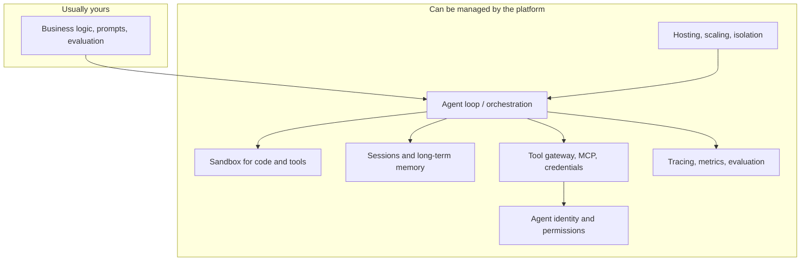
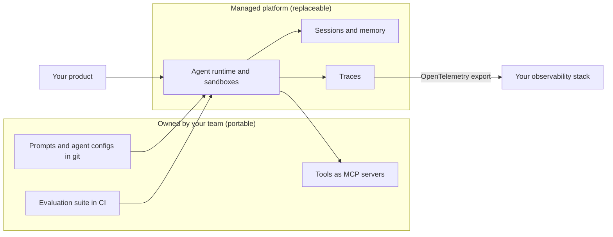

# Managed Agent Platforms

## Introduction

Every framework so far in this section is a **library**: it runs inside your process, on your servers. You are responsible for hosting it, scaling it, isolating the code it runs, storing its state, securing its credentials, and watching it in production.

A **managed agent platform** takes some or all of those jobs off your plate. You describe the agent (model, instructions, tools), or upload your agent code, and the provider runs it: the loop, the sandbox where tools execute, session storage, memory, identity, scaling, and observability.

An analogy: frameworks are like buying a commercial kitchen's equipment and running the restaurant yourself. A managed platform is like a ghost kitchen. You bring the recipes (and sometimes your own chef), and someone else runs the building, the gas, the health inspections, and the delivery drivers.

This page compares the major platforms at a conceptual level. Product names, features, regions, and pricing change frequently in this space, so treat the details as a snapshot and follow the links to each official source before you decide.

## What Gets Managed

Managed platforms differ mainly in **how much** they take on. It helps to think of the agent stack in layers:



| Layer | Self-hosted framework | Managed platform |
|-------|----------------------|------------------|
| Agent loop | Library in your process | Provider runs it (configured agents) or hosts your code |
| Tool sandbox | Your containers or VMs | Provider-managed isolated sandboxes |
| Session state | Your database | Provider-stored sessions |
| Long-term memory | Your vector store | Built-in memory services |
| Credentials for tools | Your secrets manager | Vaults or identity services that inject credentials |
| Scaling | Your autoscaler | Provider autoscaling, often per session |
| Observability | Your tracing stack | Built-in traces, often exportable via OpenTelemetry |

Broadly, platforms come in two styles, and several offer both:

1. **Configured agents**: you define model, instructions, and tools through an API or console; the provider runs the loop.
2. **Hosted runtimes**: you bring code written with any framework (LangGraph, CrewAI, the vendor SDKs) and the provider runs it in isolated, scalable sessions with add-on services.

## Claude Managed Agents (Anthropic)

**Claude Managed Agents** is Anthropic's hosted agent harness, configured through the Claude API. The agent loop runs on Anthropic's orchestration layer, and each session gets a container as the agent's workspace, where tools such as bash, file operations, and code execution run. It was in beta at the time of writing.

The core objects:

| Object | Purpose |
|--------|---------|
| **Agent** | A persisted, versioned config: model, system prompt, tools, MCP servers, skills. Create once, reuse. |
| **Environment** | Where tools execute: an Anthropic-managed cloud container or a self-hosted sandbox on your infrastructure, with networking rules. |
| **Session** | One run of an agent in an environment. You send user events and stream agent events back. |
| **Vaults** | Store credentials for MCP servers and APIs so secrets never appear in the sandbox. |

The flow in Python looks like this (setup and runtime are deliberately separate, because agents are versioned objects you create once):

```python
import anthropic

client = anthropic.Anthropic()

# --- One-time setup (store these IDs in config, do not run on every request) ---
environment = client.beta.environments.create(
    name="support-env",
    config={"type": "cloud", "networking": {"type": "limited"}},
)
agent = client.beta.agents.create(
    name="Support Agent",
    model="claude-opus-5-5",
    system="You are a support agent for Acme Gadgets.",
    tools=[{
        "type": "agent_toolset_20260401",
        "default_config": {"permission_policy": {"type": "auto"}},
        "configs": [{"name": "web_search", "enabled": False},
                    {"name": "web_fetch", "enabled": False}],
    }],
)

# --- Every run ---
session = client.beta.sessions.create(
    agent={"type": "agent", "id": agent.id, "version": agent.version},
    environment_id=environment.id,
)
with client.beta.sessions.events.stream(session_id=session.id) as stream:
    client.beta.sessions.events.send(
        session_id=session.id,
        events=[{"type": "user.message",
                 "content": [{"type": "text", "text": "Summarize ticket #4821."}]}],
    )
    for event in stream:
        if event.type == "agent.message":
            for block in event.content:
                if block.type == "text":
                    print(block.text, end="")
        elif event.type == "session.status_idle" and event.stop_reason.type != "requires_action":
            break  # simplified: real code also answers approvals and custom tool calls
```

Custom tools you implement yourself arrive as events that your app answers with results, and tool calls that need approval pause until you confirm. Other notable features include versioned agents (sessions pin to a version), per-session budgets, memory stores, multi-agent coordination, scheduled deployments, and self-hosted sandboxes for teams that must keep tool execution in their own network.

- Docs: [Claude Managed Agents overview](https://platform.claude.com/docs/en/managed-agents/overview)
- Compared with the [Claude Agent SDK](./2-agents-claude-agent-sdk.mdx): the Agent SDK runs the harness in *your* process; Managed Agents runs it on Anthropic's infrastructure.

## OpenAI's Hosted Offerings

OpenAI's agent platform is built around the **Responses API**, which can run several **hosted tools** on OpenAI's side within a single request (for example web search, file search, code interpreter, and remote MCP servers), plus the **Conversations API** for storing conversation state server-side. You typically drive these from your own code, often with the [OpenAI Agents SDK](./3-agents-openai-agents-sdk.mdx).

Other pieces and recent changes to know about:

| Offering | Status at the time of writing |
|----------|------------------------------|
| Responses API + hosted tools | OpenAI's recommended foundation for new agent work |
| Conversations API | Server-side conversation state; the migration target for Assistants API threads |
| ChatKit | Embeddable chat UI components; OpenAI states it remains available |
| Agent Builder (visual builder from AgentKit) | Scheduled to shut down on November 30, 2026; OpenAI points to the Agents SDK or ChatGPT workspace agents |
| Assistants API | Shutdown date of August 26, 2026, per OpenAI's deprecations page |

The pattern here is closer to "managed tools and state" than "managed agent runtime": OpenAI runs the model and hosted tools, and you run the orchestration code, unless you deploy that code onto a hosting platform such as those below.

- Docs: [OpenAI deprecations page](https://developers.openai.com/api/docs/deprecations) and the OpenAI API documentation on the Responses API and tools.

## AWS: Amazon Bedrock AgentCore

**Amazon Bedrock AgentCore** is AWS's modular platform for running agents built with **any framework and any model**, including models outside Amazon Bedrock. Its services can be used together or independently. According to the AWS documentation, they include:

| Service | What it does |
|---------|-------------|
| Runtime | Serverless, session-isolated hosting for agent code (LangGraph, CrewAI, LlamaIndex, OpenAI Agents SDK, Strands Agents, custom) |
| Harness | A managed, config-driven agent loop with an isolated environment per session |
| Memory | Short-term and long-term memory, shareable across agents |
| Gateway | Turns APIs and Lambda functions into MCP-compatible tools; connects existing MCP servers |
| Identity | Agent identity and credential management with existing identity providers |
| Policy | Deterministic rules on tool calls, enforced at the Gateway |
| Code Interpreter and Browser | Managed sandboxes for running code and driving a web browser |
| Observability and Evaluations | OpenTelemetry-compatible tracing and automated quality evaluation |

AWS also has the older **Amazon Bedrock Agents** feature for configuring agents in the Bedrock console. AgentCore is the more flexible, framework-agnostic option.

- Docs: [What is Amazon Bedrock AgentCore?](https://docs.aws.amazon.com/bedrock-agentcore/latest/devguide/what-is-bedrock-agentcore.html)

## Google: Agent Runtime (formerly Vertex AI Agent Engine)

Google rebranded and expanded Vertex AI as the **Gemini Enterprise Agent Platform** in 2026. The managed service previously known as **Vertex AI Agent Engine** now appears in Google's documentation under that platform, with a component called **Agent Runtime** for deploying and scaling agents. You may still see "Vertex AI Agent Engine" in older tutorials and code samples.

According to Google's documentation, the managed services include:

- **Agent Runtime**: managed deployment, operation, and scaling of agents
- **Sessions**: conversation state
- **Memory Bank**: long-term memories and user preferences
- **Code Execution and Computer Use** sandboxes
- **Evaluation**, example store, and feedback services

Supported frameworks listed by Google include its own **Agent Development Kit (ADK)**, LangChain, LangGraph, AG2, LlamaIndex, and custom agents, plus the Agent2Agent (A2A) protocol (see [Agent-to-Agent (A2A) Protocol](../7-agents-mcp/10-agents-a2a-protocol.mdx)).

- Docs: [Gemini Enterprise Agent Platform: Scale your agents](https://docs.cloud.google.com/vertex-ai/generative-ai/docs/agent-engine/overview) (the old Agent Engine URL redirects to the current docs)

## Microsoft: Foundry Agent Service

**Microsoft Foundry Agent Service** (earlier documentation called it Azure AI Foundry Agent Service) is Azure's managed platform for building, deploying, and scaling agents. It offers three agent types:

| Agent type | What you provide | What Foundry manages |
|-----------|------------------|----------------------|
| Prompt agents | Instructions, model, tools (portal, SDK, or REST) | Everything else; no code to host |
| Voice-based prompt agents | Voice and model configuration | Real-time voice orchestration |
| Hosted agents | Your code (Microsoft Agent Framework, LangGraph, OpenAI Agents SDK, Anthropic's SDK, GitHub Copilot SDK, or custom) as a container or source zip | Endpoint, autoscaling, isolated sessions, Entra identity, observability |

Other features include **toolboxes** (curated tool sets exposed through one managed MCP endpoint), a dedicated Microsoft Entra identity per agent, private networking, content safety filters, versioning, and publishing to Microsoft Teams and Microsoft 365 Copilot. It is a natural fit for teams already using [Microsoft Agent Framework](./7-agents-autogen.mdx).

- Docs: [What is Microsoft Foundry Agent Service?](https://learn.microsoft.com/en-us/azure/foundry/agents/overview)

## Side-by-Side Comparison

| Platform | Configured agents | Hosts your framework code | Model choice | Notable strengths |
|----------|-------------------|---------------------------|--------------|-------------------|
| Claude Managed Agents | Yes | Self-hosted sandbox option for tool execution | Claude models | Claude Code-style harness, per-session containers, vaults, versioned agents |
| OpenAI Responses + Conversations | Partially (hosted tools and state) | No, you run orchestration | OpenAI models | Hosted tools in a single API, Agents SDK integration |
| AWS Bedrock AgentCore | Yes (Harness) | Yes (Runtime) | Any, in or outside Bedrock | Modular services, Gateway and Policy, AWS integration |
| Google Agent Runtime | Via ADK and Agent Studio | Yes | Gemini and others via frameworks | Memory Bank, ADK, A2A |
| Microsoft Foundry Agent Service | Yes (prompt agents) | Yes (hosted agents) | Foundry model catalog | Entra identity, M365 and Teams publishing, toolboxes |

Capabilities evolve monthly. Re-check each row against the linked docs before relying on it.

## How Platforms Charge

Pricing details change often and differ by region, so this page does not quote numbers. What matters is understanding the **dimensions** you are billed on, because they change which design is cheapest:

| Billing dimension | Typical on | Design implication |
|-------------------|-----------|--------------------|
| Model tokens | Every option | Fewer turns, smaller context, caching |
| Session or runtime duration | Hosted runtimes, sandboxes | Short sessions, idle timeouts, scale to zero |
| Tool and sandbox usage | Code interpreters, browsers, hosted search | Call expensive tools only when needed |
| Memory and storage | Memory services, stored sessions | Retention policies, summarize before storing |
| Gateway or policy calls | Tool gateways | Batch related calls into one tool |

Always model your expected volume against each platform's official pricing page before deciding, and include the cost of the engineering time a platform saves.

## Questions to Ask Before Choosing a Platform

Feature lists look similar from a distance. These questions separate platforms for *your* situation:

| Area | Questions |
|------|-----------|
| Isolation | Is each session in its own container or VM? Can sessions see each other's files? Can I restrict network egress per agent? |
| Data | Which regions can store sessions and memory? How long is data retained? Can I bring my own storage? |
| Models | Which models are available? Can I pin a model version? What happens when a model is retired? |
| Tools | Can I connect my own MCP servers? How are tool credentials stored and injected? |
| Control | Can I set per-session budgets, turn limits, and approval rules? Can I version agents and roll back? |
| Observability | Can I export traces (for example via OpenTelemetry) to my existing stack? |
| Status | Which features are GA with an SLA, and which are preview or beta? |
| Exit | Can I export transcripts and memory? How much of my code is platform-specific? |

## A Hybrid Architecture

Many teams end up with a hybrid: portable pieces they own, and a platform that runs them.



The portable core is small. For the support agent, the tools fit in one MCP server that any platform or framework on these pages can call:

```python
# support_mcp_server.py
import json
from mcp.server.fastmcp import FastMCP

mcp = FastMCP("support")

ORDERS = {
    "A1001": {"status": "delivered", "total": 59.99, "delivered_days_ago": 3},
    "A1003": {"status": "delivered", "total": 35.50, "delivered_days_ago": 45},
}


@mcp.tool()
def get_order(order_id: str) -> str:
    """Look up an order by ID. Returns status, total and days since delivery."""
    order = ORDERS.get(order_id.upper())
    return json.dumps(order) if order else "Error: order not found"


@mcp.tool()
def issue_refund(order_id: str, reason: str) -> str:
    """Refund a delivered order within 30 days of delivery."""
    order = ORDERS.get(order_id.upper())
    if not order or order["delivered_days_ago"] > 30:
        return "Error: order is not eligible for a refund"
    return f"Refunded ${order['total']} for {order_id}"


if __name__ == "__main__":
    mcp.run()  # stdio by default; use an HTTP transport for remote platforms
```

Remote platforms usually need the server reachable over HTTP with authentication, which is covered in [MCP Transports](../7-agents-mcp/5-agents-mcp-transports.mdx) and [MCP Security](../7-agents-mcp/8-agents-mcp-security.mdx).

## Real-World Scenario

A 30-person SaaS company wants to launch an **AI analyst** for its customers: users ask questions about their data, and the agent writes and runs Python against an export of that data, then returns charts. There is one platform engineer, no dedicated security team, and enterprise customers ask hard questions about isolation.

**Option A: self-host.** Use the [Claude Agent SDK](./2-agents-claude-agent-sdk.mdx) or [LangGraph](./5-agents-langgraph.mdx), run each session in a Firecracker or gVisor sandbox, build session storage, secrets injection, autoscaling, and tracing. Maximum control, but months of infrastructure work for one engineer.

**Option B: managed platform.** Pick a platform whose sandboxes run untrusted code per session (for example Claude Managed Agents, AgentCore Runtime with Code Interpreter, or Foundry hosted agents), store customer credentials in the platform's vault or identity service, and use built-in tracing.

**Decision:** the team chooses Option B for launch. The deciding factors were per-session isolation they could point customers to, and not having to staff an on-call rotation for sandbox infrastructure. They keep their tools as **MCP servers** and their evaluation suite in their own repo, so moving to another platform later means re-pointing configuration, not rewriting logic.

**Why this approach fits:** the bottleneck is operations capacity, not agent logic. Managed platforms are strongest exactly where small teams are weakest: isolation, scaling, and security plumbing.

**When to use a managed platform / when not to:**

- Use one when you lack infrastructure capacity, need strong per-session isolation quickly, are already committed to that cloud, or need enterprise features such as identity integration out of the box.
- Avoid or delay when you need full control of the runtime, must run on-premises or air-gapped, have strict data-residency requirements a platform cannot meet, or when per-session platform costs exceed the cost of running your own containers at your scale.

**Alternatives and trade-offs:**

| Approach | Pros | Cons | Best for |
|----------|------|------|----------|
| Self-hosted framework | Full control, portable, no platform fees | You own isolation, scaling, state, security | Teams with platform engineering capacity |
| Model provider's managed agents | Tight model integration, minimal setup | Tied to one model vendor | Teams standardized on one model family |
| Cloud provider's agent platform | Integrates with your cloud's identity, network, billing | Cloud lock-in, more services to learn | Enterprises already on that cloud |
| Hybrid (framework code on a hosted runtime) | Portable code plus managed ops | Two layers to understand | Teams wanting an exit path |

## Common Mistakes

1. **Comparing on features alone.** Also compare data residency, compliance certifications, quotas, pricing model, and SLA status (many agent features launch in preview without an SLA).
2. **Creating agents on every request.** On platforms with persisted agent objects, create them once in setup and reference them by ID; otherwise you accumulate orphaned configs and lose versioning.
3. **Putting secrets in prompts or sandboxes.** Use the platform's vault or identity service so credentials are injected at the edge. See [Secrets Management for Agents](../12-agents-safety-and-security/4-agents-secrets-management.mdx).
4. **No exit plan.** Keep tools behind MCP or plain functions, keep prompts and evals in version control, and avoid platform-only features in core logic unless they are worth the lock-in.
5. **Skipping a local development loop.** If every test requires deploying to the platform, iteration slows to a crawl. Keep a way to run the same agent locally (for example with the matching framework or SDK) against the same tools.
6. **Ignoring cold starts and quotas.** Session start-up time and concurrency limits can dominate latency for short tasks. Measure them early. See [Latency Optimization](../13-agents-production/3-agents-latency-optimization.mdx).
7. **Trusting docs snapshots.** Names and features in this space change quickly; this page itself reflects one point in time.

## Summary

- Managed platforms run some or all of the agent stack: loop, sandbox, sessions, memory, tools, identity, scaling, and observability.
- Two styles exist: configured agents (the provider runs the loop) and hosted runtimes (the provider runs your framework code).
- Claude Managed Agents, OpenAI's Responses and Conversations APIs, AWS Bedrock AgentCore, Google's Agent Runtime, and Microsoft Foundry Agent Service each take different slices of the stack.
- Choose based on operations capacity, isolation needs, cloud commitments, model choice, and lock-in tolerance.
- Keep tools, prompts, and evaluations portable so you can change platforms later.

## Exercises

1. **Responsibility matrix.** For an agent you want to build, fill in the "What Gets Managed" table: which layers you would own with a framework and which a platform would take.
2. **Platform scorecard.** Pick two platforms from this page and score them on isolation, model choice, data residency in your region, observability export, and pricing model using their current docs.
3. **Portability check.** Rewrite the support agent's two tools as an MCP server (see [Building Your First MCP Server](../7-agents-mcp/2-agents-mcp-first-server.mdx)) and list which platforms could use it unchanged.
4. **Cost model.** Estimate monthly cost for 10,000 five-minute agent sessions on one platform using its public pricing page, and compare with running containers yourself.

**Related pages:**

- [Deployment Architectures](../13-agents-production/1-agents-deployment-architectures.mdx)
- [Sandboxing Agent Execution](../12-agents-safety-and-security/3-agents-sandboxing.mdx)
- [Agent Framework Landscape](./0-agents-framework-landscape.mdx)
- [Choosing an Agent Framework](./10-agents-choosing-a-framework.mdx)
