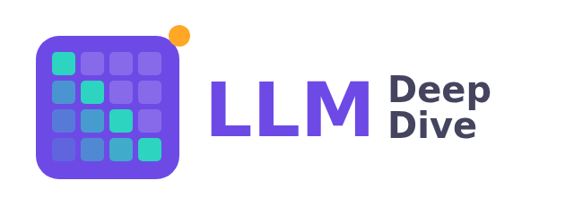
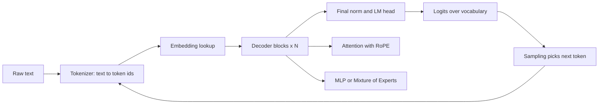
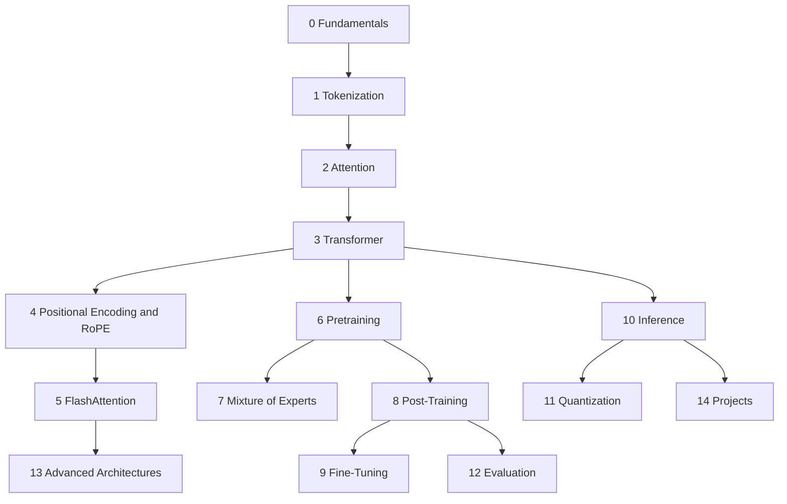

# Large Language Models Introduction



## Introduction

A **large language model** (LLM) is a neural network, almost always a Transformer, trained to predict the next token of text on a huge corpus, then tuned to follow instructions. GPT, Claude, Gemini, Llama, Qwen, DeepSeek, Mistral and Gemma are all LLMs. Underneath the chat interface, each of them repeats one operation: read a sequence of tokens, output a probability for every possible next token, pick one, and go again.

That description fits on one line, yet the systems built on it are among the most complex software ever written. A single forward pass of a modern model touches billions of parameters, an attention mechanism whose cost grows with the square of the context length, a positional scheme that decides how far the model can see, and a pile of engineering tricks that make it fit on GPUs at all.

This tutorial explains how all of it works, from the bottom up. It is written for developers who want to go past using an API:

- Read a paper such as "Attention Is All You Need" or the DeepSeek-V3 technical report and follow the equations.
- Open a model's `config.json` and know what every field means and why it has that value.
- Implement the core pieces in PyTorch: a BPE tokenizer, attention, RoPE, a GPT, a LoRA layer, a KV cache, a sampler.
- Reason about trade-offs: why grouped-query attention, why RoPE theta grew from 10,000 to millions, why FlashAttention is faster without changing the math, why a 70B model needs more memory than its weights.

If you want to build applications on top of LLMs (calling APIs, prompting, retrieval-augmented generation, tool use and agents), the companion [AI Agents tutorial](/docs/ai/agents) covers that. This tutorial is about what happens inside the model.

## What You Should Know First

You need three things:

1. **Python**, comfortably. If not, start with the [Python tutorial](/docs/language/python).
2. **Basic linear algebra**: vectors, dot products, matrix multiplication, and what the shape of a matrix product is. Every attention formula is a few matrix products.
3. **A little PyTorch**: tensors, `nn.Module`, a training loop. The [PyTorch tutorial](/docs/library/pytorch) is the best preparation. The [Neural Network Refresher](./3-llm-neural-network-refresher.mdx) in this section reviews exactly the parts LLMs rely on.

You do not need a GPU for most of the tutorial. Code snippets run on a laptop CPU with tiny sizes unless a page says otherwise (the FlashAttention and Triton pages, for example, explain what hardware they need).

## What an LLM Looks Like From the Inside

Before the roadmap, here is the whole pipeline in one picture. Each box is a section of this tutorial.



And here is the same thing in code, using GPT-2, the 124M-parameter model OpenAI released in 2019. It is small enough to run anywhere and it has the same overall shape as today's models:

```python
import torch
from transformers import AutoTokenizer, AutoModelForCausalLM

torch.manual_seed(0)
tok = AutoTokenizer.from_pretrained("openai-community/gpt2")
model = AutoModelForCausalLM.from_pretrained("openai-community/gpt2")
model.eval()

prompt = "The capital of France is"
ids = tok(prompt, return_tensors="pt").input_ids          # (1, seq_len)
print("token ids:", ids.tolist()[0])
print("tokens:   ", tok.convert_ids_to_tokens(ids[0]))

with torch.no_grad():
    logits = model(ids).logits                             # (1, seq_len, vocab_size)
print("logits shape:", tuple(logits.shape))

probs = torch.softmax(logits[0, -1], dim=-1)               # (vocab_size,)
top = torch.topk(probs, k=5)
for p, i in zip(top.values, top.indices):
    print(f"{tok.decode(int(i))!r:>12}  {p.item():.3f}")
```

```text
token ids: [464, 3139, 286, 4881, 318]
tokens:    ['The', 'Ġcapital', 'Ġof', 'ĠFrance', 'Ġis']
logits shape: (1, 5, 50257)
      ' the'  0.085
      ' now'  0.048
        ' a'  0.046
   ' France'  0.032
    ' Paris'  0.032
```

Read the output carefully, because every line is a topic in this tutorial:

- The text became five integer **token ids**. The `Ġ` marks a leading space, a detail of GPT-2's byte-level BPE tokenizer ([Tokenization](../1-llm-tokenization/0-llm-tokenization-basics.mdx)).
- The model returned **logits** with shape `(1, 5, 50257)`: one score for each of the 50,257 vocabulary entries, at each of the 5 positions. Position $t$ holds the prediction for token $t+1$ ([Language Modeling](./1-llm-language-modeling.mdx)).
- Softmax turned the last position's logits into a **probability distribution**. "Paris" is only fifth. GPT-2 is a base model that continues text; it has not been taught to answer questions. Turning a base model into an assistant is [Post-Training](../8-llm-post-training/0-llm-post-training-overview.mdx).

Modern models change almost every component inside the box (RMSNorm instead of LayerNorm, RoPE instead of learned positions, SwiGLU, grouped-query attention, mixture of experts) but this outer loop is identical.

## The Learning Path

The tutorial has 15 sections. They are ordered so that each one only uses ideas from earlier ones. The first page of each section is linked below.



### Part 1: How a Model Reads and Represents Text

0. **[LLM Fundamentals](./0-llm-introduction.mdx)** (this section). What a language model is, next-token prediction and cross-entropy, a short history from n-grams to reasoning models, a neural network refresher, the major model families and how to read their configs, the training lifecycle, and a terminology cheat sheet.
1. **[Tokenization and Embeddings](../1-llm-tokenization/0-llm-tokenization-basics.mdx)**. How text becomes integers. You will implement byte-level BPE from scratch, compare WordPiece, Unigram and SentencePiece, use `tiktoken` and Hugging Face tokenizers with chat templates, and learn why tokenization is behind many odd model failures with numbers and code.

### Part 2: The Architecture

2. **[Attention](../2-llm-attention/0-llm-attention-intuition.mdx)**. The core operation of the Transformer. You will derive scaled dot-product attention (including why it divides by $\sqrt{d_k}$), implement it from scratch and check it against PyTorch's fused kernel, then follow the evolution to multi-head, multi-query, grouped-query and DeepSeek's multi-head latent attention.
3. **[The Transformer Architecture](../3-llm-transformer/0-llm-transformer-overview.mdx)**. From the original encoder-decoder to the decoder-only models used today. Residual streams, RMSNorm, SwiGLU, and a complete GPT you build and train in PyTorch, plus how to count parameters, FLOPs and memory for a real 8B model.
4. **[Positional Encoding and RoPE](../4-llm-positional-encoding/0-llm-why-position-matters.mdx)**. Why attention has no sense of order, and how sinusoidal embeddings, ALiBi and rotary position embedding fix it. This section goes deep on RoPE: the rotation math, two implementation layouts, why the base frequency grew from 10,000 (Llama 2) to 500,000 (Llama 3) and 1,000,000 (Qwen), and how YaRN and Llama 3 scaling extend context.
5. **[FlashAttention and Efficient Attention](../5-llm-flash-attention/0-llm-gpu-memory-hierarchy.mdx)**. Why standard attention is limited by memory bandwidth, not arithmetic, and how online softmax and tiling let FlashAttention compute exact attention without ever storing the full attention matrix. Then FlashAttention-2, -3 and -4, using it from PyTorch and vLLM, sparse and linear attention, and ring attention.

### Part 3: Training

6. **[Pretraining](../6-llm-pretraining/0-llm-pretraining-data.mdx)**. Data collection and deduplication, the training objective, scaling laws (Kaplan and Chinchilla), AdamW and learning-rate schedules, mixed precision from FP32 to FP8, distributed training with FSDP and tensor parallelism, and an end-to-end small pretraining run.
7. **[Mixture of Experts](../7-llm-mixture-of-experts/0-llm-moe-introduction.mdx)**. How models such as Mixtral, DeepSeek-V3, Qwen3 and gpt-oss have hundreds of billions of parameters but use only a fraction per token: routing, load balancing, an MoE layer in PyTorch, and expert parallelism.
8. **[Post-Training and Alignment](../8-llm-post-training/0-llm-post-training-overview.mdx)**. Supervised fine-tuning, RLHF with reward models and PPO, Direct Preference Optimization (derived step by step), reinforcement learning with verifiable rewards and GRPO for reasoning models, distillation, and the limits of safety training.
9. **[Fine-Tuning in Practice](../9-llm-fine-tuning/0-llm-when-to-fine-tune.mdx)**. When fine-tuning beats prompting or RAG, LoRA and QLoRA math and memory budgets, an end-to-end run with Hugging Face `transformers`, `peft` and `trl`, data preparation, and evaluating the result without catastrophic forgetting.

### Part 4: Running Models

10. **[Inference and Decoding](../10-llm-inference/0-llm-inference-overview.mdx)**. Prefill and decode, every decoding strategy from greedy to min-p, the KV cache and its memory formula, PagedAttention and continuous batching, speculative decoding (with the proof that it does not change the output distribution), serving engines, latency metrics and structured output.
11. **[Quantization and Efficient Models](../11-llm-quantization/0-llm-quantization-basics.mdx)**. Number formats, scales and zero points, GPTQ and AWQ, GGUF and running models locally with llama.cpp, FP8 and FP4 formats, KV cache compression, and small on-device models.

### Part 5: Measuring and Extending

12. **[Evaluation and Interpretability](../12-llm-evaluation/0-llm-evaluation-overview.mdx)**. Benchmarks and why they saturate, perplexity, LLM-as-a-judge, hallucination, mechanistic interpretability (induction heads, sparse autoencoders) and benchmark contamination.
13. **[Advanced Architectures](../13-llm-advanced-architectures/0-llm-multimodal.mdx)**. Multimodal models, state space models and Mamba, hybrid attention and linear-attention models, reasoning models and test-time compute, diffusion language models and multi-token prediction.
14. **[Projects](../14-llm-projects/0-llm-project-tokenizer.mdx)**. Six projects that tie it together: a BPE tokenizer, a small GPT trained on a laptop, an experiment measuring RoPE theta and context extension, a LoRA fine-tune of an open model, a minimal inference engine with a KV cache, and a fused attention kernel in Triton.

### Suggested routes

Not everyone needs every page. Some routes through the material:

| Goal | Route |
| --- | --- |
| Understand the architecture end to end | Sections 0, 1, 2, 3, 4, then project 1 |
| Read and reason about a model's `config.json` | Model Families page, then sections 2, 3, 4 and 7 |
| Fine-tune an open model | Sections 0, 1, then 8 and 9, then project 3 |
| Serve models efficiently | Sections 3, 10 and 11, then section 5 for attention kernels |
| Long-context work | Section 4 (RoPE scaling), section 5, then the KV cache page |
| Prepare for ML engineering interviews | Section 0, attention, transformer block, KV cache, LoRA, scaling laws |

## How Each Page Works

Every page follows the same pattern, so you always know where to look:

- **Introduction**: what problem the idea solves and what you will be able to do afterward.
- **Concept sections**: the derivation with every symbol explained, a diagram, code with tensor shapes in comments, and a small numeric example you can check by hand.
- **A worked scenario or experiment**: the idea applied to a real model or a measurement you can run.
- **Common Mistakes** and **Summary**: the bugs people actually hit and the points to remember.
- **Further Reading**: the original papers and official documentation, so you can go to the source.

Math uses standard notation. Matrices are capital letters ($Q$, $K$, $V$, $W$), $X^\top$ is a transpose, and shapes are written like `(batch, seq_len, d_model)`. Numbers quoted for real models (head counts, context lengths, RoPE theta) come from the model's published `config.json` or paper; when a page says a value, you can open the file and check it.

:::tip
Run the code. Reading about attention is not the same as watching a tensor of shape `(2, 8, 16, 64)` come out of your own implementation and match PyTorch to six decimal places. Every snippet is self-contained and runs on CPU unless the page says otherwise.
:::

## Setting Up

Create a virtual environment and install the libraries used throughout the tutorial:

```bash
python -m venv llm-env
source llm-env/bin/activate
pip install torch transformers tokenizers tiktoken datasets numpy
```

Later sections add `peft` and `trl` (fine-tuning), `vllm` (serving, needs an NVIDIA GPU), `flash-attn` (GPU kernels) and `triton`. Each page lists what it needs.

Check the install with a one-liner:

```bash
python -c "import torch, transformers; print(torch.__version__, transformers.__version__)"
```

The pages were tested with PyTorch 2.14 and `transformers` 5.21. If you use an older `transformers` 4.x release, a few names differ: `from_pretrained` takes `dtype=` where older 4.x releases used `torch_dtype=`, and version 5 exposes RoPE settings as `rope_parameters` on the config object. The [Model Families](./4-llm-model-families.mdx) page shows both.

## What This Tutorial Is Not

- It is not a prompt engineering guide. Prompting, RAG and agents live in the [AI Agents tutorial](/docs/ai/agents).
- It is not a ranking of which model is best this month. The field moves too fast. Instead it teaches you to read model cards and configs so you can judge new releases yourself.
- It does not hide the math. Equations are derived, not just stated, but always next to code and a concrete example.

## Common Mistakes

- **Skipping tokenization.** It looks boring, but many confusing model behaviors (bad arithmetic, trouble counting letters, odd costs in some languages) come from it.
- **Learning architecture from blog diagrams alone.** Diagrams omit the details that matter: where the normalization goes, which dimension softmax runs over, how the heads are reshaped. Implement it once.
- **Treating parameter count as the only size that matters.** Memory at inference depends on the KV cache too, which depends on context length, the number of KV heads and the batch size. Section 10 shows the formula.
- **Assuming every model uses the same defaults.** RoPE theta, head counts, normalization epsilon and vocabulary size differ between models. Always read the config.
- **Confusing the model with the product.** A chat product adds system prompts, tools, retrieval and safety filters on top of the model. This tutorial is about the model.

## Summary

- An LLM is a Transformer trained to predict the next token, then post-trained to follow instructions. Generation repeats predict, sample, append.
- This tutorial goes from tokens to attention, the Transformer block, RoPE and FlashAttention, then training, mixture of experts, alignment, fine-tuning, inference, quantization, evaluation and newer architectures, ending with six projects.
- Each section builds on earlier ones; follow the numbered order or one of the suggested routes.
- Every page derives the math, implements it in PyTorch, and cites the original papers and official docs.
- Next: [Language Modeling and Next-Token Prediction](./1-llm-language-modeling.mdx).

## Further Reading

- [Attention Is All You Need (Vaswani et al., 2017)](https://arxiv.org/abs/1706.03762): the paper that introduced the Transformer.
- [Language Models are Few-Shot Learners (Brown et al., 2020)](https://arxiv.org/abs/2005.14165): the GPT-3 paper, which showed what scale buys.
- [The Llama 3 Herd of Models (Llama Team, Meta, 2024)](https://arxiv.org/abs/2407.21783): one of the most detailed public reports on training a frontier-scale open model.
- [DeepSeek-V3 Technical Report (DeepSeek-AI, 2024)](https://arxiv.org/abs/2412.19437): mixture of experts, multi-head latent attention and FP8 training at scale.
- [Hugging Face Transformers documentation](https://huggingface.co/docs/transformers/index): the library used for loading real models throughout this tutorial.
- [PyTorch documentation](https://docs.pytorch.org/docs/stable/index.html): reference for every tensor operation in the code.
