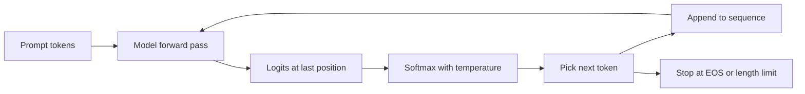

# Language Modeling and Next-Token Prediction

## Introduction

Every large language model, from GPT-2 to the newest reasoning model, is trained to do one thing: given some text, predict what token comes next. Translation, coding, summarizing and chatting are all side effects of doing that one job extremely well on trillions of tokens.

This page builds the idea from the ground up. You will see what it means to put a probability on a sentence, why the chain rule of probability turns that into a sequence of next-token predictions, why the training loss is cross-entropy, what perplexity measures, and how a model turns probabilities back into text by sampling.

By the end you will be able to:

- Write the probability of a sequence as a product of conditional probabilities and compute it by hand.
- Explain what the logits a model returns mean, and what shape they have.
- Compute cross-entropy loss and perplexity for a sentence, both by hand and with a real model (GPT-2).
- Implement an autoregressive generation loop with greedy decoding and temperature sampling.

The math needs only logarithms and basic probability. The code uses PyTorch and Hugging Face `transformers`; if PyTorch is new to you, read the [PyTorch tutorial](/docs/library/pytorch) first.

## What a Language Model Is

A **language model** is a probability distribution over sequences of tokens. A token is a small piece of text: a word, part of a word, a punctuation mark or a byte. If $x_1, x_2, \dots, x_T$ is a sequence of $T$ tokens, a language model assigns it a probability

$$
P(x_1, x_2, \dots, x_T)
$$

A good model gives high probability to text that people actually write ("The cat sat on the mat.") and low probability to text they do not ("Mat the on sat cat the."). That is the whole definition. Nothing in it mentions grammar, facts or reasoning; those emerge because they help predict text.

Two questions follow immediately:

1. How do you represent a distribution over all possible sequences? There are astronomically many of them. With a vocabulary of 50,000 tokens, there are $50000^{10}$ sequences of just ten tokens.
2. How do you use such a distribution to produce text?

The chain rule answers both.

## The Chain Rule: Turning Sequences into Next-Token Predictions

The chain rule of probability says that any joint probability can be factored into a product of conditionals:

$$
P(x_1, \dots, x_T) = P(x_1)\,P(x_2 \mid x_1)\,P(x_3 \mid x_1, x_2)\cdots P(x_T \mid x_1, \dots, x_{T-1})
$$

Written compactly, with $x_{\lt t}$ meaning "all tokens before position $t$":

$$
P(x_1, \dots, x_T) = \prod_{t=1}^{T} P(x_t \mid x_{\lt t})
$$

This is an identity, not an approximation. It holds for any distribution. What it buys you is a change of problem: instead of modeling whole sequences, you model one conditional distribution, "what comes next given everything so far". That conditional is a distribution over the vocabulary only, which is a vector of $V$ numbers that sum to 1. A neural network can output that.

Models that generate text left to right using this factorization are called **autoregressive** or **causal** language models. GPT, Llama, Qwen, DeepSeek, Mistral and Gemma are all autoregressive. (BERT-style models are trained differently, with masked tokens; the [history page](./2-llm-history.mdx) covers the difference.)

In practice every sequence starts with a special beginning-of-sequence token and often ends with an end-of-sequence token, so that the model also learns how texts start and when to stop. We will write them as `<s>` and `</s>`.

### Working with logarithms

Multiplying many probabilities below 1 quickly underflows floating point. A 1,000-token document whose tokens each have probability 0.1 has probability $10^{-1000}$, which is zero in float32. So we work with log probabilities, which turn the product into a sum:

$$
\log P(x_1, \dots, x_T) = \sum_{t=1}^{T} \log P(x_t \mid x_{\lt t})
$$

Every log probability is negative or zero. A higher (closer to zero) total means the model finds the text more likely.

## A Model You Can Compute by Hand: the Bigram Model

The simplest useful language model throws away all history except the previous token. That assumption, $P(x_t \mid x_{\lt t}) \approx P(x_t \mid x_{t-1})$, gives a **bigram model**. Its probabilities are just counts:

$$
P(w \mid v) = \frac{\mathrm{count}(v, w)}{\sum_{w'} \mathrm{count}(v, w')}
$$

Here $v$ is the previous word, $w$ the next word, and the denominator counts every word that ever followed $v$. Counting and dividing is the maximum-likelihood estimate: it is the set of probabilities that makes the training data as likely as possible.

Take a three-sentence corpus and score a new sentence:

```python
import math
from collections import Counter, defaultdict

corpus = [
    "the cat sat on the mat",
    "the dog sat on the rug",
    "the cat ate the fish",
]
BOS, EOS = "<s>", "</s>"

# Count bigrams (previous word -> next word)
counts = defaultdict(Counter)
for line in corpus:
    words = [BOS] + line.split() + [EOS]
    for prev, nxt in zip(words, words[1:]):
        counts[prev][nxt] += 1

def prob(nxt, prev):
    total = sum(counts[prev].values())
    return counts[prev][nxt] / total

print("P(cat | the) =", prob("cat", "the"))
print("P(sat | cat) =", prob("sat", "cat"))

def sequence_logprob(sentence):
    words = [BOS] + sentence.split() + [EOS]
    logp = 0.0
    for prev, nxt in zip(words, words[1:]):
        p = prob(nxt, prev)
        print(f"  P({nxt!r:7} | {prev!r:6}) = {p:.4f}")
        logp += math.log(p)
    return logp, len(words) - 1

logp, n = sequence_logprob("the cat sat on the rug")
print(f"log P = {logp:.4f}   P = {math.exp(logp):.6f}")
print(f"cross-entropy = {-logp / n:.4f} nats/token   perplexity = {math.exp(-logp / n):.3f}")
```

```text
P(cat | the) = 0.3333333333333333
P(sat | cat) = 0.5
  P('the'   | '<s>' ) = 1.0000
  P('cat'   | 'the' ) = 0.3333
  P('sat'   | 'cat' ) = 0.5000
  P('on'    | 'sat' ) = 1.0000
  P('the'   | 'on'  ) = 1.0000
  P('rug'   | 'the' ) = 0.1667
  P('</s>'  | 'rug' ) = 1.0000
log P = -3.5835   P = 0.027778
cross-entropy = 0.5119 nats/token   perplexity = 1.669
```

Check it by hand. The word "the" appears six times as a previous word, followed by cat, mat, dog, rug, cat and fish. So $P(\mathrm{cat} \mid \mathrm{the}) = 2/6 = 1/3$ and $P(\mathrm{rug} \mid \mathrm{the}) = 1/6$. "cat" is followed once by "sat" and once by "ate", so $P(\mathrm{sat} \mid \mathrm{cat}) = 1/2$. Every other step has only one option, so its probability is 1. The sentence probability is

$$
1 \cdot \tfrac{1}{3} \cdot \tfrac{1}{2} \cdot 1 \cdot 1 \cdot \tfrac{1}{6} \cdot 1 = \tfrac{1}{36} \approx 0.0278
$$

Notice the sentence "the cat sat on the rug" never appears in the corpus, yet the model gives it a sensible probability because it is built from bigrams it has seen. That is generalization in its most primitive form.

The bigram model also shows the core weakness of counting: any bigram not in the corpus gets probability exactly zero, and one zero makes the whole sentence impossible. "the fish sat on the mat" scores 0 because "fish sat" was never seen. Smoothing tricks patched this for decades. Neural language models solved it properly by mapping tokens to vectors, so that similar words share statistical strength. The [history page](./2-llm-history.mdx) tells that story.

## From Counts to Neural Networks: Logits and Softmax

A neural language model replaces the count table with a function. Given the context tokens, it outputs one real number per vocabulary entry, called a **logit**. Logits are unnormalized scores: any real value, positive or negative. The **softmax** function turns them into probabilities:

$$
P(x_t = i \mid x_{\lt t}) = \mathrm{softmax}(z)_i = \frac{e^{z_i}}{\sum_{j=1}^{V} e^{z_j}}
$$

where $z \in \mathbb{R}^V$ is the logit vector and $V$ is the vocabulary size. Exponentiation makes every entry positive, and dividing by the sum makes them add up to 1. The largest logit gets the largest probability, and adding the same constant to every logit changes nothing.

A Transformer language model computes this for **every position at once**. Feed it a sequence of $T$ tokens and it returns a tensor of logits with shape `(batch, T, V)`. The vector at position $t$ is the model's prediction for token $t+1$, computed using only tokens 1 to $t$ (a causal mask enforces that, as explained in [Causal Masking](../2-llm-attention/3-llm-causal-masking.mdx)).

Here is GPT-2 (124M parameters, released by OpenAI in 2019) predicting the next token:

```python
import torch
from transformers import AutoTokenizer, AutoModelForCausalLM

tok = AutoTokenizer.from_pretrained("openai-community/gpt2")
model = AutoModelForCausalLM.from_pretrained("openai-community/gpt2").eval()

ids = tok("The capital of France is", return_tensors="pt").input_ids   # (1, 5)
with torch.no_grad():
    logits = model(ids).logits                                          # (1, 5, 50257)
probs = torch.softmax(logits[0, -1], dim=-1)                            # (50257,)
top = torch.topk(probs, k=5)
for p, i in zip(top.values, top.indices):
    print(f"{tok.decode(int(i))!r:>12}  {p.item():.3f}")
```

```text
      ' the'  0.085
      ' now'  0.048
        ' a'  0.046
   ' France'  0.032
    ' Paris'  0.032
```

Two lessons. First, the output is a full distribution, not an answer: "Paris" is in the top five but shares the mass with many continuations that are also plausible English ("The capital of France is the city of..."). Second, a small base model trained only on web text is a text continuer, not a question answerer. Turning it into an assistant is the job of post-training, covered in [The LLM Lifecycle](./5-llm-lifecycle.mdx).

## Cross-Entropy: The Training Loss

How do you train the network that produces those logits? You show it real text and adjust its weights to make that text more probable. Maximizing the log probability of the training data is the same as minimizing its negative, averaged over tokens:

$$
\mathcal{L} = -\frac{1}{T} \sum_{t=1}^{T} \log P_\theta(x_t \mid x_{\lt t})
$$

$\theta$ stands for all the model's weights. This quantity is the **cross-entropy** between the data and the model, also called the **negative log-likelihood** (NLL). For a single position, if the true next token has index $y$ and the model outputs logits $z$, the loss is

$$
\ell = -\log \mathrm{softmax}(z)_y = -z_y + \log \sum_{j=1}^{V} e^{z_j}
$$

It is called cross-entropy because it measures the average number of nats (or bits, with base-2 logs) the model needs to encode the real data. A perfect model that always puts probability 1 on the right token has loss 0. A model that guesses uniformly over $V$ tokens has loss $\log V$. For GPT-2's vocabulary of 50,257 tokens that is $\ln 50257 \approx 10.8$ nats, which is roughly where an untrained model starts.

Three properties make cross-entropy the right loss:

- It is the maximum-likelihood objective, the standard way to fit a probability model.
- It is minimized exactly when the model's distribution equals the true data distribution, so the model is pushed toward calibrated probabilities, not just a correct top choice.
- Its gradient with respect to the logits is beautifully simple, $\mathrm{softmax}(z) - \mathrm{onehot}(y)$, which the [neural network refresher](./3-llm-neural-network-refresher.mdx) derives and checks in code.

### Teacher forcing and shifted labels

During training the model sees the real previous tokens, not its own guesses. This is called **teacher forcing**, and it is what makes training parallel: one forward pass over a sequence of $T$ tokens yields $T-1$ predictions, one per position, all scored at once. The labels are simply the inputs shifted left by one. The code below does the shift by hand, then compares it with the loss Hugging Face computes internally when you pass `labels`:

```python
import math
import torch
import torch.nn.functional as F
from transformers import AutoTokenizer, AutoModelForCausalLM

tok = AutoTokenizer.from_pretrained("openai-community/gpt2")
model = AutoModelForCausalLM.from_pretrained("openai-community/gpt2").eval()

def score(text):
    ids = tok(text, return_tensors="pt").input_ids            # (1, T)
    with torch.no_grad():
        logits = model(ids).logits                             # (1, T, V)
    # position t predicts token t+1: drop the last logit, drop the first label
    logp = F.log_softmax(logits[:, :-1], dim=-1)               # (1, T-1, V)
    target = ids[:, 1:]                                        # (1, T-1)
    token_logp = logp.gather(-1, target.unsqueeze(-1)).squeeze(-1)  # (1, T-1)
    nll = -token_logp.mean().item()
    return token_logp.sum().item(), nll, math.exp(nll)

for text in ["The cat sat on the mat.", "The mat sat on the cat.", "Mat the on sat cat the."]:
    total, nll, ppl = score(text)
    print(f"{text:26} log P = {total:7.2f}  CE = {nll:.2f} nats  PPL = {ppl:8.1f}")

# The same number from the built-in loss (labels are shifted inside the model)
ids = tok("The cat sat on the mat.", return_tensors="pt").input_ids
with torch.no_grad():
    print("model loss:", round(model(ids, labels=ids).loss.item(), 4))
```

```text
The cat sat on the mat.    log P =  -27.02  CE = 4.50 nats  PPL =     90.2
The mat sat on the cat.    log P =  -35.70  CE = 5.95 nats  PPL =    383.9
Mat the on sat cat the.    log P =  -51.12  CE = 8.52 nats  PPL =   5013.9
model loss: 4.5025
```

The model ranks the three sentences exactly as a person would: natural, then odd but grammatical, then word salad. The built-in loss matches the hand-shifted computation, which confirms the convention: when you pass `labels=input_ids`, Hugging Face shifts them for you. Shifting them yourself as well is a classic bug (see Common Mistakes).

GPT-2 tokenizes this sentence into 7 tokens, so there are 6 scored predictions. The very first token is never scored, because nothing precedes it; real pipelines prepend a beginning-of-sequence token so that the first word is scored too.

## Perplexity

Cross-entropy in nats is hard to picture. **Perplexity** converts it into a more intuitive number:

$$
\mathrm{PPL} = \exp(\mathcal{L}) = \exp\!\left(-\frac{1}{T}\sum_{t=1}^{T} \log P(x_t \mid x_{\lt t})\right)
$$

Perplexity is the geometric mean of $1/P$ over the tokens. A perplexity of $k$ means the model is, on average, as uncertain as if it were choosing uniformly among $k$ tokens. A uniform model over $V$ tokens has perplexity exactly $V$. Our bigram model had perplexity 1.67 on its sentence because most steps were forced; GPT-2 had 90 on "The cat sat on the mat." because, from its point of view, many words could follow "The".

Perplexity is only comparable between models that use **the same tokenizer and the same test text**. A model with a bigger vocabulary predicts fewer, harder tokens per sentence, so its per-token perplexity is not on the same scale. The [Perplexity page](../12-llm-evaluation/1-llm-perplexity.mdx) covers sliding-window evaluation and bits-per-byte, which fixes the tokenizer problem.

## Sampling a Sentence

Generation reverses the chain rule. To produce text from a prompt:

1. Run the model on the prompt and take the logits at the last position.
2. Turn them into a distribution and pick one token from it.
3. Append that token to the sequence and repeat until you hit an end-of-sequence token or a length limit.



How you pick the token is the **decoding strategy**. Two basic options:

- **Greedy decoding** always takes the most probable token. It is deterministic and often gets stuck in loops.
- **Sampling** draws a token at random according to the probabilities. It produces varied text; how varied is controlled by the **temperature** $\tau$, which divides the logits before the softmax:

$$
P_\tau(i) = \frac{e^{z_i / \tau}}{\sum_j e^{z_j / \tau}}
$$

With $\tau \lt 1$ the distribution gets sharper (closer to greedy); with $\tau \gt 1$ it gets flatter (more random). As $\tau \to 0$ it becomes greedy. A three-token example shows the effect:

```python
import torch
logits = torch.tensor([2.0, 1.0, 0.0])          # scores for tokens A, B, C
for T in [0.5, 1.0, 2.0]:
    p = torch.softmax(logits / T, dim=-1)
    print(f"T={T}: {[round(x, 3) for x in p.tolist()]}")
```

```text
T=0.5: [0.867, 0.117, 0.016]
T=1.0: [0.665, 0.245, 0.09]
T=2.0: [0.506, 0.307, 0.186]
```

You can check the $\tau = 1$ row by hand: $e^2 = 7.389$, $e^1 = 2.718$, $e^0 = 1$, sum 11.107, so the probabilities are 0.665, 0.245 and 0.090.

Here is a complete generation loop with GPT-2, written out instead of calling `model.generate`, so every step is visible:

```python
import torch
from transformers import AutoTokenizer, AutoModelForCausalLM

torch.manual_seed(0)
tok = AutoTokenizer.from_pretrained("openai-community/gpt2")
model = AutoModelForCausalLM.from_pretrained("openai-community/gpt2").eval()

def generate(prompt, max_new_tokens=12, temperature=1.0):
    ids = tok(prompt, return_tensors="pt").input_ids          # (1, T)
    for _ in range(max_new_tokens):
        with torch.no_grad():
            logits = model(ids).logits[:, -1, :]               # (1, V) last position only
        if temperature == 0:                                   # greedy
            next_id = logits.argmax(dim=-1, keepdim=True)      # (1, 1)
        else:
            probs = torch.softmax(logits / temperature, dim=-1)
            next_id = torch.multinomial(probs, num_samples=1)  # (1, 1)
        ids = torch.cat([ids, next_id], dim=1)                 # (1, T+1)
    return tok.decode(ids[0])

print("greedy :", generate("The meaning of life is", temperature=0))
for t in [0.7, 1.0, 1.5]:
    print(f"T={t:<4}:", generate("The meaning of life is", temperature=t))
```

```text
greedy : The meaning of life is not the same as the meaning of death.

The
T=0.7 : The meaning of life is a fundamental mystery. We are not free from the mystery of
T=1.0 : The meaning of life is the reality that the true and fantastic God is not yet known
T=1.5 : The meaning of life is earned ` can so instrumentalise it divine' in a meaningful
```

At temperature 1.5 the text falls apart: flattening the distribution gives real probability to thousands of poor tokens, and one bad pick derails everything after it. This is why real systems combine temperature with truncation methods such as top-k, top-p and min-p, implemented in [Decoding Strategies](../10-llm-inference/1-llm-decoding-strategies.mdx).

:::note
This loop recomputes the whole sequence at every step, so generating $n$ tokens costs far more than it should. Real inference engines keep a KV cache so each new token only processes one position. See [The KV Cache](../10-llm-inference/2-llm-kv-cache.mdx).
:::

## Worked Scenario: Why Next-Token Prediction Is Enough

It is fair to ask how "predict the next token" could ever produce a model that writes working code or solves algebra. Consider what the loss rewards. To lower cross-entropy on the text "The derivative of x squared is", the model must put high probability on "2x". To lower it on a Python file, it must predict that a variable defined on line 3 is used with the same name on line 40. To lower it on a chess game record, it must model legal moves.

Every regularity in the data, whether grammar, facts, arithmetic or the style of a particular author, is a way to shave nats off the loss. A model with enough capacity and enough data is pushed to learn all of them, because each one pays. This link between prediction and compression is old: Shannon measured the information content of English by asking people to guess the next letter, and a model that predicts well can be turned directly into a good compressor. The better you predict, the better you have modeled whatever process generated the text.

There are real limits. The model learns the distribution of its training text, including its errors. It has no built-in notion of truth, only of likelihood, which is one root of [hallucination](../12-llm-evaluation/3-llm-hallucination.mdx). And a pure next-token predictor will continue a question with more questions just as happily as with an answer, which is why post-training exists.

## Common Mistakes

- **Shifting labels twice.** Hugging Face causal LM models shift `labels` internally. If you pass `labels=input_ids[:, 1:]` you train the model to predict two tokens ahead and the loss looks strangely high.
- **Comparing perplexity across tokenizers.** A perplexity of 8 with a 32k vocabulary and 10 with a 150k vocabulary say nothing about which model is better. Compare bits per byte or use the same tokenizer.
- **Multiplying probabilities instead of adding log probabilities.** Long sequences underflow to zero in float32. Always accumulate in log space.
- **Applying softmax and then `F.cross_entropy`.** `F.cross_entropy` expects raw logits and applies log-softmax itself. Passing probabilities computes the wrong loss and trains badly.
- **Treating the top-1 token as the model's answer.** The model outputs a distribution. Greedy decoding is one choice among many and often not the best one.
- **Expecting a base model to follow instructions.** A pretrained model continues text. Instruction following comes from post-training and a chat template.

## Summary

- A language model assigns a probability to every token sequence. The chain rule factors it exactly into next-token conditionals $P(x_t \mid x_{\lt t})$.
- A neural model outputs logits of shape `(batch, T, V)`; softmax turns each position's logits into a distribution over the vocabulary.
- Training minimizes cross-entropy, the average negative log probability of the real next token, with teacher forcing and labels shifted by one.
- Perplexity is the exponential of cross-entropy: the effective number of choices the model is torn between. It is only comparable with the same tokenizer and test set.
- Generation runs the chain rule forward: predict, pick a token (greedy or sampled with a temperature), append, repeat.
- Next-token prediction is a simple objective whose minimization forces the model to learn whatever structure the data contains.

## Further Reading

- [A Mathematical Theory of Communication (Shannon, 1948)](https://people.math.harvard.edu/~ctm/home/text/others/shannon/entropy/entropy.pdf): introduces entropy and n-gram models of English text.
- [A Neural Probabilistic Language Model (Bengio et al., 2003)](https://www.jmlr.org/papers/volume3/bengio03a/bengio03a.pdf): the first neural language model, with learned word vectors.
- [Language Models are Unsupervised Multitask Learners (Radford et al., 2019)](https://cdn.openai.com/better-language-models/language_models_are_unsupervised_multitask_learners.pdf): the GPT-2 paper, which showed that next-token prediction alone yields many skills.
- [Speech and Language Processing, chapter on n-gram language models (Jurafsky and Martin)](https://web.stanford.edu/~jurafsky/slp3/): the standard textbook treatment of n-grams, smoothing and perplexity.
- [Hugging Face documentation: Perplexity of fixed-length models](https://huggingface.co/docs/transformers/perplexity): how to compute perplexity with a sliding window.
- [PyTorch `torch.nn.functional.cross_entropy`](https://docs.pytorch.org/docs/stable/generated/torch.nn.functional.cross_entropy.html): the loss function used in every training loop on this site.
