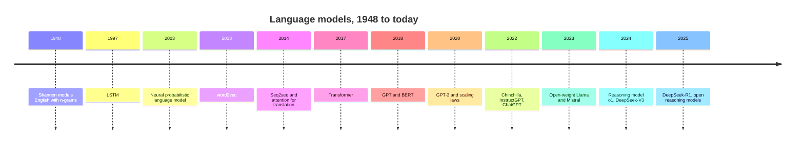

# From N-grams to GPT: A Short History of Language Models

## Introduction

Today's LLMs look like they appeared suddenly in late 2022, but almost every idea inside them is older. The objective (predict the next token) goes back to the 1940s. Word vectors date from 2003. Attention was invented for machine translation in 2014. The Transformer is from 2017. What changed around 2020 was scale, and around 2022 the recipe for turning a text predictor into an assistant.

Knowing the history is practical, not nostalgic. Each step solved a specific failure of the previous one, and those failures explain the design of modern models. N-grams could not generalize, so we got embeddings. Recurrent networks forgot long contexts and could not be parallelized, so we got attention and then the Transformer. Pretrained models did not follow instructions, so we got instruction tuning and RLHF.

This page walks through that chain. For each step you will see what problem it solved, what it cost, and what replaced it. Papers are cited with first author and year so you can read them; links are in Further Reading.

## Timeline at a Glance



## Statistical Language Models: N-grams

**Claude Shannon** introduced information theory in "A Mathematical Theory of Communication" (1948) and, as an illustration, generated English-like text from letter and word n-gram statistics. In 1951 he estimated the entropy of English by having people guess the next letter of a text, the same game an LLM plays.

An **n-gram model** approximates the chain rule by keeping only the last $n-1$ tokens of history:

$$
P(x_t \mid x_1, \dots, x_{t-1}) \approx P(x_t \mid x_{t-n+1}, \dots, x_{t-1})
$$

and estimates each conditional by counting, as the bigram example in [Language Modeling](./1-llm-language-modeling.mdx) showed. From the 1980s to the early 2010s, n-gram models were the language model inside speech recognizers and statistical machine translation systems.

Their fatal problem is **sparsity**. The number of possible n-grams grows as $V^n$, and most valid ones never appear in any finite corpus. You can measure this directly:

```python
import importlib
import inspect
import re

# Build an English corpus from the docstrings that ship with Python's standard library
modules = ["os", "re", "json", "collections", "itertools", "functools", "random", "statistics",
           "datetime", "pathlib", "subprocess", "threading", "argparse", "logging", "unittest",
           "email.message", "http.client", "urllib.request", "asyncio", "typing", "decimal"]
docs = []
for name in modules:
    mod = importlib.import_module(name)
    for _, obj in inspect.getmembers(mod):
        doc = inspect.getdoc(obj)
        if doc:
            docs.append(doc)
words = re.findall(r"[a-z']+", " ".join(dict.fromkeys(docs)).lower())   # dedupe docstrings, then tokenize

split = int(len(words) * 0.9)
train, test = words[:split], words[split:]

def ngrams(seq, n):
    return [tuple(seq[i:i + n]) for i in range(len(seq) - n + 1)]

print(f"train words: {len(train):,}  test words: {len(test):,}")
for n in range(1, 6):
    seen = set(ngrams(train, n))
    test_grams = ngrams(test, n)
    unseen = sum(g not in seen for g in test_grams)
    print(f"n={n}: {unseen / len(test_grams):6.1%} of test {n}-grams never appear in training")
```

```text
train words: 36,440  test words: 4,049
n=1:   8.3% of test 1-grams never appear in training
n=2:  57.1% of test 2-grams never appear in training
n=3:  88.3% of test 3-grams never appear in training
n=4:  95.7% of test 4-grams never appear in training
n=5:  97.8% of test 5-grams never appear in training
```

(Exact numbers depend on your Python version, since the docstrings change between releases.) Even on this narrow technical text, more than half the bigrams and almost all 4-grams in held-out text were never seen. A raw count model gives every one of them probability zero.

Researchers fought this with **smoothing** and **backoff**: shift some probability mass to unseen events, and fall back to shorter n-grams when a long one is missing. Kneser-Ney smoothing (Kneser and Ney, 1995) was the best-known method for years. The other fix was more data. Brants et al. (Google, 2007) trained 5-gram models on up to 2 trillion tokens for machine translation in a paper titled "Large Language Models in Machine Translation", which shows how old the phrase is.

But no amount of counting solves the deeper issue: an n-gram model treats "cat" and "dog" as unrelated symbols, so seeing "the cat sat" teaches it nothing about "the dog sat".

## Neural Language Models and Word Embeddings

**Yoshua Bengio** and colleagues fixed that in "A Neural Probabilistic Language Model" (2003). Their model mapped each word to a learned dense vector (an **embedding**), concatenated the vectors of the previous few words, passed them through a hidden layer and output a softmax over the vocabulary. Because similar words end up with similar vectors, evidence about "cat" transfers to "dog". This is the architecture you train yourself in the [neural network refresher](./3-llm-neural-network-refresher.mdx): it is still the skeleton of every LLM (embedding lookup, neural network, softmax over the vocabulary).

The cost was compute. A softmax over a large vocabulary was expensive on 2003 hardware, and the model still had a fixed context window, like an n-gram.

**word2vec** (Mikolov et al., 2013) made embeddings cheap and famous. It dropped the deep network and trained shallow models (skip-gram and CBOW) to predict nearby words, with tricks such as negative sampling to avoid the full softmax. Trained on billions of words, the vectors captured analogies: the vector arithmetic king minus man plus woman landed near queen. GloVe (Pennington et al., 2014) reached similar vectors from global co-occurrence counts.

These static embeddings had a limit: one vector per word, regardless of context. "Bank" got the same vector in "river bank" and "bank account". Contextual representations had to wait for deeper sequence models.

## Recurrent Networks: RNNs and LSTMs

A **recurrent neural network** (RNN) removes the fixed window. It reads tokens one at a time and keeps a hidden state vector $h_t$ that summarizes everything so far:

$$
h_t = \tanh(W_h h_{t-1} + W_x e_t + b), \qquad P(x_{t+1} \mid x_{\le t}) = \mathrm{softmax}(W_o h_t)
$$

where $e_t$ is the embedding of token $t$. In principle the context is unlimited. Mikolov et al. (2010) showed RNN language models beating n-grams in speech recognition.

In practice plain RNNs forget. Gradients flowing back through many steps get multiplied by the same matrix again and again and either vanish or explode. The **Long Short-Term Memory** (LSTM) cell (Hochreiter and Schmidhuber, 1997) added a separate memory cell with gates that decide what to keep, write and output, which lets gradients survive across longer spans. The GRU (Cho et al., 2014) is a simpler gated variant. From about 2014 to 2017, LSTMs were the default for language tasks.

Two problems remained:

1. **Sequential computation.** Step $t$ needs $h_{t-1}$, so a sequence of length $T$ takes $T$ dependent steps. You cannot parallelize across time during training, which wastes GPUs.
2. **A fixed-size bottleneck.** Everything the model knows about the past must squeeze into one vector $h_t$ of fixed size.

## Sequence-to-Sequence and Attention

Machine translation exposed the bottleneck most clearly. The **sequence-to-sequence** model (Sutskever, Vinyals and Le, 2014; Cho et al., 2014) used one LSTM, the encoder, to read the source sentence into a vector, and a second LSTM, the decoder, to generate the translation from it. It worked, but quality dropped on long sentences: one vector cannot hold a 50-word sentence.

**Bahdanau, Cho and Bengio** (2014) proposed **attention**. Instead of a single summary vector, the decoder looks back at all encoder states at every output step, scores how relevant each one is, and takes a weighted average:

$$
\alpha_{t,i} = \mathrm{softmax}_i\big(\mathrm{score}(s_{t-1}, h_i)\big), \qquad c_t = \sum_i \alpha_{t,i}\, h_i
$$

Here $s_{t-1}$ is the decoder state, $h_i$ the encoder state at source position $i$, and $c_t$ the context vector used to produce output $t$. The weights $\alpha$ form a soft alignment between output and input words. Luong et al. (2015) simplified the scoring to a dot product. The [Attention section](../2-llm-attention/0-llm-attention-intuition.mdx) starts from exactly this idea.

Attention fixed the bottleneck but kept the RNNs, and with them the sequential computation.

## The Transformer

"**Attention Is All You Need**" (Vaswani et al., 2017) removed recurrence entirely. Every token attends to every other token through **self-attention**, computed for all positions at once with matrix multiplications. Positional encodings supply word order, multiple heads let the model attend to different things in parallel, and residual connections plus layer normalization make deep stacks trainable. The model was an encoder-decoder for translation and set a new state of the art while training much faster than recurrent models.

The trade-off: self-attention costs $O(T^2)$ in sequence length, against the RNN's $O(T)$. In exchange you get full parallelism across the sequence during training and a direct path between any two tokens, no matter how far apart. On GPUs that trade was overwhelmingly worth it, and the quadratic cost became the problem that FlashAttention, sliding windows and linear attention later attacked ([Section 5](../5-llm-flash-attention/0-llm-gpu-memory-hierarchy.mdx)).

## Pretraining: GPT and BERT

In 2018 the field converged on **pretrain, then fine-tune**. ULMFiT (Howard and Ruder, 2018) and ELMo (Peters et al., 2018) showed that a language model pretrained on lots of text gives representations that transfer to many tasks. Two Transformer variants then took over:

- **GPT** (Radford et al., OpenAI, 2018), "Improving Language Understanding by Generative Pre-Training", was a decoder-only Transformer of about 117M parameters trained to predict the next token on books, then fine-tuned per task.
- **BERT** (Devlin et al., Google, 2018) was an encoder-only Transformer trained to fill in masked tokens using context on both sides. It dominated classification and question-answering benchmarks for years.
- **T5** (Raffel et al., Google, 2019) cast every task as text-to-text with an encoder-decoder model.

The differences between these three designs, and why decoder-only won for generation, are covered in [Encoder-Only, Decoder-Only and Encoder-Decoder Models](../3-llm-transformer/1-llm-encoder-decoder-variants.mdx).

**GPT-2** (Radford et al., 2019), at 1.5B parameters trained on about 40 GB of web text, showed that a large enough language model could perform tasks such as summarization and translation **zero-shot**, with no fine-tuning, just by framing them as text continuation.

## Scaling

**Kaplan et al.** (OpenAI, 2020), "Scaling Laws for Neural Language Models", found that loss falls as a smooth power law in model size, data and compute across many orders of magnitude. That turned model building into an engineering forecast: spend more compute, get a predictably better model.

**GPT-3** (Brown et al., 2020) put it into practice with 175B parameters trained on about 300B tokens. Its headline result was **in-context learning**: given a few examples in the prompt, it could do new tasks without any weight updates.

**Chinchilla** (Hoffmann et al., DeepMind, 2022) corrected the recipe. For a fixed compute budget, parameters and training tokens should grow together, roughly 20 tokens per parameter. Their 70B model trained on 1.4T tokens beat much larger models trained on less data. Today's open models train far past that ratio (Llama 3 8B saw over 15T tokens) because a smaller, over-trained model is cheaper to serve. [Scaling Laws](../6-llm-pretraining/2-llm-scaling-laws.mdx) works through the numbers.

## From Text Predictor to Assistant

A pretrained model continues text; it does not reliably follow instructions or refuse harmful requests. **InstructGPT** (Ouyang et al., OpenAI, 2022) fixed that in three steps: supervised fine-tuning on human-written demonstrations, a reward model trained on human preference comparisons, and reinforcement learning (PPO) against that reward, a procedure known as **RLHF**. A 1.3B InstructGPT model was preferred by human raters over the 175B GPT-3.

**ChatGPT**, released in November 2022, applied the same recipe to a dialogue model and brought LLMs to the general public. Anthropic's Constitutional AI (Bai et al., 2022) replaced part of the human feedback with feedback guided by written principles. Direct Preference Optimization (Rafailov et al., 2023) removed the separate reward model and RL loop. All of this is in [Post-Training and Alignment](../8-llm-post-training/0-llm-post-training-overview.mdx).

## Open Weights

In February 2023, Meta released **LLaMA** (Touvron et al.), models from 7B to 65B trained only on public data, to researchers. Its weights spread quickly and started the open-weight ecosystem. **Llama 2** (July 2023) came with a license allowing commercial use and a chat-tuned version. **Mistral 7B** (September 2023) and the mixture-of-experts **Mixtral 8x7B** (December 2023) came under Apache 2.0. Qwen from Alibaba, DeepSeek, Google's Gemma and, in August 2025, OpenAI's gpt-oss followed. The [Model Families](./4-llm-model-families.mdx) page covers who they are and how to read their configs.

Open weights changed how the field learns. When a model ships with its `config.json` and code, everyone can see that Llama uses RMSNorm, SwiGLU, RoPE and grouped-query attention, and that DeepSeek-V3 uses multi-head latent attention and 256 routed experts. Most of the "modern recipe" in this tutorial is known because of open releases.

## Reasoning Models

Chain-of-thought prompting (Wei et al., 2022) showed that asking a model to write out intermediate steps improves results on math and logic. The next step was to train for it. OpenAI's **o1** (September 2024) used reinforcement learning so that the model produces a long internal chain of thought before answering, and its accuracy improved the more tokens it was allowed to think. This made **test-time compute** a second axis of scaling, alongside training compute.

**DeepSeek-R1** (DeepSeek-AI, January 2025) published an open recipe: reinforcement learning with automatically verifiable rewards (correct math answers, passing code tests) using the GRPO algorithm, and released the weights under the MIT license. Its precursor, R1-Zero, showed that long reasoning behavior could emerge from RL on a base model with no supervised reasoning examples. Since then, most major model families have shipped reasoning or hybrid "thinking" modes. See [Reinforcement Learning for Reasoning](../8-llm-post-training/4-llm-reasoning-rl.mdx) and [Reasoning Models and Test-Time Compute](../13-llm-advanced-architectures/3-llm-reasoning-models.mdx).

## Worked Scenario: Tracing One Idea Through History

Follow the question "how does the model use context?" through the timeline:

| Era | How context is used | Limit |
| --- | --- | --- |
| N-gram (1948 to 2010s) | Exact match on the last $n-1$ words | Sparsity; no generalization |
| Neural LM (2003) | Concatenated embeddings of a fixed window | Fixed window; expensive softmax |
| RNN / LSTM (2010 to 2017) | A hidden state updated token by token | Sequential; fixed-size state forgets |
| Seq2seq + attention (2014) | Decoder attends over all encoder states | Still recurrent, so slow to train |
| Transformer (2017) | Every token attends to every earlier token | Cost grows with the square of context |
| Long-context LLMs (2023 onward) | RoPE scaling, FlashAttention, sparse and hybrid attention | KV cache memory, quality far into the context |

Each row's limit is the next row's motivation. The last row is where much of today's research happens, and it is why this tutorial spends whole sections on [RoPE](../4-llm-positional-encoding/0-llm-why-position-matters.mdx) and [efficient attention](../5-llm-flash-attention/0-llm-gpu-memory-hierarchy.mdx).

## Common Mistakes

- **Thinking the Transformer invented attention.** Attention came from Bahdanau et al. (2014) for RNN translation. The Transformer's contribution was using only attention, with no recurrence.
- **Thinking GPT and BERT are the same kind of model.** GPT predicts the next token left to right (decoder-only); BERT fills in masked tokens using both sides (encoder-only) and is not a natural text generator.
- **Treating "LLM" as a 2022 invention.** The objective is from the 1940s and the term "large language model" was used for n-gram systems in 2007. What is new is scale plus post-training.
- **Reading Chinchilla as "always train 20 tokens per parameter".** It is the compute-optimal ratio for training cost alone. Models meant to be served heavily are deliberately trained much longer.
- **Assuming reasoning models use a new architecture.** o1 and R1-style models are ordinary Transformers; the difference is in post-training and in how much they generate at inference time.

## Summary

- N-gram models count; they cannot generalize to unseen word sequences. Smoothing and big data only delayed the problem.
- Neural language models (2003) and word2vec (2013) introduced embeddings, so similar words share evidence.
- RNNs and LSTMs gave unbounded context but were sequential and squeezed history into one vector.
- Attention (2014) let a model look back at all positions; the Transformer (2017) kept only attention and became fully parallel.
- GPT and BERT (2018) established pretraining; GPT-2 and GPT-3 showed that scale yields zero-shot and in-context learning; scaling laws made progress predictable.
- InstructGPT and ChatGPT (2022) added post-training to make assistants; open-weight models (2023 onward) made the recipe public; reasoning models (2024 to 2025) added test-time compute.

## Further Reading

- [A Mathematical Theory of Communication (Shannon, 1948)](https://people.math.harvard.edu/~ctm/home/text/others/shannon/entropy/entropy.pdf): entropy and n-gram approximations of English.
- [A Neural Probabilistic Language Model (Bengio et al., 2003)](https://www.jmlr.org/papers/volume3/bengio03a/bengio03a.pdf): learned word embeddings inside a language model.
- [Efficient Estimation of Word Representations in Vector Space (Mikolov et al., 2013)](https://arxiv.org/abs/1301.3781): the word2vec paper.
- [Sequence to Sequence Learning with Neural Networks (Sutskever et al., 2014)](https://arxiv.org/abs/1409.3215): the encoder-decoder LSTM for translation.
- [Neural Machine Translation by Jointly Learning to Align and Translate (Bahdanau et al., 2014)](https://arxiv.org/abs/1409.0473): the original attention mechanism.
- [Attention Is All You Need (Vaswani et al., 2017)](https://arxiv.org/abs/1706.03762): the Transformer.
- [BERT (Devlin et al., 2018)](https://arxiv.org/abs/1810.04805): masked-language-model pretraining with an encoder.
- [Scaling Laws for Neural Language Models (Kaplan et al., 2020)](https://arxiv.org/abs/2001.08361): loss as a power law of size, data and compute.
- [Language Models are Few-Shot Learners (Brown et al., 2020)](https://arxiv.org/abs/2005.14165): GPT-3 and in-context learning.
- [Training Compute-Optimal Large Language Models (Hoffmann et al., 2022)](https://arxiv.org/abs/2203.15556): the Chinchilla scaling result.
- [Training Language Models to Follow Instructions with Human Feedback (Ouyang et al., 2022)](https://arxiv.org/abs/2203.02155): InstructGPT and RLHF.
- [LLaMA: Open and Efficient Foundation Language Models (Touvron et al., 2023)](https://arxiv.org/abs/2302.13971): the release that started the open-weight wave.
- [DeepSeek-R1 (DeepSeek-AI, 2025)](https://arxiv.org/abs/2501.12948): reinforcement learning for reasoning with an open recipe.
