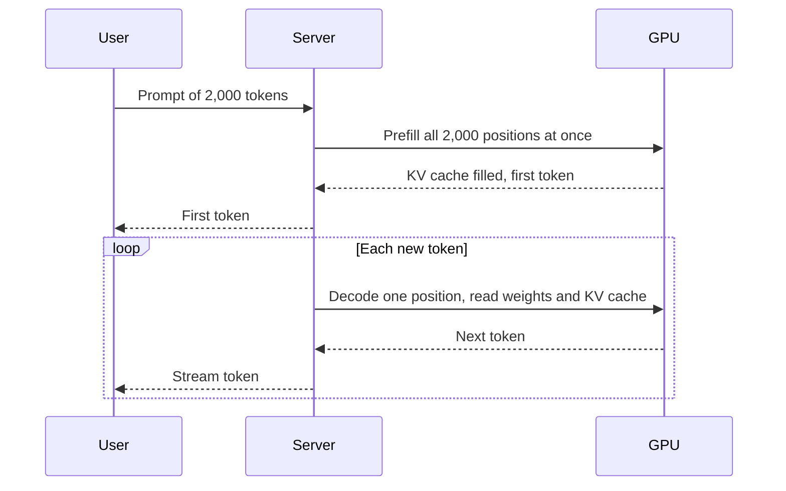

# The LLM Lifecycle: Pretraining, Post-Training and Inference

## Introduction

Every modern LLM is made in stages. First, **pretraining** turns trillions of tokens of raw text into a **base model** that predicts text well but does not reliably follow instructions. Then **post-training** turns the base model into an **assistant** (or a reasoning model) using curated demonstrations, preference data and reinforcement learning. Finally, **inference** serves the model to users, one token at a time, under tight memory and latency budgets.

Each stage has a different goal, different data, a different cost profile and its own engineering problems. Mixing them up is a common source of confusion: "fine-tuning" a model, "training" a model and "running" a model mean very different things in compute and skill.

This page gives you the map. By the end you will be able to:

- Describe what goes in and what comes out of each stage, and roughly what it costs.
- Estimate pretraining compute with the $6ND$ rule and compare it with published GPU-hours.
- Explain why a base model behaves differently from its instruct version, and what a chat template is.
- Explain why inference is limited by memory as much as by compute.
- Know which section of this tutorial goes deep on each stage.

## The Big Picture

```mermaid
flowchart LR
    A["Web, code, books: trillions of tokens"] --> B["Pretraining: next-token prediction"]
    B --> C["Base model"]
    C --> D["Mid-training: long context, high-quality data"]
    D --> E["SFT on demonstrations"]
    E --> F["Preference tuning: RLHF or DPO"]
    F --> G["RL with verifiable rewards"]
    G --> H["Instruct or reasoning model"]
    H --> I["Quantize and deploy"]
    I --> J["Inference: prefill and decode"]
    J --> K["Users and evaluation"]
    K --> E
```



Notice the loop at the end. Deployed models generate feedback and failure cases that feed the next round of post-training. Pretraining runs are rare and huge; post-training is iterated often.

| Stage | Data | Objective | Compute (8B-class model) | Output |
| --- | --- | --- | --- | --- |
| Pretraining | Trillions of tokens of web text, code, books, math | Next-token cross-entropy | Around $10^{23}$ to $10^{24}$ FLOPs, hundreds of thousands of GPU-hours | Base model |
| Post-training | Thousands to millions of demonstrations, comparisons, prompts with checkable answers | SFT loss, preference loss, RL reward | Usually a small fraction of pretraining | Instruct / chat / reasoning model |
| Inference | User prompts | None; generate tokens | About $2N$ FLOPs per token, plus memory for weights and KV cache | Text |

## Stage 1: Pretraining

Pretraining is what [Language Modeling](./1-llm-language-modeling.mdx) described, at enormous scale: minimize next-token cross-entropy over a corpus of trillions of tokens. Everything the model "knows" (facts, languages, coding, arithmetic patterns) is learned here.

### Data

The corpus is assembled from crawled web pages (Common Crawl is the usual source), code repositories, books, academic papers, math and multilingual text. Raw web data is mostly junk, so pipelines extract text from HTML, filter by language and quality (often with a small classifier trained to spot "educational" pages), remove personal data and toxic content, and **deduplicate** aggressively with techniques such as MinHash. Published examples: Llama 3 trained on over 15T tokens, DeepSeek-V3 on 14.8T, and Qwen3 on about 36T. Data quality and mixture often matter more than architecture. [Pretraining Data](../6-llm-pretraining/0-llm-pretraining-data.mdx) covers the pipeline.

### Compute

A dense Transformer with $N$ parameters costs about $2N$ FLOPs per token in the forward pass and about $4N$ in the backward pass, so training on $D$ tokens costs

$$
C \approx 6 N D
$$

The derivation is in [Counting Parameters, FLOPs and Memory](../3-llm-transformer/6-llm-parameter-and-flop-counting.mdx). Plug in an 8B model and 15T tokens:

```python
# Back-of-the-envelope numbers for the three lifecycle stages of an 8B dense model
N = 8.03e9            # parameters (Llama 3.1 8B)
D = 15e12             # pretraining tokens (Llama 3 used "over 15T")

train_flops = 6 * N * D                      # forward + backward, about 6 FLOPs per parameter per token
print(f"pretraining compute  : {train_flops:.2e} FLOPs")

peak = 989e12         # H100 SXM dense BF16 peak, FLOP/s
mfu = 0.40            # fraction of peak a good large run sustains
gpu_hours = train_flops / (peak * mfu) / 3600
print(f"H100 GPU-hours at 40% MFU: {gpu_hours:,.0f}  (= {gpu_hours / 24 / 1024:.0f} days on 1,024 GPUs)")

chinchilla_tokens = 20 * N
print(f"Chinchilla-optimal tokens: {chinchilla_tokens:.2e}  -> trained {D / chinchilla_tokens:.0f}x longer")

# Inference: each generated token costs about 2N FLOPs, and the weights must sit in memory
print(f"inference compute per token: {2 * N:.2e} FLOPs")
for name, bytes_per_param in [("bf16", 2), ("int8", 1), ("4-bit", 0.5)]:
    print(f"weights in {name:5}: {N * bytes_per_param / 2**30:5.1f} GiB")
```

```text
pretraining compute  : 7.23e+23 FLOPs
H100 GPU-hours at 40% MFU: 507,457  (= 21 days on 1,024 GPUs)
Chinchilla-optimal tokens: 1.61e+11  -> trained 93x longer
inference compute per token: 1.61e+10 FLOPs
weights in bf16 :  15.0 GiB
weights in int8 :   7.5 GiB
weights in 4-bit:   3.7 GiB
```

**MFU** (model FLOPs utilization) is the fraction of the GPU's peak arithmetic the training run actually achieves; 35 to 45 percent is typical for well-tuned large runs. Meta's Llama 3.1 model card reports 1.46M H100 GPU-hours for the 8B model, roughly three times this idealized estimate. The gap is normal: real runs include long-context stages, lower utilization at times, failures and restarts, and the estimate ignores attention FLOPs. Use $6ND$ for orders of magnitude, not invoices.

The Chinchilla line shows a deliberate choice. Compute-optimal training (Hoffmann et al., 2022) would use about 20 tokens per parameter, 160B tokens for 8B parameters. Llama 3 trained over 90 times longer because a smaller model that has seen more data is much cheaper to serve to millions of users. [Scaling Laws](../6-llm-pretraining/2-llm-scaling-laws.mdx) makes this trade-off precise.

For a frontier-scale data point: the DeepSeek-V3 report gives 2.788M H800 GPU-hours for the full training of its 671B-total, 37B-active MoE model, of which 2.664M were pretraining on 14.8T tokens.

### Engineering

A run this size needs thousands of GPUs working as one machine for weeks. That brings in mixed precision (BF16, increasingly FP8), sharding of parameters and optimizer state across GPUs (FSDP, ZeRO), tensor and pipeline parallelism, careful learning-rate schedules, and monitoring for **loss spikes**, sudden jumps in loss that can derail training. [Pretraining](../6-llm-pretraining/0-llm-pretraining-data.mdx) covers each of these.

### Mid-training

Between plain pretraining and post-training, most recent reports describe extra phases, often called **mid-training** or **annealing**:

- **Long-context extension.** Models are pretrained mostly on short sequences (4K or 8K tokens) because attention cost grows with the square of length. Near the end, they train on longer documents with an adjusted RoPE configuration. Llama 3.1 extended from 8K to 128K tokens this way.
- **Annealing on high-quality data.** In the final phase, as the learning rate decays to zero, the data mix is shifted toward the best sources (math, code, curated text), which measurably improves benchmarks.

The output of all this is the **base model**: an excellent text predictor that continues whatever you give it.

## Stage 2: Post-Training

A base model asked "What is 2 + 2?" might answer "4", or continue with "What is 3 + 3?", because a list of questions is a plausible continuation. Post-training changes the model's behavior, not its knowledge: it teaches the model to respond in a conversation format, follow instructions, refuse harmful requests, use tools and reason step by step.

### Chat templates

Conversations are serialized into a single token sequence with special tokens that mark who is speaking. That serialization is the **chat template**, stored with the tokenizer. Here is Qwen3's:

```python
from transformers import AutoTokenizer

tok = AutoTokenizer.from_pretrained("Qwen/Qwen3-8B")           # downloads tokenizer files only
messages = [
    {"role": "system", "content": "You are a concise assistant."},
    {"role": "user", "content": "What is 2 + 2?"},
]
text = tok.apply_chat_template(messages, tokenize=False, add_generation_prompt=True,
                               enable_thinking=False)
print(text)
print(len(tok(text).input_ids), "tokens")
```

```text
<|im_start|>system
You are a concise assistant.<|im_end|>
<|im_start|>user
What is 2 + 2?<|im_end|>
<|im_start|>assistant
<think>

</think>


31 tokens
```

`add_generation_prompt=True` appends the opening of the assistant turn so that the model's next tokens are its reply. `enable_thinking=False` is a Qwen3 option: the template inserts an empty `<think>` block, telling the hybrid model to skip its reasoning phase. The model learned these markers during post-training. Feed a base model or a different template and quality drops sharply. [Using tiktoken and Hugging Face Tokenizers](../1-llm-tokenization/3-llm-tokenizer-libraries.mdx) covers templates in detail.

### The post-training stack

Post-training is a sequence of steps; the exact recipe differs by lab, but the components are shared:

1. **Supervised fine-tuning (SFT).** Train on example conversations (prompt plus ideal response) with the same cross-entropy loss as pretraining, but computed only on the response tokens. Thousands to millions of examples, human-written or generated by stronger models. See [Supervised Fine-Tuning and Chat Templates](../8-llm-post-training/1-llm-supervised-fine-tuning.mdx).
2. **Preference optimization.** Collect pairs of responses where one is preferred. **RLHF** (as in InstructGPT, Ouyang et al., 2022) trains a reward model on those comparisons and then optimizes the policy against it with PPO, with a KL penalty that keeps it close to the SFT model. **DPO** (Rafailov et al., 2023) optimizes directly on the pairs without a separate reward model. Llama 3's post-training, for example, combined SFT, rejection sampling and DPO over several rounds. See [RLHF](../8-llm-post-training/2-llm-rlhf.mdx) and [DPO](../8-llm-post-training/3-llm-dpo.mdx).
3. **Reinforcement learning with verifiable rewards.** For math, code and other tasks with checkable answers, the model generates many attempts and is rewarded for correct ones, using algorithms such as GRPO. This is how reasoning models such as DeepSeek-R1 learned long chains of thought. See [Reinforcement Learning for Reasoning](../8-llm-post-training/4-llm-reasoning-rl.mdx).
4. **Distillation.** Smaller models are often post-trained on outputs of a larger model in the same family rather than going through the full pipeline. See [Knowledge Distillation](../8-llm-post-training/5-llm-distillation.mdx).

Safety training runs through all of these: refusal examples in SFT, harmlessness preferences, and red-team data. See [Alignment, Safety Training and Their Limits](../8-llm-post-training/6-llm-alignment-safety.mdx).

### Fine-tuning by users

When you "fine-tune a model" for your own task, you are doing a small piece of post-training, usually SFT, often with parameter-efficient methods such as LoRA that train under 1 percent of the weights. It costs GPU-hours, not GPU-years. [Fine-Tuning in Practice](../9-llm-fine-tuning/0-llm-when-to-fine-tune.mdx) starts with whether you should do it at all, since prompting or retrieval often suffices.

## Stage 3: Inference

Inference runs the trained model to produce text. It has two phases with very different behavior:

- **Prefill.** The whole prompt is processed in one forward pass, all positions in parallel. This is a large matrix multiplication workload and is **compute-bound**. It determines the time to first token.
- **Decode.** Tokens are generated one at a time. Each step processes a single new position but must read every weight from GPU memory, and the cached keys and values of all previous tokens. Arithmetic per byte read is tiny, so decode is **memory-bandwidth-bound**. It determines the time per output token.



Two memory consumers dominate:

1. **Weights.** An 8B model in BF16 needs 15 GiB just to sit on the GPU (see the output above). Quantizing to 4 bits brings that under 4 GiB, which is why local inference relies on it. See [Quantization](../11-llm-quantization/0-llm-quantization-basics.mdx).
2. **The KV cache.** To avoid recomputing attention over the whole history at every step, the server caches every layer's keys and values for every token. For Llama 3.1 8B that is $2 \times 32 \text{ layers} \times 8 \text{ KV heads} \times 128 \times 2 \text{ bytes} = 128$ KiB per token, so a single 128K-token context needs 16 GiB, more than the weights. This is why attention variants that shrink the cache (GQA, MLA, sliding windows) matter so much. See [The KV Cache](../10-llm-inference/2-llm-kv-cache.mdx).

Serving engines such as vLLM, SGLang and TensorRT-LLM add continuous batching, paged KV memory, prefix caching and speculative decoding to push throughput up and cost down; llama.cpp and Ollama target local machines. [Inference and Decoding](../10-llm-inference/0-llm-inference-overview.mdx) covers all of them.

Inference also includes the **decoding strategy**: greedy, temperature, top-p, min-p, constrained decoding for JSON. These choices change output quality noticeably without touching the weights.

## Worked Scenario: Following One Model Through Its Life

Take a hypothetical team building an 8B open model, using published numbers as a guide:

1. **Data (months).** Build a 15T-token corpus: crawl, extract, filter with a quality classifier, deduplicate, mix in code and math. Train a few small models on candidate mixtures to choose the recipe.
2. **Pretraining (weeks).** About $7 \times 10^{23}$ FLOPs. At realistic efficiency that is on the order of a million H100-hours, for example a few weeks on a few thousand GPUs. Checkpoints are saved regularly; loss spikes are handled by rolling back and skipping data.
3. **Mid-training (days).** Extend context from 8K to 128K with RoPE scaling and long documents; anneal on high-quality data. Release the base model.
4. **Post-training (days to weeks, repeated).** SFT on a few million conversations, several rounds of preference optimization, RL on math and code with verifiers, safety tuning. Release the instruct model with its chat template.
5. **Evaluation (throughout).** Benchmarks, held-out perplexity, human and LLM-judge comparisons, contamination checks. See [Evaluation](../12-llm-evaluation/0-llm-evaluation-overview.mdx).
6. **Deployment.** Publish BF16 weights plus FP8 and 4-bit quantized versions; serve with vLLM or SGLang. Each token generated costs about $1.6 \times 10^{10}$ FLOPs, and the KV cache, not the weights, limits how many long conversations fit on one GPU.

Every number in that story comes from formulas you will derive in later sections. The proportions are what to remember: pretraining is the giant one-time cost, post-training is where behavior is shaped, and inference is where most of the lifetime cost goes once a model is popular.

:::note
The boundaries are blurring. Some labs mix instruction-like data into late pretraining, and reasoning models spend heavily on RL during post-training. The three-stage picture is still the right mental model, but expect to see "mid-training" and "continued pretraining" in technical reports.
:::

## Common Mistakes

- **Calling every training step "fine-tuning".** Pretraining, post-training and your own LoRA fine-tune differ by many orders of magnitude in compute and in what they can change. Fine-tuning rarely adds broad new knowledge; it mostly changes behavior and format.
- **Using an instruct model without its chat template.** Sending raw text to an instruct model, or using a template from a different family, measurably degrades output.
- **Estimating memory from weights alone.** At long contexts and large batches the KV cache exceeds the weights.
- **Treating $6ND$ as exact.** It ignores attention FLOPs, recomputation and inefficiency; real GPU-hours are often several times higher.
- **Assuming the base model is "raw" and useless.** Base models are the best starting point for fine-tuning to new formats, for research and for distillation; they just are not assistants.
- **Forgetting the knowledge cutoff.** Post-training does not add knowledge of recent events. Retrieval does; see the [AI Agents tutorial](/docs/ai/agents).

## Summary

- Pretraining minimizes next-token loss over trillions of tokens to produce a base model; it costs on the order of $6ND$ FLOPs and dominates training compute.
- Mid-training extends context and anneals on high-quality data before post-training.
- Post-training (SFT, preference optimization with RLHF or DPO, RL with verifiable rewards, distillation, safety tuning) turns a base model into an assistant or reasoning model, using chat templates to structure conversations.
- Inference has a compute-bound prefill phase and a memory-bound decode phase; weights and the KV cache are the two big memory consumers.
- Each later section of this tutorial goes deep on one part of this lifecycle.

## Further Reading

- [The Llama 3 Herd of Models (Llama Team, 2024)](https://arxiv.org/abs/2407.21783): a complete public account of pretraining, long-context extension, post-training and inference for one family.
- [DeepSeek-V3 Technical Report (DeepSeek-AI, 2024)](https://arxiv.org/abs/2412.19437): training cost breakdown and FP8 training at scale.
- [Training Compute-Optimal Large Language Models (Hoffmann et al., 2022)](https://arxiv.org/abs/2203.15556): the Chinchilla analysis of parameters versus tokens.
- [Training Language Models to Follow Instructions with Human Feedback (Ouyang et al., 2022)](https://arxiv.org/abs/2203.02155): the SFT, reward model and PPO recipe.
- [Direct Preference Optimization (Rafailov et al., 2023)](https://arxiv.org/abs/2305.18290): preference tuning without a separate reward model.
- [Efficient Memory Management for Large Language Model Serving with PagedAttention (Kwon et al., 2023)](https://arxiv.org/abs/2309.06180): the vLLM paper on serving and KV cache memory.
- [Hugging Face chat templates documentation](https://huggingface.co/docs/transformers/chat_templating): how `apply_chat_template` works.
