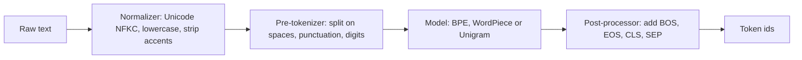

# Tokenization Basics: Characters, Words and Subwords

## Introduction

A language model never sees text. It sees a list of integers. Every prompt you send to GPT, Llama or Qwen is first cut into pieces called **tokens**, each piece is replaced by its integer id from a fixed **vocabulary**, and only then does the neural network start working. The output goes the other way: the model predicts a probability for every id in the vocabulary, one id is chosen, and the tokenizer turns it back into text.

This step looks like boring plumbing, but it decides a surprising amount:

- **Cost and speed.** API prices, context windows and attention cost are all measured in tokens, not characters. A tokenizer that needs 30 percent more tokens for the same text makes every request 30 percent more expensive and slower.
- **What the model can learn easily.** If "1234567" is split as `123|456|7`, arithmetic becomes harder than if digits were split one by one. If a word in Hindi takes eight tokens, the model has to spend capacity just reassembling it.
- **Model size.** Every vocabulary entry owns a row in the embedding matrix. A 128k vocabulary with 4,096-dimensional vectors is 525 million parameters before the first Transformer layer.

By the end of this page you will be able to explain the three granularities (characters, words, subwords), the pipeline a modern tokenizer runs, why UTF-8 bytes are the foundation of most LLM tokenizers, and how to measure the trade-off between vocabulary size and sequence length. The rest of this section builds on it: [BPE from scratch](./1-llm-bpe.mdx), [WordPiece and Unigram](./2-llm-wordpiece-unigram-sentencepiece.mdx), [the libraries](./3-llm-tokenizer-libraries.mdx), [embeddings](./4-llm-embeddings.mdx) and [pitfalls](./5-llm-tokenization-pitfalls.mdx).

## From Text to Integers

Formally, a tokenizer is a pair of functions. The encoder maps a string $s$ to a sequence of ids, and the decoder maps ids back to a string:

$$
\mathrm{encode}: s \mapsto (x_1, x_2, \dots, x_T), \quad x_t \in \{0, 1, \dots, V-1\}
$$

$$
\mathrm{decode}: (x_1, \dots, x_T) \mapsto s'
$$

Here $V$ is the vocabulary size and $T$ is the number of tokens. A good tokenizer is **lossless**: $\mathrm{decode}(\mathrm{encode}(s)) = s$ for every string. Older tokenizers such as BERT's lowercase vocabulary are not lossless (they drop case and accents), which is acceptable for classification but not for a model that must generate text exactly.

The language model then learns the probability of the id sequence, using the chain rule from [Language Modeling and Next-Token Prediction](../0-llm-fundamentals/1-llm-language-modeling.mdx):

$$
P(x_1, \dots, x_T) = \prod_{t=1}^{T} P(x_t \mid x_1, \dots, x_{t-1})
$$

Notice that $T$ depends on the tokenizer. The same sentence can be 14 tokens with one tokenizer and 50 with another, and the model has to make 14 or 50 predictions accordingly.

In practice, encoding runs as a pipeline of four stages. The Hugging Face `tokenizers` library names them explicitly, and the same stages exist (sometimes merged) in tiktoken and SentencePiece:



- The **normalizer** cleans the string, for example converting it to a canonical Unicode form or lowercasing.
- The **pre-tokenizer** cuts the string into chunks that tokens may never cross, usually at spaces and punctuation.
- The **model** is the learned algorithm that splits each chunk into vocabulary entries.
- The **post-processor** adds special tokens such as beginning-of-sequence markers.

You can watch each stage with two real tokenizers. BERT (2018) lowercases and strips accents; GPT-2 (2019) leaves the text untouched and works on bytes:

```python
from transformers import AutoTokenizer

bert = AutoTokenizer.from_pretrained("google-bert/bert-base-uncased")
gpt2 = AutoTokenizer.from_pretrained("openai-community/gpt2")
text = "Héllo, World!  It's 2026."

for name, tok in [("bert", bert), ("gpt2", gpt2)]:
    bt = tok.backend_tokenizer                      # the Rust tokenizers.Tokenizer inside
    norm = bt.normalizer.normalize_str(text) if bt.normalizer else text
    print(f"{name} normalized : {norm!r}")
    print(f"{name} pre-tokens : {[w for w, _ in bt.pre_tokenizer.pre_tokenize_str(norm)]}")
    print(f"{name} tokens     : {tok.tokenize(text)}")
    print(f"{name} ids        : {tok(text)['input_ids']}")
```

```text
bert normalized : "hello, world!  it's 2026."
bert pre-tokens : ['hello', ',', 'world', '!', 'it', "'", 's', '2026', '.']
bert tokens     : ['hello', ',', 'world', '!', 'it', "'", 's', '202', '##6', '.']
bert ids        : [101, 7592, 1010, 2088, 999, 2009, 1005, 1055, 16798, 2575, 1012, 102]
gpt2 normalized : "Héllo, World!  It's 2026."
gpt2 pre-tokens : ['Héllo', ',', 'ĠWorld', '!', 'Ġ', 'ĠIt', "'s", 'Ġ2026', '.']
gpt2 tokens     : ['H', 'é', 'llo', ',', 'ĠWorld', '!', 'Ġ', 'ĠIt', "'s", 'Ġ20', '26', '.']
gpt2 ids        : [39, 2634, 18798, 11, 2159, 0, 220, 632, 338, 1160, 2075, 13]
```

Several details are worth noticing. BERT threw away the capital H, the accent and the double space, so it can never reproduce the input exactly; it also added ids 101 (`[CLS]`) and 102 (`[SEP]`). GPT-2 kept everything. The odd characters `Ġ` and `é` are not errors: GPT-2 displays each raw byte as a printable Unicode character, and `Ġ` is how it prints the space byte. The accented `é` is two bytes in UTF-8, which GPT-2 shows as `é`. We will unpack this byte-to-character trick in [Byte-Pair Encoding from Scratch](./1-llm-bpe.mdx).

## Characters, Code Points and UTF-8 Bytes

To understand modern tokenizers you need one fact about text encoding. Unicode assigns every character a **code point**, an integer between 0 and 1,114,111 (hexadecimal `10FFFF`). About 155,000 characters are assigned today. **UTF-8** stores each code point as one to four bytes:

| Character | Code point | UTF-8 bytes (hex) | Byte count |
| --- | --- | --- | --- |
| `A` | U+0041 | `41` | 1 |
| `é` | U+00E9 | `c3 a9` | 2 |
| `€` | U+20AC | `e2 82 ac` | 3 |
| `東` | U+6771 | `e6 9d b1` | 3 |
| `𝔘` | U+1D518 | `f0 9d 94 98` | 4 |

ASCII text is one byte per character, most European accented letters are two, and Chinese, Japanese, Korean and Hindi characters are usually three. This already tells you something about fairness across languages: the same sentence can be three times longer in bytes depending on the script.

A tokenizer can choose its **base alphabet** in two ways:

1. **Characters (code points).** The vocabulary must contain every character that may ever appear. Covering all of Unicode would need about 155,000 base entries before learning any multi-character pieces, so character-based tokenizers usually keep only the frequent characters and map the rest to an unknown token.
2. **Bytes.** Every string, in any language, including emoji and binary junk, is a sequence of values from 0 to 255. A vocabulary that starts with these 256 entries can represent anything, so there is never an unknown token. GPT-2 introduced this choice for LLMs, and GPT-4, Llama 3, Qwen and DeepSeek all use byte-level tokenizers today.

The price of bytes is that one character can be split across several tokens, so a single token may decode to an incomplete character. Libraries handle this by decoding the whole byte string at once, and by streaming output only when a full character is ready.

## Word-Level Tokenization and the Out-of-Vocabulary Problem

The most intuitive idea is one token per word. Classic NLP systems and early neural models (word2vec, 2013; the first sequence-to-sequence translation systems, 2014) worked like this. Let us build a word vocabulary from a tiny corpus and try to encode a new sentence:

```python
import re

text = "The unbelievable tokenizer tokenizes unbelievably long tokens."

# 1. Character level: every Unicode character is a token
chars = list(text)
# 2. Word level: split on words and punctuation
words = re.findall(r"\w+|[^\w\s]", text)

print("characters:", len(chars), chars[:12])
print("words     :", len(words), words)

# A word vocabulary built from a tiny "training corpus"
corpus = "the tokenizer splits text . the long text is split into tokens ."
vocab = {w: i for i, w in enumerate(sorted(set(corpus.split())) + ["<unk>"])}
ids = [vocab.get(w.lower(), vocab["<unk>"]) for w in words]
print("word ids  :", ids)
print("unknown   :", [w for w in words if w.lower() not in vocab])
```

```text
characters: 62 ['T', 'h', 'e', ' ', 'u', 'n', 'b', 'e', 'l', 'i', 'e', 'v']
words     : 8 ['The', 'unbelievable', 'tokenizer', 'tokenizes', 'unbelievably', 'long', 'tokens', '.']
word ids  : [7, 10, 8, 10, 10, 3, 9, 0]
unknown   : ['unbelievable', 'tokenizes', 'unbelievably']
```

Word-level tokenization gives short sequences (8 tokens instead of 62 characters), but three of the eight words are unknown and collapse into the same `<unk>` id 10. The model cannot tell them apart, and it can never generate them. This is the **out-of-vocabulary (OOV) problem**, and it does not go away with a bigger corpus:

- **Zipf's law.** Word frequencies follow a long tail: a few words are extremely common and most words are rare. Any finite vocabulary leaves a steady stream of names, typos, numbers, URLs and new words outside it.
- **Morphology.** "tokenize", "tokenizes", "tokenized", "tokenizer", "tokenization" become five unrelated ids, so the model must learn the shared meaning five times. In languages like Finnish or Turkish, one stem can have hundreds of surface forms.
- **No spaces.** Chinese, Japanese and Thai do not separate words with spaces, so "split on whitespace" is not even defined without a separate word segmenter.
- **Huge vocabularies.** Covering English reasonably needs hundreds of thousands of words, and multilingual coverage needs millions, each with its own embedding row.

## Character-Level Tokenization and Long Sequences

The opposite extreme uses one token per character (or per byte). The OOV problem disappears, the vocabulary is tiny, and spelling is fully visible to the model. Character-level RNN language models were popular around 2015, and byte-level Transformers such as ByT5 (Xue et al., 2021) show the approach can work at scale.

The cost is sequence length. Our example sentence grew from 8 words to 62 characters, almost eight times longer. Three problems follow:

1. **Attention cost grows with the square of length.** Self-attention compares every token with every other token, so its cost is proportional to $T^2$ (see [The Quadratic Cost of Attention](../2-llm-attention/7-llm-attention-complexity.mdx)). Eight times more tokens means roughly 64 times more attention compute.
2. **The context window holds less text.** A model with a 128k-token window would see 128k characters (about 30 pages) instead of roughly four times more text with subwords.
3. **More steps per word.** Generation runs one forward pass per token, so producing a word of six characters takes six passes instead of one or two. Each prediction is also less informative, and the model must use early layers just to assemble characters into meaningful units.

ByT5's authors reported that their byte-level models were competitive on noisy and multilingual tasks but slower to train and run than subword models of the same size. That is why byte-level and character-level models remain a research direction (for example, Meta's Byte Latent Transformer, 2024, groups bytes into dynamic patches), while almost every production LLM uses subwords.

## Subwords: The Middle Ground

Subword tokenization keeps frequent strings as single tokens and breaks rare strings into smaller, reusable pieces. Common words such as " the" or " tokens" get one id; a rare word like "unbelievably" is split into parts the model has seen many times. Here is the GPT-4 tokenizer (`cl100k_base`) on our sentence:

```python
import tiktoken

enc = tiktoken.get_encoding("cl100k_base")   # GPT-4 / GPT-3.5-turbo tokenizer
text = "The unbelievable tokenizer tokenizes unbelievably long tokens."
ids = enc.encode(text)
pieces = [enc.decode([i]) for i in ids]
print(len(ids), "tokens")
print(ids)
print(pieces)
```

```text
10 tokens
[791, 52229, 47058, 4037, 4861, 40037, 89234, 1317, 11460, 13]
['The', ' unbelievable', ' tokenizer', ' token', 'izes', ' unbelie', 'vably', ' long', ' tokens', '.']
```

Ten tokens, no unknowns, and the decode is exact. Notice three properties that you will meet again throughout this section:

- **The leading space is part of the token.** `' tokens'` (with a space) and `'tokens'` (without) are different ids. This makes decoding a simple concatenation.
- **Splits follow frequency, not linguistics.** "tokenizes" became `' token' + 'izes'`, which matches the morphology, but "unbelievably" became `' unbelie' + 'vably'`, which does not. The tokenizer only knows which strings were frequent in its training data.
- **The vocabulary is learned.** A training algorithm chooses which strings deserve their own id, given a target vocabulary size. The three standard algorithms are Byte-Pair Encoding (BPE), WordPiece and Unigram, each covered in the next pages.

Subword tokenization was introduced to neural machine translation by Sennrich, Haddow and Birch in "Neural Machine Translation of Rare Words with Subword Units" (2016), using BPE. Google's WordPiece (Schuster and Nakajima, 2012) and Kudo's Unigram language model (2018) followed similar goals with different algorithms.

## Measuring the Trade-off: Compression and Vocabulary Size

To compare tokenizers we need a number. The most common one is **compression**, the average amount of text per token:

$$
\mathrm{CPT} = \frac{N_{\mathrm{chars}}}{T}, \qquad \mathrm{BPT} = \frac{N_{\mathrm{bytes}}}{T}
$$

Here $N_\mathrm{chars}$ is the number of characters, $N_\mathrm{bytes}$ the number of UTF-8 bytes, and CPT and BPT stand for characters and bytes per token. Higher is better for efficiency, because it means fewer tokens for the same text. Bytes per token is the fairer measure across languages, since it does not depend on how many bytes a character needs. Let us compare six real tokenizers on one English paragraph:

```python
import tiktoken
from transformers import AutoTokenizer

text = (
    "Large language models read text as a sequence of integer token ids. "
    "A tokenizer decides where one token ends and the next begins, and that "
    "choice affects cost, context length and even what the model can learn. "
    "In 2024, most open models used vocabularies between 32,000 and 256,000 entries."
)

rows = []
for name in ["gpt2", "cl100k_base", "o200k_base"]:
    enc = tiktoken.get_encoding(name)
    rows.append((name, enc.n_vocab, len(enc.encode(text))))
for repo in ["google-bert/bert-base-uncased", "TinyLlama/TinyLlama-1.1B-Chat-v1.0",
             "Qwen/Qwen2.5-0.5B"]:
    tok = AutoTokenizer.from_pretrained(repo)
    rows.append((repo.split("/")[1], len(tok), len(tok(text, add_special_tokens=False)["input_ids"])))

print(f"{'tokenizer':<26}{'vocab':>8}{'tokens':>8}{'chars/token':>13}")
for name, v, n in rows:
    print(f"{name:<26}{v:>8}{n:>8}{len(text)/n:>13.2f}")
print("characters:", len(text), " UTF-8 bytes:", len(text.encode('utf-8')))
```

```text
tokenizer                    vocab  tokens  chars/token
gpt2                         50257      64         4.52
cl100k_base                 100277      65         4.45
o200k_base                  200019      65         4.45
bert-base-uncased            30522      65         4.45
TinyLlama-1.1B-Chat-v1.0     32000      79         3.66
Qwen2.5-0.5B                151665      74         3.91
characters: 289  UTF-8 bytes: 289
```

On plain English, all subword tokenizers land near 4 to 4.5 characters per token, a useful rule of thumb. The differences come from design choices rather than vocabulary size alone: TinyLlama uses the Llama 2 tokenizer and Qwen2.5 splits every digit into its own token, so the paragraph's numbers ("2024", "32,000", "256,000") cost them extra tokens. Bigger vocabularies like `o200k_base` mostly pay off on non-English text and code, as you will see in [Tokenization Pitfalls](./5-llm-tokenization-pitfalls.mdx).

The core trade-off can be stated in one line: **a bigger vocabulary means shorter sequences but a bigger, harder-to-train embedding matrix.**

| Vocabulary size | Sequence length | Embedding parameters | Rare tokens |
| --- | --- | --- | --- |
| Small (256 bytes) | Very long | Tiny | None, every byte is common |
| Medium (32k, Llama 2) | Moderate | 131M at d = 4096 | Few |
| Large (128k to 262k, Llama 3, Gemma 3) | Shorter | 525M at d = 4096 for 128k | Many entries seen rarely in training |

Rare tokens matter because each row of the embedding matrix is only updated when its token appears in a training batch. A row that is seen a handful of times stays close to its random initialization, which is the origin of the "glitch tokens" covered later. Research by Tao et al. ("Scaling Laws with Vocabulary", NeurIPS 2024) suggests that the compute-optimal vocabulary grows with model size, and that many models (they cite Llama 2 70B with 32k entries) use vocabularies smaller than optimal. That is a research result, not settled practice, but the industry trend agrees: Llama went from 32k (Llama 2) to 128k (Llama 3), and Gemma uses 256k.

## Worked Scenario: Budgeting a Context Window

Suppose you want a model to read a 400 KB English technical manual in one prompt. ASCII English means 400,000 bytes, which is also 400,000 characters. How many tokens is that, and how does the choice of tokenizer change the attention cost?

**Step 1: token counts.** Using the compression numbers above:

| Granularity | Text per token | Tokens for 400,000 chars |
| --- | --- | --- |
| Bytes | 1.00 | 400,000 |
| Llama 2 style subwords | about 3.7 | about 108,000 |
| cl100k style subwords | about 4.45 | about 90,000 |

**Step 2: does it fit?** A 128k context window (Llama 3.1, many Qwen models) fits the subword versions with room for an answer, but the byte-level version is three times too long.

**Step 3: attention cost.** Attention work grows with $T^2$. The ratio between bytes and the cl100k tokenizer is:

$$
\left(\frac{400{,}000}{90{,}000}\right)^2 \approx 4.44^2 \approx 19.8
$$

So byte-level input needs roughly 20 times more attention compute for the same document, and every other per-token cost (the MLP layers, the KV cache) grows by about 4.4 times.

**Step 4: the price of the shorter sequence.** The cl100k-sized vocabulary (100k entries) with a hidden size of 4,096 needs an embedding table of 100,000 times 4,096, or about 410 million parameters, against about 1 million for 256 byte embeddings. For a 7B to 8B model that is roughly 5 percent of the parameters (10 percent if the output layer is separate, as in Llama 3.1 8B), a cost that almost everyone happily pays for four times shorter sequences.

This is the calculation that pushed the field toward subword vocabularies in the tens of thousands, and then, as models grew, toward 100k to 260k entries. If you work with hosted APIs, the same arithmetic explains your bill; the [AI Agents tutorial](/docs/ai/agents) covers token counting and context windows from the API side.

## Common Mistakes

- **Estimating cost in words or characters.** Prices, limits and latency are per token, and the ratio varies by tokenizer and language. Count tokens with the model's own tokenizer.
- **Assuming tokens are words.** Tokens often include a leading space, split words in odd places, and can be a fraction of a character.
- **Mixing tokenizers and models.** Ids are only meaningful for the vocabulary the model was trained with. Feeding Llama 3 ids into a Qwen model produces garbage without any error.
- **Thinking a bigger vocabulary is always better.** It shortens sequences but adds parameters and rarely seen tokens. The right size depends on the model scale and the languages you care about.
- **Using a lossy tokenizer for generation.** Lowercasing or accent stripping (as in BERT uncased) makes exact reproduction of text impossible.

## Summary

- A tokenizer maps text to a sequence of integer ids from a fixed vocabulary and back; modern LLM tokenizers are lossless.
- Encoding runs as normalizer, pre-tokenizer, model (BPE, WordPiece or Unigram) and post-processor.
- Word-level vocabularies suffer from out-of-vocabulary words; character and byte-level vocabularies produce sequences several times longer, and attention cost grows with the square of length.
- Subword tokenizers keep frequent strings whole and split rare ones, giving about 4 to 4.5 characters per token on English.
- Byte-level base alphabets (GPT-2 onward) guarantee that any string can be encoded with no unknown token.
- Vocabulary size trades sequence length against embedding parameters and under-trained rare tokens; recent models use 128k to 262k entries.

## Further Reading

- [Neural Machine Translation of Rare Words with Subword Units (Sennrich et al., 2016)](https://arxiv.org/abs/1508.07909): the paper that brought BPE subwords to neural networks.
- [Language Models are Unsupervised Multitask Learners (Radford et al., 2019)](https://cdn.openai.com/better-language-models/language_models_are_unsupervised_multitask_learners.pdf): GPT-2, section 2.2 introduces byte-level BPE.
- [ByT5: Towards a Token-Free Future (Xue et al., 2021)](https://arxiv.org/abs/2105.13626): byte-level Transformers and their speed trade-offs.
- [Scaling Laws with Vocabulary (Tao et al., 2024)](https://arxiv.org/abs/2407.13623): how the optimal vocabulary size grows with compute.
- [Byte Latent Transformer (Pagnoni et al., 2024)](https://arxiv.org/abs/2412.09871): a tokenizer-free architecture that groups bytes into patches.
- [Hugging Face tokenizers: the tokenization pipeline](https://huggingface.co/docs/tokenizers/pipeline): the normalizer, pre-tokenizer, model and post-processor stages.
- [UTF-8 Everywhere](https://utf8everywhere.org/): a clear explanation of Unicode and UTF-8 for programmers.
