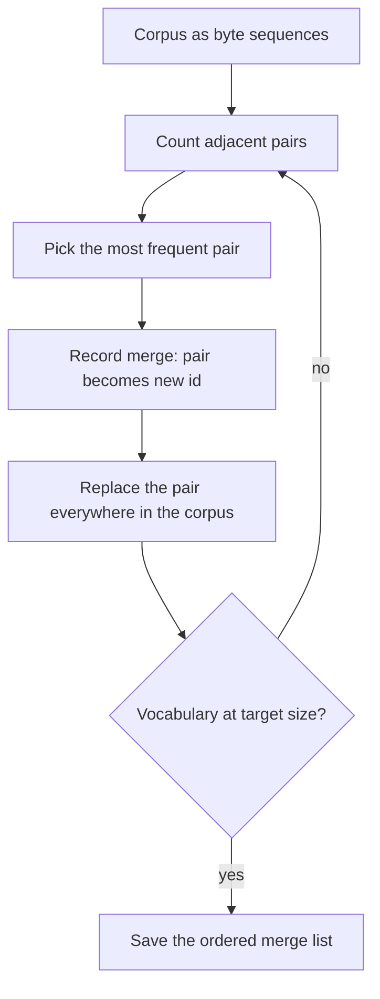

# Byte-Pair Encoding from Scratch

## Introduction

Byte-Pair Encoding (BPE) is the tokenizer algorithm behind GPT-2, GPT-4, GPT-4o, Llama 3, Qwen, DeepSeek and Mistral's recent models. If you open the `tokenizer.json` of almost any open model released since 2023, you will find a `"type": "BPE"` model with a list of **merges**. Understanding BPE means understanding what those merges are, how they were learned, and how they turn text into ids.

The idea is older than deep learning. Philip Gage described BPE in 1994 as a data compression method: repeatedly find the most frequent pair of adjacent bytes and replace it with a new, unused byte. In 2016, Sennrich, Haddow and Birch adapted it for neural machine translation ("Neural Machine Translation of Rare Words with Subword Units"): instead of compressing a file, they used the merges to build a subword vocabulary. In 2019, GPT-2 (Radford et al.) made it **byte-level**, starting from the 256 possible byte values so that any string can be encoded.

On this page you will:

- derive the training rule (merge the most frequent adjacent pair) and run it by hand on a toy corpus,
- understand why modern tokenizers start from bytes and split text with a regular expression first,
- implement `train`, `encode` and `decode` for a byte-level BPE tokenizer in about 60 lines of Python,
- prove your encoder is correct by reproducing the exact token ids of OpenAI's `cl100k_base` (GPT-4) tokenizer,
- measure how vocabulary size changes compression on a real book.

If you have not read [Tokenization Basics](./0-llm-tokenization-basics.mdx), start there for the vocabulary-size trade-off this algorithm navigates.

## The Training Rule

BPE training is a greedy loop. Start with a vocabulary of single symbols (characters in the 2016 paper, bytes in GPT-2). Represent the training corpus as sequences of those symbols. Then repeat:

1. Count every pair of adjacent symbols across the corpus.
2. Pick the most frequent pair.
3. Add the concatenation of that pair to the vocabulary as a new symbol.
4. Replace every occurrence of the pair in the corpus with the new symbol.

Stop when the vocabulary reaches the target size. With $f(w)$ the frequency of a word (or chunk) $w$ and $n_w(a,b)$ the number of times symbol $a$ is directly followed by symbol $b$ inside $w$, the pair count is:

$$
c(a,b) = \sum_w f(w) \, n_w(a,b)
$$

and each step merges

$$
(a^\ast, b^\ast) = \arg\max_{(a,b)} c(a,b)
$$

Each merge adds exactly one vocabulary entry, so after $k$ merges from a byte alphabet the vocabulary has $256 + k$ entries (plus special tokens). The ordered list of merges is the trained tokenizer: it is all you need to encode new text.

Why does this rule produce good subwords? Each merge removes $c(a^\ast, b^\ast)$ symbols from the corpus, the largest reduction available at that step, so BPE is a greedy compressor. Frequent words end up as single tokens because their pairs are merged early; rare words are left as sequences of shorter, frequent pieces. Note that "greedy" means it does not search for the globally best vocabulary of a given size. The Unigram algorithm on the [next page](./2-llm-wordpiece-unigram-sentencepiece.mdx) takes a different, probabilistic approach.



## A Worked Example by Hand

Use the word counts from a toy corpus: "low" appears 5 times, "lower" 2 times, "newest" 6 times and "widest" 3 times. Start from characters so the numbers stay readable.

Step 1 counts. The pair `e s` appears in "newest" (6) and "widest" (3), so $c(e,s) = 9$. The pair `s t` also appears in both, also 9. The pair `w e` appears in "lower" (2) and "newest" (6), giving 8. Ties are broken by whichever pair the implementation sees first; here `e s` wins and becomes the new symbol `es`.

Step 2 counts are recomputed on the merged corpus. Now `es t` appears 9 times and becomes `est`. Step 3 merges `l o` (7 = 5 + 2), step 4 merges `lo w` (7). The code below runs these steps and prints the top three candidates at each one:

```python
from collections import Counter

# Word frequencies from a toy corpus, words split into characters
words = {("l","o","w"): 5, ("l","o","w","e","r"): 2,
         ("n","e","w","e","s","t"): 6, ("w","i","d","e","s","t"): 3}

def pair_counts(words):
    counts = Counter()
    for symbols, freq in words.items():
        for a, b in zip(symbols, symbols[1:]):
            counts[(a, b)] += freq
    return counts

def merge_word(symbols, pair):
    out, i = [], 0
    while i < len(symbols):
        if i < len(symbols) - 1 and (symbols[i], symbols[i+1]) == pair:
            out.append(symbols[i] + symbols[i+1]); i += 2
        else:
            out.append(symbols[i]); i += 1
    return tuple(out)

for step in range(1, 6):
    counts = pair_counts(words)
    best = max(counts, key=counts.get)
    print(f"step {step}: top pairs {counts.most_common(3)} -> merge {best}")
    words = {merge_word(s, best): f for s, f in words.items()}
print(words)
```

```text
step 1: top pairs [(('e', 's'), 9), (('s', 't'), 9), (('w', 'e'), 8)] -> merge ('e', 's')
step 2: top pairs [(('es', 't'), 9), (('l', 'o'), 7), (('o', 'w'), 7)] -> merge ('es', 't')
step 3: top pairs [(('l', 'o'), 7), (('o', 'w'), 7), (('n', 'e'), 6)] -> merge ('l', 'o')
step 4: top pairs [(('lo', 'w'), 7), (('n', 'e'), 6), (('e', 'w'), 6)] -> merge ('lo', 'w')
step 5: top pairs [(('n', 'e'), 6), (('e', 'w'), 6), (('w', 'est'), 6)] -> merge ('n', 'e')
{('low',): 5, ('low', 'e', 'r'): 2, ('ne', 'w', 'est'): 6, ('w', 'i', 'd', 'est'): 3}
```

After five merges the corpus went from 5×3 + 2×5 + 6×6 + 3×6 = 79 symbols to 5×1 + 2×3 + 6×3 + 3×4 = 41 symbols. The suffix "est" became a reusable piece shared by "newest" and "widest", and "low" became a single token. Now an unseen word like "lowest" can be encoded as `low` + `est` even though it never appeared in training. That generalization to unseen words is the entire point.

## Why Bytes, and Why a Regex Comes First

### Byte-Level Base Alphabet

The 2016 BPE started from characters, which leaves an open question: which characters? Unicode has about 155,000. The GPT-2 paper points out that a character-level base vocabulary covering all of Unicode would exceed 130,000 entries before any merges, far larger than the 32,000 to 64,000 token vocabularies typical at the time. Starting from bytes needs only 256 base symbols and still covers every possible string. Rare characters simply stay split into their UTF-8 bytes.

### Pre-tokenization With a Regular Expression

If you run BPE on raw bytes of a whole document, merges happily cross word boundaries and punctuation. GPT-2's authors observed vocabulary slots wasted on variants like `dog.`, `dog!` and `dog?`. Their fix was to stop BPE from merging across character categories: first split the text into chunks with a regular expression, then run BPE inside each chunk only. A space is allowed to attach to the start of the following word, which is why tokens look like `' dog'`.

Here is the pattern tiktoken uses for `cl100k_base` (GPT-4), split into its alternatives:

| Alternative | Matches | Example chunks |
| --- | --- | --- |
| `'(?i:[sdmt]\|ll\|ve\|re)` | English contractions, any case | `'s`, `'LL` |
| `[^\r\n\p{L}\p{N}]?+\p{L}++` | a letter run with one optional leading non-letter (often a space) | `' hello'`, `'(world'` |
| `\p{N}{1,3}+` | one to three digits | `'123'`, `'4'` |
| ` ?[^\s\p{L}\p{N}]++[\r\n]*+` | punctuation run with optional leading space and trailing newlines | `' ++'`, `'.\n'` |
| `\s++$`, `\s*[\r\n]`, `\s+(?!\S)`, `\s` | whitespace runs and newlines | `'\n\n'`, `'    '` |

`\p{L}` means any Unicode letter and `\p{N}` any number, which is why the third-party `regex` module is needed (Python's built-in `re` does not support these classes). The digit rule is important: GPT-2's older pattern allowed arbitrarily long digit runs, so its vocabulary learned tokens for frequent numbers like `2015`. GPT-4's pattern caps digit chunks at three, which gives every number a more uniform split. Number handling is a big topic of its own in [Tokenization Pitfalls](./5-llm-tokenization-pitfalls.mdx).

### The Printable Byte Trick

Open GPT-2's `vocab.json` and you will see entries like `"Ġthe"`. GPT-2 maps each of the 256 bytes to a printable Unicode character so the vocabulary can be stored as readable JSON strings. Printable bytes map to themselves; the others (space, newline, control bytes) are shifted to code points from U+0100 upward:

```python
def bytes_to_unicode():
    """GPT-2's map from each byte value to a printable Unicode character."""
    printable = (list(range(ord("!"), ord("~") + 1)) + list(range(ord("¡"), ord("¬") + 1))
                 + list(range(ord("®"), ord("ÿ") + 1)))
    mapping, shift = {}, 0
    for b in range(256):
        if b in printable:
            mapping[b] = chr(b)                 # printable bytes map to themselves
        else:
            mapping[b] = chr(256 + shift)       # the rest move to U+0100 and above
            shift += 1
    return mapping

m = bytes_to_unicode()
print(repr(m[ord(" ")]), hex(ord(m[ord(" ")])), repr(m[ord("\n")]), repr(m[ord("A")]))
print("".join(m[b] for b in " héllo".encode("utf-8")))
```

```text
'Ġ' 0x120 'Ċ' 'A'
Ġhéllo
```

This is purely a storage convention. `Ġ` is the space byte, `Ċ` is the newline byte, and `é` is the two-byte UTF-8 encoding of `é`. tiktoken avoids the trick altogether by storing raw bytes (base64-encoded) with their ranks.

## Implementing a Byte-Level BPE Tokenizer

Now the real implementation. Save this as `bpe.py`. It uses the GPT-4 pre-tokenization pattern, trains on distinct chunks weighted by frequency (exactly the $f(w)$ in the formula above), and stores two tables: `merges` maps a pair of ids to its new id, and `vocab` maps every id to its bytes.

```python
import regex as re  # the third-party "regex" module supports \p{L} and \p{N}
from collections import Counter

# GPT-4 (cl100k_base) pre-tokenization pattern, from tiktoken
GPT4_PATTERN = (r"""'(?i:[sdmt]|ll|ve|re)|[^\r\n\p{L}\p{N}]?+\p{L}++|\p{N}{1,3}+| ?[^\s\p{L}\p{N}]++[\r\n]*+|"""
                r"""\s++$|\s*[\r\n]|\s+(?!\S)|\s""")

def merge(ids, pair, new_id):
    """Replace every occurrence of `pair` in `ids` with `new_id`."""
    out, i = [], 0
    while i < len(ids):
        if i < len(ids) - 1 and ids[i] == pair[0] and ids[i + 1] == pair[1]:
            out.append(new_id)
            i += 2
        else:
            out.append(ids[i])
            i += 1
    return out

class ByteBPE:
    def __init__(self, pattern=GPT4_PATTERN):
        self.pattern = re.compile(pattern)
        self.merges = {}                                   # (id, id) -> new id
        self.vocab = {i: bytes([i]) for i in range(256)}  # id -> bytes

    def train(self, text, vocab_size, verbose=False):
        assert vocab_size >= 256
        # Count each distinct pre-token chunk once, with its frequency.
        chunk_freq = Counter(self.pattern.findall(text))
        chunks = [list(c.encode("utf-8")) for c in chunk_freq]
        freqs = list(chunk_freq.values())
        for new_id in range(256, vocab_size):
            counts = Counter()
            for ids, f in zip(chunks, freqs):
                for pair in zip(ids, ids[1:]):
                    counts[pair] += f
            if not counts:
                break
            pair = max(counts, key=counts.get)            # most frequent pair
            chunks = [merge(c, pair, new_id) for c in chunks]
            self.merges[pair] = new_id
            self.vocab[new_id] = self.vocab[pair[0]] + self.vocab[pair[1]]
            if verbose:
                print(f"merge {new_id - 255}: {pair} -> {new_id} "
                      f"{self.vocab[new_id]!r} ({counts[pair]} times)")

    def _encode_chunk(self, ids):
        # Apply merges in the order they were learned (lowest new id first).
        while len(ids) >= 2:
            pairs = set(zip(ids, ids[1:]))
            pair = min(pairs, key=lambda p: self.merges.get(p, float("inf")))
            if pair not in self.merges:
                break                                       # nothing left to merge
            ids = merge(ids, pair, self.merges[pair])
        return ids

    def encode(self, text):
        out = []
        for chunk in self.pattern.findall(text):
            out.extend(self._encode_chunk(list(chunk.encode("utf-8"))))
        return out

    def decode(self, ids):
        data = b"".join(self.vocab[i] for i in ids)
        return data.decode("utf-8", errors="replace")
```

Install the one dependency with `pip install regex`, then train eight merges on a tiny repetitive corpus and watch them appear:

```python
from bpe import ByteBPE

corpus = ("the cat sat on the mat. the cat ate the rat. "
          "a fat cat and a thin rat sat on a mat. ") * 20
tok = ByteBPE()
tok.train(corpus, vocab_size=256 + 8, verbose=True)

text = "the fat rat sat on the cat"
ids = tok.encode(text)
print(ids)
print([tok.decode([i]) for i in ids])
print(tok.decode(ids) == text)
print(tok.encode("héllo"), tok.decode(tok.encode("héllo")))
```

```text
merge 1: (97, 116) -> 256 b'at' (220 times)
merge 2: (116, 104) -> 257 b'th' (100 times)
merge 3: (32, 257) -> 258 b' th' (99 times)
merge 4: (32, 97) -> 259 b' a' (80 times)
merge 5: (258, 101) -> 260 b' the' (79 times)
merge 6: (32, 99) -> 261 b' c' (60 times)
merge 7: (261, 256) -> 262 b' cat' (60 times)
merge 8: (32, 115) -> 263 b' s' (40 times)
[257, 101, 32, 102, 256, 32, 114, 256, 263, 256, 32, 111, 110, 260, 262]
['th', 'e', ' ', 'f', 'at', ' ', 'r', 'at', ' s', 'at', ' ', 'o', 'n', ' the', ' cat']
True
[104, 195, 169, 108, 108, 111] héllo
```

Several properties of real tokenizers already show up:

- **Merges build on earlier merges.** Merge 3 combines the space byte 32 with merge 2's id 257, and merge 7 combines merge 6 with merge 1. Every token is a binary tree of bytes.
- **`'the'` and `' the'` are different.** The first word of the text has no leading space, so it is encoded as `th` + `e`, while later occurrences are the single token `' the'` (id 260). Real vocabularies contain both forms of common words.
- **Unseen characters are fine.** `é` was never in the corpus, so it stays as its two UTF-8 bytes 195 and 169, and decoding still returns the exact string.

### Why Encoding Uses Merge Order

A subtle point: to encode new text you must apply merges **in the order they were learned**, not by frequency in the new text and not greedily by longest match. `_encode_chunk` repeatedly finds the adjacent pair with the lowest merge id and merges it. This reproduces the state the training corpus would have reached for this chunk, so the tokenizer behaves the same at training and inference time. Applying merges in a different order would yield different, unfamiliar token sequences for the same string.

### Complexity

The training loop above recounts all pairs after every merge. With $K$ merges and $N$ symbols in the distinct-chunk corpus, it costs $O(KN)$ time. Production trainers (Hugging Face `tokenizers`, SentencePiece) keep pair counts in a priority queue and only update the counts touched by each merge, which makes training on gigabytes of text practical. Encoding one chunk of length $n$ is $O(n^2)$ in this naive version; tiktoken and `tokenizers` run the same logic in Rust, and chunks are short (a word or a number), so this cost is rarely an issue.

## Checking Against GPT-4's Tokenizer

How do you know your encoder is right? Load a real vocabulary and compare. tiktoken stores `cl100k_base` as a table from byte strings to **ranks**, where a token's rank is also its id and lower ranks were merged earlier. Encoding with ranks is the same algorithm as above: inside each chunk, repeatedly merge the adjacent pair whose concatenation has the lowest rank.

```python
import regex as re
import tiktoken
from bpe import GPT4_PATTERN

enc = tiktoken.get_encoding("cl100k_base")
ranks = enc._mergeable_ranks          # dict: bytes -> rank (= token id), 100,256 entries
pattern = re.compile(GPT4_PATTERN)
print(len(ranks), "mergeable byte sequences")

def encode_with_ranks(text):
    out = []
    for chunk in pattern.findall(text):
        parts = [bytes([b]) for b in chunk.encode("utf-8")]
        while len(parts) > 1:
            # rank of each adjacent concatenation; lower rank = learned earlier
            cands = [(ranks.get(parts[i] + parts[i + 1], float("inf")), i)
                     for i in range(len(parts) - 1)]
            rank, i = min(cands)
            if rank == float("inf"):
                break
            parts[i:i + 2] = [parts[i] + parts[i + 1]]
        out.extend(ranks[p] for p in parts)
    return out

samples = ["Hello world!", "unbelievably", "    def forward(self, x):\n        return x",
           "12345678 + 0.5", "naïve café 東京", "I'll say it's fine"]
for s in samples:
    ours, ref = encode_with_ranks(s), enc.encode(s)
    print(ours == ref, ours)
```

```text
100256 mergeable byte sequences
True [9906, 1917, 0]
True [359, 32898, 89234]
True [262, 711, 4741, 1214, 11, 865, 997, 286, 471, 865]
True [4513, 10961, 2495, 489, 220, 15, 13, 20]
True [3458, 38672, 588, 53050, 61696, 109, 47653]
True [40, 3358, 2019, 433, 596, 7060]
```

Twenty lines of Python reproduce GPT-4's tokenizer exactly, including code indentation, digits and Chinese characters. `_mergeable_ranks` is a private attribute, which is fine for learning but should not be relied on in production code. The 100,256 mergeable entries plus 5 special tokens explain why `enc.n_vocab` reports 100,277: the special tokens sit at ids 100257 to 100276, with a few unused ids in between.

The same structure appears in Hugging Face `tokenizer.json` files for Llama 3 and Qwen: a `vocab` mapping strings (in the printable byte form) to ids, and a `merges` list in rank order. Andrej Karpathy's `minbpe` repository walks through the same reconstruction for GPT-4 in more detail.

## Experiment: Vocabulary Size Versus Compression

Let us train our tokenizer on the first 500,000 characters of *Pride and Prejudice* (Project Gutenberg, file `pg1342.txt`) and measure bytes per token on the next 100,000 characters, which the tokenizer has never seen.

```python
import time
from bpe import ByteBPE

text = open("pride.txt", encoding="utf-8").read()
train, test = text[:500_000], text[500_000:600_000]

for vocab_size in [256, 512, 1024, 2048]:
    t0 = time.time()
    tok = ByteBPE()
    tok.train(train, vocab_size)
    ids = tok.encode(test)
    assert tok.decode(ids) == test               # lossless round trip
    print(f"vocab {vocab_size:>5}: {len(test.encode('utf-8'))/len(ids):.2f} bytes/token, "
          f"train {time.time()-t0:.1f}s")
longest = sorted(tok.vocab.values(), key=len)[-5:]
print("longest tokens:", longest)
```

```text
vocab   256: 1.00 bytes/token, train 0.1s
vocab   512: 2.19 bytes/token, train 4.5s
vocab  1024: 2.88 bytes/token, train 10.5s
vocab  2048: 3.48 bytes/token, train 24.8s
longest tokens: [b' Hertfordshire', b'                ', b'                                ', b'                                            ', b'                                                ']
```

The pattern is the one every tokenizer designer sees:

- **Diminishing returns.** The first 256 merges more than double compression (1.00 to 2.19 bytes per token). The next 512 add 0.69, the next 1,024 add 0.60. Each doubling of the vocabulary buys less, which is why going from 128k to 256k entries matters mostly for languages and domains the smaller vocabulary under-serves.
- **The vocabulary reflects the corpus.** The longest learned tokens are a place name from the novel and long runs of spaces, because the Gutenberg file is indented with spaces. Train on code and you will get tokens for indentation and keywords; train on English prose and other languages get split into bytes. Tokenizer training data matters as much as the algorithm.
- **Pure Python is slow.** About 25 seconds for 1,792 merges on half a megabyte. The Rust trainer in Hugging Face `tokenizers` does the same job in under a second (see [Using tiktoken and Hugging Face Tokenizers](./3-llm-tokenizer-libraries.mdx)). Use your own implementation to learn and debug, and a library to train real vocabularies.

You can take this tokenizer much further in [Project: Build a Byte-Level BPE Tokenizer](../14-llm-projects/0-llm-project-tokenizer.mdx), which adds special tokens, saving and loading, and training on a larger corpus.

## Common Mistakes

- **Applying merges in the wrong order.** Encoding must follow merge rank, not frequency in the input and not longest match; otherwise the ids differ from what the model saw in training.
- **Skipping pre-tokenization.** Without the regex split, merges cross word and punctuation boundaries and waste the vocabulary on fragments like `dog.` or `e t`.
- **Using Python's built-in `re`.** It does not support `\p{L}` or possessive quantifiers like `++`; use the `regex` package.
- **Decoding token by token for display.** A single token may be half of a UTF-8 character. Concatenate the bytes of all tokens first, then decode.
- **Forgetting special tokens.** BPE merges never produce ids for `<|endoftext|>` or chat markers; those are added separately and must not be created from user text by accident.
- **Comparing compression on training text.** Always measure on held-out text, as in the experiment, or the numbers are optimistic.

## Summary

- BPE training repeatedly merges the most frequent adjacent pair; the ordered merge list is the tokenizer.
- Each merge adds one vocabulary entry, so a byte-level vocabulary has 256 base entries plus one per merge plus special tokens.
- Byte-level BPE (GPT-2, 2019) can encode any string with no unknown token; a regex pre-tokenizer keeps merges inside words, numbers and punctuation runs.
- Encoding applies merges in rank order inside each chunk; decoding concatenates bytes and decodes UTF-8 once.
- A rank-based encoder of about 20 lines reproduces `cl100k_base` exactly.
- Compression grows quickly for the first few hundred merges and then with diminishing returns; the learned vocabulary mirrors the training corpus.

## Further Reading

- [Neural Machine Translation of Rare Words with Subword Units (Sennrich et al., 2016)](https://arxiv.org/abs/1508.07909): the original BPE-for-NLP paper, with the merge algorithm in a few lines of Python.
- [Language Models are Unsupervised Multitask Learners (Radford et al., 2019)](https://cdn.openai.com/better-language-models/language_models_are_unsupervised_multitask_learners.pdf): GPT-2's byte-level BPE and the character-category rule.
- [openai/tiktoken](https://github.com/openai/tiktoken): OpenAI's fast BPE tokenizer and the source of the `cl100k_base` and `o200k_base` patterns.
- [karpathy/minbpe](https://github.com/karpathy/minbpe): a minimal, well-commented BPE implementation, including the GPT-4 reconstruction.
- [BPE-Dropout (Provilkov et al., 2020)](https://arxiv.org/abs/1910.13267): randomly skipping merges during training as a regularizer.
- [Byte Pair Encoding is Suboptimal for Language Model Pretraining (Bostrom and Durrett, 2020)](https://arxiv.org/abs/2004.03720): a comparison of BPE and Unigram segmentations.
- [Hugging Face LLM Course: Byte-Pair Encoding tokenization](https://huggingface.co/learn/llm-course/chapter6/5): a step-by-step walkthrough with the `tokenizers` library.
