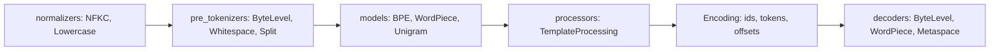

# Using tiktoken and Hugging Face Tokenizers

## Introduction

After implementing BPE yourself in [Byte-Pair Encoding from Scratch](./1-llm-bpe.mdx), you will almost never use that code in production. Real systems rely on three libraries:

- **tiktoken** (OpenAI): a fast BPE encoder in Rust with a Python API, shipping the vocabularies of OpenAI models (`cl100k_base` for GPT-4, `o200k_base` for GPT-4o and later, `o200k_harmony` for the open-weight gpt-oss models).
- **tokenizers** (Hugging Face): a Rust library that can both **train** and run BPE, WordPiece and Unigram tokenizers, and that defines the `tokenizer.json` format found in almost every model repository.
- **transformers** (Hugging Face): wraps a `tokenizers` object with model-specific knowledge: special tokens, padding, truncation and the **chat template** that turns a list of messages into the exact string the model was fine-tuned on.

This page shows how to use each one correctly, with output from real runs (tiktoken 0.14, tokenizers 0.23, transformers 5.21). You will learn how special tokens are protected from user text, how to train and save your own tokenizer, how to wrap it for `transformers`, how padding works for decoder-only models, and how chat templates work, including the most common bug they cause. Everything runs on a CPU and only downloads tokenizer files, except one example that loads a 135M-parameter model.

```bash
pip install tiktoken tokenizers "transformers>=5" torch
```

## tiktoken: Fast Encoding for OpenAI Vocabularies

tiktoken has one central object, an `Encoding`, which bundles a regex pattern, a table of mergeable byte strings with their ranks, and a dictionary of special tokens. You load it by name or by model name:

```python
import tiktoken

enc = tiktoken.get_encoding("o200k_base")      # GPT-4o family
print(tiktoken.encoding_for_model("gpt-4").name, tiktoken.encoding_for_model("gpt-4o").name)

ids = enc.encode("Tokenizers turn text into integers.")
print(ids, len(ids))
print([enc.decode_single_token_bytes(i) for i in ids])
print(enc.decode(ids))

# Special tokens are refused by default: text from users must not smuggle them in
try:
    enc.encode("hello <|endoftext|>")
except ValueError as e:
    print("ValueError:", str(e).splitlines()[0])
print(enc.encode("hello <|endoftext|>", allowed_special={"<|endoftext|>"}))
print(enc.encode("hello <|endoftext|>", disallowed_special=()))   # treat as plain text
print(enc.encode_ordinary("hello <|endoftext|>"))
print("eot id:", enc.eot_token)
```

```text
cl100k_base o200k_base
[4421, 24223, 3716, 2201, 1511, 54912, 13] 7
[b'Token', b'izers', b' turn', b' text', b' into', b' integers', b'.']
Tokenizers turn text into integers.
ValueError: Encountered text corresponding to disallowed special token '<|endoftext|>'.
[24912, 220, 199999]
[24912, 464, 91, 419, 1440, 919, 91, 29]
[24912, 464, 91, 419, 1440, 919, 91, 29]
eot id: 199999
```

The special-token behavior deserves attention. A special token like `<|endoftext|>` is a control signal: it tells the model a document ended. If a user could type the string and have it become id 199999, they could forge document boundaries or chat roles. So tiktoken raises an error by default when the text contains a special token string. You then choose explicitly:

- `allowed_special={...}` or `allowed_special="all"`: you trust this text and want the control token.
- `disallowed_special=()` or `encode_ordinary`: encode the string as ordinary characters (`<`, `|`, `endo`, ...), which is what you want for untrusted input.

`decode_single_token_bytes` returns raw bytes, which is how you inspect tokens safely. A token can be an incomplete UTF-8 sequence, and decoding it alone produces the replacement character:

```python
import tiktoken

cl100k = tiktoken.get_encoding("cl100k_base")
ids = cl100k.encode("鳥")                      # one character, 3 UTF-8 bytes
print(ids, [cl100k.decode_single_token_bytes(i) for i in ids])
print(repr(cl100k.decode(ids[:1])))           # incomplete character
print(repr(cl100k.decode(ids)))

# Extending an encoding with your own special tokens
base = tiktoken.get_encoding("cl100k_base")
enc = tiktoken.Encoding(
    name="cl100k_chat",
    pat_str=base._pat_str,
    mergeable_ranks=base._mergeable_ranks,
    special_tokens={**base._special_tokens,
                    "<|im_start|>": 100264, "<|im_end|>": 100265},
)
text = "<|im_start|>user\nHi<|im_end|>"
print(enc.encode(text, allowed_special="all"))
```

```text
[165, 111, 98] [b'\xe9', b'\xb3', b'\xa5']
'�'
'鳥'
[100264, 882, 198, 13347, 100265]
```

The character 鳥 ("bird") is not a single token in `cl100k_base`; it is three byte tokens. If you stream output to a user token by token, you must buffer bytes until they form complete characters. The second half of the example shows the pattern tiktoken's README recommends for adding your own special tokens: build a new `Encoding` from the base encoding's pattern and ranks.

For counting tokens at scale, `encode_batch` and `encode_ordinary_batch` use multiple threads. Remember that tiktoken only knows OpenAI's vocabularies; for any open model, load the model's own tokenizer through `transformers`. For token counting with hosted APIs from other providers, use the provider's counting endpoint, as described in the [AI Agents tutorial](/docs/ai/agents).

## Hugging Face tokenizers: The Pipeline and Training

The `tokenizers` library models a tokenizer as the four-stage pipeline from [Tokenization Basics](./0-llm-tokenization-basics.mdx): normalizer, pre-tokenizer, model, post-processor, plus a decoder for the reverse direction. Each stage is a component you can mix and match:



Here is a GPT-2 style byte-level BPE tokenizer trained on the same 500,000 characters of *Pride and Prejudice* used on the BPE page, with a vocabulary of 2,048:

```python
import time
from tokenizers import Tokenizer, models, trainers, pre_tokenizers, decoders, processors

tok = Tokenizer(models.BPE())
tok.pre_tokenizer = pre_tokenizers.ByteLevel(add_prefix_space=False)
tok.decoder = decoders.ByteLevel()
trainer = trainers.BpeTrainer(
    vocab_size=2048,
    special_tokens=["<|endoftext|>", "<|pad|>"],
    initial_alphabet=pre_tokenizers.ByteLevel.alphabet(),   # all 256 bytes
)
t0 = time.time()
tok.train(["corpus.txt"], trainer)
print(f"trained in {time.time() - t0:.2f}s, vocab = {tok.get_vocab_size()}")

tok.post_processor = processors.TemplateProcessing(
    single="$A <|endoftext|>", special_tokens=[("<|endoftext|>", tok.token_to_id("<|endoftext|>"))])

enc = tok.encode("Mr. Darcy was unbelievably proud.")
print(enc.tokens)
print(enc.ids)
print(enc.offsets[:4])
print(tok.decode(enc.ids))
tok.save("my-bpe.json")
```

```text
trained in 0.76s, vocab = 2048
['Mr', '.', 'ĠDarcy', 'Ġwas', 'Ġun', 'be', 'lie', 'v', 'ably', 'Ġpr', 'oud', '.', '<|endoftext|>']
[659, 15, 459, 327, 509, 663, 722, 87, 923, 783, 1539, 15, 0]
[(0, 2), (2, 3), (3, 9), (9, 13)]
Mr. Darcy was unbelievably proud.
```

Compare 0.76 seconds with the 25 seconds our pure Python trainer needed for the same vocabulary size. Points to notice:

- **`initial_alphabet`** adds all 256 byte symbols even if some never occur in the corpus. Without it, a byte that is absent from the training data would have no token, and the "never unknown" guarantee breaks.
- **Special tokens get the lowest ids** (0 and 1 here) because they were listed first. They are never split or merged.
- **Offsets** map every token back to a character span in the original string, which you need for tasks like highlighting or span extraction. The leading space in `ĠDarcy` is included in its span (3, 9).
- **The post-processor** appended `<|endoftext|>` automatically. Models differ in whether they want BOS at the start, EOS at the end, both or neither; this is where that rule lives.

The saved `my-bpe.json` is the same format as the `tokenizer.json` in a model repository. Open one from Qwen or Llama 3 and you will find these same sections: `normalizer`, `pre_tokenizer` (a `Split` with a regex plus `ByteLevel`), `model` with `vocab` and `merges`, `post_processor`, `decoder` and `added_tokens`.

## Tokenizers in transformers v5

`transformers` loads a tokenizer with `AutoTokenizer.from_pretrained`. Version 5 (5.0.0 was released in January 2026) reorganized the tokenizer classes. In v4, most models had two implementations, a slow pure-Python "slow" tokenizer and a Rust-backed "fast" one, and the fast class names ended in `Fast`. In v5, the Rust `tokenizers` backend is the default implementation, model classes such as `Qwen2Tokenizer` inherit from a common `TokenizersBackend` class, and `PreTrainedTokenizerFast` remains as a name for that backend. Code written for v4 that only calls `AutoTokenizer` and the standard methods mostly keeps working; code that checks class names or relies on slow-tokenizer internals may not.

You can wrap the tokenizer we just trained and use the standard API:

```python
from transformers import PreTrainedTokenizerFast, AutoTokenizer

hf_tok = PreTrainedTokenizerFast(tokenizer_file="my-bpe.json",
                                 eos_token="<|endoftext|>", pad_token="<|pad|>")
print(type(hf_tok).__name__)
batch = hf_tok(["Mr. Darcy", "Elizabeth laughed at him."], padding=True, return_tensors="pt")
print(batch["input_ids"])
print(batch["attention_mask"])
hf_tok.save_pretrained("my-tokenizer")

tok = AutoTokenizer.from_pretrained("Qwen/Qwen2.5-0.5B-Instruct")
print(tok.eos_token, tok.eos_token_id, tok.pad_token, tok.bos_token)
enc = tok("Hello world", return_offsets_mapping=True)
print(enc["input_ids"], enc["offset_mapping"])
print(tok.convert_ids_to_tokens(tok("naïve café")["input_ids"]))
print(tok.decode(tok("naïve café")["input_ids"]))
```

```text
TokenizersBackend
tensor([[659,  15, 459,   0,   1,   1,   1,   1,   1],
        [405, 344, 542,  72, 641, 362, 380,  15,   0]])
tensor([[1, 1, 1, 1, 0, 0, 0, 0, 0],
        [1, 1, 1, 1, 1, 1, 1, 1, 1]])
<|im_end|> 151645 <|endoftext|> None
[9707, 1879] [(0, 5), (5, 11)]
['na', 'ï', 've', 'Ġcafé']
naïve café
```

What this shows:

- `PreTrainedTokenizerFast(...)` now constructs a `TokenizersBackend`.
- **Padding** fills shorter sequences with the pad id (1) and the **attention mask** marks real tokens with 1 and padding with 0, so attention ignores the padding (see [Causal Masking and Autoregressive Decoding](../2-llm-attention/3-llm-causal-masking.mdx)). The `<|endoftext|>` id 0 at the end of each row comes from our post-processor.
- `save_pretrained` writes `tokenizer.json` plus `tokenizer_config.json`, the pair you upload next to model weights.
- **Special tokens depend on the checkpoint.** Qwen2.5-Instruct's EOS is `<|im_end|>` (the end-of-turn marker in chat), its pad token is `<|endoftext|>`, and it has no BOS token at all. The base Qwen2.5 model uses `<|endoftext|>` as EOS. Always read these from the tokenizer rather than hard-coding them.
- `convert_ids_to_tokens` shows the stored (printable byte) form; `decode` gives the real text.

### Adding Tokens and Padding for Generation

When you fine-tune a model for tool calling or a new chat format, you often add special tokens. Every new token needs a new row in the embedding matrix (see [Token Embeddings and the Embedding Matrix](./4-llm-embeddings.mdx)):

```python
import torch
from transformers import AutoModelForCausalLM, AutoTokenizer

repo = "HuggingFaceTB/SmolLM2-135M"
tok = AutoTokenizer.from_pretrained(repo)
model = AutoModelForCausalLM.from_pretrained(repo, dtype=torch.float32)
print("before:", len(tok), model.get_input_embeddings().weight.shape)

added = tok.add_tokens(["<tool_call>", "</tool_call>"], special_tokens=True)
model.resize_token_embeddings(len(tok), pad_to_multiple_of=64)
print("added", added, "->", len(tok), model.get_input_embeddings().weight.shape)
print(tok.tokenize("<tool_call>search</tool_call>"))

tok.pad_token = tok.eos_token
tok.padding_side = "left"                       # decoder-only generation pads on the left
batch = tok(["Hi", "The capital of France is"], padding=True, return_tensors="pt")
print(batch["input_ids"])
print(batch["attention_mask"])
```

```text
before: 49152 torch.Size([49152, 576])
added 2 -> 49154 torch.Size([49216, 576])
['<tool_call>', 'search', '</tool_call>']
tensor([[    0,     0,     0,     0, 26843],
        [  504,  3575,   282,  4649,   314]])
tensor([[0, 0, 0, 0, 1],
        [1, 1, 1, 1, 1]])
```

Three practical lessons. First, `resize_token_embeddings` grew the matrix from 49,152 to 49,216 rows because we asked for a multiple of 64, which keeps matrix shapes friendly for GPU kernels; the extra 62 rows are never produced by the tokenizer. Recent versions initialize new rows from the mean and covariance of the existing embeddings (it prints a notice about this), which trains better than random initialization. Second, the added tokens are matched as whole units before BPE runs. Third, `dtype=` is the v5 name for what v4 called `torch_dtype`.

The padding side matters for generation. A decoder-only model predicts the next token from the **last** position. With right padding, the last position of the short prompt "Hi" would be a pad token, and the model would continue from padding. Left padding puts every prompt's real last token at the end. For training with labels, right padding is the common choice, because the loss ignores padded positions anyway.

## Chat Templates

Instruction-tuned models were fine-tuned on conversations rendered in a specific text format with special role markers. If you prompt the model with a different format, quality drops sharply, sometimes to nonsense. A **chat template** is a Jinja template stored in the tokenizer configuration that produces exactly that format from a list of messages. `apply_chat_template` renders it:

```python
from transformers import AutoTokenizer

messages = [
    {"role": "system", "content": "You are a concise assistant."},
    {"role": "user", "content": "What is a token?"},
]
for repo in ["Qwen/Qwen2.5-0.5B-Instruct", "HuggingFaceTB/SmolLM2-135M-Instruct",
             "TinyLlama/TinyLlama-1.1B-Chat-v1.0"]:
    tok = AutoTokenizer.from_pretrained(repo)
    prompt = tok.apply_chat_template(messages, tokenize=False, add_generation_prompt=True)
    print(f"--- {repo}\n{prompt}")

tok = AutoTokenizer.from_pretrained("Qwen/Qwen2.5-0.5B-Instruct")
enc = tok.apply_chat_template(messages, add_generation_prompt=True, return_tensors="pt")
print(type(enc).__name__, list(enc.keys()), tuple(enc["input_ids"].shape))
```

```text
--- Qwen/Qwen2.5-0.5B-Instruct
<|im_start|>system
You are a concise assistant.<|im_end|>
<|im_start|>user
What is a token?<|im_end|>
<|im_start|>assistant

--- HuggingFaceTB/SmolLM2-135M-Instruct
<|im_start|>system
You are a concise assistant.<|im_end|>
<|im_start|>user
What is a token?<|im_end|>
<|im_start|>assistant

--- TinyLlama/TinyLlama-1.1B-Chat-v1.0
<|system|>
You are a concise assistant.</s>
<|user|>
What is a token?</s>
<|assistant|>

BatchEncoding ['input_ids', 'attention_mask'] (1, 24)
```

Qwen and SmolLM2 use the ChatML format (`<|im_start|>role ... <|im_end|>`), while TinyLlama uses Zephyr-style `<|user|>` markers closed by `</s>`. `add_generation_prompt=True` appends the opening of the assistant turn, so the model's next token starts the answer. Without it, the model may continue the user's message instead.

:::warning
In transformers v5, `apply_chat_template` with `tokenize=True` (the default) returns a `BatchEncoding` dictionary with `input_ids` and `attention_mask`, because `return_dict` now defaults to `True`. In v4 it returned a plain list of ids. Code like `ids = tok.apply_chat_template(msgs)` followed by `model.generate(ids)` must become `model.generate(**enc)` or use `enc["input_ids"]`.
:::

### The Double BOS Bug

Templates often include the BOS token themselves. If you render the template to a string and then tokenize that string normally, the tokenizer adds a **second** BOS. Llama 3.2 shows it clearly (the `unsloth` mirror has the same tokenizer files as the gated `meta-llama` repository):

```python
from transformers import AutoTokenizer

tok = AutoTokenizer.from_pretrained("unsloth/Llama-3.2-1B-Instruct")  # same files as meta-llama
messages = [{"role": "user", "content": "What is a token?"}]
prompt = tok.apply_chat_template(messages, tokenize=False, add_generation_prompt=True,
                                 date_string="26 Oct 2026")
print(prompt)
good = tok.apply_chat_template(messages, add_generation_prompt=True, date_string="26 Oct 2026")["input_ids"]
bad = tok(prompt)["input_ids"]                      # adds a second <|begin_of_text|>
print(len(good), len(bad), tok.convert_ids_to_tokens(bad[:2]))
fixed = tok(prompt, add_special_tokens=False)["input_ids"]
print(fixed == good)
```

```text
<|begin_of_text|><|start_header_id|>system<|end_header_id|>

Cutting Knowledge Date: December 2023
Today Date: 26 Oct 2026

<|eot_id|><|start_header_id|>user<|end_header_id|>

What is a token?<|eot_id|><|start_header_id|>assistant<|end_header_id|>


```

```text
40 41 ['<|begin_of_text|>', '<|begin_of_text|>']
True
```

The template injected a default system header with a knowledge-cutoff line (extra keyword arguments such as `date_string` are passed into the Jinja template). The string version tokenized normally has 41 ids and starts with two `<|begin_of_text|>` tokens, a sequence the model never saw in training. Either let `apply_chat_template` tokenize, or pass `add_special_tokens=False` when tokenizing a rendered template.

Chat templates are also where loss masking for fine-tuning starts: you only want the loss on assistant tokens. That is covered in [Supervised Fine-Tuning and Chat Templates](../8-llm-post-training/1-llm-supervised-fine-tuning.mdx), and prompting with these formats through hosted APIs is covered in the [AI Agents tutorial](/docs/ai/agents).

## Worked Scenario: Reading a Model's Tokenizer Files

Suppose you download a new open model and want to know how it tokenizes before using it. A checklist using only the files and APIs from this page:

1. **Open `tokenizer.json`.** Check `model.type` (BPE, WordPiece or Unigram), the `pre_tokenizer` regex (does it split digits one by one or in groups of three?), whether `byte_fallback` is set, and the size of `vocab`.
2. **Open `tokenizer_config.json`.** Find `bos_token`, `eos_token`, `pad_token`, the `added_tokens_decoder` table (all special and added tokens with their ids) and `chat_template`.
3. **Compare with `config.json`.** The model's `vocab_size` is often larger than `len(tokenizer)` because the embedding matrix was padded: Qwen2.5-0.5B has 151,936 embedding rows but `len(tok)` is 151,665. A larger model is fine; a smaller one means some token ids would index past the matrix.
4. **Render a conversation** with `apply_chat_template(..., tokenize=False)` and read it, including any default system prompt the template injects.
5. **Round-trip test**: `decode(encode(s)) == s` on samples of your real data, including code, numbers, other languages and unusual whitespace.

Five minutes with this checklist prevents most of the tokenizer bugs listed in [Tokenization Pitfalls](./5-llm-tokenization-pitfalls.mdx).

## Common Mistakes

- **Allowing special tokens in user text.** tiktoken protects you by default; with Hugging Face tokenizers, special token strings inside text are matched as control tokens, so sanitize untrusted input (more in the pitfalls page).
- **Double BOS.** Tokenizing a rendered chat template with `add_special_tokens=True` adds a second BOS.
- **Hand-writing chat formats.** Use the model's own template; small differences such as a missing newline change the token sequence.
- **Assuming `apply_chat_template` returns a list.** In transformers v5 it returns a `BatchEncoding` by default.
- **Right padding for batched generation.** Decoder-only models need left padding when generating from a batch of prompts.
- **Adding tokens without resizing embeddings.** New ids index past the embedding matrix and crash, or worse, silently hit padded rows.
- **Using tiktoken to count tokens for non-OpenAI models.** Every model family has its own vocabulary; counts can differ by 20 percent or more.

## Summary

- tiktoken encodes with OpenAI vocabularies, refuses special tokens in text by default, and exposes raw token bytes for inspection.
- Hugging Face `tokenizers` builds a tokenizer from normalizer, pre-tokenizer, model, post-processor and decoder components and trains BPE, WordPiece or Unigram in Rust in seconds.
- `tokenizer.json` holds the full pipeline; `tokenizer_config.json` holds special tokens and the chat template.
- In transformers v5, tokenizers are backed by `TokenizersBackend`, `dtype` replaces `torch_dtype`, and `apply_chat_template` returns a dictionary by default.
- Pad on the left for batched generation, resize embeddings after adding tokens, and never add BOS twice.

## Further Reading

- [openai/tiktoken](https://github.com/openai/tiktoken): README with the encoding list and the pattern for extending encodings.
- [Hugging Face tokenizers documentation](https://huggingface.co/docs/tokenizers): components, training and the `tokenizer.json` format.
- [Transformers: Tokenizers](https://huggingface.co/docs/transformers/main/en/fast_tokenizers): loading, special tokens, padding and truncation in transformers.
- [Transformers: Chat templates](https://huggingface.co/docs/transformers/main/en/chat_templating): writing and applying Jinja chat templates.
- [Transformers v5 release notes](https://github.com/huggingface/transformers/releases): the list of breaking changes, including tokenizers.
- [Initializing New Word Embeddings for Pretrained Language Models (Hewitt, 2021)](https://www.cs.columbia.edu/~johnhew/vocab-expansion.html): why new embedding rows should start at the mean of the old ones.
