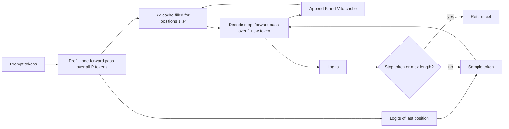
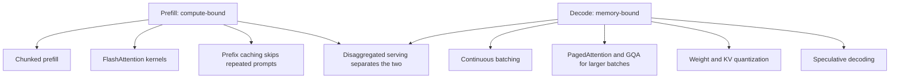

# How LLM Inference Works: Prefill and Decode

## Introduction

Training a language model is a single, enormous batch job. Inference is the opposite: millions of small, latency-sensitive requests, each of which wants its first word quickly and every following word at reading speed. The same weights that trained at 40 percent of a GPU's peak FLOPs can run at 1 percent of peak during generation if you serve them naively.

The reason is that a generation request is really two different workloads glued together. First the model reads the whole prompt in one parallel pass, called **prefill**. Then it produces the answer one token at a time, called **decode**. Prefill looks like training: big matrix-matrix products that keep the arithmetic units busy. Decode looks like a sequence of matrix-vector products: every step reads all the weights from memory to do very little arithmetic on them.

Almost every inference optimization you will meet in this section (the KV cache, continuous batching, PagedAttention, speculative decoding, quantization, prefill-decode disaggregation) is a response to this split. After reading this page you will be able to:

- Describe the autoregressive generation loop and what is computed in each phase.
- Compute the arithmetic intensity of a decode step and compare it with a GPU's ridge point.
- Estimate prefill time and the best possible decode speed for a real model on a real GPU from two numbers on the datasheet.
- Explain why batching helps decode so much and helps prefill so little.

This page assumes you know the decoder-only Transformer from [Inside a Decoder Block](../3-llm-transformer/2-llm-transformer-block.mdx) and causal attention from [Causal Masking and Autoregressive Decoding](../2-llm-attention/3-llm-causal-masking.mdx).

## The Autoregressive Loop

A decoder-only LLM defines a distribution over the next token given everything before it:

$$
p(x_{t+1} \mid x_1, \dots, x_t) = \mathrm{softmax}\!\left(h_t W_U\right)
$$

Here $h_t$ is the final hidden state at position $t$ (a vector of size $d_\mathrm{model}$) and $W_U$ is the unembedding matrix of shape $d_\mathrm{model} \times V$, where $V$ is the vocabulary size. Generation repeats three steps: run the model, pick a token from the distribution (the subject of [Decoding Strategies](./1-llm-decoding-strategies.mdx)), append that token to the input.

A naive implementation reruns the full model on the whole sequence every step. For a prompt of $P$ tokens and $G$ generated tokens, that processes $P + (P+1) + \dots + (P+G-1)$ positions, which grows quadratically with the output length. The fix is the observation that, thanks to the causal mask, the keys and values of earlier positions never change once they are computed. We store them in a **KV cache** and, at each new step, only compute the new position. The [KV Cache](./2-llm-kv-cache.mdx) page derives and implements this; for now, accept that with a cache the loop looks like this:



The two phases have the same weights and the same code path, but the shapes going through them are very different:

| | Prefill | Decode |
|---|---|---|
| Tokens processed per sequence per pass | all $P$ prompt tokens | 1 |
| Linear layers | matrix-matrix, `(P, d) @ (d, d_out)` | matrix-vector, `(1, d) @ (d, d_out)` |
| Attention | $P \times P$ causal scores | 1 query against $t$ cached keys |
| Passes per request | 1 (or a few chunks) | $G$, one per output token |
| Bottleneck | arithmetic (FLOPs) | memory bandwidth (bytes) |
| User-visible metric | time to first token (TTFT) | time per output token (TPOT) |

## Counting FLOPs and Bytes

To see why the bottlenecks differ, count work and memory traffic for one linear layer, which is where most of an LLM's FLOPs live.

Take a weight matrix $W$ of shape $d_\mathrm{in} \times d_\mathrm{out}$ stored in BF16 (2 bytes per number), and an input $X$ of shape $n \times d_\mathrm{in}$, where $n$ is the number of tokens in the pass. The product $XW$ needs one multiply and one add per weight per token:

$$
\mathrm{FLOPs} = 2\, n\, d_\mathrm{in}\, d_\mathrm{out}
$$

The bytes that must move between GPU memory (HBM) and the compute units are at least the weights, plus the inputs and outputs:

$$
\mathrm{Bytes} \approx 2\, d_\mathrm{in}\, d_\mathrm{out} + 2\, n\, d_\mathrm{in} + 2\, n\, d_\mathrm{out}
$$

When $n$ is much smaller than $d_\mathrm{in}$ and $d_\mathrm{out}$, the weight term dominates. The ratio of the two is the **arithmetic intensity**, FLOPs performed per byte moved:

$$
I = \frac{\mathrm{FLOPs}}{\mathrm{Bytes}} \approx \frac{2\, n\, d_\mathrm{in}\, d_\mathrm{out}}{2\, d_\mathrm{in}\, d_\mathrm{out}} = n
$$

So in BF16 a linear layer performs roughly $n$ FLOPs per byte, where $n$ is the number of tokens sharing the same weight read. Summed over the whole model, a forward pass costs about $2N$ FLOPs per token for a model with $N$ parameters (ignoring attention over the context), and it must stream all $2N$ bytes of weights at least once per pass.

### The Ridge Point

A GPU has a peak compute rate $F$ (FLOP/s) and a peak memory bandwidth $B$ (bytes/s). A kernel cannot run faster than either limit allows:

$$
t \ge \max\!\left(\frac{\mathrm{FLOPs}}{F},\ \frac{\mathrm{Bytes}}{B}\right)
$$

The two limits are equal when $I = F / B$, the **ridge point** of the roofline model (covered in depth in [GPU Memory Hierarchy](../5-llm-flash-attention/0-llm-gpu-memory-hierarchy.mdx)). Below the ridge the kernel is memory-bound: the compute units wait for data. Above it, the kernel is compute-bound.

For an NVIDIA H100 SXM the datasheet gives about 989 TFLOP/s of dense BF16 tensor-core compute and 3.35 TB/s of HBM3 bandwidth:

$$
\frac{F}{B} = \frac{989 \times 10^{12}}{3.35 \times 10^{12}} \approx 295 \ \text{FLOPs per byte}
$$

Combine this with $I \approx n$:

- **Prefill** of a 2,000-token prompt has $n = 2000$, far above 295. It is compute-bound.
- **Decode** for a single user has $n = 1$, almost 300 times below the ridge. The GPU is idle more than 99 percent of the time, waiting for weights.

This is the central fact of LLM inference. One decode step for one user costs about as much wall-clock time as one decode step for a hundred users, because both are dominated by reading the same weights.

:::note
The ridge point grows with every GPU generation because FLOPs have increased faster than memory bandwidth. With FP8 compute the H100's ridge point roughly doubles, which makes decode even more memory-bound relative to the hardware's potential.
:::

## A Worked Estimate for Llama 3.1 8B on an H100

Let us turn the formulas into numbers for Llama 3.1 8B (about 8.03 billion parameters, so about 16.1 GB in BF16). The script below uses only the two datasheet numbers and the $2N$ rule.

```python
# Back-of-the-envelope roofline numbers for Llama 3.1 8B on one H100 SXM
peak_flops = 989e12        # BF16 dense FLOP/s
hbm_bw = 3.35e12           # bytes/s
ridge = peak_flops / hbm_bw
print(f"ridge point: {ridge:.0f} FLOPs per byte")

n_params = 8.03e9
weight_bytes = n_params * 2  # BF16

# Prefill: 2 FLOPs per parameter per token, all prompt tokens at once
prompt = 2000
prefill_flops = 2 * n_params * prompt
t_compute = prefill_flops / peak_flops
t_memory = weight_bytes / hbm_bw
print(f"prefill {prompt} tokens: compute {t_compute*1e3:.1f} ms, weight read {t_memory*1e3:.1f} ms")

# Decode: one new token per sequence per step, weights read once per step
for batch in [1, 8, 64, 256]:
    flops = 2 * n_params * batch
    t_c = flops / peak_flops
    t_m = weight_bytes / hbm_bw
    step = max(t_c, t_m)
    print(f"decode batch {batch:>3}: compute {t_c*1e3:5.2f} ms, memory {t_m*1e3:5.2f} ms, "
          f"-> {batch/step:8.0f} tokens/s total, {1/step:5.0f} tokens/s per user")
```

```text
ridge point: 295 FLOPs per byte
prefill 2000 tokens: compute 32.5 ms, weight read 4.8 ms
decode batch   1: compute  0.02 ms, memory  4.79 ms, ->      209 tokens/s total,   209 tokens/s per user
decode batch   8: compute  0.13 ms, memory  4.79 ms, ->     1669 tokens/s total,   209 tokens/s per user
decode batch  64: compute  1.04 ms, memory  4.79 ms, ->    13350 tokens/s total,   209 tokens/s per user
decode batch 256: compute  4.16 ms, memory  4.79 ms, ->    53400 tokens/s total,   209 tokens/s per user
```

Read the output carefully:

1. Prefill of 2,000 tokens needs about 32 ms of pure compute but only about 5 ms of weight traffic. Compute wins, so prefill is compute-bound. Real kernels reach perhaps 50 to 70 percent of peak, so expect 50 to 60 ms in practice.
2. A single decode step needs 0.02 ms of compute but 4.8 ms of memory traffic. No matter how good your kernels are, one user cannot get more than about 209 tokens per second from this model on this GPU in BF16.
3. Batching 64 users raises total throughput 64 times while each user still sees the same per-token speed, because the weight read is shared. This is why serving engines work so hard to batch decode steps together.

This simple model ignores one important cost: at every decode step each sequence must also read its own KV cache, which is not shared across the batch. For Llama 3.1 8B that is 128 KiB per cached token (derived on the [KV Cache](./2-llm-kv-cache.mdx) page). A batch of 64 sequences each holding 4,000 tokens reads about 31 GiB of KV per step, almost twice the weights. Long contexts and large batches therefore move the bottleneck from weight reads to KV reads, which batching does not amortize. That is why the attention-side techniques in this section (GQA, MLA, paged KV, KV quantization) matter so much for serving.

## Seeing the Effect on a CPU

You can observe the same shape of curve on a laptop. The script below multiplies a batch of $n$ rows by a fixed $4096 \times 4096$ matrix. The matrix is 64 MiB in FP32, which does not fit in CPU cache, so it must stream from RAM on every call.

```python
import time
import torch

torch.manual_seed(0)
torch.set_num_threads(1)
d = 4096
W = torch.randn(d, d)                      # (d_in, d_out), 64 MiB in FP32

def bench(batch, iters=30):
    x = torch.randn(batch, d)              # (batch, d_in)
    for _ in range(5):                     # warm-up
        x @ W
    times = []
    for _ in range(iters):
        t0 = time.perf_counter()
        x @ W                              # (batch, d_out)
        times.append(time.perf_counter() - t0)
    return sorted(times)[len(times) // 2]  # median is robust to noise

for b in [1, 2, 4, 8, 16, 32, 64]:
    t = bench(b)
    gflops = 2 * b * d * d / t / 1e9
    print(f"batch {b:>3}: {t*1e3:6.2f} ms per matmul, {gflops:6.1f} GFLOP/s, "
          f"{t*1e3/b:6.3f} ms per row")
```

One run on a shared server (your numbers will differ):

```text
batch   1:   2.39 ms per matmul,   14.0 GFLOP/s,  2.393 ms per row
batch   2:   8.10 ms per matmul,    8.3 GFLOP/s,  4.051 ms per row
batch   4:   6.12 ms per matmul,   21.9 GFLOP/s,  1.530 ms per row
batch   8:   7.36 ms per matmul,   36.5 GFLOP/s,  0.920 ms per row
batch  16:  10.66 ms per matmul,   50.4 GFLOP/s,  0.666 ms per row
batch  32:  19.76 ms per matmul,   54.3 GFLOP/s,  0.617 ms per row
batch  64:  29.52 ms per matmul,   72.7 GFLOP/s,  0.461 ms per row
```

Going from 1 row to 64 rows does 64 times more arithmetic but takes only about 12 times longer, and the cost per row drops about fivefold. CPUs have a much lower ridge point than GPUs (a few FLOPs per byte rather than hundreds), so the curve flattens out early. On a GPU the flat region extends to batch sizes in the hundreds.

## Prefill and Decode in a Real Model

Now measure both phases in an actual Transformer. This uses the small SmolLM2-135M model from Hugging Face (30 layers, about 135 million parameters) with its KV cache, on CPU.

```python
import time
import torch
from transformers import AutoModelForCausalLM

torch.manual_seed(0)
torch.set_num_threads(4)
model = AutoModelForCausalLM.from_pretrained(
    "HuggingFaceTB/SmolLM2-135M-Instruct", dtype=torch.float32).eval()

@torch.inference_mode()
def prefill_then_decode(prompt_len, new_tokens=32):
    ids = torch.randint(0, model.config.vocab_size, (1, prompt_len))   # (1, T)
    t0 = time.perf_counter()
    out = model(input_ids=ids, use_cache=True)                         # prefill
    t_prefill = time.perf_counter() - t0
    cache = out.past_key_values
    nxt = out.logits[:, -1:].argmax(-1)                                # (1, 1)
    t0 = time.perf_counter()
    for _ in range(new_tokens):                                        # decode loop
        out = model(input_ids=nxt, past_key_values=cache, use_cache=True)
        cache = out.past_key_values
        nxt = out.logits[:, -1:].argmax(-1)
    t_decode = (time.perf_counter() - t0) / new_tokens
    return t_prefill, t_decode

prefill_then_decode(16)  # warm-up
for T in [16, 128, 512, 1024]:
    tp, td = prefill_then_decode(T)
    print(f"prompt {T:>4}: prefill {tp*1e3:7.1f} ms ({tp/T*1e3:5.2f} ms/token) | "
          f"decode {td*1e3:5.1f} ms/token")
```

```text
prompt   16: prefill   101.0 ms ( 6.31 ms/token) | decode 109.3 ms/token
prompt  128: prefill   274.3 ms ( 2.14 ms/token) | decode 153.3 ms/token
prompt  512: prefill  2443.6 ms ( 4.77 ms/token) | decode 135.3 ms/token
prompt 1024: prefill  3151.2 ms ( 3.08 ms/token) | decode 138.9 ms/token
```

These numbers came from a heavily loaded machine, so they are noisy, but the gap is unmistakable: a prompt token costs 2 to 6 ms inside a prefill batch while a generated token costs over 100 ms. Per token, decode is 20 to 60 times more expensive than prefill even though both perform the same arithmetic per token. The difference is pure memory traffic and per-pass overhead (Python, kernel launches), which a single-token pass cannot amortize.

Two consequences follow directly:

- **Input tokens are cheaper than output tokens.** API providers price output tokens several times higher than input tokens for this reason.
- **Long prompts hurt the first token, long answers hurt the total.** TTFT grows roughly linearly with prompt length (and eventually quadratically, from attention), while the total latency is dominated by the number of output tokens times TPOT. The [Inference Metrics](./6-llm-inference-metrics.mdx) page formalizes this.

## How Systems Exploit the Split

Because the two phases stress different resources, serving systems treat them differently.

**Batch decode steps across requests.** Many users decoding at once share each weight read. Static batching (wait for a group, run them together until all finish) wastes slots when requests finish at different times. **Continuous batching**, introduced by the Orca system (Yu et al., OSDI 2022), schedules at the granularity of one iteration, so finished sequences leave and new ones join after every step. See [PagedAttention, Continuous Batching and Prefix Caching](./3-llm-paged-attention.mdx).

**Make room for bigger batches.** The batch size you can run is limited by KV cache memory, not by weights. PagedAttention (Kwon et al., SOSP 2023), grouped-query attention and KV quantization all exist to fit more sequences.

**Chunk long prefills.** A 32,000-token prefill can occupy the GPU for a second, stalling every other user's decode. Chunked prefill, studied in Sarathi and Sarathi-Serve (Agrawal et al., 2023 and OSDI 2024), splits prefills into pieces and mixes them with decode tokens in the same batch so the GPU stays busy and decode latency stays smooth. Engines such as vLLM enable it by default.

**Disaggregate prefill and decode.** Splitwise (Patel et al., 2023) and DistServe (Zhong et al., OSDI 2024) run prefill and decode on separate GPU pools, transferring the KV cache between them. Each pool can then be sized and parallelized for its own bottleneck, and long prefills never interfere with decode latency. Large deployments (for example with NVIDIA Dynamo or llm-d) use this design; it pays off at scale but adds network transfer of the KV cache.

**Use more FLOPs per weight read during decode.** Speculative decoding verifies several guessed tokens in one pass, raising $n$ for a single user from 1 to 4 or more. It converts idle compute into lower latency. See [Speculative Decoding](./4-llm-speculative-decoding.mdx).

**Shrink the bytes.** Quantizing weights to 8 or 4 bits cuts the bytes read per decode step by 2 to 4 times, which translates almost directly into decode speed when memory-bound. See [Quantization Basics](../11-llm-quantization/0-llm-quantization-basics.mdx).



## Common Mistakes

- Measuring tokens per second with one request and assuming it is the server's capacity. Single-stream speed and aggregate throughput differ by one to two orders of magnitude.
- Buying FLOPs for a decode-heavy workload. For chat and agent traffic, memory bandwidth and capacity predict performance better than peak TFLOPs.
- Forgetting the KV cache in the memory-bound estimate. The weight-only bound is a best case; long contexts make KV reads the larger term.
- Treating prompt length as free because prefill is fast per token. Long prompts still delay the first token, consume KV memory for the whole generation and slow every decode step through attention.
- Comparing benchmarks run at different batch sizes or concurrency levels. Always report the load at which a latency number was measured.
- Rerunning the full sequence every step instead of using a KV cache. This turns linear generation cost into quadratic cost.

## Summary

- LLM inference has two phases: **prefill** processes the entire prompt in one parallel pass, **decode** generates one token per pass.
- The arithmetic intensity of a BF16 linear layer is about $n$ FLOPs per byte, where $n$ is the number of tokens sharing the weight read.
- An H100's ridge point is about 295 FLOPs per byte, so prefill (thousands of tokens) is compute-bound and single-user decode ($n = 1$) is deeply memory-bound.
- The best single-stream decode speed is roughly memory bandwidth divided by model size: about 209 tokens per second for Llama 3.1 8B in BF16 on an H100.
- Batching decode across users multiplies throughput almost for free until KV cache reads and capacity become the limit.
- Continuous batching, chunked prefill, PagedAttention, speculative decoding, quantization and disaggregated serving are all ways of exploiting this split.

## Further Reading

- [Orca: A Distributed Serving System for Transformer-Based Generative Models (Yu et al., OSDI 2022)](https://www.usenix.org/conference/osdi22/presentation/yu) - introduced iteration-level scheduling, the idea behind continuous batching.
- [Efficient Memory Management for Large Language Model Serving with PagedAttention (Kwon et al., 2023)](https://arxiv.org/abs/2309.06180) - the vLLM paper on KV cache memory as the limit on batch size.
- [SARATHI: Efficient LLM Inference by Piggybacking Decodes with Chunked Prefills (Agrawal et al., 2023)](https://arxiv.org/abs/2308.16369) - chunked prefill mixed with decode.
- [Splitwise: Efficient Generative LLM Inference Using Phase Splitting (Patel et al., 2023)](https://arxiv.org/abs/2311.18677) - characterizes the two phases and runs them on different machines.
- [DistServe: Disaggregating Prefill and Decoding for Goodput-optimized LLM Serving (Zhong et al., 2024)](https://arxiv.org/abs/2401.09670) - disaggregation tuned for latency targets.
- [Roofline: An Insightful Visual Performance Model (Williams, Waterman, Patterson, 2009)](https://dl.acm.org/doi/10.1145/1498765.1498785) - the original roofline paper.
- [Transformer Inference Arithmetic (kipply, 2022)](https://kipp.ly/transformer-inference-arithmetic/) - a clear blog post on the same back-of-the-envelope calculations.
