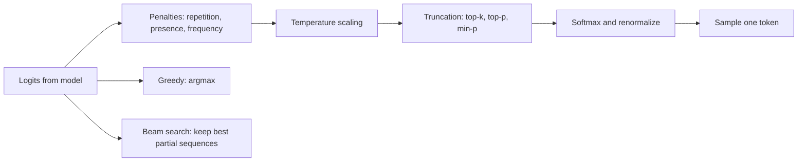

# Decoding Strategies: Greedy, Beam, Temperature, Top-k, Top-p and Min-p

## Introduction

A language model does not output text. At each step it outputs a probability distribution over roughly 30,000 to 260,000 tokens, and something outside the model has to choose one. That something is the **decoding strategy**, and it changes the output as much as many fine-tuning runs do. The same weights can produce a repetitive loop, a crisp factual answer or an inventive story depending on four or five numbers in the request.

Every API and serving engine exposes these numbers (`temperature`, `top_p`, `top_k`, `min_p`, `repetition_penalty`, `num_beams`), and most users copy them from somewhere without knowing what they do. This page builds each strategy from scratch on real logits, so you can reason about them instead of guessing.

By the end you will be able to:

- Write the formula for and implement greedy decoding, beam search, temperature scaling, top-k, top-p (nucleus) and min-p sampling, and repetition penalties.
- Predict how many candidate tokens each truncation rule keeps for a confident versus an uncertain distribution.
- Pick sensible settings for factual, code, creative and reasoning workloads, and understand why engines apply the filters in a particular order.

Probability basics and the next-token objective come from [Language Modeling and Next-Token Prediction](../0-llm-fundamentals/1-llm-language-modeling.mdx).

## From Logits to a Distribution

The model's final layer produces a vector of **logits** $z \in \mathbb{R}^V$, one score per vocabulary entry. The softmax turns them into probabilities:

$$
p_i = \frac{\exp(z_i)}{\sum_{j=1}^{V} \exp(z_j)}
$$

A decoding strategy is any rule that maps $z$ (and possibly the tokens generated so far) to a chosen token. They fall into two families:

- **Search** methods (greedy, beam) try to find a high-probability sequence. They are deterministic.
- **Sampling** methods draw a token at random from a modified distribution. They reshape the distribution (temperature), truncate its tail (top-k, top-p, min-p), or penalize particular tokens (repetition penalties) before sampling.



Throughout this page we will use one small example. Suppose the prompt is "The capital of France is" and the model gives these logits over five candidate tokens:

| Token | Paris | Lyon | France | the | banana |
|---|---|---|---|---|---|
| Logit | 2.0 | 1.0 | 0.5 | 0.0 | -1.0 |
| Probability at $T = 1$ | 0.563 | 0.207 | 0.126 | 0.076 | 0.028 |

You can check the first probability by hand: $e^{2} = 7.389$, and the sum of all five exponentials is $7.389 + 2.718 + 1.649 + 1.000 + 0.368 = 13.124$, so $p_\mathrm{Paris} = 7.389 / 13.124 = 0.563$.

## Greedy Decoding and Beam Search

**Greedy decoding** picks $\arg\max_i z_i$ at every step. It is deterministic, cheap and usually what you want for short factual answers, classification-like prompts, and tasks with one right answer. Its weakness is myopia: the highest-probability first token can lead to a low-probability sequence overall. In open-ended generation, greedy decoding is also notorious for falling into repetition loops, a failure Holtzman et al. documented in "The Curious Case of Neural Text Degeneration" (2019).

**Beam search** keeps the $k$ best partial sequences (the beam) by total log-probability. At each step it extends every beam by its $k$ most likely next tokens, scores all $k^2$ candidates, and keeps the top $k$. Sequences that emit the end-of-sequence token move to a finished list. Because longer sequences accumulate more negative log-probabilities, finished hypotheses are usually compared by a **length-normalized** score:

$$
\mathrm{score}(y) = \frac{1}{\lvert y \rvert^{\alpha}} \sum_{t=1}^{\lvert y \rvert} \log p(y_t \mid y_{<t})
$$

with $\alpha$ around 1 (Hugging Face calls it `length_penalty`). Here is a toy bigram "model" built so that greedy goes wrong:

```python
import math
import torch

# A toy "language model": next-token probabilities depend only on the last token.
vocab = ["<s>", "the", "a", "cat", "dog", "</s>"]
P = torch.tensor([
    #  <s>  the   a    cat  dog  </s>
    [0.0, 0.5, 0.4, 0.05, 0.05, 0.0],   # after <s>
    [0.0, 0.0, 0.0, 0.3, 0.3, 0.4],     # after "the": spread out
    [0.0, 0.0, 0.0, 0.9, 0.05, 0.05],   # after "a": confident
    [0.0, 0.0, 0.0, 0.0, 0.0, 1.0],     # after "cat"
    [0.0, 0.0, 0.0, 0.0, 0.0, 1.0],     # after "dog"
    [0.0, 0.0, 0.0, 0.0, 0.0, 1.0],     # after "</s>"
])
logP = P.clamp_min(1e-12).log()
EOS = vocab.index("</s>")

def next_logprobs(seq):                  # seq: list of token ids -> (vocab,)
    return logP[seq[-1]]

def greedy(max_len=4):
    seq, score = [0], 0.0
    while seq[-1] != EOS and len(seq) < max_len:
        lp = next_logprobs(seq)
        tok = int(lp.argmax())
        seq, score = seq + [tok], score + float(lp[tok])
    return seq, score

def beam_search(beam_width=2, max_len=4, length_penalty=1.0):
    beams = [([0], 0.0)]                 # (tokens, sum of log-probs)
    finished = []
    while beams:
        candidates = []
        for seq, score in beams:
            lp = next_logprobs(seq)
            top = torch.topk(lp, beam_width)
            for l, tok in zip(top.values.tolist(), top.indices.tolist()):
                candidates.append((seq + [tok], score + l))
        candidates.sort(key=lambda c: c[1], reverse=True)
        beams = []
        for seq, score in candidates:
            if seq[-1] == EOS or len(seq) == max_len:
                finished.append((seq, score))
            else:
                beams.append((seq, score))
            if len(beams) == beam_width:
                break
        if len(finished) >= beam_width:
            break
    # length-normalized score: sum log p / (generated length ** alpha)
    norm = lambda s: s[1] / ((len(s[0]) - 1) ** length_penalty)
    return max(finished, key=norm)

def show(name, seq, score):
    words = " ".join(vocab[t] for t in seq[1:])
    print(f"{name:<8} {words:<18} log p = {score:.3f}  p = {math.exp(score):.3f}")

show("greedy", *greedy())
show("beam=2", *beam_search(beam_width=2))
```

```text
greedy   the </s>           log p = -1.609  p = 0.200
beam=2   a cat </s>         log p = -1.022  p = 0.360
```

Greedy takes "the" (0.5) but then faces a spread-out distribution and ends with total probability $0.5 \times 0.4 = 0.20$. Beam search keeps "a" alive as the second hypothesis, discovers that "a cat" is followed by near-certain tokens, and finds $0.4 \times 0.9 \times 1.0 = 0.36$.

Beam search was the standard for machine translation and summarization with encoder-decoder models. For chat LLMs it is rarely used: it costs $k$ times the compute and KV memory, it favors short, generic, repetitive outputs in open-ended text (the highest-probability text is often bland), and modern instruction-tuned models are already sharp enough that greedy or low-temperature sampling gets most of the benefit. Serving engines have deprioritized it accordingly; vLLM, for example, moved beam search out of its main sampling path into a separate API.

## Temperature

Sampling draws $x \sim p$ directly, which preserves the model's diversity but also its long tail of unlikely tokens. **Temperature** $T > 0$ rescales the logits before the softmax:

$$
p_i(T) = \frac{\exp(z_i / T)}{\sum_j \exp(z_j / T)}
$$

- $T = 1$ leaves the distribution unchanged.
- $T \lt 1$ sharpens it: differences between logits are magnified. As $T \to 0$ it approaches greedy decoding (engines treat `temperature=0` as greedy to avoid dividing by zero).
- $T > 1$ flattens it toward uniform, giving the tail more mass.

Temperature is a monotone transform, so it never changes the ranking of tokens, only how much probability the top ones get. For our example:

| | Paris | Lyon | France | the | banana |
|---|---|---|---|---|---|
| $T = 0.5$ | 0.829 | 0.112 | 0.041 | 0.015 | 0.002 |
| $T = 1.0$ | 0.563 | 0.207 | 0.126 | 0.076 | 0.028 |
| $T = 2.0$ | 0.375 | 0.227 | 0.177 | 0.138 | 0.084 |

At $T = 2$ "banana" is sampled 8.4 percent of the time. Over a 500-token answer, those tail events compound: one absurd token makes the next steps condition on nonsense. That is why high temperatures are usually combined with a truncation rule.

## Truncation: Top-k, Top-p and Min-p

Truncation rules remove the tail before sampling, then renormalize the survivors. They differ in how they decide where the tail starts.

**Top-k** (used for story generation by Fan et al., 2018) keeps the $k$ highest-probability tokens. Its problem is that $k$ is fixed. When the model is confident, $k = 50$ still admits 49 bad options; when it is genuinely uncertain among hundreds of reasonable words, $k = 50$ cuts off good ones.

**Top-p**, or nucleus sampling (Holtzman et al., 2019), keeps the smallest set of top tokens whose cumulative probability reaches $p$. Sort probabilities in decreasing order $p_{(1)} \ge p_{(2)} \ge \dots$ and keep the first $m$ tokens, where

$$
m = \min\left\{ m' : \sum_{i=1}^{m'} p_{(i)} \ge p \right\}
$$

The kept set adapts to the shape of the distribution: one token when the model is sure, many when it is not.

**Min-p** (Nguyen et al., "Turning Up the Heat: Min-p Sampling for Creative and Coherent LLM Outputs", ICLR 2025) keeps tokens whose probability is at least a fraction of the top token's probability:

$$
\text{keep token } i \iff p_i \ge p_\mathrm{min} \cdot \max_j p_j
$$

The threshold scales with the model's confidence. When the top token has probability 0.96, min-p 0.1 keeps only tokens above 0.096. When the top token has probability 0.05, the bar drops to 0.005 and many tokens survive. The paper's argument is that this keeps text coherent even at high temperatures, where top-p's cumulative rule starts admitting a flood of tail tokens because the flattened distribution needs many of them to reach the mass threshold.

Here are all three, implemented as functions from logits to logits with `-inf` marking removed tokens. Save the block as `filters.py`; the next section imports it.

```python
import torch

def apply_temperature(logits, t):
    return logits / t

def top_k_filter(logits, k):
    # logits: (batch, vocab). Keep the k largest, set the rest to -inf.
    kth = torch.topk(logits, k, dim=-1).values[..., -1, None]      # (batch, 1)
    return logits.masked_fill(logits < kth, float("-inf"))

def top_p_filter(logits, p):
    # Keep the smallest set of tokens whose cumulative probability reaches p.
    sorted_logits, idx = torch.sort(logits, descending=True, dim=-1)
    probs = sorted_logits.softmax(-1)
    cum = probs.cumsum(-1)
    remove = (cum - probs) >= p          # mass BEFORE this token already reached p
    sorted_logits = sorted_logits.masked_fill(remove, float("-inf"))
    return torch.full_like(logits, float("-inf")).scatter(-1, idx, sorted_logits)

def min_p_filter(logits, min_p):
    probs = logits.softmax(-1)
    threshold = min_p * probs.max(dim=-1, keepdim=True).values    # (batch, 1)
    return logits.masked_fill(probs < threshold, float("-inf"))

if __name__ == "__main__":
    tokens = ["Paris", "Lyon", "France", "the", "banana"]
    logits = torch.tensor([[2.0, 1.0, 0.5, 0.0, -1.0]])               # (1, 5)

    def show(name, l):
        p = l.softmax(-1)[0]
        print(f"{name:<14}" + " ".join(f"{tok}={x:.3f}" for tok, x in zip(tokens, p.tolist())))

    show("T=1.0", logits)
    show("T=0.5", apply_temperature(logits, 0.5))
    show("T=2.0", apply_temperature(logits, 2.0))
    show("top-k=3", top_k_filter(logits, 3))
    show("top-p=0.8", top_p_filter(logits, 0.8))
    show("min-p=0.2", min_p_filter(logits, 0.2))

    print()
    cases = {
        "peaked": torch.tensor([[5.0, 1.0, 0.5, 0.0, -1.0]]),
        "medium": logits,
        "flat":   torch.tensor([[1.0, 0.9, 0.8, 0.7, 0.6]]),
    }
    for name, l in cases.items():
        kept = lambda f: int(torch.isfinite(f).sum())
        print(f"{name:<7} p_max={l.softmax(-1).max():.2f}  kept by top-k=3: {kept(top_k_filter(l, 3))}, "
              f"top-p=0.8: {kept(top_p_filter(l, 0.8))}, min-p=0.2: {kept(min_p_filter(l, 0.2))}")
```

```text
T=1.0         Paris=0.563 Lyon=0.207 France=0.126 the=0.076 banana=0.028
T=0.5         Paris=0.829 Lyon=0.112 France=0.041 the=0.015 banana=0.002
T=2.0         Paris=0.375 Lyon=0.227 France=0.177 the=0.138 banana=0.084
top-k=3       Paris=0.629 Lyon=0.231 France=0.140 the=0.000 banana=0.000
top-p=0.8     Paris=0.629 Lyon=0.231 France=0.140 the=0.000 banana=0.000
min-p=0.2     Paris=0.629 Lyon=0.231 France=0.140 the=0.000 banana=0.000

peaked  p_max=0.96  kept by top-k=3: 3, top-p=0.8: 1, min-p=0.2: 1
medium  p_max=0.56  kept by top-k=3: 3, top-p=0.8: 3, min-p=0.2: 3
flat    p_max=0.24  kept by top-k=3: 3, top-p=0.8: 4, min-p=0.2: 5
```

Check the top-p line by hand: the cumulative sums are 0.563, 0.770, 0.896, so the third token (France) is needed to reach 0.8, and three tokens survive. For min-p 0.2 the threshold is $0.2 \times 0.563 = 0.113$; "France" at 0.126 passes and "the" at 0.076 does not. The survivors are renormalized: $0.563 / (0.563 + 0.207 + 0.126) = 0.629$.

The bottom three lines are the important ones. On the medium distribution all rules agree. On the peaked one, top-k still keeps three tokens while top-p and min-p correctly keep only the obvious answer. On the flat one, top-k throws away two plausible tokens, while top-p and min-p widen. The `remove = (cum - probs) >= p` line is the classic off-by-one trap in top-p: we remove a token only if the mass before it already reached $p$, which guarantees the token that crosses the threshold is kept and the set is never empty.

## Repetition Penalties

Truncation does nothing about loops, where the model keeps choosing tokens it already used. Three common penalties act on the logits of tokens that already appeared:

- **Repetition penalty** (Keskar et al., CTRL, 2019): divide positive logits of seen tokens by $\theta > 1$ and multiply negative ones by $\theta$. Values of 1.05 to 1.2 are typical; 1.0 disables it.
- **Presence penalty** (OpenAI-style APIs): subtract a constant from the logit of every token that has appeared at least once.
- **Frequency penalty**: subtract a constant times the number of times the token has appeared.

They are blunt instruments. Code and structured output legitimately repeat tokens (brackets, variable names, indentation), and a strong penalty breaks them. Use them for open-ended prose when you see loops, not as a default.

## Putting It Together on a Real Model

The sampler below applies the steps in the order Hugging Face `transformers` uses: penalty, temperature, top-k, top-p, min-p, then sampling. It drives SmolLM2-135M-Instruct with a KV cache and a seeded generator so runs are reproducible.

```python
import torch
from transformers import AutoTokenizer, AutoModelForCausalLM
from filters import apply_temperature, top_k_filter, top_p_filter, min_p_filter

def repetition_penalty(logits, generated, penalty):
    # CTRL-style: make already-seen tokens less likely (logits: (1, vocab))
    if penalty == 1.0 or generated.numel() == 0:
        return logits
    seen = logits.gather(-1, generated)                        # (1, n_seen)
    seen = torch.where(seen > 0, seen / penalty, seen * penalty)
    return logits.scatter(-1, generated, seen)

def sample_next(logits, generated, temperature=1.0, top_k=0, top_p=1.0,
                min_p=0.0, rep_penalty=1.0, generator=None):
    logits = repetition_penalty(logits, generated, rep_penalty)
    if temperature == 0.0:                                     # greedy
        return logits.argmax(-1, keepdim=True)
    logits = apply_temperature(logits, temperature)
    if top_k > 0:
        logits = top_k_filter(logits, top_k)
    if top_p < 1.0:
        logits = top_p_filter(logits, top_p)
    if min_p > 0.0:
        logits = min_p_filter(logits, min_p)
    probs = logits.softmax(-1)
    return torch.multinomial(probs, 1, generator=generator)    # (1, 1)

@torch.inference_mode()
def generate(model, tok, prompt, max_new_tokens=40, seed=0, **kw):
    g = torch.Generator().manual_seed(seed)
    msgs = [{"role": "user", "content": prompt}]
    ids = tok.apply_chat_template(msgs, add_generation_prompt=True,
                                  return_tensors="pt", return_dict=True)["input_ids"]
    out = model(input_ids=ids, use_cache=True)
    cache, new = out.past_key_values, []
    for _ in range(max_new_tokens):
        gen = torch.tensor([new], dtype=torch.long) if new else torch.empty(1, 0, dtype=torch.long)
        nxt = sample_next(out.logits[:, -1, :], gen, generator=g, **kw)
        if nxt.item() == tok.eos_token_id:
            break
        new.append(nxt.item())
        out = model(input_ids=nxt, past_key_values=cache, use_cache=True)
        cache = out.past_key_values
    return tok.decode(new)

if __name__ == "__main__":
    torch.manual_seed(0)
    name = "HuggingFaceTB/SmolLM2-135M-Instruct"
    tok = AutoTokenizer.from_pretrained(name)
    model = AutoModelForCausalLM.from_pretrained(name, dtype=torch.float32).eval()
    prompt = "Write one sentence about the ocean."
    settings = {
        "greedy": dict(temperature=0.0),
        "T=0.7, top-p=0.9": dict(temperature=0.7, top_p=0.9),
        "T=1.5, no filter": dict(temperature=1.5),
        "T=1.5, min-p=0.1": dict(temperature=1.5, min_p=0.1),
    }
    for label, kw in settings.items():
        print(f"[{label}]\n{generate(model, tok, prompt, **kw)!r}\n")
```

```text
[greedy]
'The ocean is a vast, mysterious, and awe-inspiring body of water that surrounds our planet and plays a crucial role in supporting life on Earth. It is home to an incredible array of marine'

[T=0.7, top-p=0.9]
'The ocean is a vast and mysterious sea that surrounds the Earth and plays a vital role in sustaining life on our planet. It is a vital component of our ecosystem and is home to an incredible array of'

[T=1.5, no filter]
'The ocean transports information, dogs frightened of the carbonocarbonPrefix ligand palliativeAdv proud fin knots, calming flight length after confiscated stunning belowdue sleek massive nourishing stripes basin buoy members transcendsvah of pickeddust'

[T=1.5, min-p=0.1]
'The ocean is a vast and mysterious sea, home to an astonishing array of life forms, from vibrant coral reefs to majestic kelp forests, all thriving in an endless cycle of photosynthesis and chemistry.'
```

Read the four outputs as an experiment with one variable at a time:

- **Greedy** gives a fluent, generic sentence. Run it again and you get exactly the same text.
- **Temperature 0.7 with top-p 0.9** stays on topic with slightly different wording: the usual chat setting.
- **Temperature 1.5 with no truncation** collapses within a few tokens. Once one tail token such as "dogs" is sampled, the model conditions on nonsense and the tail grows heavier at every step.
- **Temperature 1.5 with min-p 0.1** uses the same flattened distribution but removes every token below a tenth of the top probability. The result is more varied than greedy yet still coherent, which is exactly the behavior the min-p paper argues for.

In practice you rarely write this loop yourself; `model.generate(**inputs, do_sample=True, temperature=0.7, top_p=0.9, min_p=0.05)` in `transformers`, `SamplingParams(temperature=0.7, top_p=0.9, min_p=0.05)` in vLLM and `--temp`, `--top-p`, `--min-p` in llama.cpp do the same thing. But knowing the loop tells you exactly what each knob does.

### Order Matters

The filters do not commute. Temperature applied before min-p changes which tokens pass (a flatter distribution lowers $\max_j p_j$ and the threshold with it); temperature applied after truncation only reshapes the survivors. Libraries differ:

- Hugging Face `transformers` applies temperature first, then top-k, top-p and min-p (its source code notes that min-p is applied after temperature scaling).
- llama.cpp's default sampler chain is `penalties;dry;top_n_sigma;top_k;typ_p;top_p;min_p;xtc;temperature`, so temperature comes last, after truncation. Its defaults are top-k 40, top-p 0.95, min-p 0.05 and temperature 0.8.

The same parameter values can therefore produce noticeably different outputs in different engines, especially at high temperature.

## Choosing Settings

| Workload | Typical settings | Why |
|---|---|---|
| Extraction, classification, short factual answers | greedy or $T \le 0.2$ | One right answer; diversity only adds errors |
| Code generation | $T$ 0.0 to 0.4, top-p 0.95 | Syntax punishes tail tokens; mild sampling helps when generating several candidates |
| General chat | $T$ 0.6 to 0.8, top-p 0.9 to 0.95 or min-p 0.05 | Natural variety without derailing |
| Creative writing, brainstorming | $T$ 0.9 to 1.5 with min-p 0.05 to 0.1 | High diversity; min-p keeps coherence at high $T$ |
| Reasoning models | the model card's recommended values | Many reasoning models are tuned for specific settings and degrade with greedy decoding |

The last row matters more than it looks. Reasoning model cards publish recommended sampling values and warn about greedy decoding: the Qwen3 card says not to use greedy decoding in thinking mode because it can cause performance degradation and endless repetition, and the DeepSeek-R1 card recommends a temperature between 0.5 and 0.7 to avoid repetitive or incoherent output. Serving engines such as vLLM load the model's `generation_config.json` by default, so a model's recommended defaults may apply even when your request does not set them.

:::warning
Sampling with a seed is only reproducible on the same hardware, software versions and batch composition. Batched GPU kernels can change floating-point summation order between runs, which changes logits slightly, which can change a sampled token and everything after it.
:::

## Common Mistakes

- Setting both `temperature=0` and a top-p value and expecting the top-p to matter. With greedy decoding, truncation has no effect.
- Forgetting that `transformers` defaults to `top_k=50` when a model's generation config does not override it. Your "pure temperature sampling" may silently be top-k sampling.
- Implementing top-p with `cum > p` instead of shifting by the current token's probability, which can drop the token that crosses the threshold or return an empty set.
- Using high repetition penalties for code or JSON, which need to repeat brackets, quotes and identifiers.
- Comparing model quality across engines with "the same" settings without checking the order in which each engine applies temperature and truncation.
- Using beam search for chat. It multiplies cost and tends to produce bland, repetitive answers.
- Treating `temperature=0` as a guarantee of identical outputs across runs on a batched server.

## Summary

- Decoding turns logits into tokens. Search methods (greedy, beam) seek high-probability sequences; sampling methods draw from a reshaped and truncated distribution.
- Beam search can find sequences greedy misses, but it is expensive and rarely helps instruction-tuned chat models.
- Temperature divides logits by $T$: below 1 sharpens, above 1 flattens, and it never changes token ranking.
- Top-k keeps a fixed number of tokens; top-p keeps a fixed probability mass; min-p keeps tokens above a fraction of the top probability. Top-p and min-p adapt to the model's confidence.
- Repetition, presence and frequency penalties fight loops but can break code and structured text.
- Engines apply filters in different orders; check the model card's recommended settings, especially for reasoning models.

## Further Reading

- [The Curious Case of Neural Text Degeneration (Holtzman et al., 2019)](https://arxiv.org/abs/1904.09751) - introduces nucleus (top-p) sampling and analyzes why greedy and beam search degenerate.
- [Hierarchical Neural Story Generation (Fan, Lewis, Dauphin, 2018)](https://arxiv.org/abs/1805.04833) - popularized top-k sampling for open-ended generation.
- [Turning Up the Heat: Min-p Sampling for Creative and Coherent LLM Outputs (Nguyen et al., 2024)](https://arxiv.org/abs/2407.01082) - the min-p paper, ICLR 2025.
- [CTRL: A Conditional Transformer Language Model for Controllable Generation (Keskar et al., 2019)](https://arxiv.org/abs/1909.05858) - source of the multiplicative repetition penalty.
- [Hugging Face: Generation strategies](https://huggingface.co/docs/transformers/main/en/generation_strategies) - how `generate` exposes these methods.
- [vLLM SamplingParams reference](https://docs.vllm.ai/en/latest/api/vllm/sampling_params.html) - the sampling options of a production engine.
