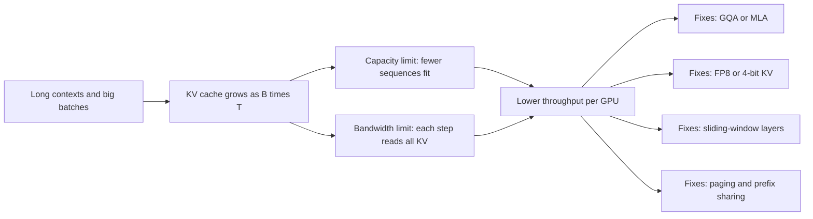

# The KV Cache

## Introduction

Every token a model generates needs attention over every token before it. Without any reuse, generating the 1,000th token would recompute the keys and values of the 999 previous tokens, in every layer, even though nothing about them has changed. The **KV cache** stores those keys and values the first time they are computed so that each decode step only processes the one new token.

The cache is the single most important data structure in LLM serving. It turns generation from quadratic to linear work, but it also becomes the dominant consumer of GPU memory and memory bandwidth as contexts get long and batches get large. Most of the serving tricks you will meet later (PagedAttention, prefix caching, grouped-query and latent attention, KV quantization, sliding-window layers) are ways of storing, sharing or shrinking this one structure.

After this page you will be able to:

- Prove why caching keys and values is exact, not an approximation.
- Implement a KV cache for a causal attention layer and verify it against full recomputation.
- Compute the cache size of any model from its `config.json`, and use that to size a deployment.
- Explain why the cache, not the weights, limits batch size and long-context throughput.

You should know scaled dot-product attention and causal masking from [Causal Masking and Autoregressive Decoding](../2-llm-attention/3-llm-causal-masking.mdx) and the prefill/decode split from [How LLM Inference Works](./0-llm-inference-overview.mdx).

## Why Caching Keys and Values Is Exact

Consider one attention layer. Its input at position $i$ is a hidden vector $x_i$ of size $d_\mathrm{model}$. The layer projects it into a query, a key and a value:

$$
q_i = x_i W_Q, \qquad k_i = x_i W_K, \qquad v_i = x_i W_V
$$

With a causal mask, the output at position $t$ only looks at positions $1$ to $t$:

$$
o_t = \sum_{i=1}^{t} \alpha_{t,i}\, v_i, \qquad \alpha_{t,i} = \frac{\exp\!\left(q_t \cdot k_i / \sqrt{d_h}\right)}{\sum_{j=1}^{t} \exp\!\left(q_t \cdot k_j / \sqrt{d_h}\right)}
$$

Now ask: when we append token $t+1$, does $k_i$ or $v_i$ for some $i \le t$ change? The vector $x_i$ in the first layer is just the embedding of token $i$ (plus its position), so it does not change. In layer 2, $x_i$ is layer 1's output at position $i$, which by the equation above depends only on positions $1$ to $i$. By induction over layers, **the hidden state at position $i$ in every layer depends only on tokens $1$ to $i$**. Appending new tokens cannot change it, so $k_i$ and $v_i$ are fixed forever once computed.

That is the whole argument. At step $t+1$ we only need:

1. The new token's $q_{t+1}$, $k_{t+1}$, $v_{t+1}$ in each layer (one row of projections).
2. All previous $k_i$ and $v_i$, which we read from the cache.

We never need old queries, because no future output depends on $q_i$ for $i \le t$. That is why it is a K-V cache and not a Q-K-V cache.

:::note
The argument relies on causality. Bidirectional encoders like BERT cannot use a KV cache for generation because every position's representation depends on the whole sequence, including tokens added later.
:::

### Work Saved

For a prompt of length $P$ and $G$ generated tokens, recomputing everything processes

$$
\sum_{s=0}^{G-1} (P + s) = GP + \frac{G(G-1)}{2}
$$

positions through every linear layer, while the cached version processes $P + G$ positions in total. For $P = 16$ and $G = 512$ that is 138,944 positions versus 528, a factor of about 263 fewer passes through the projection and MLP weights. Attention itself still has to look at all $t$ cached keys at step $t$, so its total cost stays quadratic in sequence length, but the per-step cost drops from "redo the whole model on $t$ tokens" to "one token through the model plus a dot product with $t$ keys".

## Implementing a KV Cache from Scratch

The layer below accepts an optional `cache` dictionary. On each call it computes K and V for the new positions, concatenates them onto whatever is already cached, and attends the new queries against all keys. The only subtle part is the mask: a new query at absolute position `T_past + i` may see keys `0` through `T_past + i`, which is a lower-triangular mask shifted right by `T_past`.

```python
import time
import torch
import torch.nn as nn
import torch.nn.functional as F

torch.manual_seed(0)

class CausalSelfAttention(nn.Module):
    def __init__(self, d_model=64, n_heads=4):
        super().__init__()
        self.h, self.dh = n_heads, d_model // n_heads
        self.qkv = nn.Linear(d_model, 3 * d_model, bias=False)
        self.out = nn.Linear(d_model, d_model, bias=False)

    def forward(self, x, cache=None):
        # x: (B, T_new, d_model); cache: dict with "k", "v" of shape (B, h, T_past, dh)
        B, T, _ = x.shape
        q, k, v = self.qkv(x).split(x.shape[-1], dim=-1)
        q, k, v = (t.view(B, T, self.h, self.dh).transpose(1, 2) for t in (q, k, v))
        T_past = 0
        if cache is not None:
            if "k" in cache:
                T_past = cache["k"].shape[2]
                k = torch.cat([cache["k"], k], dim=2)       # (B, h, T_past + T, dh)
                v = torch.cat([cache["v"], v], dim=2)
            cache["k"], cache["v"] = k, v
        # new query i (absolute position T_past + i) may attend to keys 0..T_past + i
        T_total = k.shape[2]
        mask = torch.ones(T, T_total, dtype=torch.bool).tril(diagonal=T_past)
        y = F.scaled_dot_product_attention(q, k, v, attn_mask=mask)  # (B, h, T, dh)
        return self.out(y.transpose(1, 2).reshape(B, T, -1))

if __name__ == "__main__":
    attn = CausalSelfAttention().eval()
    x = torch.randn(1, 10, 64)                                   # a sequence of 10 positions

    with torch.no_grad():
        full = attn(x)                                           # all 10 positions at once
        cache = {}
        prefill = attn(x[:, :6], cache)                          # first 6 positions
        steps = [attn(x[:, t:t + 1], cache) for t in range(6, 10)]  # then 1 at a time
        incremental = torch.cat([prefill] + steps, dim=1)

    print("cache k shape:", tuple(cache["k"].shape))
    print("max abs difference:", (full - incremental).abs().max().item())
```

```text
cache k shape: (1, 4, 10, 16)
max abs difference: 1.4901161193847656e-07
```

The cached computation, a prefill of 6 positions followed by 4 single-token steps, matches the full computation to within floating-point rounding. Notice that the same code handles prefill (many new tokens, `T_past = 0`) and decode (one new token, `T_past > 0`). With `T_past = 0` the mask reduces to the usual causal triangle.

### Measuring the Speedup

Save the block above as `a_kvcache.py`, then stack four such layers with MLPs into a tiny language model and generate greedily with and without the cache:

```python
import time
import torch
import torch.nn as nn
from a_kvcache import CausalSelfAttention

torch.manual_seed(0)
torch.set_num_threads(4)

class TinyLM(nn.Module):
    def __init__(self, vocab=1000, d=256, n_layers=4, n_heads=8):
        super().__init__()
        self.emb = nn.Embedding(vocab, d)
        self.attn = nn.ModuleList(CausalSelfAttention(d, n_heads) for _ in range(n_layers))
        self.mlp = nn.ModuleList(nn.Sequential(nn.Linear(d, 4 * d), nn.GELU(), nn.Linear(4 * d, d))
                                 for _ in range(n_layers))
        self.head = nn.Linear(d, vocab, bias=False)

    def forward(self, ids, caches=None):                     # ids: (B, T_new)
        x = self.emb(ids)
        for i, (a, m) in enumerate(zip(self.attn, self.mlp)):
            x = x + a(x, None if caches is None else caches[i])
            x = x + m(x)
        return self.head(x)                                  # (B, T_new, vocab)

@torch.no_grad()
def generate(model, prompt, n_new, use_cache):
    ids = prompt
    caches = [dict() for _ in model.attn] if use_cache else None
    logits = model(ids, caches)
    for _ in range(n_new):
        nxt = logits[:, -1:].argmax(-1)                      # (B, 1)
        ids = torch.cat([ids, nxt], dim=1)
        logits = model(nxt, caches) if use_cache else model(ids)
    return ids

model = TinyLM().eval()
prompt = torch.randint(0, 1000, (1, 16))
generate(model, prompt, 8, use_cache=False); generate(model, prompt, 8, use_cache=True)  # warm-up
for n_new in [64, 256, 512]:
    t0 = time.perf_counter(); a = generate(model, prompt, n_new, use_cache=False); t_no = time.perf_counter() - t0
    t0 = time.perf_counter(); b = generate(model, prompt, n_new, use_cache=True); t_kv = time.perf_counter() - t0
    print(f"{n_new:>3} new tokens: no cache {t_no:6.2f} s, KV cache {t_kv:5.2f} s, "
          f"speedup {t_no / t_kv:4.1f}x, same tokens: {torch.equal(a, b)}")
```

```text
 64 new tokens: no cache   0.30 s, KV cache  0.09 s, speedup  3.2x, same tokens: True
256 new tokens: no cache   2.88 s, KV cache  0.37 s, speedup  7.7x, same tokens: True
512 new tokens: no cache  14.96 s, KV cache  1.13 s, speedup 13.3x, same tokens: True
```

The outputs are token-for-token identical, and the gap widens with length, as the quadratic sum predicts. (Timings came from a busy shared machine; expect your exact ratios to differ, but the trend will not.)

Real implementations avoid `torch.cat` on every step, because concatenation copies the whole cache each time. They preallocate a buffer for the maximum length and write the new K and V into the next slot, or, as in vLLM, store the cache in fixed-size blocks; see [PagedAttention](./3-llm-paged-attention.mdx).

## The Memory Formula

Each cached token stores one key vector and one value vector per KV head per layer. For a model with $L$ layers, $n_\mathrm{kv}$ key-value heads of size $d_h$, stored with $b$ bytes per number:

$$
\mathrm{bytes\ per\ token} = 2 \cdot L \cdot n_\mathrm{kv} \cdot d_h \cdot b
$$

The leading 2 counts K and V. For a batch of $B$ sequences of length $T$:

$$
M_\mathrm{KV} = 2 \cdot L \cdot n_\mathrm{kv} \cdot d_h \cdot b \cdot T \cdot B
$$

All the inputs are in the model's `config.json`. Here is the relevant part for Llama 3.1 8B:

```json
{
  "hidden_size": 4096,
  "num_attention_heads": 32,
  "num_hidden_layers": 32,
  "num_key_value_heads": 8,
  "head_dim": 128,
  "max_position_embeddings": 131072
}
```

Plugging in BF16 ($b = 2$): $2 \cdot 32 \cdot 8 \cdot 128 \cdot 2 = 131{,}072$ bytes, exactly 128 KiB per token. At the full 131,072-token context that is $131{,}072 \times 128\ \mathrm{KiB} = 16\ \mathrm{GiB}$ for a single sequence, as large as the model's weights.

Notice that `num_key_value_heads` (8) is smaller than `num_attention_heads` (32). That is grouped-query attention: four query heads share each KV head, which cuts the cache by four times. It is explained in [Multi-Query and Grouped-Query Attention](../2-llm-attention/5-llm-mqa-gqa.mdx).

The script below applies the formula to several real models. Every number comes from the model's `config.json`.

```python
# KV cache bytes per token = 2 (K and V) * layers * kv_heads * head_dim * bytes_per_value
models = {
    # name: (layers, kv_heads, head_dim)   values from each model's config.json
    "SmolLM2-135M":        (30, 3, 64),
    "Llama-3.1-8B":        (32, 8, 128),
    "Qwen3-8B":            (36, 8, 128),
    "Llama-3.1-70B":       (80, 8, 128),
    "70B if it used MHA":  (80, 64, 128),
}
GiB, KiB = 2**30, 2**10
print(f"{'model':<20}{'per token':>12}{'8k ctx':>10}{'128k ctx':>11}")
for name, (L, kv, dh) in models.items():
    per_tok = 2 * L * kv * dh * 2                       # BF16 = 2 bytes
    print(f"{name:<20}{per_tok / KiB:>8.1f} KiB{per_tok * 8192 / GiB:>7.2f} GiB"
          f"{per_tok * 131072 / GiB:>8.1f} GiB")

# DeepSeek-V3 MLA caches one compressed latent (512) plus a shared RoPE key (64) per layer
mla = 61 * (512 + 64) * 2
print(f"{'DeepSeek-V3 (MLA)':<20}{mla / KiB:>8.1f} KiB{mla * 8192 / GiB:>7.2f} GiB{mla * 131072 / GiB:>8.1f} GiB")

# How many concurrent 8k-token sequences fit next to Llama 3.1 8B on an 80 GB GPU?
weights = 8.03e9 * 2
budget = 80e9 * 0.9 - weights                            # leave 10% for activations etc.
per_seq = 2 * 32 * 8 * 128 * 2 * 8192
print(f"\nLlama-3.1-8B on 80 GB: KV budget {budget / 1e9:.1f} GB -> {int(budget // per_seq)} sequences of 8k tokens")
```

```text
model                  per token    8k ctx   128k ctx
SmolLM2-135M            22.5 KiB   0.18 GiB     2.8 GiB
Llama-3.1-8B           128.0 KiB   1.00 GiB    16.0 GiB
Qwen3-8B               144.0 KiB   1.12 GiB    18.0 GiB
Llama-3.1-70B          320.0 KiB   2.50 GiB    40.0 GiB
70B if it used MHA    2560.0 KiB  20.00 GiB   320.0 GiB
DeepSeek-V3 (MLA)       68.6 KiB   0.54 GiB     8.6 GiB
```

```text
Llama-3.1-8B on 80 GB: KV budget 55.9 GB -> 52 sequences of 8k tokens
```

Several lessons are visible in the table:

- **Architecture decides the cache, not parameter count.** DeepSeek-V3 has 671 billion parameters but caches less per token than Llama 3.1 8B, because Multi-Head Latent Attention stores a 512-dimensional compressed latent plus a 64-dimensional shared RoPE key per layer instead of full per-head keys and values (see [Multi-Head Latent Attention](../2-llm-attention/6-llm-mla.mdx)).
- **GQA is worth 8 times here.** Llama 3.1 70B with full multi-head attention would need 2.5 MiB per token, making a single 128k context 320 GiB, larger than four H100s.
- **Qwen3-8B's native window is 40,960 tokens** (`max_position_embeddings` in its config); the 128k column assumes you enable YaRN scaling as its model card describes. The cost per token does not change with the scaling.

### Verifying the Formula Against Hugging Face

The `transformers` library returns the cache from a forward pass. Its size should match the formula byte for byte:

```python
import torch
from transformers import AutoModelForCausalLM, AutoTokenizer

torch.manual_seed(0)
name = "HuggingFaceTB/SmolLM2-135M-Instruct"
tok = AutoTokenizer.from_pretrained(name)
model = AutoModelForCausalLM.from_pretrained(name, dtype=torch.bfloat16).eval()
cfg = model.config

ids = tok("The KV cache stores keys and values for every past token.", return_tensors="pt").input_ids
with torch.inference_mode():
    out = model(input_ids=ids, use_cache=True)
cache = out.past_key_values                       # a transformers DynamicCache
T = ids.shape[1]
layer0 = cache.layers[0]
print("cache type:", type(cache).__name__, "| layers:", len(cache.layers))
print("layer 0 keys:", tuple(layer0.keys.shape), layer0.keys.dtype)   # (batch, kv_heads, T, head_dim)

measured = sum(l.keys.numel() * l.keys.element_size() + l.values.numel() * l.values.element_size()
               for l in cache.layers)
formula = 2 * cfg.num_hidden_layers * cfg.num_key_value_heads * cfg.head_dim * 2 * T
print(f"tokens: {T}, measured {measured} bytes, formula {formula} bytes")
```

```text
cache type: DynamicCache | layers: 30
layer 0 keys: (1, 3, 13, 64) torch.bfloat16
tokens: 13, measured 299520 bytes, formula 299520 bytes
```

The cache layout is `(batch, kv_heads, seq_len, head_dim)` per layer, with 3 KV heads even though the model has 9 query heads: SmolLM2 also uses GQA. `DynamicCache` grows by concatenation as in our implementation. For `torch.compile` and CUDA graphs, `transformers` also offers a preallocated static cache, selected with `model.generate(..., cache_implementation="static")`, which keeps tensor shapes fixed across steps.

## Why the Cache Dominates Long-Context Serving

The weights are a fixed cost: you pay for them once per GPU no matter how many users you serve. The KV cache is a variable cost proportional to batch size times context length. Past a modest load, the variable cost is the larger one, in two separate ways.

### Capacity

The previous script showed that an 80 GB GPU serving Llama 3.1 8B has room for about 52 concurrent 8k-token sequences. Since decode throughput grows almost linearly with batch size (the [overview](./0-llm-inference-overview.mdx) showed the weights are shared), the KV budget directly caps throughput. Double the context and you halve the batch, and therefore roughly halve tokens per second per GPU.

### Bandwidth

At every decode step each sequence reads its entire cache once, to compute attention for the new query. Unlike the weights, this read is not shared across the batch. The bytes read per step are

$$
\mathrm{Bytes}_\mathrm{step} = \underbrace{2N}_{\text{weights}} + \underbrace{B \cdot T \cdot 2 L n_\mathrm{kv} d_h b}_{\text{KV cache}}
$$

For Llama 3.1 8B the KV term equals the weight term when $B \cdot T \cdot 128\ \mathrm{KiB} = 16\ \mathrm{GB}$, that is when the batch holds about 122,000 tokens in total, for example 30 users at 4k tokens each. Beyond that, attention reads dominate, and because each sequence's KV is private, larger batches stop helping: the arithmetic intensity of attention during decode is only a few FLOPs per byte regardless of batch size: each cached number is used once by each query head that shares it, so the intensity is roughly the GQA group size (4 for Llama 3.1 8B).

This is why GQA and MLA exist, why serving engines quantize the cache to FP8 (halving both capacity and bandwidth costs, see [KV Cache Compression and Quantization](../11-llm-quantization/4-llm-kv-cache-quantization.mdx)), and why some models make most layers local. Gemma 3, for example, sets `sliding_window: 1024` with `sliding_window_pattern: 6` in its config: five of every six layers only keep the last 1,024 tokens, so only one layer in six pays for the full context.



## Worked Scenario: Sizing a 70B Deployment

You plan to serve Llama 3.1 70B in BF16 on one node with four 80 GB H100s, using tensor parallelism (each GPU holds a quarter of every layer, including a quarter of the KV heads: 2 of the 8).

1. **Weights:** about 70.6 billion parameters times 2 bytes is 141 GB, or about 35 GB per GPU.
2. **Usable memory:** a serving engine like vLLM claims a fraction of GPU memory set by `--gpu-memory-utilization` (0.92 in the current docs); say 0.9 to leave room for activations and CUDA graphs. That is 288 GB in total.
3. **KV budget:** 288 minus 141 leaves about 147 GB.
4. **Tokens that fit:** 147 GB divided by 320 KiB per token is about 448,000 cached tokens across the node.
5. **Concurrency:** at a 32k context per user that is about 13 simultaneous users; at a typical chat length of 4k tokens it is about 109.

Now try the levers. FP8 KV cache halves the per-token cost to 160 KiB and doubles both concurrency numbers. FP8 weights free another 70 GB, adding roughly 215,000 more tokens of BF16 cache. Neither change touches the model architecture, which is why both are among the first settings production deployments enable. And if your users share a long system prompt, prefix caching (next page) stores it once instead of once per user.

## Common Mistakes

- Forgetting the factor of 2 for keys and values, or using `num_attention_heads` instead of `num_key_value_heads` in the formula. The second mistake overestimates GQA models by 4 to 8 times.
- Assuming `head_dim = hidden_size / num_attention_heads`. Many modern configs (Qwen3, Gemma 3) set `head_dim` explicitly to a different value; always read it from the config.
- Measuring memory with a short prompt and extrapolating linearly to a batch at full context without accounting for fragmentation in a naive contiguous cache.
- Concatenating tensors to grow the cache in a production loop. Each `torch.cat` copies the whole cache; preallocate or page instead.
- Reusing a cache after changing earlier tokens (editing the prompt, applying a different chat template). The cache is only valid for an exact prefix of the same tokens.
- Forgetting that positions matter: keys are cached after RoPE is applied, so a cached prefix can only be reused at the same positions.

## Summary

- Because of the causal mask, each position's keys and values depend only on earlier tokens, so they can be computed once and cached exactly.
- The cache turns each decode step into one token through the model plus attention over the cached keys, saving a factor that grows with sequence length.
- Cache size per token is $2 \cdot L \cdot n_\mathrm{kv} \cdot d_h \cdot b$: 128 KiB for Llama 3.1 8B, 320 KiB for Llama 3.1 70B, about 69 KiB for DeepSeek-V3 with MLA, all in BF16.
- The KV cache, not the weights, limits how many sequences fit on a GPU and therefore caps decode throughput.
- At long contexts KV reads exceed weight reads per step, and those reads do not amortize over the batch.
- GQA, MLA, sliding-window layers, KV quantization, paging and prefix sharing all attack the same structure.

## Further Reading

- [Efficient Memory Management for Large Language Model Serving with PagedAttention (Kwon et al., 2023)](https://arxiv.org/abs/2309.06180) - shows KV cache memory as the bottleneck for batch size.
- [Efficiently Scaling Transformer Inference (Pope et al., 2022)](https://arxiv.org/abs/2211.05102) - Google's analysis of memory, latency and partitioning for large-model decoding.
- [GQA: Training Generalized Multi-Query Transformer Models from Multi-Head Checkpoints (Ainslie et al., 2023)](https://arxiv.org/abs/2305.13245) - grouped-query attention, the standard way to shrink the cache.
- [DeepSeek-V2: A Strong, Economical, and Efficient Mixture-of-Experts Language Model (DeepSeek-AI, 2024)](https://arxiv.org/abs/2405.04434) - introduces Multi-Head Latent Attention.
- [Hugging Face Transformers: KV cache strategies](https://huggingface.co/docs/transformers/main/en/kv_cache) - DynamicCache, static caches, offloading and quantized caches.
- [Llama 3.1 8B config.json](https://huggingface.co/meta-llama/Llama-3.1-8B/blob/main/config.json) - the source of the numbers used above (gated; requires accepting the license).
