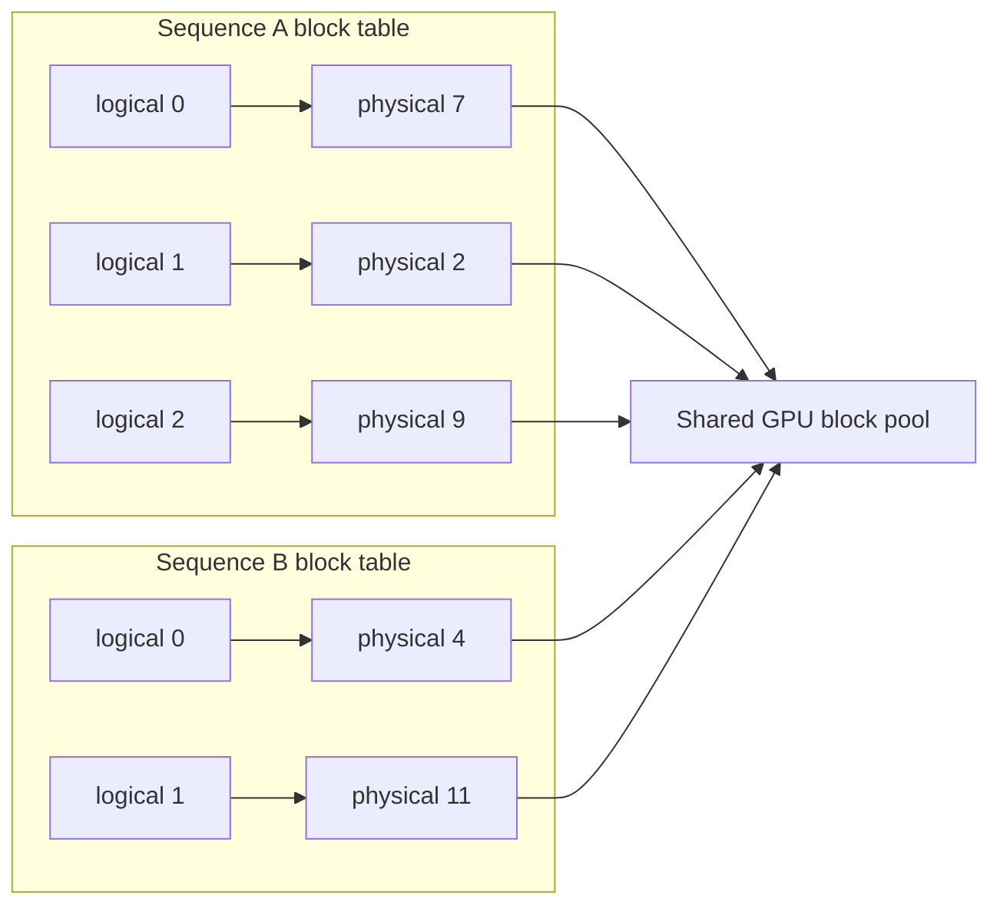
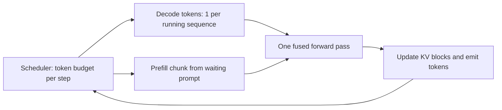

# PagedAttention, Continuous Batching and Prefix Caching

## Introduction

The [KV Cache](./2-llm-kv-cache.mdx) page ended with a budget: an 80 GB GPU running Llama 3.1 8B has room for roughly 420,000 cached tokens, and decode throughput rises almost linearly with the number of sequences you can keep in flight. The engineering question for a serving system is therefore simple to state: how do you keep as many useful tokens in that budget as possible, and keep the GPU stepping all of them every iteration?

Early serving systems did badly on both counts. They reserved a contiguous slab of KV memory per request sized for the maximum possible output, wasting most of it, and they ran batches as fixed groups that waited for their slowest member. Three ideas fixed this and now underlie every production engine:

- **PagedAttention** (Kwon et al., SOSP 2023, the vLLM paper) stores the KV cache in small fixed-size blocks, like pages of virtual memory, so a sequence only holds the memory it actually uses and blocks can be shared.
- **Continuous batching** (iteration-level scheduling, from Orca by Yu et al., OSDI 2022) lets requests join and leave the running batch after every decode step.
- **Prefix caching** (vLLM's automatic prefix caching and SGLang's RadixAttention, Zheng et al., 2023) keeps KV blocks of finished requests around so a later request with the same prefix skips that part of prefill.

Together with **chunked prefill**, these turn a GPU from a device that serves a few requests at a time into one that serves hundreds. On this page you will implement a toy version of each and see the numbers.

## Why Contiguous KV Memory Wastes Space

Suppose an engine allows outputs up to 4,096 tokens. When a request arrives, the engine does not know how long its answer will be, so a contiguous design must reserve space for the maximum. Three kinds of waste follow:

- **Reservation:** slots reserved for tokens that will be generated later, unusable by anyone else in the meantime.
- **Internal fragmentation:** slots that are never used because the answer ended before the maximum.
- **External fragmentation:** gaps between differently sized reservations that are too small for a new request.

A quick simulation of 100 requests with lengths spread between 200 and 3,000 tokens shows the scale:

```python
import random

random.seed(0)
max_len, block = 4096, 16
# 100 requests: actual final lengths (prompt + output) vary a lot
lengths = [random.randint(200, 3000) for _ in range(100)]
used = sum(lengths)

# Contiguous: each request reserves max_len slots up front
reserved_contig = len(lengths) * max_len
# Paged: each request holds ceil(len / block) blocks
reserved_paged = sum(-(-n // block) * block for n in lengths)

print(f"tokens actually stored : {used:,}")
print(f"contiguous reservation : {reserved_contig:,}  -> {used / reserved_contig:.1%} useful")
print(f"paged (block=16)       : {reserved_paged:,}  -> {used / reserved_paged:.1%} useful")
```

```text
tokens actually stored : 161,375
contiguous reservation : 409,600  -> 39.4% useful
paged (block=16)       : 162,096  -> 99.6% useful
```

This toy result is close to what the vLLM authors measured on real systems: in their profiling of existing servers (Orca-style reservation strategies), only 20.4 to 38.2 percent of KV memory held actual token states, while vLLM used 96.3 percent. With blocks, the only waste is the unfilled tail of each sequence's last block, at most `block_size - 1` tokens per sequence.

## PagedAttention: Virtual Memory for the KV Cache

Operating systems solved the same problem decades ago. A process sees a contiguous virtual address space, but the OS backs it with fixed-size physical pages scattered anywhere in RAM, tracked by a page table. PagedAttention applies the same idea:

- GPU memory for the KV cache is divided into a pool of **physical blocks**, each holding the keys and values of `block_size` tokens (16 by default in the paper and in vLLM on CUDA) for every layer and KV head.
- Each sequence has a **block table** mapping its logical blocks (tokens 0 to 15, 16 to 31, ...) to physical block ids.
- A new block is allocated only when the previous one fills up. When a sequence finishes, its blocks return to the free pool.
- The attention kernel takes the block table as an input and gathers keys and values from wherever the blocks live.



Mathematically nothing changes. Attention for query $q$ over $T$ cached tokens split into blocks $K_1, \dots, K_n$ and $V_1, \dots, V_n$ is still

$$
o = \sum_{j=1}^{n} \mathrm{softmax}_j\!\left(\frac{q K_j^\top}{\sqrt{d_h}}\right) V_j
$$

where the softmax normalizes over all $T$ positions across blocks (in a real kernel, using the online-softmax recurrence from [Online Softmax and Tiling](../5-llm-flash-attention/1-llm-online-softmax.mdx), so blocks can be processed one at a time). Only the addressing changes.

### A Toy Implementation

The code below keeps one physical pool for keys and one for values, hands out blocks in a deliberately scrambled order, interleaves two sequences' writes, and checks that attention over the gathered blocks equals attention over a contiguous copy.

```python
import torch
import torch.nn.functional as F

torch.manual_seed(0)
n_heads, head_dim, block_size, num_blocks = 2, 8, 4, 32

# The physical KV pool shared by all sequences: (num_blocks, block_size, n_heads, head_dim)
k_pool = torch.zeros(num_blocks, block_size, n_heads, head_dim)
v_pool = torch.zeros_like(k_pool)
free_blocks = torch.randperm(num_blocks).tolist()       # physical order does not matter

class Sequence:
    def __init__(self):
        self.block_table, self.length = [], 0       # logical block i -> physical block id

    def append(self, k, v):                         # k, v: (n_heads, head_dim) for one token
        if self.length % block_size == 0:           # current block full: grab a new one
            self.block_table.append(free_blocks.pop())
        blk, off = self.block_table[-1], self.length % block_size
        k_pool[blk, off], v_pool[blk, off] = k, v
        self.length += 1

def paged_attention(q, seq):
    # q: (n_heads, head_dim). Gather this sequence's blocks, then attend.
    ids = torch.tensor(seq.block_table)
    k = k_pool[ids].reshape(-1, n_heads, head_dim)[: seq.length]   # (T, h, dh)
    v = v_pool[ids].reshape(-1, n_heads, head_dim)[: seq.length]
    scores = torch.einsum("hd,thd->ht", q, k) / head_dim ** 0.5    # (h, T)
    return torch.einsum("ht,thd->hd", scores.softmax(-1), v)       # (h, dh)

# Two sequences of different lengths interleave their writes into the same pool
lens = {"A": 11, "B": 6}
seqs = {name: Sequence() for name in lens}
ref = {name: (torch.randn(n, n_heads, head_dim), torch.randn(n, n_heads, head_dim)) for name, n in lens.items()}
for t in range(max(lens.values())):
    for name, seq in seqs.items():
        if t < lens[name]:
            seq.append(ref[name][0][t], ref[name][1][t])

for name, seq in seqs.items():
    q = torch.randn(n_heads, head_dim)
    K, V = ref[name]                                                # contiguous reference
    expected = F.scaled_dot_product_attention(q[:, None], K.transpose(0, 1), V.transpose(0, 1))[:, 0]
    got = paged_attention(q, seq)
    print(f"seq {name}: length {seq.length:>2}, block table {seq.block_table}, "
          f"max diff {(got - expected).abs().max():.2e}")
print("free blocks left:", len(free_blocks))
```

```text
seq A: length 11, block table [30, 0, 1], max diff 1.19e-07
seq B: length  6, block table [7, 17], max diff 2.38e-07
free blocks left: 27
```

Sequence A's 11 tokens live in three non-adjacent blocks (the last one only three-quarters full), and the result matches contiguous attention to rounding error. A production kernel does not materialize the gathered `k` tensor as we did; it reads each block directly inside the attention loop, which is why PagedAttention needed custom CUDA kernels, and why FlashAttention and FlashInfer later added paged-KV variants.

### Choosing the Block Size

Small blocks waste less memory at the tail and share prefixes at finer granularity, but they make the kernel do more, smaller reads and grow the block tables. Large blocks are the opposite. The vLLM paper's ablation found 16 tokens a good balance for typical workloads. Some attention backends require specific sizes (for example multiples of 16 or 64), which is why engines expose it as a setting (`--block-size` in vLLM).

### Sharing Blocks: Copy-on-Write

Because a block table is just a list of ids, two sequences can point at the same physical block. Each block carries a **reference count**. This makes several decoding patterns cheap:

- **Parallel sampling** (`n` completions of one prompt) shares the prompt's blocks across all `n` sequences instead of copying them.
- **Beam search** shares the common history of beams; when a beam diverges inside a shared, partially filled block, the engine copies just that block (**copy-on-write**) before writing.
- **Prefix caching**, below, extends sharing across different requests.

## Continuous Batching

Paging solves the memory side. The scheduling side is about what runs in each forward pass.

With **static batching**, the server collects a group of requests, runs them together until every one has finished, then starts the next group. Since output lengths vary enormously (one user asks for "yes or no", another for an essay), most slots sit idle while the batch waits for its longest member.

**Continuous batching**, also called iteration-level scheduling, makes the decision after every single decode step: sequences that hit a stop condition leave immediately, and waiting requests take their place. This was the core contribution of Orca (Yu et al., 2022) and is what vLLM, SGLang, TensorRT-LLM ("in-flight batching") and llama.cpp's server all do.

The simulation below gives 64 requests to an engine with 8 slots. Output lengths are drawn from a long-tailed mix of short and long answers.

```python
import random

random.seed(0)
# 64 requests arrive at t=0; output lengths vary widely (chat answers are long-tailed)
outputs = [random.choice([20, 50, 100, 400]) + random.randint(0, 20) for _ in range(64)]
slots = 8                                          # max sequences per decode step

def static_batching(outs):
    steps = busy = 0
    for i in range(0, len(outs), slots):
        group = outs[i:i + slots]
        steps += max(group)                        # batch runs until its longest member ends
        busy += sum(group)                         # slot-steps doing useful work
    return steps, busy

def continuous_batching(outs):
    queue, running, steps, busy = list(outs), [], 0, 0
    while queue or running:
        while queue and len(running) < slots:      # refill free slots every iteration
            running.append(queue.pop(0))
        steps += 1
        busy += len(running)
        running = [r - 1 for r in running if r > 1]
    return steps, busy

for name, fn in [("static", static_batching), ("continuous", continuous_batching)]:
    steps, busy = fn(outputs)
    print(f"{name:<10}: {steps:>5} decode steps, slot utilization {busy / (steps * slots):.0%}")
```

```text
static    :  3000 decode steps, slot utilization 36%
continuous:  1322 decode steps, slot utilization 83%
```

The same work finishes in 44 percent of the steps. Since each decode step costs about the same regardless of how many slots are filled (the memory-bound argument from the [overview](./0-llm-inference-overview.mdx)), fewer steps means proportionally more throughput, and short requests no longer wait behind long ones.

### Preemption

Continuous batching admits requests optimistically, before knowing how many blocks they will need. If the pool runs dry while sequences are still growing, the scheduler must **preempt** some running sequences: free their blocks and resume them later. There are two ways to bring them back:

- **Swap:** copy the blocks to CPU memory and copy them back later.
- **Recompute:** drop the blocks and redo the prefill (prompt plus tokens generated so far) when the sequence resumes.

Recompute sounds wasteful, but prefill is fast and compute-bound while PCIe transfers are slow, and the vLLM docs state that the current V1 engine uses recompute as its default preemption mode. Frequent preemption is a sign that `--max-num-seqs` is too high for the memory available, or that `--gpu-memory-utilization` leaves too little room for KV blocks.

## Chunked Prefill and the Token Budget

A naive continuous batcher alternates between prefill iterations for new requests and decode iterations for running ones. A single 30,000-token prompt then freezes every other user's stream for the duration of its prefill, producing visible stalls.

**Chunked prefill** (Agrawal et al., SARATHI, 2023, and Sarathi-Serve, OSDI 2024) treats each iteration as a fixed **token budget**. The scheduler first adds one token for every running decode sequence, then fills the remaining budget with a chunk of some waiting prompt. A long prompt is processed over several iterations, each mixed with ongoing decodes.



The mix is efficient because the two phases are complementary: decode tokens are cheap in FLOPs but need the weights streamed anyway, and prefill tokens supply the arithmetic that makes the weight read worthwhile. In vLLM the budget is `--max-num-batched-tokens`. The vLLM optimization guide describes the trade-off directly: smaller budgets (around 2,048) give smoother inter-token latency because fewer prefill tokens share each step, while larger budgets (above 8,192) improve time to first token and throughput. Chunked prefill is enabled by default in vLLM's V1 engine whenever the model supports it; SGLang exposes the chunk size as `--chunked-prefill-size`.

## Prefix Caching

Many requests start with the same tokens: a long system prompt, a set of few-shot examples, a shared document in a RAG pipeline, or the whole earlier conversation in a multi-turn chat. Their KV blocks are identical, as long as the tokens and their positions are identical (the [KV Cache](./2-llm-kv-cache.mdx) page explained why). Prefix caching keeps blocks of finished requests in the pool and reuses them when a new request begins with the same tokens.

### Hash Chains (vLLM)

vLLM's automatic prefix caching identifies each full block by a hash of its parent block's hash, its own tokens and any extra keys (such as a LoRA adapter id or multimodal input hash). Chaining the parent hash in is essential: block 3's KV depends on everything before it, so two blocks with the same tokens but different histories must not collide. Only full blocks are cached, and when the pool needs space, unreferenced cached blocks are evicted in least-recently-used order.

```python
import hashlib

BLOCK = 4

class PrefixCache:
    """Maps a hash of (parent hash, block tokens) to a physical block id."""
    def __init__(self):
        self.table, self.refcount, self.next_id = {}, {}, 0

    @staticmethod
    def block_hash(parent, tokens):
        return hashlib.sha256(f"{parent}|{tokens}".encode()).hexdigest()[:12]

    def allocate(self, tokens):
        parent, blocks, hits = "root", [], 0
        n_full = len(tokens) // BLOCK                  # only full blocks are shareable
        for i in range(n_full):
            h = self.block_hash(parent, tuple(tokens[i * BLOCK:(i + 1) * BLOCK]))
            if h in self.table:
                hits += 1                              # reuse: no prefill needed for this block
            else:
                self.table[h] = self.next_id
                self.next_id += 1
            blk = self.table[h]
            self.refcount[blk] = self.refcount.get(blk, 0) + 1
            blocks.append(blk)
            parent = h                                 # chain: a block's identity includes its prefix
        return blocks, hits * BLOCK

system = list(range(100, 112))                         # a 12-token shared system prompt
cache = PrefixCache()
for name, user in [("req1", [1, 2, 3, 4, 5]), ("req2", [7, 8, 9, 10, 11, 12]), ("req3", [1, 2, 3, 4, 9])]:
    tokens = system + user
    blocks, reused = cache.allocate(tokens)
    print(f"{name}: {len(tokens)} tokens, blocks {blocks}, prefill skipped for {reused} tokens")
print("refcounts:", cache.refcount)
```

```text
req1: 17 tokens, blocks [0, 1, 2, 3], prefill skipped for 0 tokens
req2: 18 tokens, blocks [0, 1, 2, 4], prefill skipped for 12 tokens
req3: 17 tokens, blocks [0, 1, 2, 3], prefill skipped for 16 tokens
refcounts: {0: 3, 1: 3, 2: 3, 3: 2, 4: 1}
```

Request 2 reuses the three system-prompt blocks. Request 3 also matches the first block of request 1's user turn, so it skips 16 of its 17 tokens. The trailing partial block is never shared, and a real engine always recomputes at least the final prompt token, because it needs that position's logits to sample the first output token.

### Radix Trees (SGLang)

SGLang's RadixAttention stores cached prefixes in a radix tree whose edges are token sequences. Looking up a new request walks the tree to find the longest cached prefix, at any token granularity, and finished requests insert their sequences as new branches. Eviction removes least-recently-used leaves. The tree makes the cache structure explicit, which SGLang uses for **cache-aware scheduling**: requests that share long prefixes are run close together in time, before their shared blocks can be evicted. The two designs reach similar hit rates in practice; the difference is mostly in bookkeeping and scheduling policy.

### Getting Cache Hits

Prefix caching is automatic, but you control whether your prompts share prefixes:

- Put stable content first (system prompt, tool definitions, few-shot examples, documents) and variable content last.
- Never put a timestamp, request id or random value near the top of the prompt; a single changed token invalidates every block after it.
- In a multi-replica deployment, route requests with the same prefix to the same replica (prefix-aware or session-affinity routing), since each replica has its own cache.

## Worked Scenario: A Shared System Prompt

A support chatbot runs Llama 3.1 8B with a 2,000-token system prompt (instructions plus a product catalog). Each conversation adds about 300 tokens of user text before the model answers.

- **Without prefix caching**, every request prefills 2,300 tokens and holds 2,300 tokens of KV: about 288 MiB at 128 KiB per token.
- **With prefix caching**, the 2,000-token prefix (125 blocks of 16) is computed once and shared. Each request prefills only about 300 tokens, so prefill compute per request drops by about 87 percent and time to first token drops with it.
- **Memory:** 100 concurrent conversations would hold 100 copies of the prefix without sharing, about 24 GiB of KV. With sharing, the prefix is stored once (250 MiB) and the 100 private tails take about 3.7 GiB. The freed memory goes to more concurrent sequences.

These savings are why API providers now offer discounted pricing for cached input tokens: the provider's cost for those tokens really is lower.

## Common Mistakes

- Setting `--max-num-seqs` high to raise throughput without checking KV capacity. If the blocks do not fit, the engine preempts and recomputes constantly and throughput drops.
- Assuming a bigger `--max-num-batched-tokens` is always better. It improves throughput and TTFT but makes inter-token latency spikier for users already streaming.
- Putting dynamic content (dates, user names, request ids) at the start of every prompt, which silently destroys prefix-cache hit rates.
- Expecting the prefix cache to survive across replicas or restarts. It lives in each engine's GPU memory unless you add a distributed KV cache layer.
- Forgetting that a prefix match must be token-exact. A different tokenizer setting, chat template or whitespace change produces different tokens and a miss.
- Comparing engines with prefix caching on for one and off for the other. Benchmarks with repeated prompts can be dominated by cache hits.

## Summary

- Contiguous per-request KV reservation wasted most memory; the vLLM paper measured 20 to 38 percent utilization in prior systems versus about 96 percent with paging.
- PagedAttention stores KV in fixed-size blocks (16 tokens by default) mapped through per-sequence block tables, so memory is allocated on demand and can be shared with reference counts and copy-on-write.
- Continuous batching schedules per iteration: finished sequences leave and new ones join after every step, which raises slot utilization dramatically.
- When memory runs out, engines preempt sequences and later recompute or swap their KV; vLLM V1 recomputes by default.
- Chunked prefill splits long prompts into pieces that share each step's token budget with ongoing decodes, smoothing latency.
- Prefix caching (hash chains in vLLM, radix trees in SGLang) reuses KV blocks of identical prefixes, cutting prefill compute and memory for shared system prompts and multi-turn chats.

## Further Reading

- [Efficient Memory Management for Large Language Model Serving with PagedAttention (Kwon et al., 2023)](https://arxiv.org/abs/2309.06180) - the PagedAttention and vLLM paper.
- [Orca: A Distributed Serving System for Transformer-Based Generative Models (Yu et al., OSDI 2022)](https://www.usenix.org/conference/osdi22/presentation/yu) - iteration-level scheduling.
- [SGLang: Efficient Execution of Structured Language Model Programs (Zheng et al., 2023)](https://arxiv.org/abs/2312.07104) - RadixAttention and cache-aware scheduling.
- [Taming Throughput-Latency Tradeoff in LLM Inference with Sarathi-Serve (Agrawal et al., 2024)](https://arxiv.org/abs/2403.02310) - chunked prefill and stall-free scheduling.
- [vLLM design: Automatic Prefix Caching](https://docs.vllm.ai/en/latest/design/prefix_caching.html) - block hashing and eviction in the current engine.
- [vLLM: Optimization and Tuning](https://docs.vllm.ai/en/latest/configuration/optimization.html) - preemption, chunked prefill and the batching knobs.
