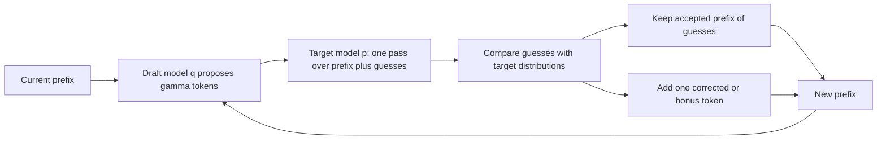

# Speculative Decoding

## Introduction

Decoding a single sequence wastes most of a GPU. The [overview page](./0-llm-inference-overview.mdx) showed that a decode step for one user performs about 1 FLOP per byte of weights read, while an H100 could do about 295. The step takes the same time whether it scores 1 token or 8, because it is waiting on memory either way.

**Speculative decoding** turns that idle compute into speed. A cheap mechanism guesses the next few tokens, and the big model checks all the guesses in a single forward pass. Every guess that matches what the big model would have produced is a token gained for free. With a careful acceptance rule, the output follows *exactly* the same distribution as sampling from the big model alone: this is a lossless optimization, not an approximation.

The idea was published independently by Leviathan, Kalman and Matias at Google ("Fast Inference from Transformers via Speculative Decoding", 2022) and by Chen et al. at DeepMind ("Accelerating Large Language Model Decoding with Speculative Sampling", 2023), building on blockwise parallel decoding (Stern et al., 2018). It now ships in every major serving engine, and newer methods such as Medusa, EAGLE and multi-token prediction heads have replaced the separate draft model in many deployments.

After this page you will be able to:

- Explain the draft-then-verify loop and why verification costs about one decode step.
- Prove that the rejection-sampling acceptance rule leaves the output distribution unchanged, and check it numerically.
- Compute expected tokens per step and speedup from the acceptance rate, draft length and draft cost.
- Compare draft models, n-gram lookup, Medusa, EAGLE and MTP heads, and know when speculation stops helping.

## Draft, Then Verify

Let $p$ be the target model (the one whose outputs we want) and $q$ a draft model that is much cheaper. One iteration with draft length $\gamma$ works like this:

1. **Draft:** run $q$ autoregressively for $\gamma$ steps from the current prefix, producing guesses $\tilde{x}_1, \dots, \tilde{x}_\gamma$ and remembering each draft distribution $q_i$.
2. **Verify:** run $p$ once on the prefix plus all $\gamma$ guesses. Because a Transformer computes logits for every input position in parallel, this one pass gives the target distributions $p_1, \dots, p_{\gamma+1}$ at every guessed position plus one beyond.
3. **Accept or reject:** walk through the guesses left to right, accepting each with a probability defined below. At the first rejection, sample a replacement token from a corrected distribution and stop. If all $\gamma$ guesses are accepted, sample one bonus token from $p_{\gamma+1}$.

Each iteration produces between 1 and $\gamma + 1$ tokens for one target forward pass. The verify pass processes $\gamma + 1$ positions instead of 1, but since decode is memory-bound, that costs about the same as a single-token step.



## The Acceptance Rule and Its Proof

With greedy decoding the rule is obvious: accept a guess if it equals the target's argmax at that position. With sampling we need something subtler, because the draft and target distributions differ.

For a guessed token $x$ drawn from $q$, accept it with probability

$$
a(x) = \min\!\left(1, \frac{p(x)}{q(x)}\right)
$$

If it is rejected, sample a replacement from the **residual distribution**

$$
r(x) = \frac{\max\!\left(0,\ p(x) - q(x)\right)}{\sum_{y} \max\!\left(0,\ p(y) - q(y)\right)}
$$

Intuitively, if the draft overestimates a token ($q(x) > p(x)$) we accept it only part of the time, and the residual gives extra probability to exactly the tokens the draft underestimated.

**Claim:** the token produced by this procedure is distributed exactly according to $p$.

**Proof.** A token $x$ can be output in two ways: drafted and accepted, or drafted something, rejected, and resampled as $x$.

The first way has probability

$$
q(x)\, \min\!\left(1, \frac{p(x)}{q(x)}\right) = \min\!\left(q(x),\ p(x)\right)
$$

The total acceptance probability is therefore $\beta = \sum_y \min(q(y), p(y))$, and the rejection probability is $1 - \beta$. Now note that

$$
\sum_y \max\!\left(0,\ p(y) - q(y)\right) = \sum_y \left(p(y) - \min(p(y), q(y))\right) = 1 - \beta
$$

So the second way has probability

$$
(1 - \beta)\, r(x) = (1 - \beta) \frac{\max(0,\ p(x) - q(x))}{1 - \beta} = \max\!\left(0,\ p(x) - q(x)\right)
$$

Adding the two:

$$
P(\text{output} = x) = \min(p(x), q(x)) + \max(0,\ p(x) - q(x)) = p(x)
$$

because for any two numbers, $\min(a, b) + \max(0, a - b) = a$. $\blacksquare$

Applied position by position (each accepted token becomes part of the prefix for the next), the whole generated sequence has the target model's distribution. Two useful facts fall out of the proof:

- The **acceptance rate** for one position is $\beta = \sum_y \min(p(y), q(y)) = 1 - \mathrm{TV}(p, q)$, one minus the total variation distance between the two distributions. A draft that agrees closely with the target is accepted often.
- Correctness never depends on draft quality. A bad draft only lowers the acceptance rate, which lowers speed. It cannot change the outputs.

### Checking It Numerically

The script below implements one step of the rule for a five-token vocabulary and samples it 200,000 times.

```python
import torch

torch.manual_seed(0)
p = torch.tensor([0.50, 0.25, 0.15, 0.07, 0.03])    # target model's next-token distribution
q = torch.tensor([0.30, 0.40, 0.10, 0.15, 0.05])    # draft model's distribution

def speculative_sample(p, q):
    x = torch.multinomial(q, 1).item()               # 1. draft proposes x ~ q
    if torch.rand(()) < min(1.0, (p[x] / q[x]).item()):
        return x, True                               # 2. accept with prob min(1, p/q)
    residual = (p - q).clamp_min(0)                  # 3. otherwise resample from norm(max(0, p - q))
    return torch.multinomial(residual / residual.sum(), 1).item(), False

n = 200_000
counts, accepted = torch.zeros(5), 0
for _ in range(n):
    x, ok = speculative_sample(p, q)
    counts[x] += 1
    accepted += ok
print("target p     :", [round(v, 3) for v in p.tolist()])
print("empirical    :", [round(v, 3) for v in (counts / n).tolist()])
print(f"acceptance rate {accepted / n:.3f}  vs  sum(min(p, q)) = {torch.minimum(p, q).sum():.3f}")
```

```text
target p     : [0.5, 0.25, 0.15, 0.07, 0.03]
empirical    : [0.499, 0.251, 0.151, 0.07, 0.03]
acceptance rate 0.750  vs  sum(min(p, q)) = 0.750
```

Even though the draft badly overrates token 1 (0.40 versus 0.25) and underrates token 0, the output matches $p$ to sampling noise, and the acceptance rate equals $\sum \min(p, q) = 0.30 + 0.25 + 0.10 + 0.07 + 0.03 = 0.75$, which you can add up by hand.

## How Much Faster? The Expected-Tokens Formula

Assume, as Leviathan et al. do, that each guess is accepted independently with the same probability $\alpha$. An iteration emits the accepted prefix plus one more token (a correction or the bonus). The probability that at least $i$ guesses are accepted is $\alpha^i$, so the expected number of tokens per iteration is

$$
E[\text{tokens}] = 1 + \alpha + \alpha^2 + \dots + \alpha^{\gamma} = \frac{1 - \alpha^{\gamma + 1}}{1 - \alpha}
$$

Each iteration costs one target pass plus $\gamma$ draft steps. If a draft step costs $c$ times a target step, the wall-clock speedup over plain decoding is

$$
S(\alpha, \gamma, c) = \frac{1 - \alpha^{\gamma + 1}}{(1 - \alpha)(\gamma c + 1)}
$$

```python
def expected_tokens(alpha, gamma):
    # tokens produced per target forward pass: (1 - alpha^(gamma+1)) / (1 - alpha)
    return (1 - alpha ** (gamma + 1)) / (1 - alpha)

def speedup(alpha, gamma, c):
    # c = cost of one draft step relative to one target step
    return expected_tokens(alpha, gamma) / (gamma * c + 1)

print("expected tokens per target pass")
print("alpha  " + "".join(f"g={g:<6}" for g in [1, 2, 4, 8]))
for a in [0.5, 0.7, 0.8, 0.9]:
    print(f"{a:<7}" + "".join(f"{expected_tokens(a, g):<8.2f}" for g in [1, 2, 4, 8]))
print("\nwall-clock speedup with draft cost c = 0.05")
for a in [0.5, 0.7, 0.8, 0.9]:
    best = max(range(1, 16), key=lambda g: speedup(a, g, 0.05))
    print(f"alpha {a}: gamma=4 -> {speedup(a, 4, 0.05):.2f}x, best gamma={best} -> {speedup(a, best, 0.05):.2f}x")
```

```text
expected tokens per target pass
alpha  g=1     g=2     g=4     g=8     
0.5    1.50    1.75    1.94    2.00    
0.7    1.70    2.19    2.77    3.20    
0.8    1.80    2.44    3.36    4.33    
0.9    1.90    2.71    4.10    6.13    

wall-clock speedup with draft cost c = 0.05
alpha 0.5: gamma=4 -> 1.61x, best gamma=3 -> 1.63x
alpha 0.7: gamma=4 -> 2.31x, best gamma=6 -> 2.35x
alpha 0.8: gamma=4 -> 2.80x, best gamma=8 -> 3.09x
alpha 0.9: gamma=4 -> 3.41x, best gamma=13 -> 4.67x
```

Two lessons. First, the acceptance rate dominates everything: at $\alpha = 0.5$ no draft length gets you past 2 tokens per pass. Second, longer drafts have diminishing returns because the chance of surviving all of them decays geometrically, while their cost grows linearly. Real systems use $\gamma$ between 2 and 8 and many adapt it on the fly. The independence assumption is optimistic: acceptance is high on boilerplate and code and low on creative text, so measured speedups vary by workload.

## A Working Example with Two Real Models

SmolLM2-135M-Instruct and SmolLM2-360M-Instruct share a tokenizer, so the small one can draft for the large one. The implementation below uses greedy verification and, to stay short, recomputes the full sequence instead of managing caches. That makes it slow in wall-clock terms on CPU, so we count target forward passes, which is what speculative decoding saves.

```python
import torch
from transformers import AutoModelForCausalLM, AutoTokenizer

torch.manual_seed(0)
tok = AutoTokenizer.from_pretrained("HuggingFaceTB/SmolLM2-360M-Instruct")
target = AutoModelForCausalLM.from_pretrained("HuggingFaceTB/SmolLM2-360M-Instruct", dtype=torch.float32).eval()
draft = AutoModelForCausalLM.from_pretrained("HuggingFaceTB/SmolLM2-135M-Instruct", dtype=torch.float32).eval()

@torch.inference_mode()
def greedy(model, ids, n_new):
    passes = 0
    for _ in range(n_new):
        nxt = model(ids).logits[:, -1].argmax(-1, keepdim=True)   # (1, 1)
        ids, passes = torch.cat([ids, nxt], 1), passes + 1
    return ids, passes

@torch.inference_mode()
def speculative_greedy(target, draft, ids, n_new, gamma=4):
    start, passes, accepted_total = ids.shape[1], 0, 0
    while ids.shape[1] - start < n_new:
        # 1. draft gamma tokens autoregressively (cheap model)
        d = ids
        for _ in range(gamma):
            d = torch.cat([d, draft(d).logits[:, -1].argmax(-1, keepdim=True)], 1)
        proposal = d[:, ids.shape[1]:]                                   # (1, gamma)
        # 2. ONE target pass scores all gamma proposals plus one extra position
        logits = target(d).logits[:, ids.shape[1] - 1:]                  # (1, gamma + 1, vocab)
        passes += 1
        choice = logits.argmax(-1)                                       # target's own greedy picks
        # 3. accept the longest prefix where draft == target, then take target's next token
        n_ok = int((proposal == choice[:, :gamma]).int().cumprod(-1).sum())
        accepted_total += n_ok
        ids = torch.cat([ids, proposal[:, :n_ok], choice[:, n_ok:n_ok + 1]], 1)
    return ids[:, :start + n_new], passes, accepted_total

msgs = [{"role": "user", "content": "Explain what a hash table is in two sentences."}]
ids = tok.apply_chat_template(msgs, add_generation_prompt=True, return_tensors="pt",
                              return_dict=True)["input_ids"]
n_new = 48
ref, ref_passes = greedy(target, ids, n_new)
out, passes, acc = speculative_greedy(target, draft, ids, n_new, gamma=4)
print("identical to target greedy:", torch.equal(ref, out))
print(f"target passes: plain {ref_passes}, speculative {passes} "
      f"({n_new / passes:.2f} tokens per pass, {acc} draft tokens accepted)")
print(repr(tok.decode(out[0, ids.shape[1]:])))
```

```text
identical to target greedy: True
target passes: plain 48, speculative 16 (3.00 tokens per pass, 35 draft tokens accepted)
'A hash table is a data structure that stores key-value pairs in a way that allows for efficient lookup, insertion, and deletion of data. It uses a hash function to map keys to indices in an array, where the value associated with'
```

The output is token-for-token identical to the target's own greedy decoding, but the target ran 16 times instead of 48. Of the 64 tokens drafted (16 rounds of 4), 35 were accepted, an acceptance rate of about 55 percent per drafted token, and each round produced 3 tokens on average. On a GPU, where the verify pass over 5 positions costs about the same as a 1-position step, that would translate into close to a 3x lower latency minus the draft model's cost.

The key line is `logits = target(d).logits[:, ids.shape[1] - 1:]`: the logits at position `ids.shape[1] - 1` predict the first guess, the next position predicts the second guess, and so on, with the final position giving the bonus token. A production implementation keeps KV caches for both models and, after a rejection, simply truncates them back to the accepted length (in `transformers`, `DynamicCache.crop` does this).

You do not need to write this yourself. In `transformers`, pass a draft model to `generate`:

```python
out = target.generate(**inputs, assistant_model=draft, max_new_tokens=128)
```

## Beyond Separate Draft Models

A separate draft model has practical costs: it must share the tokenizer, it needs its own KV cache and memory, and its quality is capped by how well a small model imitates a large one. Several alternatives produce drafts more cheaply or more accurately.

**N-gram and prompt lookup.** Many outputs copy spans of the input: code edits, summaries that quote, RAG answers. Prompt lookup decoding (Saxena, 2023) finds the last few generated tokens elsewhere in the prompt and proposes whatever followed them there. It needs no extra model at all. In `transformers` it is `generate(..., prompt_lookup_num_tokens=10)`; in vLLM it is the `ngram` method. It shines on editing and extraction and does little for free-form writing.

**Medusa** (Cai et al., 2024) adds several extra decoding heads on top of the target model's last hidden state; head $k$ predicts the token $k + 1$ positions ahead. Their top candidates are combined into a tree of possible continuations, and **tree attention** (a mask that lets each candidate attend only to its own ancestors) verifies the whole tree in one pass. Medusa-1 trains only the heads on a frozen model; Medusa-2 fine-tunes the backbone jointly. Medusa optionally relaxes exact verification with a "typical acceptance" rule, which trades the losslessness guarantee for more accepted tokens.

**EAGLE** (Li et al., 2024) drafts at the feature level: a small, one-layer Transformer predicts the target model's next hidden state from its current hidden states plus the sampled token, and the target's own LM head turns those features into token guesses. Because it reuses the target's rich features, its drafts are accepted far more often than a standalone small model's. **EAGLE-2** (2024) builds the draft tree dynamically using the draft's confidence scores. **EAGLE-3** (Li et al., 2025, NeurIPS 2025) drops the feature-prediction constraint, predicts tokens directly, fuses features from low, middle and high layers of the target, and trains with a "training-time test" that simulates multi-step drafting; the paper reports speedups of up to 6.5x.

**Multi-token prediction (MTP) heads** are trained with the model from the start. DeepSeek-V3 has one MTP module (`num_nextn_predict_layers: 1` in its config) that predicts one extra token; its technical report says the second token is accepted 85 to 90 percent of the time, giving about 1.8 times the tokens per second. See [Multi-Token Prediction](../13-llm-advanced-architectures/5-llm-multi-token-prediction.mdx).

| Method | Extra parameters | Training needed | Typical use |
|---|---|---|---|
| Draft model | a full small LM | none if one exists | same-family pairs, e.g. 1B drafting for 70B |
| N-gram / prompt lookup | none | none | code editing, RAG, summarization |
| Medusa | a few heads | heads (and optionally backbone) | single-model deployments |
| EAGLE / EAGLE-3 | one small layer plus fusion | draft layer on target's features | high-acceptance general chat |
| MTP heads | MTP modules | during pretraining | models shipped with them (DeepSeek-V3 and successors) |

### Using It in Serving Engines

vLLM takes a JSON `--speculative-config`. An EAGLE-3 drafter for Llama 3.1 8B looks like this:

```bash
vllm serve meta-llama/Llama-3.1-8B-Instruct \
  --speculative-config '{"method": "eagle3", "model": "RedHatAI/Llama-3.1-8B-Instruct-speculator.eagle3", "num_speculative_tokens": 3}'
```

Other `method` values include `draft_model`, `ngram` (with `prompt_lookup_min` and `prompt_lookup_max`), `suffix` and `mtp`. SGLang uses flags such as `--speculative-algorithm EAGLE3`, `--speculative-draft-model-path`, `--speculative-num-steps`, `--speculative-eagle-topk` and `--speculative-num-draft-tokens`. llama.cpp's server accepts a draft GGUF with `-md` (or `--spec-draft-model`) and a speculation type with `--spec-type`. Flag names in this area change between releases, so check `--help` for your installed version.

## When Speculation Stops Helping

Speculative decoding spends extra FLOPs to save memory-bound steps. It therefore helps most when the GPU has spare compute, which is exactly when the batch is small.

- **Large batches.** At high concurrency the target's verify pass is already compute-heavy. Verifying $\gamma + 1$ tokens for each of 128 sequences multiplies the FLOPs per step, and rejected tokens are pure waste. Measured gains shrink with batch size and can become losses; the EAGLE-3 paper, for instance, reports a much smaller 1.38x throughput gain at batch size 64 in SGLang than its single-stream speedups.
- **Low acceptance.** Creative writing at high temperature, unfamiliar domains, or a draft trained on different data can push $\alpha$ toward 0.5, where the overhead eats the benefit.
- **Memory pressure.** Draft models and their KV caches take memory that could hold more user sequences.

The rule of thumb: enable speculation for latency-sensitive, low-to-moderate concurrency services (interactive chat, coding assistants, agents waiting on tool calls) and measure it under your real load before enabling it for throughput-oriented batch jobs.

## Common Mistakes

- Believing speculative decoding changes output quality. With the exact acceptance rule (or exact-match for greedy), outputs follow the target's distribution; only relaxed schemes such as Medusa's typical acceptance trade this away.
- Pairing a draft and target with different tokenizers without a translation layer. Token ids must mean the same thing.
- Picking $\gamma$ by intuition. Measure the acceptance rate on your traffic and use the speedup formula or the engine's metrics to choose.
- Benchmarking at batch size 1 and deploying at batch size 64. The speedup does not transfer.
- Forgetting to roll back the KV cache after a rejection, which leaves stale keys for rejected tokens and silently corrupts later steps.
- Comparing with sampling enabled using greedy exact-match verification. For sampling, the probabilistic acceptance rule is required to keep the distribution exact.

## Summary

- Speculative decoding drafts $\gamma$ tokens cheaply and verifies them with one target forward pass, which costs about one memory-bound decode step.
- Accepting a draft token with probability $\min(1, p/q)$ and resampling rejections from $\mathrm{norm}(\max(0, p - q))$ makes the output distribution exactly $p$.
- The acceptance rate equals $\sum \min(p, q)$, and expected tokens per pass is $(1 - \alpha^{\gamma+1}) / (1 - \alpha)$; acceptance rate matters far more than draft length.
- Drafts can come from a small model, n-gram lookup, Medusa heads, EAGLE feature-level drafters or built-in MTP modules; EAGLE-3 and MTP give the highest acceptance today.
- Gains are largest at low batch sizes and shrink, or reverse, as the GPU becomes compute-bound.

## Further Reading

- [Fast Inference from Transformers via Speculative Decoding (Leviathan, Kalman, Matias, 2022)](https://arxiv.org/abs/2211.17192) - the acceptance rule, its proof and the speedup analysis.
- [Accelerating Large Language Model Decoding with Speculative Sampling (Chen et al., 2023)](https://arxiv.org/abs/2302.01318) - DeepMind's concurrent formulation, applied to a 70B model.
- [Blockwise Parallel Decoding for Deep Autoregressive Models (Stern, Shazeer, Uszkoreit, 2018)](https://arxiv.org/abs/1811.03115) - the earlier greedy draft-and-verify idea.
- [Medusa: Simple LLM Inference Acceleration Framework with Multiple Decoding Heads (Cai et al., 2024)](https://arxiv.org/abs/2401.10774) - extra heads and tree attention.
- [EAGLE: Speculative Sampling Requires Rethinking Feature Uncertainty (Li et al., 2024)](https://arxiv.org/abs/2401.15077) - feature-level drafting.
- [EAGLE-3: Scaling up Inference Acceleration of Large Language Models via Training-Time Test (Li et al., 2025)](https://arxiv.org/abs/2503.01840) - the current EAGLE version.
- [DeepSeek-V3 Technical Report (DeepSeek-AI, 2024)](https://arxiv.org/abs/2412.19437) - MTP modules and their use for speculative decoding.
- [vLLM: Speculative Decoding](https://docs.vllm.ai/en/latest/features/speculative_decoding/) - supported methods and configuration.
