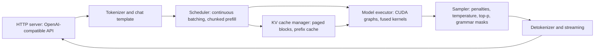

# Serving Engines: vLLM, SGLang, TensorRT-LLM and llama.cpp

## Introduction

The previous pages built the pieces of an inference stack by hand: a KV cache, sampling, paging, continuous batching, prefix caching and speculative decoding. A **serving engine** packages all of them, plus optimized GPU kernels, parallelism across GPUs, quantized formats, tokenization, chat templates and an HTTP API, into one program you start with a single command.

Four open-source engines cover most deployments today:

- **vLLM**, from UC Berkeley's Sky Computing Lab and now a large community project, the default choice for GPU serving.
- **SGLang**, from the LMSYS group, strong on prefix-heavy and structured workloads and widely used for large MoE models.
- **TensorRT-LLM**, NVIDIA's engine, tuned for NVIDIA hardware and integrated with Triton and Dynamo.
- **llama.cpp**, a C/C++ engine built on the ggml library, which runs quantized GGUF models on CPUs, Apple Silicon and consumer GPUs.

Hugging Face's Text Generation Inference (TGI), once a fifth major option, is now in maintenance mode; its README recommends vLLM, SGLang, llama.cpp or MLX for new deployments.

This page explains how each engine is organized, shows the commands to serve a model and query it through the OpenAI-compatible API, and gives you a decision table. Commands were checked against each project's documentation in late 2026; these projects release weekly, so confirm flags with `--help` on your installed version.

## What Every Engine Has in Common

Despite different codebases, the engines share an architecture, because they all solve the problems from this section in similar ways.



- **An OpenAI-compatible API.** All four serve `/v1/chat/completions` and `/v1/completions`, so client code written for one works with the others by changing `base_url`. This is also how agent frameworks talk to self-hosted models; see the [AI Agents tutorial](/docs/ai/agents).
- **A scheduler** doing continuous batching with a per-step token budget and chunked prefill ([PagedAttention, Continuous Batching and Prefix Caching](./3-llm-paged-attention.mdx)).
- **A KV cache manager** with paged blocks and prefix reuse.
- **A model executor** that runs fused attention kernels (FlashAttention, FlashInfer or the engine's own), fused MLP and MoE kernels, and captures decode steps as CUDA graphs to remove CPU launch overhead.
- **Parallelism**: tensor parallelism within a node, pipeline parallelism across nodes, expert parallelism for MoE models ([Training and Serving MoE Models](../7-llm-mixture-of-experts/4-llm-moe-training-and-serving.mdx)), and data-parallel replicas.
- **Quantization** support for FP8, INT8 and INT4 weight formats and FP8 KV caches ([Quantization Basics](../11-llm-quantization/0-llm-quantization-basics.mdx)).

The differences are in where each engine invests: hardware coverage, kernel tuning, scheduling policy and ease of use.

## vLLM

vLLM began as the reference implementation of PagedAttention (Kwon et al., SOSP 2023). Its current engine, called V1, separates the API server, the scheduler and the GPU workers into processes, enables chunked prefill and prefix caching by default, and supports hundreds of model architectures directly from their Hugging Face checkpoints. It runs on NVIDIA and AMD GPUs, Google TPUs, Intel hardware and others through plugins.

Install it with `uv` and start a server:

```bash
uv venv --python 3.12 --seed
source .venv/bin/activate
uv pip install vllm --torch-backend=auto

vllm serve Qwen/Qwen3-8B \
  --max-model-len 32768 \
  --gpu-memory-utilization 0.90 \
  --tensor-parallel-size 1
```

The server listens on port 8000 by default. The flags you will touch most often:

| Flag | What it controls |
|---|---|
| `--max-model-len` | maximum context per request; lower it to fit more concurrent sequences |
| `--gpu-memory-utilization` | fraction of GPU memory vLLM claims for weights, activations and KV blocks |
| `--tensor-parallel-size`, `-tp` | number of GPUs to shard each layer across |
| `--max-num-seqs` | maximum concurrent sequences per step |
| `--max-num-batched-tokens` | per-step token budget shared by prefill chunks and decode tokens |
| `--kv-cache-dtype` | `auto` or an FP8 type to halve KV memory |
| `--quantization` | weight quantization method, usually detected from the checkpoint |
| `--speculative-config` | JSON for EAGLE, n-gram, MTP or draft-model speculation |
| `--generation-config` | `vllm` to ignore the model's `generation_config.json` defaults |

vLLM also has an offline Python API for batch jobs, which skips HTTP entirely and lets the scheduler see all prompts at once:

```python
from vllm import LLM, SamplingParams

llm = LLM(model="Qwen/Qwen3-8B", max_model_len=8192)
params = SamplingParams(temperature=0.7, top_p=0.9, max_tokens=256)
outputs = llm.chat(
    [[{"role": "user", "content": f"Summarize item {i} of the report."}] for i in range(1000)],
    params,
)
print(outputs[0].outputs[0].text)
```

`llm.generate` takes raw prompts and does not apply a chat template; use `llm.chat` for instruction-tuned models.

## SGLang

SGLang (Zheng et al., 2023) started as a frontend language for programs that call an LLM many times (branching, few-shot, tool loops) plus a runtime designed for them. Its runtime introduced **RadixAttention**, which stores cached prefixes in a radix tree and schedules requests to maximize prefix reuse. It also built one of the first fast grammar-constrained decoders (compressed finite-state machines, and later integration with XGrammar). SGLang is used heavily for serving large MoE models such as DeepSeek-V3 with expert parallelism and prefill-decode disaggregation.

```bash
uv pip install --prerelease=allow sglang

sglang serve Qwen/Qwen3-8B --host 0.0.0.0 --port 30000
```

The older entry point `python3 -m sglang.launch_server --model-path Qwen/Qwen3-8B` still appears throughout SGLang's documentation and accepts the same server arguments. The default port is 30000. Frequently used options include `--tp-size` (alias `--tp`) for tensor parallelism, `--mem-fraction-static` for the share of memory given to weights and KV cache, `--context-length`, `--chunked-prefill-size`, `--schedule-policy` (for example `lpm`, longest prefix match, versus `fcfs`), `--grammar-backend` (`xgrammar`, `outlines`, `llguidance`), and the `--speculative-*` family described on the [Speculative Decoding](./4-llm-speculative-decoding.mdx) page.

## TensorRT-LLM

TensorRT-LLM is NVIDIA's open-source inference library. Early versions compiled each model into a TensorRT engine ahead of time, which gave excellent performance but required a build step per model, GPU type and configuration. Current releases default to a **PyTorch-based backend** that loads Hugging Face checkpoints directly while still using NVIDIA's custom kernels (FP8 and FP4 GEMMs, fused attention, in-flight batching, paged KV, speculative decoding). It is usually the first engine to support new NVIDIA hardware features such as Blackwell's NVFP4.

The quickest route is NVIDIA's release container from NGC. Inside it, `trtllm-serve` starts an OpenAI-compatible server, and a YAML file passed with `--config` carries advanced options:

```bash
trtllm-serve Qwen/Qwen3-8B --tp_size 1 --max_batch_size 64 --max_num_tokens 8192 --port 8000
```

There is also a Python API that mirrors vLLM's:

```python
from tensorrt_llm import LLM, SamplingParams

llm = LLM(model="Qwen/Qwen3-8B")
for out in llm.generate(["The capital of France is"], SamplingParams(temperature=0.8, top_p=0.95)):
    print(out.outputs[0].text)
```

TensorRT-LLM runs only on NVIDIA GPUs. In large deployments it is often run under **NVIDIA Dynamo**, an orchestration layer that adds disaggregated prefill and decode, KV-aware routing and KV offloading across a cluster; Dynamo can also drive vLLM and SGLang workers.

## llama.cpp

llama.cpp, started by Georgi Gerganov in 2023, runs models in the **GGUF** format: a single file holding weights (usually quantized with k-quants such as `Q4_K_M`), the tokenizer and the chat template. Its backends cover x86 and ARM CPUs, Apple Metal, CUDA, ROCm, Vulkan and SYCL, and it can split a model between GPU and CPU memory layer by layer. That makes it the engine of choice for laptops, workstations and edge devices, and it is the engine inside Ollama and LM Studio. GGUF and quantization types are covered in [GGUF and Running Models Locally](../11-llm-quantization/2-llm-gguf-and-llama-cpp.mdx).

Download a release binary or build from source, then run `llama-server`. The `-hf` flag downloads a GGUF straight from Hugging Face:

```bash
llama-server -hf Qwen/Qwen3-0.6B-GGUF:Q8_0 -c 8192 -np 4 --host 127.0.0.1 --port 8080
```

```text
srv    load_model: initializing, n_slots = 4, n_ctx_slot = 2048, kv_unified = 'false'
srv  server_run_i: model loaded
srv  server_on_li: listening on http://127.0.0.1:8080
```

That excerpt is from a real start-up log (we ran the CUDA build with `-ngl all` on port 18080 on an RTX 4060 Ti for our tests; timestamps removed). It shows a llama.cpp detail worth knowing: `-c` is the total context, divided among the `-np` parallel slots, so `-c 8192 -np 4` gives each concurrent request only 2,048 tokens. Other important flags are `-ngl` (layers to offload to the GPU; the default `auto` fits as many as possible), `-fa` (FlashAttention: `on`, `off` or `auto`), `-ctk` and `-ctv` (KV cache types such as `q8_0`), `--jinja` (use the GGUF's Jinja chat template, on by default) and `-md` for a speculative draft model. Pass `--port` explicitly; the default port has changed between releases. For interactive terminal chat, `llama-cli -hf ...` uses the same model loading code.

llama.cpp's server does continuous batching across its slots and reuses the KV cache of a slot's previous prompt (`cache_prompt`, enabled by default), but it is designed for a handful of concurrent users rather than hundreds. Its kernels are optimized for quantized matrix-vector work, which is exactly what single-user decoding needs.

## One Client for All Four

Because all four engines speak the OpenAI protocol, one client works everywhere. This script ran against the llama.cpp server started above:

```python
from openai import OpenAI

client = OpenAI(base_url="http://127.0.0.1:18080/v1", api_key="none")  # vLLM: port 8000, SGLang: 30000
model = client.models.list().data[0].id
resp = client.chat.completions.create(
    model=model,
    messages=[{"role": "user", "content": "/no_think In one sentence, what is a KV cache?"}],
    temperature=0.0,
    max_tokens=60,
)
print(model)
print(resp.choices[0].message.content.strip())
print(resp.usage)
```

```text
Qwen/Qwen3-0.6B-GGUF:Q8_0
A KV cache is a type of memory cache used to store frequently accessed data, typically in a key-value format, to improve performance by reducing the number of times data needs to be fetched from main memory.
CompletionUsage(completion_tokens=46, prompt_tokens=21, total_tokens=67, completion_tokens_details=None, prompt_tokens_details=PromptTokensDetails(audio_tokens=None, cache_write_tokens=None, cached_tokens=0, image_tokens=None, text_tokens=None))
```

The plumbing works: the server reports the model id, returns a completion and fills in the `usage` block, including a `cached_tokens` count from its prompt cache. The *answer* is wrong, though. A 0.6-billion-parameter model confuses the Transformer KV cache with a generic key-value store, a useful reminder that a serving engine only serves; quality is the model's job.

The `/no_think` prefix is a Qwen3 convention that switches off its reasoning mode for a single turn. The model name, the `api_key` value and the extra request fields each engine accepts (for example `top_k`, `min_p` or structured-output fields) differ slightly, but the request shape is the same.

## Choosing an Engine

| | vLLM | SGLang | TensorRT-LLM | llama.cpp |
|---|---|---|---|---|
| Primary hardware | NVIDIA, AMD, TPU and more | NVIDIA, AMD and more | NVIDIA only | CPU, Apple, consumer GPUs, also CUDA |
| Model formats | HF checkpoints, FP8, GPTQ, AWQ and others | HF checkpoints and common quantized formats | HF checkpoints, NVIDIA FP8 and FP4 | GGUF |
| Scale | single GPU to multi-node | single GPU to large multi-node MoE | single GPU to multi-node with Dynamo | one machine, few users |
| Strengths | breadth of models and hardware, ecosystem | prefix reuse, structured output, MoE at scale | peak NVIDIA performance, newest GPU features | runs anywhere, tiny footprint, offloading |
| Default port | 8000 | 30000 | 8000 | set it with `--port` |

Practical guidance:

1. **Start with vLLM** for GPU serving unless you have a reason not to. It has the broadest model support, and most tutorials and model cards include a vLLM command.
2. **Try SGLang** when your traffic shares long prefixes (agents, multi-turn chat, few-shot pipelines), relies heavily on structured output, or when you serve very large MoE models across many GPUs. For many popular models the two engines trade benchmark wins release by release, so measure.
3. **Use TensorRT-LLM** when you run NVIDIA hardware at scale and need the last 10 to 30 percent of performance, or the newest hardware features first, and can absorb a more specialized toolchain.
4. **Use llama.cpp** (directly or through Ollama) for local, offline, CPU or Apple Silicon deployments, and anywhere a single binary and a single file are worth more than peak throughput.

Whatever you pick, benchmark it with your own prompt and output length distribution, at your target concurrency, with the metrics from the [next page](./6-llm-inference-metrics.mdx). Published comparisons rarely match a specific workload.

## Worked Scenario: Moving a Prototype to Production

A team prototypes a document assistant with Ollama on a laptop running a 4-bit 8B model. It works, and they need to serve 200 concurrent users.

- **Prototype:** llama.cpp under Ollama, one user, about 30 to 60 tokens per second on a recent laptop, KV for one 8k context.
- **Production engine:** vLLM on one 80 GB GPU with the BF16 or FP8 version of the same model. The KV budget from the [KV Cache](./2-llm-kv-cache.mdx) page (about 52 sequences of 8k tokens in BF16, roughly twice that with an FP8 KV cache) plus continuous batching covers 200 users who are rarely all generating at once.
- **Prompt layout:** they put the system prompt and the retrieved documents' shared instructions first so prefix caching applies, and move per-user data to the end.
- **API:** their application code does not change, apart from `base_url`, because both Ollama and vLLM speak the OpenAI protocol.
- **Validation:** they run `vllm bench serve` with their real prompt lengths and check that p99 time to first token and time per output token meet their targets before launch.

The only real migration work is model format (GGUF quantizations versus Hugging Face checkpoints) and re-checking output quality, since the 4-bit GGUF and the FP8 checkpoint are not bit-identical models.

## Common Mistakes

- Choosing an engine from a benchmark run on a different model, GPU, prompt length or concurrency than yours.
- Leaving `--max-model-len` at the model's maximum (128k or more) when your requests are short; the engine must plan for the worst case and admits fewer sequences.
- Forgetting that engines apply the model's `generation_config.json` sampling defaults, then wondering why outputs differ from another engine.
- Running llama.cpp with `-np 8` and the default context, not realizing each slot gets one eighth of `-c`.
- Using `llm.generate` with raw prompts on an instruction-tuned model in vLLM, which skips the chat template and degrades quality.
- Pinning to a tutorial's exact flags months later. These engines rename and deprecate options frequently; check `--help` and the release notes.

## Summary

- Serving engines combine paged KV caches, continuous batching, chunked prefill, prefix caching, speculative decoding, optimized kernels, parallelism and quantization behind an OpenAI-compatible API.
- vLLM is the general-purpose default with the broadest hardware and model coverage; start it with `vllm serve <model>` on port 8000.
- SGLang emphasizes prefix reuse via RadixAttention, fast structured output and large-scale MoE serving; start it with `sglang serve <model>` on port 30000.
- TensorRT-LLM targets peak performance on NVIDIA GPUs, now with a PyTorch backend; start it with `trtllm-serve <model>`.
- llama.cpp runs GGUF models on almost any hardware with `llama-server`; remember that `-c` is split across `-np` slots.
- TGI is in maintenance mode. Benchmark candidates on your own workload before choosing.

## Further Reading

- [vLLM documentation](https://docs.vllm.ai/en/latest/) - installation, `vllm serve`, engine arguments and features.
- [SGLang documentation](https://docs.sglang.io/) - quickstart, server arguments, RadixAttention and structured outputs.
- [TensorRT-LLM documentation](https://nvidia.github.io/TensorRT-LLM/) - quick start, `trtllm-serve` and the LLM API.
- [llama.cpp server README](https://github.com/ggml-org/llama.cpp/blob/master/tools/server/README.md) - every `llama-server` flag and endpoint.
- [Efficient Memory Management for Large Language Model Serving with PagedAttention (Kwon et al., 2023)](https://arxiv.org/abs/2309.06180) - the paper behind vLLM.
- [SGLang: Efficient Execution of Structured Language Model Programs (Zheng et al., 2023)](https://arxiv.org/abs/2312.07104) - the paper behind SGLang.
- [NVIDIA Dynamo](https://github.com/ai-dynamo/dynamo) - datacenter-scale orchestration with disaggregated serving.
- [Text Generation Inference README](https://github.com/huggingface/text-generation-inference) - the maintenance-mode notice and recommended alternatives.
