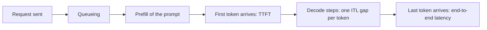

# Inference Metrics: TTFT, TPOT, Throughput and Cost

## Introduction

"How fast is it?" has at least five different answers for an LLM server. A user in a chat window cares about how long the screen stays blank and whether the text then streams faster than they read. A batch job cares about tokens per second across the whole fleet. Finance cares about dollars per million tokens. An SRE cares about the 99th percentile, not the average. These quantities pull against each other: the settings that maximize throughput make individual requests slower.

This page defines the standard metrics precisely, shows where each comes from in the prefill/decode picture, measures them against a real server, and turns them into cost and capacity estimates. After reading it you will be able to:

- Define TTFT, TPOT, ITL, end-to-end latency, throughput and goodput, and compute each from token timestamps.
- Explain the latency-throughput trade-off with a simple model and Little's law.
- Benchmark a server with your own script or `vllm bench serve` and read the results correctly.
- Estimate cost per million tokens and how many GPUs a workload needs.

## The Latency Metrics

Take one streamed request. Let $t_0$ be when the client sends it, $t_1$ when the first output token arrives, $t_i$ when the $i$-th token arrives, and $n$ the number of output tokens.



**Time to first token (TTFT)** is how long the user waits before anything appears:

$$
\mathrm{TTFT} = t_1 - t_0
$$

It includes network time, queueing behind other requests, tokenization and the whole prefill. It grows with prompt length and with server load.

**Inter-token latency (ITL)** is each gap between consecutive tokens, $t_{i+1} - t_i$. You get $n - 1$ of them per request, so a server produces a whole distribution of ITLs, and its tail shows stalls (for example a long prefill from another user that froze the batch for 200 ms).

**Time per output token (TPOT)** is the average gap for one request, excluding the first token:

$$
\mathrm{TPOT} = \frac{t_n - t_1}{n - 1}
$$

It reflects the decode step time while the request was running, which depends on how many other sequences were in the batch and how long their contexts were. For comfortable reading, chat products usually aim for TPOT well under 50 ms (20 or more tokens per second); human silent reading speed is roughly 4 to 8 tokens per second, but people skim and agents do not read at all.

**End-to-end latency** combines them:

$$
\mathrm{E2E} = \mathrm{TTFT} + (n - 1) \cdot \mathrm{TPOT}
$$

For long outputs, the second term dominates. A 1,000-token answer at 30 ms TPOT takes 30 seconds no matter how fast the first token was. For agents and tool calls, where the next step waits for the complete response, E2E is the number that matters.

:::note
Vendors and tools use these names slightly differently. Some define TPOT including the first token, some report "output tokens per second per user" (the reciprocal of TPOT), and some measure TTFT on the server, excluding the network. Check the definition before comparing numbers from two sources.
:::

## The Throughput Metrics

**Output throughput** is the number of generated tokens per second across all requests, and **total throughput** adds prompt tokens. **Request throughput** is completed requests per second. These are fleet metrics: they say nothing about any single user's experience.

**Goodput**, introduced in the DistServe paper (Zhong et al., 2024), is the request rate the server sustains *while meeting latency targets*, for example "p90 TTFT under 500 ms and p90 TPOT under 50 ms". A configuration with higher raw throughput but missed latency targets has lower goodput. Goodput is the right objective for capacity planning because it encodes the product requirement.

**Percentiles** matter more than means. Latency distributions are long-tailed: a few requests hit preemption, a burst of long prompts, or a garbage-collection pause. Report p50 (typical), p90 or p95 (bad but common) and p99 (worst common case), and always state the load (request rate or concurrency) at which you measured them.

## Where the Numbers Come From

Use the [prefill and decode](./0-llm-inference-overview.mdx) model. A decode step for a batch of $B$ sequences, each with $T$ cached tokens, must read the weights once and every sequence's KV cache:

$$
t_\mathrm{step}(B, T) \approx \frac{2N + B \cdot T \cdot s_\mathrm{kv}}{\mathrm{bandwidth}}
$$

where $2N$ is the weight bytes in BF16 and $s_\mathrm{kv}$ is the KV bytes per token (128 KiB for Llama 3.1 8B). Each sequence advances one token per step, so TPOT is about $t_\mathrm{step}$ and output throughput is about $B / t_\mathrm{step}$. The script below evaluates this model for Llama 3.1 8B on an H100, assuming kernels reach 70 percent of peak bandwidth and an assumed rental price of 3 USD per GPU-hour.

```python
# Memory-bound decode model for Llama 3.1 8B (BF16) on one H100: step time vs batch size
BW, PEAK = 3.35e12, 989e12              # bytes/s, FLOP/s
W = 8.03e9 * 2                          # weight bytes
KV = 131072                             # KV bytes per token
N = 8.03e9
PRICE = 3.0                             # assumed USD per GPU-hour
HBM = 80e9 * 0.9                        # usable GPU memory

def step_time(batch, ctx, efficiency=0.7):
    mem = (W + batch * ctx * KV) / (BW * efficiency)
    compute = 2 * N * batch / (PEAK * 0.5)
    return max(mem, compute)

print(f"{'batch':>5} {'ctx':>6} {'TPOT ms':>8} {'tok/s':>8} {'USD per 1M out':>15}")
for ctx in [2048, 16384]:
    for batch in [1, 8, 32, 128]:
        t = step_time(batch, ctx)
        tps = batch / t
        cost = PRICE / (tps * 3600) * 1e6
        fits = W + batch * ctx * KV <= HBM
        print(f"{batch:>5} {ctx:>6} {t*1e3:>8.1f} {tps:>8.0f} {cost:>15.2f}"
              + ("" if fits else "   (KV does not fit in 80 GB)"))
```

```text
batch    ctx  TPOT ms    tok/s  USD per 1M out
    1   2048      7.0      144            5.80
    8   2048      7.8     1030            0.81
   32   2048     10.5     3044            0.27
  128   2048     21.5     5953            0.14
    1  16384      7.8      129            6.47
    8  16384     14.2      564            1.48
   32  16384     36.2      885            0.94   (KV does not fit in 80 GB)
  128  16384    124.1     1032            0.81   (KV does not fit in 80 GB)
```

This idealized model ignores prefill, scheduling overhead and attention FLOPs, but it captures the shape every real benchmark shows:

- **Throughput rises steeply with batch size while TPOT barely moves**, as long as weights dominate the bytes. Going from batch 1 to batch 32 at 2k context raises throughput about 21 times and cost drops from 5.80 to 0.27 USD per million tokens, while TPOT rises from 7.0 to 10.5 ms.
- **Long contexts flatten the curve.** At 16k context, KV reads dominate, TPOT climbs quickly with batch size, and throughput saturates near 1,000 tokens per second. Worse, the larger batches do not even fit in memory.
- **Cost per token is a throughput metric.** Everything that raises sustainable batch size (paging, GQA, FP8 KV, prefix caching) lowers cost.

### Little's Law

Little's law from queueing theory links three quantities in any stable system: the average number of requests in the system $L$, the arrival rate $\lambda$ and the average time each spends inside $W$:

$$
L = \lambda W
$$

For an LLM server, $L$ is the concurrency (sequences in flight), $\lambda$ is requests per second and $W$ is the end-to-end latency. If users send 10 requests per second and each takes 8 seconds, the server must hold about 80 sequences at once. If your KV budget allows only 52, requests queue, TTFT explodes, and the system is overloaded no matter how fast each step is. This is the quickest sanity check for any capacity plan.

## Measuring a Real Server

The client below streams requests through the OpenAI-compatible API, records the arrival time of every content chunk, and computes TTFT, TPOT and ITL percentiles at two concurrency levels. It works against vLLM, SGLang, TensorRT-LLM or llama.cpp; we ran it against the llama.cpp server with Qwen3-0.6B started on the [Serving Engines](./5-llm-serving-engines.mdx) page.

```python
import statistics
import sys
import time
from concurrent.futures import ThreadPoolExecutor
from openai import OpenAI

BASE_URL = sys.argv[1] if len(sys.argv) > 1 else "http://127.0.0.1:8080/v1"
client = OpenAI(base_url=BASE_URL, api_key="none")
MODEL = client.models.list().data[0].id

def one_request(i):
    t0 = time.perf_counter()
    stamps = []                                   # arrival time of each streamed chunk with text
    stream = client.chat.completions.create(
        model=MODEL, max_tokens=64, temperature=0.0, stream=True,
        stream_options={"include_usage": True},
        messages=[{"role": "user", "content": f"/no_think List {i % 5 + 3} uses of a paperclip."}])
    n_out = None
    for chunk in stream:
        if chunk.choices and chunk.choices[0].delta.content:
            stamps.append(time.perf_counter())
        if chunk.usage:                           # final chunk carries token counts
            n_out = chunk.usage.completion_tokens
    end = time.perf_counter()
    ttft = stamps[0] - t0
    itls = [b - a for a, b in zip(stamps, stamps[1:])]
    tpot = (end - stamps[0]) / max(n_out - 1, 1)
    return dict(ttft=ttft, tpot=tpot, itls=itls, e2e=end - t0, n_out=n_out)

def run(concurrency, n_requests=8):
    t0 = time.perf_counter()
    with ThreadPoolExecutor(concurrency) as pool:
        results = list(pool.map(one_request, range(n_requests)))
    wall = time.perf_counter() - t0
    pct = lambda xs, q: statistics.quantiles(xs, n=100)[q - 1]
    ttfts = [r["ttft"] for r in results]
    tpots = [r["tpot"] for r in results]
    itls = [x for r in results for x in r["itls"]]
    tokens = sum(r["n_out"] for r in results)
    print(f"concurrency {concurrency}: TTFT p50 {statistics.median(ttfts)*1e3:6.0f} ms | "
          f"TPOT p50 {statistics.median(tpots)*1e3:5.1f} ms | ITL p99 {pct(itls, 99)*1e3:5.1f} ms | "
          f"throughput {tokens / wall:5.1f} tok/s")

for c in [1, 4]:
    run(c)
```

Measured against Qwen3-0.6B (Q8_0) fully offloaded to an RTX 4060 Ti, on a host whose CPUs were shared with other jobs:

```text
concurrency 1: TTFT p50    149 ms | TPOT p50  25.4 ms | ITL p99  86.5 ms | throughput  35.0 tok/s
concurrency 4: TTFT p50    193 ms | TPOT p50  32.0 ms | ITL p99 117.9 ms | throughput 115.6 tok/s
```

Quadrupling concurrency raised aggregate throughput 3.3 times while each user's TPOT grew only 26 percent, the batching effect from the decode model above, now measured. TTFT rose a little because requests now share steps with other users' decodes. The ITL p99 is three to four times the median TPOT: a few gaps are much longer than typical, which is exactly what percentiles exist to expose. (For a model this small, per-step CPU overhead dominates, so absolute numbers are far from what the GPU could do; the shape of the trade-off is the point.)

Three details in the script are easy to get wrong. The first token timestamp must be the first chunk *with content*, since many servers send an empty role chunk first. The token count should come from the server's `usage` field (requested with `stream_options`), because one streamed chunk can carry more than one token. And throughput must be total tokens over wall-clock time for the whole run, not the average of per-request rates.

### Using vllm bench serve

For serious benchmarking, use a maintained tool. vLLM ships one that works against any OpenAI-compatible server:

```bash
vllm bench serve \
  --backend openai-chat \
  --base-url http://127.0.0.1:8000 \
  --endpoint /v1/chat/completions \
  --model Qwen/Qwen3-8B \
  --dataset-name random \
  --random-input-len 1024 --random-output-len 256 \
  --num-prompts 500 \
  --request-rate 8 \
  --percentile-metrics ttft,tpot,itl,e2el \
  --metric-percentiles 50,90,99 \
  --goodput ttft:500 tpot:50
```

`--request-rate` sends requests as a Poisson process at that average rate (the default `inf` sends everything at once, which measures peak throughput, not latency under realistic load), `--max-concurrency` caps requests in flight, and `--goodput` takes SLO thresholds in milliseconds. Sweep the request rate from low to high and plot TPOT and TTFT percentiles against throughput: the knee of that curve is your server's practical capacity.

## Cost per Token

The cost of self-hosting is the price of the hardware divided by the tokens it produces:

$$
\mathrm{USD\ per\ 1M\ tokens} = \frac{\mathrm{USD\ per\ GPU\ hour} \times \mathrm{GPUs}}{\mathrm{tokens\ per\ second} \times 3600} \times 10^{6}
$$

The decode model above already showed the most important consequence: at batch 1 a GPU costs 20 to 40 times more per token than at a healthy batch size. Utilization is the cost lever. Some further points:

- **Input and output tokens cost differently.** Prefill processes thousands of tokens per second per GPU at high utilization, while decode is limited by memory traffic, so output tokens are several times more expensive to produce. API pricing reflects this, and cached input tokens (prefix-cache hits) are cheaper still.
- **Idle time is paid for.** A GPU that is busy 30 percent of the day costs more than three times its loaded per-token price. Traffic that can wait (evaluations, data generation, offline summarization) should go to batch jobs at full utilization.
- **Bigger is sometimes cheaper.** A larger model that answers correctly in one attempt can beat a smaller model that needs retries or longer reasoning chains. Measure cost per successful task, not per token.

## Worked Scenario: Capacity for a Chat Product

A product team expects a peak of 6 requests per second. Prompts average 1,500 tokens (system prompt plus history), answers average 300 tokens, and the targets are p90 TTFT under 1 second and p90 TPOT under 40 ms. They plan to use Llama 3.1 8B on H100s.

1. **Concurrency from Little's law.** Estimate end-to-end latency at the target: roughly 0.5 s TTFT plus $299 \times 0.03$ s, about 9.5 s. Then $L = 6 \times 9.5 \approx 57$ sequences in flight.
2. **Memory.** 57 sequences at up to 1,800 tokens each is about 103,000 tokens of KV, about 12.5 GiB at 128 KiB per token. That fits easily beside the 16 GB of weights on one 80 GB GPU.
3. **Step time.** With about 103,000 cached tokens per step, the decode model gives roughly $(16 + 13.5)\ \mathrm{GB} / (0.7 \times 3.35\ \mathrm{TB/s}) \approx 12.6$ ms per step, comfortably under 40 ms TPOT.
4. **Prefill load.** 6 requests per second times 1,500 prompt tokens is 9,000 prefill tokens per second, about 145 TFLOP/s at $2N$ FLOPs per token, roughly 15 percent of the GPU's peak. With prefix caching on the shared system prompt it is lower.
5. **Decision.** One GPU is enough on paper; deploy two replicas for redundancy and headroom, then confirm with `vllm bench serve` at 6 requests per second using real prompt lengths, checking that the goodput meets the SLO.

The estimate takes ten minutes and prevents the two classic failures: buying ten GPUs for a one-GPU workload, or launching on one GPU with a KV budget that cannot hold the required concurrency.

## Common Mistakes

- Reporting a single "tokens per second" without saying whether it is per user or aggregate, and at what concurrency.
- Benchmarking with `--request-rate inf` (everything at once) and quoting the resulting latencies as typical. That measures a burst, not steady state.
- Using random or very short prompts when production prompts are long and share prefixes. Both prefill cost and prefix-cache hit rates change the result.
- Averaging latencies instead of reporting percentiles, which hides the stalls users complain about.
- Counting streamed chunks as tokens. Engines may pack several tokens into one chunk or emit an empty first chunk.
- Ignoring output length in capacity plans. A model that writes twice as many tokens (common with reasoning models) halves capacity at the same TPOT.
- Comparing cost per token of a self-hosted GPU at 100 percent utilization with an API price, without accounting for idle hours, redundancy and operations.

## Summary

- TTFT is the wait before the first token (queueing plus prefill); ITL is each gap between tokens; TPOT is a request's average gap; E2E latency is TTFT plus $(n-1)$ TPOT.
- Throughput is a fleet metric; goodput is throughput that meets latency targets and is the right capacity objective.
- Decode step time is roughly bytes read (weights plus every sequence's KV) divided by bandwidth, so batching raises throughput nearly for free until KV traffic and capacity take over.
- Little's law, concurrency equals arrival rate times latency, tells you how many sequences the server must hold.
- Cost per million tokens is GPU price over throughput; utilization and batch size are the biggest levers.
- Benchmark with realistic prompt and output lengths, a realistic arrival process and percentile reporting.

## Further Reading

- [DistServe: Disaggregating Prefill and Decoding for Goodput-optimized LLM Serving (Zhong et al., 2024)](https://arxiv.org/abs/2401.09670) - defines goodput under TTFT and TPOT targets.
- [Taming Throughput-Latency Tradeoff in LLM Inference with Sarathi-Serve (Agrawal et al., 2024)](https://arxiv.org/abs/2403.02310) - how scheduling trades TTFT against ITL.
- [vLLM: vllm bench serve](https://docs.vllm.ai/en/latest/cli/bench/serve.html) - options of vLLM's serving benchmark.
- [NVIDIA: LLM Inference Benchmarking, Fundamental Concepts](https://developer.nvidia.com/blog/llm-benchmarking-fundamental-concepts/) - metric definitions as used by NVIDIA's tools.
- [Efficiently Scaling Transformer Inference (Pope et al., 2022)](https://arxiv.org/abs/2211.05102) - latency and cost trade-offs for large-model decoding.
- [A Proof for the Queuing Formula L = lambda W (Little, 1961)](https://pubsonline.informs.org/doi/10.1287/opre.9.3.383) - the original Little's law paper.
