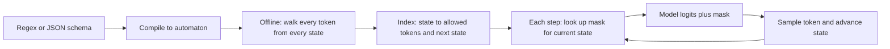

# Constrained Decoding and Structured Output

## Introduction

Programs that consume LLM output need it in a fixed shape: a JSON object with specific fields, one label from a list, a date, a SQL query, a function call. Asking nicely in the prompt works most of the time, and "most of the time" is the problem. At a million requests a day, a 0.5 percent failure rate is 5,000 broken parses, retries and edge cases.

**Constrained decoding** removes the failure mode at the source. At each step, before sampling, the engine sets the logit of every token that would make the output invalid to $-\infty$. The model can only choose among tokens that keep the text a valid prefix of the target language, so the final output is guaranteed to match the schema, regular expression or grammar. Every major serving engine and API now offers this, under names like structured outputs, guided decoding, JSON mode or grammars.

This page explains how it works and what it costs. You will learn to:

- Express "valid output" as a regular expression or grammar and compile it to an automaton.
- Precompute, for each automaton state, which tokens are allowed, and apply that mask during generation (implemented from scratch on a real model).
- Understand why JSON Schema needs context-free grammars and how engines such as XGrammar make that fast.
- Use structured output in vLLM and llama.cpp, and avoid the quality pitfalls.

For prompt-level techniques and API usage with hosted models, see the [AI Agents tutorial](/docs/ai/agents); this page is about the decoding machinery underneath.

## Masking Logits

Let $\mathcal{L}$ be the set of valid outputs (for example all strings matching a regex). Write $\mathrm{Pref}(\mathcal{L})$ for the set of strings that are a prefix of at least one valid output. Given the text generated so far, $s$, define the set of allowed tokens:

$$
A(s) = \{\, v \in \mathcal{V} : s \cdot \mathrm{str}(v) \in \mathrm{Pref}(\mathcal{L}) \,\}
$$

where $\mathcal{V}$ is the vocabulary and $\mathrm{str}(v)$ is the token's text. Constrained decoding samples from the renormalized distribution

$$
\tilde{p}(v \mid s) = \frac{p(v \mid s)\, \mathbb{1}[v \in A(s)]}{\sum_{u \in A(s)} p(u \mid s)}
$$

which is the same as adding $0$ to the logits of allowed tokens and $-\infty$ to the rest, then applying softmax. The end-of-sequence token is allowed only when $s$ itself is in $\mathcal{L}$. All the usual samplers (temperature, top-p, min-p) still apply on top.

Two observations shape everything that follows:

- **Validity is guaranteed only if $A(s)$ is never empty** before the output is complete. That holds as long as every valid prefix can be extended by some token, which is true when the vocabulary contains all single bytes or characters (byte-level BPE tokenizers do).
- **The naive check is expensive.** Testing every one of 150,000 tokens against the language at every step is far too slow. The art of constrained decoding is precomputing as much of $A(s)$ as possible.

## Regular Expressions and Finite-State Machines

Willard and Louf ("Efficient Guided Generation for Large Language Models", 2023, the paper behind the Outlines library) made constrained decoding practical for regular languages. Any regular expression compiles to a **deterministic finite automaton (DFA)**: a finite set of states, a start state, accepting states and a transition function on characters. The key insight is that whether a token is allowed depends only on the current DFA state, not on the full text. So for each state $q$ we can precompute, once and offline:

$$
\mathrm{index}(q) = \{\, (v, q') : \text{running the DFA on } \mathrm{str}(v) \text{ from } q \text{ ends in state } q' \,\}
$$

At generation time the allowed set is just a lookup, `index[state]`, and after sampling token $v$ the new state is the stored $q'$. Each step costs a dictionary lookup and a mask, independent of vocabulary size.



### Implementing It on a Real Model

The script below builds a DFA for ISO dates (`YYYY-MM-DD`) by hand: state $i$ means $i$ characters matched, and each state accepts one character class. It then walks every token in SmolLM2's 49,152-token vocabulary from every state to build the index, and generates an answer with and without the mask.

```python
import time
import torch
from transformers import AutoTokenizer, AutoModelForCausalLM

torch.manual_seed(0)
name = "HuggingFaceTB/SmolLM2-135M-Instruct"
tok = AutoTokenizer.from_pretrained(name)
model = AutoModelForCausalLM.from_pretrained(name, dtype=torch.float32).eval()

# A DFA for dates YYYY-MM-DD: state i means "i characters matched"; each state allows one char class.
DIGITS = set("0123456789")
pattern = [DIGITS] * 4 + [{"-"}] + [DIGITS] * 2 + [{"-"}] + [DIGITS] * 2
ACCEPT = len(pattern)

def step(state, text):
    """Advance the DFA over a whole string; return the new state or None if rejected."""
    for ch in text:
        if state >= ACCEPT or ch not in pattern[state]:
            return None
        state += 1
    return state

# Offline index: for every DFA state, which tokens keep us inside the language, and where do they lead?
t0 = time.perf_counter()
vocab = {i: tok.decode([i]) for i in range(len(tok))}
index = {s: {} for s in range(ACCEPT + 1)}
for s in range(ACCEPT + 1):
    for tid, text in vocab.items():
        if text and (nxt := step(s, text)) is not None:
            index[s][tid] = nxt
print(f"index built in {time.perf_counter() - t0:.1f} s over {len(vocab)} tokens")
print("allowed tokens per state:", [len(index[s]) for s in range(ACCEPT)])

@torch.inference_mode()
def generate(prompt, constrained, max_new_tokens=20):
    msgs = [{"role": "user", "content": prompt}]
    ids = tok.apply_chat_template(msgs, add_generation_prompt=True, return_tensors="pt",
                                  return_dict=True)["input_ids"]
    state, out = 0, []
    for _ in range(max_new_tokens):
        logits = model(ids).logits[0, -1]                        # (vocab,)
        if constrained:
            if state == ACCEPT:                                  # complete match: force end
                break
            mask = torch.full_like(logits, float("-inf"))
            allowed = torch.tensor(list(index[state]))
            mask[allowed] = 0.0
            logits = logits + mask                               # forbid everything else
        nxt = int(logits.argmax())
        if nxt == tok.eos_token_id:
            break
        if constrained:
            state = index[state][nxt]
        out.append(nxt)
        ids = torch.cat([ids, torch.tensor([[nxt]])], dim=1)
    return tok.decode(out)

q = "On what date did Apollo 11 land on the Moon? Reply with the date only, in YYYY-MM-DD format."
print("unconstrained:", repr(generate(q, constrained=False)))
print("constrained  :", repr(generate(q, constrained=True)))
```

```text
index built in 0.2 s over 49152 tokens
allowed tokens per state: [10, 10, 10, 10, 1, 10, 10, 1, 10, 10]
unconstrained: 'Apollo 11 landed on the Moon on July 20, 1969'
constrained  : '1969-01-20'
```

The unconstrained model answers in prose, which a date parser would reject. The constrained run is guaranteed to be a well-formed date, and the allowed-token counts show the structure of the index: exactly ten tokens (the single digits) in the digit states and one token in the two hyphen states, because SmolLM2's tokenizer splits numbers into single digits. Notice also that the date is *wrong*: the model knew "July 20, 1969" but, forced to emit digits immediately, picked month 01.

Several general lessons are visible even in this toy:

- **Tokens can span several DFA transitions.** Here each token advances one state, but in tokenizers that merge digits or punctuation (`"19"`, `"-0"`), one token moves the DFA several steps. The index handles this automatically because it runs the DFA over the token's whole string.
- **The mask guarantees format, not truth.** The constraint stops the model from writing prose, but whether the digits are right is still up to the model, and this run shows it getting them wrong. Constrained decoding is a parser guarantee, not a correctness guarantee. (Asking for an ISO date when the model prefers to write "July 20" also illustrates the early-commitment problem discussed below.)
- **The index is built once per pattern and tokenizer.** Building it took a fraction of a second in Python for ten states; libraries do it in compiled code and cache it, because real schemas produce automata with thousands of states.

## From JSON Schema to Grammars

Regular expressions cannot describe arbitrarily nested structures. JSON allows objects inside arrays inside objects to any depth, and matching brackets requires counting, which a finite automaton cannot do. Two strategies exist:

1. **Bound the depth and compile to a regex.** A specific JSON Schema with a fixed shape (an object with fields `name: string`, `age: integer`) is a regular language, and Outlines originally compiled schemas this way. Recursive schemas and free-form JSON objects are not.
2. **Use a context-free grammar (CFG).** A CFG, written for example in EBNF or llama.cpp's GBNF, describes nested structure directly. Executing it requires a **pushdown automaton**: a state machine plus a stack that tracks open brackets and nested rules.

The difficulty with CFGs is that the allowed-token set now depends on the stack, which can be unbounded, so you cannot precompute one mask per state. A naive engine re-checks every token against the parser at every step, which used to make grammar-constrained decoding several times slower than unconstrained generation.

**XGrammar** (Dong et al., 2024, MLSys 2025), one of vLLM's two structured-output backends (alongside guidance) and also available in SGLang and TensorRT-LLM, attacks this cost directly. It splits the vocabulary, for each grammar position, into **context-independent** tokens, whose validity can be decided without looking at the stack and therefore precomputed and cached, and **context-dependent** tokens, which must be checked against the stack at runtime. For typical grammars the second group is small. Together with a persistent stack data structure and overlapping mask computation with the GPU's forward pass, the paper reports up to 100 times faster mask generation than earlier solutions and near-zero end-to-end overhead. Microsoft's **llguidance** (used by the Guidance library and available as a vLLM backend) takes a different route, computing masks on the fly with a fast lexer and Earley parser in Rust.

The JSONSchemaBench study (Geng et al., 2025) compared six frameworks (Guidance, Outlines, llama.cpp, XGrammar, OpenAI and Gemini) on 10,000 real-world JSON Schemas and found that they differ substantially in how much of the JSON Schema specification they support, in speed, and in output quality. Check your engine's documentation for unsupported keywords (`pattern`, `format`, `minItems` and recursive `$ref` are common gaps), because unsupported constraints may be silently ignored or rejected.

## Using Structured Output in Practice

### vLLM

vLLM's OpenAI-compatible server accepts the standard `response_format` with a JSON Schema, plus a vLLM-specific `structured_outputs` field for choices, regexes and grammars. A Pydantic model gives you the schema:

```python
from openai import OpenAI
from pydantic import BaseModel

class Ticket(BaseModel):
    category: str
    priority: int
    summary: str

client = OpenAI(base_url="http://localhost:8000/v1", api_key="EMPTY")
resp = client.chat.completions.create(
    model="Qwen/Qwen3-8B",
    messages=[{"role": "user", "content": "My laptop will not boot after the update. Make a ticket."}],
    response_format={"type": "json_schema",
                     "json_schema": {"name": "ticket", "schema": Ticket.model_json_schema()}},
)
ticket = Ticket.model_validate_json(resp.choices[0].message.content)

label = client.chat.completions.create(
    model="Qwen/Qwen3-8B",
    messages=[{"role": "user", "content": "Sentiment of: 'the update broke everything'"}],
    extra_body={"structured_outputs": {"choice": ["positive", "negative", "neutral"]}},
)
```

The `structured_outputs` dictionary also accepts `regex`, `json` and `grammar` (EBNF) keys. These replaced the older `guided_json`, `guided_regex`, `guided_choice` and `guided_grammar` fields, which were removed in vLLM 0.12. Offline, pass `SamplingParams(structured_outputs=StructuredOutputsParams(choice=[...]))`. The backend is chosen with `--structured-outputs-config.backend` (`auto` by default, selecting XGrammar or guidance per request).

### llama.cpp

`llama-server` converts JSON Schemas to its GBNF grammar format internally and supports the same `response_format` request. This request ran against the Qwen3-0.6B server from the [Serving Engines](./5-llm-serving-engines.mdx) page (llama.cpp CUDA build on an RTX 4060 Ti):

```python
import json
from openai import OpenAI

client = OpenAI(base_url="http://127.0.0.1:18080/v1", api_key="none")
schema = {
    "type": "object",
    "properties": {
        "city": {"type": "string"},
        "country": {"type": "string"},
        "population_millions": {"type": "number"},
    },
    "required": ["city", "country", "population_millions"],
    "additionalProperties": False,
}
resp = client.chat.completions.create(
    model=client.models.list().data[0].id,
    messages=[{"role": "user", "content": "/no_think Give facts about the capital of Japan as JSON."}],
    response_format={"type": "json_schema", "json_schema": {"name": "city", "schema": schema}},
    temperature=0.0,
    max_tokens=100,
)
text = resp.choices[0].message.content
print(text)
print(json.loads(text)["city"])
```

```text
{
  "city": "Tokyo",
  "country": "Japan",
  "population_millions": 1400000000
}
Tokyo
```

The response parses, has exactly the three required fields with the right types, and nothing else. It is also a perfect example of the limits: `population_millions` is 1.4 billion, wrong by a factor of about 100 million (Tokyo has roughly 14 million people) because the small model ignored the unit in the field name. The schema could have bounded it with `minimum` and `maximum`, but in general semantic checks belong in your code.

For grammars beyond JSON, pass a GBNF grammar with `--grammar-file` on the command line or a `grammar` field in llama.cpp's native `/completion` endpoint.

## Pitfalls: When Constraints Hurt Quality

A mask changes the distribution the model samples from. Usually that is harmless, but there are three ways it can hurt.

**Forcing format too early.** If the schema forces the answer field first, the model must commit before it has reasoned. Tam et al. ("Let Me Speak Freely?", 2024) found significant drops in reasoning performance under strict format restrictions, with stricter constraints hurting more. Mitigations: put a free-text `reasoning` field before the `answer` field in the schema, let reasoning models think freely first and constrain only the final answer (in vLLM, start the server with a `--reasoning-parser` so the constraint applies to the answer after the thinking section), or generate freely and use a second, constrained call to extract the structure.

**Token boundary distortions.** The model was trained on text tokenized in a canonical way, but a constraint can force non-canonical token sequences. For example, if the grammar allows a `"` only as a separate token while the tokenizer normally merges `":"` into one token, the model sees an unusual sequence and its next predictions degrade. Good engines allow all tokenizations of valid text rather than forcing one, which avoids most of this; libraries like Guidance also implement "token healing" at prompt boundaries.

**Mass on the wrong branch.** Masking renormalizes over allowed tokens even when the model put almost all its probability elsewhere. If the model "wanted" to say "I don't know" and the schema demands a number, it will produce a confident-looking number. Leave an escape hatch in the schema (a nullable field, an `"unknown"` enum value) when the honest answer may not fit.

:::tip
Constrain the shape and describe the content. Put field descriptions in the prompt or the schema's `description` fields, keep enums small, and prefer a nullable field to forcing a guess. Then validate semantically (ranges, cross-field rules) in your code, because the grammar only guarantees syntax.
:::

## Worked Scenario: Extraction at Scale

You need to extract `{"vendor": str, "invoice_date": "YYYY-MM-DD", "total": number, "currency": "USD" | "EUR" | "GBP"}` from 2 million scanned invoices with an 8B model on vLLM.

- **Without constraints**, a test run of 10,000 documents produces malformed JSON, missing fields or prose preambles in a fraction of cases, and every failure needs a retry or a human.
- **With a JSON Schema**, every output parses. The schema uses `"pattern": "^\\d{4}-\\d{2}-\\d{2}$"` for the date and an `enum` for currency, so those fields are syntactically valid too. Check that your backend supports `pattern`; if not, use a regex or grammar for that field.
- **Throughput** is essentially unchanged with XGrammar, because all 2 million requests share one compiled grammar whose masks are cached, and mask computation overlaps the GPU forward pass.
- **Accuracy** is checked separately: on a labeled sample, compare extracted totals and dates with ground truth. If accuracy drops compared with free-form output, add a short `"notes"` field before the numeric fields so the model can describe what it sees first.

## Common Mistakes

- Treating a valid parse as a correct answer. The grammar guarantees syntax only.
- Forcing an answer field before any reasoning, then blaming the model for worse accuracy.
- Relying on JSON features the backend silently ignores (`pattern`, `format`, numeric bounds, recursion) and assuming they were enforced.
- Using vLLM's removed `guided_json` or `guided_choice` fields with a current server; use `response_format` or `structured_outputs`.
- Forgetting to allow whitespace or field order variations the model naturally produces, which makes masks fight the model's preferences. Most schema compilers handle this; hand-written grammars often do not.
- Compiling a new grammar for every request when only the values differ. Reuse schemas so the engine's grammar cache works.
- Leaving no way to express "not found", which turns missing information into confident fabrications.

## Summary

- Constrained decoding masks the logits of every token that would leave the set of valid prefixes, guaranteeing that output matches a regex, schema or grammar.
- For regular languages, compile to a DFA and precompute for each state the allowed tokens and next states (the Outlines approach); each step is then a lookup.
- Nested JSON and general grammars need pushdown automata; XGrammar makes them fast by precomputing context-independent tokens and checking only the few context-dependent ones at runtime.
- vLLM accepts `response_format` JSON Schemas and a `structured_outputs` field (choice, regex, json, grammar); llama.cpp converts schemas to GBNF grammars.
- Constraints can hurt reasoning when they force early commitment; let the model reason first, keep escape hatches, and validate content separately.

## Further Reading

- [Efficient Guided Generation for Large Language Models (Willard and Louf, 2023)](https://arxiv.org/abs/2307.09702) - the FSM index approach behind Outlines.
- [XGrammar: Flexible and Efficient Structured Generation Engine for Large Language Models (Dong et al., 2024)](https://arxiv.org/abs/2411.15100) - fast context-free grammar masking.
- [JSONSchemaBench: A Rigorous Benchmark of Structured Outputs for Language Models (Geng et al., 2025)](https://arxiv.org/abs/2501.10868) - compares six frameworks on 10,000 real schemas.
- [Let Me Speak Freely? A Study on the Impact of Format Restrictions on Performance of Large Language Models (Tam et al., 2024)](https://arxiv.org/abs/2408.02442) - how format constraints affect reasoning.
- [vLLM: Structured Outputs](https://docs.vllm.ai/en/latest/features/structured_outputs.html) - request formats, backends and options.
- [llama.cpp GBNF grammar guide](https://github.com/ggml-org/llama.cpp/blob/master/grammars/README.md) - grammar syntax and JSON Schema conversion.
- [Outlines](https://github.com/dottxt-ai/outlines) and [llguidance](https://github.com/guidance-ai/llguidance) - two widely used open-source constrained decoding libraries.
