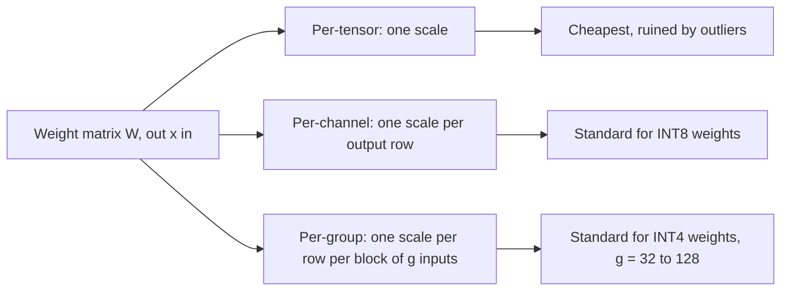

# Quantization Basics: Number Formats, Scales and Zero Points

## Introduction

A model with 8 billion parameters stored in BF16 needs about 16 GB just for its weights. That is more than most laptop GPUs have, and it is also the reason generation is slow. Each new token has to read every weight from memory once, so the time per token is set mostly by how many bytes the weights take up, not by how fast the chip can multiply. Make the weights four times smaller and you can fit the model on cheaper hardware, and each token gets faster too.

**Quantization** means storing numbers with fewer bits than the format they were trained in. In practice that means 8-bit or 4-bit integers, or 8-bit and 4-bit floats, each with a small amount of extra data that says how to map the integers back to real values. Every quantized checkpoint you download, whether a GPTQ or AWQ model on Hugging Face, a `Q4_K_M` GGUF file for llama.cpp, or an FP8 checkpoint for vLLM, is built from the ideas on this page.

By the end of this page you will be able to:

- explain the main number formats (FP32, BF16, FP16, INT8, INT4) and what each costs in memory;
- derive the scale and zero point for symmetric and asymmetric quantization and quantize a vector by hand;
- explain why one scale per tensor fails for LLM weights, and why per-channel and per-group scales fix it;
- implement round-to-nearest quantization in PyTorch and measure what it does to a real model's perplexity.

The rest of this section builds on this page. [Post-Training Quantization](./1-llm-post-training-quantization.mdx) covers smarter rounding methods (GPTQ, AWQ, SmoothQuant), [GGUF](./2-llm-gguf-and-llama-cpp.mdx) covers the block formats llama.cpp uses, and [FP8, MXFP4 and NVFP4](./3-llm-fp8-and-fp4.mdx) covers the low-bit float formats in recent GPUs.

## Number Formats and What They Cost

A floating-point number stores a sign, an exponent and a mantissa (also called the significand). The exponent sets the **range**, meaning how large and how small a number can be. The mantissa sets the **precision**, meaning how many distinct values fit between two powers of two. An integer format has no exponent: its values are evenly spaced, and the range is fixed by the bit width.

| Format | Bits | Exponent / mantissa bits | Largest finite value | Typical use in LLMs |
| --- | --- | --- | --- | --- |
| FP32 | 32 | 8 / 23 | about 3.4e38 | optimizer states, master weights |
| BF16 | 16 | 8 / 7 | about 3.4e38 | training and serving default |
| FP16 | 16 | 5 / 10 | 65504 | older GPUs, some inference kernels |
| FP8 E4M3 | 8 | 4 / 3 | 448 | weights and activations on Hopper and Blackwell |
| INT8 | 8 | none | 127 | weights, activations, KV cache |
| INT4 | 4 | none | 7 | weight-only quantization |
| FP4 E2M1 | 4 | 2 / 1 | 6 | MXFP4 and NVFP4 blocks |

BF16 keeps the FP32 exponent and cuts the mantissa. It has the same range as FP32 with much less precision, which is why it became the default for training (see [Mixed Precision](../6-llm-pretraining/4-llm-mixed-precision.mdx)). Below 16 bits, there are too few bits to keep both a wide range and good precision, so every low-bit format needs a **scale**: an extra number, kept in higher precision, that moves the small format to where the data actually lies.

The memory cost follows directly from the bit width. For a model with $N$ parameters stored at $b$ bits per weight:

$$
\text{bytes} = \frac{N \cdot b}{8}
$$

For Llama 3.1 8B, with about 8.03 billion parameters:

| Storage | Bits per weight | Weight memory |
| --- | --- | --- |
| FP32 | 32 | 32.1 GB |
| BF16 | 16 | 16.1 GB |
| INT8 with per-channel scales | about 8.0 | 8.0 GB |
| INT4 with one FP16 scale per 128 weights | 4.125 | 4.1 GB |

The last row shows something you will see again and again: scales are not free. One 16-bit scale shared by 128 weights adds $16/128 = 0.125$ bits to every weight. Smaller groups give better accuracy and cost more bits. This trade-off is behind almost every format in this section.

## Affine Quantization: Scale and Zero Point

The standard mapping from a real number $x$ to a $b$-bit integer $q$ is **affine** (linear plus an offset). It uses two parameters, a scale $s$ (a positive real number) and a zero point $z$ (an integer):

$$
q = \mathrm{clamp}\!\left(\mathrm{round}\!\left(\frac{x}{s}\right) + z,\; q_{\min},\; q_{\max}\right)
$$

$$
\hat{x} = s\,(q - z)
$$

Here $\hat{x}$ is the **dequantized** value, the real number the integer stands for. The scale $s$ is the step between two neighbouring representable values. The zero point $z$ is the integer that represents the real value 0. `round` maps to the nearest integer, and `clamp` cuts off anything outside the integer range $[q_{\min}, q_{\max}]$.

Think of it as a ruler with $2^b$ tick marks. The scale is the spacing between ticks, and the zero point says which tick is labelled 0. Quantizing means snapping each value to the nearest tick.

### Asymmetric (Min-Max) Quantization

To use every tick, stretch the ruler so that the smallest value in the data lands on $q_{\min}$ and the largest on $q_{\max}$. With unsigned integers $q \in [0, 2^b - 1]$:

$$
s = \frac{x_{\max} - x_{\min}}{2^b - 1}, \qquad z = \mathrm{round}\!\left(-\frac{x_{\min}}{s}\right)
$$

This is **asymmetric** quantization, because the range does not have to be centred on zero. It suits data that is mostly one-sided, such as the output of a ReLU.

### Symmetric Quantization

If the data is roughly centred on zero, which is true of most weight matrices, we can fix $z = 0$ and use signed integers. The scale is chosen so that the largest magnitude lands on the largest integer:

$$
s = \frac{\max_i \lvert x_i \rvert}{2^{b-1} - 1}, \qquad q = \mathrm{clamp}\!\left(\mathrm{round}\!\left(\frac{x}{s}\right), -(2^{b-1}-1),\; 2^{b-1}-1\right)
$$

For 4 bits the integers run from $-7$ to $7$ and for 8 bits from $-127$ to $127$. The code $-8$ (or $-128$) is left unused here so the range stays exactly symmetric. Some libraries use it anyway and accept a range that is one step longer on the negative side. Symmetric quantization wastes some range when the data is lopsided, but the arithmetic is simpler: with no zero point, $\hat{x} = s\,q$.

### A Worked Example You Can Check by Hand

Quantize $x = [-1.2,\ 0.3,\ 0.9,\ 2.4]$ to 4 bits.

**Asymmetric.** The range is $2.4 - (-1.2) = 3.6$ and there are $2^4 - 1 = 15$ steps, so $s = 3.6/15 = 0.24$. The zero point is $z = \mathrm{round}(1.2/0.24) = 5$. Then:

- $-1.2/0.24 = -5$, plus 5 gives $q = 0$;
- $0.3/0.24 = 1.25$ rounds to 1, plus 5 gives $q = 6$, so $\hat{x} = 0.24 \cdot (6 - 5) = 0.24$;
- $0.9/0.24 = 3.75$ rounds to 4, plus 5 gives $q = 9$, so $\hat{x} = 0.96$;
- $2.4/0.24 = 10$, plus 5 gives $q = 15$, so $\hat{x} = 2.4$.

**Symmetric.** $s = 2.4/7 \approx 0.3429$. Then $-1.2/s = -3.5$, which rounds to $-4$ (PyTorch rounds halves to the nearest even integer). The other values give $0.875 \to 1$, $2.625 \to 3$ and $7 \to 7$. Because the data is lopsided, the negative half of the integer range is half empty and the error is larger.

The same calculation in PyTorch:

```python
import torch

torch.manual_seed(0)

def quantize_asym(x, bits):
    """Asymmetric (affine) quantization of a whole tensor to unsigned ints."""
    qmin, qmax = 0, 2**bits - 1
    scale = (x.max() - x.min()) / (qmax - qmin)          # step size between levels
    zero_point = torch.round(qmin - x.min() / scale)     # the integer that represents 0.0
    q = torch.clamp(torch.round(x / scale) + zero_point, qmin, qmax)
    return q.to(torch.int32), scale, zero_point

def quantize_sym(x, bits):
    """Symmetric quantization: zero point fixed at 0, signed ints."""
    qmax = 2**(bits - 1) - 1                             # 7 for 4 bits, 127 for 8 bits
    scale = x.abs().max() / qmax
    q = torch.clamp(torch.round(x / scale), -qmax, qmax)
    return q.to(torch.int32), scale

def dequant_asym(q, scale, zero_point):
    return scale * (q.float() - zero_point)

x = torch.tensor([-1.2, 0.3, 0.9, 2.4])
q, s, z = quantize_asym(x, bits=4)
print("asym  scale", round(s.item(), 4), "zero_point", int(z.item()))
print("asym  q    ", q.tolist())
print("asym  x_hat", [round(v, 4) for v in dequant_asym(q, s, z).tolist()])

q, s = quantize_sym(x, bits=4)
print("sym   scale", round(s.item(), 4))
print("sym   q    ", q.tolist())
print("sym   x_hat", [round(v, 4) for v in (s * q.float()).tolist()])
```

```text
asym  scale 0.24 zero_point 5
asym  q     [0, 6, 9, 15]
asym  x_hat [-1.2, 0.24, 0.96, 2.4]
sym   scale 0.3429
sym   q     [-4, 1, 3, 7]
sym   x_hat [-1.3714, 0.3429, 1.0286, 2.4]
```

### How Large Is the Error?

Rounding to the nearest step moves each value by at most $s/2$. If the values fall at random positions between ticks, the rounding error $e = \hat{x} - x$ is roughly uniform on $[-s/2, s/2]$, and its variance is:

$$
\mathbb{E}[e^2] = \frac{1}{s}\int_{-s/2}^{s/2} e^2 \, de = \frac{s^2}{12}
$$

Each extra bit doubles the number of steps across the same range, which halves $s$ and cuts the error variance by four. In signal terms that is about 6 dB of signal-to-noise ratio per bit. Going from 8 bits to 4 bits makes the step 17 times wider ($255/15$) and the error variance almost 300 times larger. That is why 8-bit quantization is nearly lossless for most models while 4-bit needs care.

The formula also shows the real enemy: $s$ is set by the **range**. A single large value stretches the ruler for every other value in the same group.

## Granularity: Per-Tensor, Per-Channel and Per-Group

Which values share one scale? This choice, the **granularity**, matters more than almost anything else in low-bit quantization.



- **Per-tensor**: one scale for a whole matrix. It costs almost nothing in storage, but one outlier anywhere sets the step size for millions of weights.
- **Per-channel** (per output row): each row of $W$, which produces one output feature, gets its own scale. Rows with small weights get a fine ruler. This is the usual choice for INT8 weights.
- **Per-group** (also called block-wise): each row is cut into blocks of $g$ consecutive input weights, typically 32, 64 or 128, and each block gets a scale (and, for asymmetric schemes, a zero point). This is the usual choice for 4-bit weights. GPTQ and AWQ checkpoints usually use $g = 128$, and llama.cpp formats use blocks of 32 or 256 with sub-blocks inside them.

For activations, the natural granularity is **per-token**: each row of the activation matrix $X$ (one token) gets its own scale, computed on the fly. Large language models also have a few **outlier feature channels**, hidden dimensions whose activations are 10 to 100 times larger than the rest. Dettmers et al. found in LLM.int8() (2022) that these appear systematically in models beyond a few billion parameters. They are why activations are much harder to quantize than weights, a problem the [next page](./1-llm-post-training-quantization.mdx) takes up.

### Why Granularity Interacts with the Matrix Multiply

Quantization is only useful if the hardware can compute with the small numbers. Consider $y_i = \sum_j W_{ij} x_j$ with a symmetric scale $s_{w,i}$ per weight row and one scale $s_x$ for the activation vector:

$$
y_i \approx \sum_j \left(s_{w,i}\, q^{w}_{ij}\right)\left(s_x\, q^{x}_j\right) = s_{w,i}\, s_x \sum_j q^{w}_{ij}\, q^{x}_j
$$

Both scales come out of the sum, so the inner product runs entirely on integers (INT8 times INT8, accumulated in INT32) and is rescaled once at the end. Per-channel weight scales and per-token activation scales both have this property, which is why **W8A8** (8-bit weights and activations) kernels use exactly those granularities.

A per-group scale changes along $j$, the dimension being summed, so it cannot be pulled out. Kernels either rescale partial sums group by group, or more commonly dequantize the weights back to FP16 or BF16 inside the kernel and multiply in high precision. This is **weight-only quantization**, written W4A16 (4-bit weights, 16-bit activations). It saves memory and memory bandwidth but not multiply work. During decoding that is exactly the right trade, because decoding is limited by memory bandwidth, not arithmetic (see [Prefill and Decode](../10-llm-inference/0-llm-inference-overview.mdx)).

## Quantization in a Real Model

How much does granularity matter in practice? The script below loads SmolLM2-135M, a small Llama-architecture model, and measures its perplexity on 8,192 tokens of WikiText-2. Then it applies **round-to-nearest (RTN)** quantization, the simplest method, to every linear layer inside the decoder blocks, using different bit widths and granularities. The weights are quantized and immediately dequantized back to FP32 (this is called **fake quantization**), so the numbers show the effect of rounding without needing integer kernels. Lower perplexity is better; see [Perplexity](../12-llm-evaluation/1-llm-perplexity.mdx) for the definition.

```bash
pip install torch transformers datasets
```

```python
import math, torch
from datasets import load_dataset
from transformers import AutoModelForCausalLM, AutoTokenizer

torch.manual_seed(0)
torch.set_num_threads(8)
name = "HuggingFaceTB/SmolLM2-135M"                   # about 270 MB download
tok = AutoTokenizer.from_pretrained(name)
text = "\n\n".join(load_dataset("Salesforce/wikitext", "wikitext-2-raw-v1", split="test")["text"])
ids = tok(text, return_tensors="pt").input_ids[:, : 16 * 512]   # 16 windows of 512 tokens

@torch.no_grad()
def perplexity(model):
    nll, n = 0.0, 0
    for i in range(0, ids.shape[1], 512):
        chunk = ids[:, i : i + 512]                   # (1, 512)
        out = model(chunk, labels=chunk)
        nll += out.loss.item() * (chunk.shape[1] - 1)
        n += chunk.shape[1] - 1
    return math.exp(nll / n)

def fake_quant(w, bits, group=None, per_channel=False):
    """Round-to-nearest symmetric quantization, returned already dequantized."""
    out_f, in_f = w.shape                             # (out_features, in_features)
    qmax = 2 ** (bits - 1) - 1
    if group is not None:                             # one scale per (row, group of columns)
        wg = w.reshape(out_f, in_f // group, group)
        scale = wg.abs().amax(dim=-1, keepdim=True) / qmax
        return (torch.clamp(torch.round(wg / scale), -qmax, qmax) * scale).reshape(out_f, in_f)
    if per_channel:                                   # one scale per output row
        scale = w.abs().amax(dim=1, keepdim=True) / qmax
    else:                                             # one scale for the whole matrix
        scale = w.abs().max() / qmax
    return torch.clamp(torch.round(w / scale), -qmax, qmax) * scale

def quantized_copy(base, **kw):
    model = AutoModelForCausalLM.from_pretrained(name, dtype=torch.float32)
    for mod in model.model.layers.modules():          # every Linear inside the decoder blocks
        if isinstance(mod, torch.nn.Linear):
            mod.weight.data = fake_quant(mod.weight.data, **kw)
    return model

base = AutoModelForCausalLM.from_pretrained(name, dtype=torch.float32).eval()
print(f"{'FP32 baseline':<24} ppl {perplexity(base):7.2f}")
for label, kw in [("INT8 per-tensor", dict(bits=8)),
                  ("INT4 per-tensor", dict(bits=4)),
                  ("INT4 per-channel", dict(bits=4, per_channel=True)),
                  ("INT4 group 64", dict(bits=4, group=64)),
                  ("INT4 group 32", dict(bits=4, group=32)),
                  ("INT3 group 32", dict(bits=3, group=32))]:
    print(f"{label:<24} ppl {perplexity(quantized_copy(base, **kw).eval()):7.2f}")
```

```text
FP32 baseline            ppl   24.49
INT8 per-tensor          ppl   25.49
INT4 per-tensor          ppl 6228943.02
INT4 per-channel         ppl   56.70
INT4 group 64            ppl   34.97
INT4 group 32            ppl   32.60
INT3 group 32            ppl  141.61
```

SmolLM2's hidden size is 576, which is not a multiple of 128, so the script uses groups of 64 and 32. Read the output from top to bottom:

- **INT8 per-tensor** costs about 4% in perplexity (24.5 to 25.5). With 255 levels, even a range stretched by outliers leaves the steps fine enough. Per-channel INT8 scales would close most of that gap.
- **INT4 per-tensor** destroys the model: a perplexity in the millions means the output is noise. With only 15 levels and a step set by the largest weight in each matrix, most weights round to zero.
- **INT4 per-channel** brings the model back to life, but perplexity still more than doubles (56.7).
- **Per-group** scales close most of the remaining gap: 35.0 with groups of 64 and 32.6 with groups of 32. This is why 4-bit formats almost always use groups.
- **INT3**, even with groups of 32, falls apart again (141.6). Below 4 bits plain rounding is not enough, and you need the error-correcting methods of the [next page](./1-llm-post-training-quantization.mdx) or quantization-aware training.

Small models like this one are also harder to quantize than large ones. Each weight carries more of the model's knowledge, so the same rounding costs more perplexity. A 4-bit, group-128 quantization of a 70B model is usually much closer to its baseline than these numbers suggest.

## Where Quantization Happens in the Pipeline

Quantization can be applied at different stages, and the names are worth knowing because model cards use them:

| Approach | When | Data needed | Examples |
| --- | --- | --- | --- |
| Round-to-nearest (RTN) | after training, per tensor | none | bitsandbytes INT8 and NF4, llama.cpp `Q8_0` and `Q4_0` without an importance matrix |
| Calibrated PTQ | after training, layer by layer | a few hundred sample sequences | GPTQ, AWQ, SmoothQuant, llama.cpp with an importance matrix |
| Quantization-aware training (QAT) | during or after training, with gradients | training data | Gemma 3 QAT checkpoints, the Llama 3.2 1B and 3B QAT plus LoRA releases |
| Low-bit training | from the start | the whole pretraining run | FP8 training in DeepSeek-V3, BitNet b1.58 ternary weights |

**Post-training quantization (PTQ)** is cheap and needs no training pipeline, so it is what most people use. **Quantization-aware training (QAT)** puts the fake-quantization step inside the forward pass so the model learns weights that survive rounding. The rounding function has zero gradient almost everywhere, so QAT uses the **straight-through estimator**: in the backward pass, `round` is treated as the identity. In PyTorch that is one line, `w_q = w + (fake_quant(w) - w).detach()`.

What you quantize also matters:

- **Weights** are fixed, so you can spend minutes or hours choosing good scales offline.
- **Activations** change with every input and contain outlier channels, so their scales must be computed on the fly (dynamic) or estimated from calibration data (static).
- **The KV cache** grows with context length and can be larger than the weights in long-context serving. It has its own page: [KV Cache Compression and Quantization](./4-llm-kv-cache-quantization.mdx).

:::tip
When a model card says W4A16, W8A8 or FP8, read it as "weights at X bits, activations at Y bits". W4A16 is weight-only and helps mostly during decoding. W8A8 and FP8 also speed up the matrix multiplies themselves, which helps prefill and large batches, but only on hardware with fast INT8 or FP8 units.
:::

## Common Mistakes

- **Quantizing everything with one scale per tensor.** At 4 bits this destroys the model, as the experiment shows. Use per-group scales for 4-bit weights.
- **Forgetting the scale overhead when budgeting memory.** A "4-bit" model with FP16 scales per 32 weights is 4.5 bits per weight, not 4.
- **Quantizing the embedding and output layers as aggressively as the rest.** Many recipes keep `lm_head` (and sometimes the embeddings) at 8 or 16 bits because errors there directly change the output probabilities.
- **Expecting weight-only quantization to speed up prefill.** W4A16 dequantizes to 16 bits before multiplying, so compute-bound phases do not get faster and can even get slower.
- **Comparing quantized models by eye.** A few sample answers look fine even when quality has dropped. Measure perplexity or KL divergence against the unquantized model, then run a task benchmark.
- **Mixing up rounding conventions.** `torch.round` rounds halves to the nearest even number, while many C implementations round halves away from zero. When you reimplement a format, match its convention or results will differ slightly.

## Summary

- Quantization stores weights (and optionally activations and the KV cache) in fewer bits, plus scales that map the integers back to real values.
- Affine quantization uses $q = \mathrm{round}(x/s) + z$ and $\hat{x} = s(q - z)$. Symmetric schemes fix $z = 0$. Asymmetric schemes fit the full min-max range.
- Rounding error has variance about $s^2/12$. The scale is set by the range, so outliers inflate the error of every value that shares their scale.
- Granularity is the key design choice: per-tensor is cheapest, per-channel suits INT8, and per-group (32 to 128 weights) is the standard for 4-bit weights.
- Per-channel and per-token scales allow pure integer matrix multiplies (W8A8). Per-group scales are usually paired with weight-only kernels (W4A16), which pay off in memory-bound decoding.
- Plain round-to-nearest works at 8 bits and at 4 bits with small groups. Below that you need calibrated methods or quantization-aware training.

## Further Reading

- [A White Paper on Neural Network Quantization (Nagel et al., 2021)](https://arxiv.org/abs/2106.08295): a clear reference on affine quantization, granularity and PTQ versus QAT.
- [LLM.int8(): 8-bit Matrix Multiplication for Transformers at Scale (Dettmers et al., 2022)](https://arxiv.org/abs/2208.07339): the paper that documented outlier features in large transformers.
- [Quantization and Training of Neural Networks for Efficient Integer-Arithmetic-Only Inference (Jacob et al., 2017)](https://arxiv.org/abs/1712.05877): the integer-only scheme with scales and zero points that most inference libraries follow.
- [Hugging Face Transformers quantization overview](https://huggingface.co/docs/transformers/main/en/quantization/overview): every quantization backend Transformers supports, with a hardware compatibility table.
- [PyTorch torchao](https://github.com/pytorch/ao): PyTorch's library for quantization and low-bit training, including INT4, INT8 and FP8 recipes.
