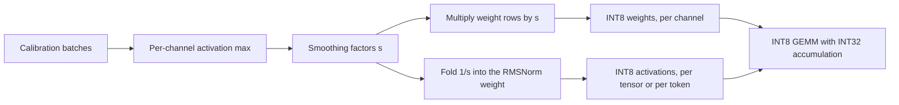

# Post-Training Quantization: GPTQ, AWQ and SmoothQuant

## Introduction

The [previous page](./0-llm-quantization-basics.mdx) showed that round-to-nearest (RTN) quantization works at 8 bits and, with small groups, at 4 bits. It also showed where RTN starts to fail: at 3 bits and below, and whenever activations have to be quantized as well as weights. RTN treats every weight on its own and ignores the data that flows through the layer. Three methods from 2022 and 2023 fixed this by looking at that data, and between them they produce most of the quantized checkpoints you will find on Hugging Face:

- **GPTQ** (Frantar et al., 2022) quantizes weights one column at a time and adjusts the not-yet-quantized weights to cancel the error, using second-order information from calibration inputs.
- **AWQ** (Lin et al., 2023) finds the small fraction of weights that matter most, judged by activation size, and protects them by rescaling channels before rounding.
- **SmoothQuant** (Xiao et al., 2022) makes activations quantizable by moving their outliers into the weights with an exact rescaling, which enables fast 8-bit weight-and-activation (W8A8) inference.

All three are **post-training quantization (PTQ)** methods. They need a trained model and a small **calibration set**, typically 128 to 512 text sequences, but no gradient training. On this page you will derive each method, implement it in PyTorch, measure it on a real model, and see how to run the production versions with `llm-compressor`, the quantization library from the vLLM project.

## The Layer-Wise Reconstruction Objective

All three methods work one linear layer at a time. For a layer with weights $W$ of shape (out, in) and calibration inputs $X$ of shape (in, tokens), they look for quantized weights $\widehat{W}$ that keep the layer's **output** close to the original, rather than keeping the weights themselves close:

$$
\widehat{W} = \arg\min_{\widehat{W}} \left\lVert W X - \widehat{W} X \right\rVert_F^2
$$

This changes what counts as a good rounding. An error on a weight whose input is always near zero does no harm. An error on a weight whose input is large does a lot. And if two inputs are correlated, an error on one weight can be partly cancelled by an opposite error on the other.

Expand the objective for one row $w$ of $W$, with error $\delta = w - \hat{w}$:

$$
\lVert \delta X \rVert^2 = \delta \, X X^\top \delta^\top = \tfrac{1}{2}\, \delta H \delta^\top, \qquad H = 2 X X^\top
$$

The matrix $H$, of shape (in, in), is the Hessian of the squared error with respect to the weights. It depends only on the inputs, so **every row of $W$ shares the same $H$**. GPTQ's speed comes from that fact. Its diagonal $H_{jj}$ measures how large input $j$ is on average, which is exactly the quantity AWQ uses to find important channels.

## GPTQ: Quantize a Column, Fix the Rest

### The Optimal Brain Surgeon Update

GPTQ grew out of Optimal Brain Surgeon, a 1990s pruning method, and its quantization extension, Optimal Brain Quantization (Frantar and Alistarh, 2022). The question is: if we force weight $q$ in a row to its quantized value, how should we change the remaining weights to keep the loss as small as possible?

Write the change to the row as $\delta$, constrained so that $\delta_q = \mathrm{quant}(w_q) - w_q$. Minimizing $\tfrac{1}{2}\delta H \delta^\top$ under this one linear constraint (a Lagrange multiplier problem) gives:

$$
\delta = -\frac{w_q - \mathrm{quant}(w_q)}{[H^{-1}]_{qq}} \, \left(H^{-1}\right)_{q,:}, \qquad \Delta L = \frac{\left(w_q - \mathrm{quant}(w_q)\right)^2}{2\,[H^{-1}]_{qq}}
$$

Read it in two parts. The scalar part is the rounding error of weight $q$, scaled by how "cheap" that weight is to change ($[H^{-1}]_{qq}$ is large when input $q$ is small or redundant). The vector part, row $q$ of $H^{-1}$, says how to spread a compensating change over the other weights so that their inputs absorb the error. Once weight $q$ is fixed, it is removed from the problem and $H^{-1}$ is updated by one step of Gaussian elimination:

$$
H^{-1}_{-q} = H^{-1} - \frac{1}{[H^{-1}]_{qq}}\, \left(H^{-1}\right)_{:,q} \left(H^{-1}\right)_{q,:}
$$

### Three Tricks That Make It Scale

Optimal Brain Quantization picked the next weight greedily, separately for each row, which costs $O(d_{\text{row}} \cdot d_{\text{col}}^3)$ and was too slow for billion-parameter models. GPTQ (Frantar, Ashkboos, Hoefler and Alistarh, 2022) made three changes:

1. **Fixed order.** Quantize columns left to right for all rows at once. The paper found that on large layers this is almost as good as greedy order. Because $H$ is shared, all rows now need the same sequence of $H^{-1}$ updates, so the cost drops to $O(d_{\text{row}} \cdot d_{\text{col}}^2)$.
2. **Lazy batch updates.** Updating the whole remaining matrix after every column is memory-bound. GPTQ applies updates only inside a block of 128 columns and pushes the accumulated error to the rest of the matrix once per block, with one matrix multiply.
3. **Cholesky form.** Repeated elimination steps accumulate rounding errors and can make $H^{-1}$ indefinite on large models. The rows needed by the fixed-order algorithm are exactly the rows of the upper Cholesky factor of $H^{-1}$, which can be computed once in a numerically stable way. A small **dampening** term, 1% of the mean diagonal of $H$ added to the diagonal, keeps $H$ invertible.

With these, the paper quantized 175-billion-parameter models to 3 or 4 bits in about four GPU hours.

### A Two-Weight Example

Take one row $w = [0.6,\ 0.6]$, a quantization grid of whole numbers, and correlated inputs with $H \propto \begin{bmatrix} 2 & 1 \\ 1 & 2 \end{bmatrix}$. Then $H^{-1} = \frac{1}{3}\begin{bmatrix} 2 & -1 \\ -1 & 2 \end{bmatrix}$.

- **RTN** rounds both weights to 1. The error is $\delta = [-0.4, -0.4]$ and the loss $\delta H \delta^\top = 0.96$.
- **GPTQ** rounds $w_1 = 0.6$ to 1 (error $-0.4$) and then updates $w_2$ by $-\frac{-0.4}{2/3}\cdot\left(-\frac{1}{3}\right) = -0.2$, so $w_2$ becomes $0.4$, which rounds to 0. The error is $\delta = [-0.4, 0.6]$ and the loss is $0.56$.

The positive correlation means that rounding one weight up can be offset by rounding the other down. GPTQ finds this. RTN cannot.

```python
import itertools, torch

torch.manual_seed(0)
H = torch.tensor([[2.0, 1.0], [1.0, 2.0]])          # proportional to X X^T: inputs are correlated
w = torch.tensor([0.6, 0.6])                         # one row of W; the grid is the integers

def loss(w_hat):
    d = w - w_hat
    return (d @ H @ d).item()                        # proportional to ||w X - w_hat X||^2

rtn = torch.round(w)
Hinv = torch.linalg.inv(H)
w_work = w.clone()
q1 = torch.round(w_work[0])                          # quantize the first weight
err = (w_work[0] - q1) / Hinv[0, 0]
w_work[1] -= err * Hinv[0, 1]                        # GPTQ / OBS update of the remaining weight
gptq = torch.stack([q1, torch.round(w_work[1])])

print("RTN  ", rtn.tolist(), "loss", round(loss(rtn), 3))
print("w2 after update", round(w_work[1].item(), 3))
print("GPTQ ", gptq.tolist(), "loss", round(loss(gptq), 3))
best = min(itertools.product([0.0, 1.0], repeat=2), key=lambda c: loss(torch.tensor(c)))
print("best ", list(best), "loss", round(loss(torch.tensor(best)), 3))
```

```text
RTN   [1.0, 1.0] loss 0.96
w2 after update 0.4
GPTQ  [1.0, 0.0] loss 0.56
best  [0.0, 1.0] loss 0.56
```

GPTQ reaches the best possible loss here (two roundings tie at 0.56).

### Implementing GPTQ for a Whole Model

The implementation below follows the paper's algorithm: Cholesky factor of the dampened inverse Hessian, lazy blocks of 128 columns, and one symmetric scale per group of 32 weights computed when the group is reached (so it sees weights already adjusted by earlier columns). The model is quantized one decoder layer at a time. For each layer, hooks collect $H$ for every linear layer from calibration data that has passed through the already-quantized earlier layers, so later layers learn to correct for the errors of earlier ones.

```python
import math, torch
from datasets import load_dataset
from transformers import AutoModelForCausalLM, AutoTokenizer

torch.manual_seed(0)
torch.set_num_threads(12)
NAME = "HuggingFaceTB/SmolLM2-135M"
tok = AutoTokenizer.from_pretrained(NAME)
ds = load_dataset("Salesforce/wikitext", "wikitext-2-raw-v1")
test_ids = tok("\n\n".join(ds["test"]["text"]), return_tensors="pt").input_ids[:, : 16 * 512]
train_ids = tok("\n\n".join(ds["train"]["text"])[:400_000], return_tensors="pt").input_ids
starts = torch.randint(0, train_ids.shape[1] - 512, (32,))
calib = torch.stack([train_ids[0, s : s + 512] for s in starts])      # (32, 512) calibration tokens

@torch.no_grad()
def perplexity(model):
    nll, n = 0.0, 0
    for i in range(0, test_ids.shape[1], 512):
        chunk = test_ids[:, i : i + 512]
        nll += model(chunk, labels=chunk).loss.item() * (chunk.shape[1] - 1)
        n += chunk.shape[1] - 1
    return math.exp(nll / n)

def quant_rtn(w, scale, qmax):
    return torch.clamp(torch.round(w / scale), -qmax, qmax) * scale

def group_scale(w, qmax):
    return w.abs().amax(dim=1, keepdim=True) / qmax                 # (out, 1): one scale per row of the group

def rtn_matrix(W, bits, group):
    qmax = 2 ** (bits - 1) - 1
    Q = torch.empty_like(W)
    for g in range(0, W.shape[1], group):
        Q[:, g : g + group] = quant_rtn(W[:, g : g + group], group_scale(W[:, g : g + group], qmax), qmax)
    return Q

def gptq_matrix(W, H, bits, group, block=128, damp=0.01):
    """GPTQ for one weight matrix W (out, in) with Hessian H = X X^T (in, in)."""
    W, H = W.clone(), H.clone()
    n = W.shape[1]
    qmax = 2 ** (bits - 1) - 1
    dead = torch.diag(H) == 0                                       # inputs that never fire
    H[dead, dead] = 1.0
    W[:, dead] = 0.0
    H += damp * torch.mean(torch.diag(H)) * torch.eye(n)            # dampening keeps H invertible
    Hinv = torch.linalg.cholesky(torch.cholesky_inverse(torch.linalg.cholesky(H)), upper=True)
    Q = torch.zeros_like(W)
    for b0 in range(0, n, block):                                   # lazy batch of columns
        b1 = min(b0 + block, n)
        W1, Err1, Hinv1 = W[:, b0:b1].clone(), torch.zeros(W.shape[0], b1 - b0), Hinv[b0:b1, b0:b1]
        for i in range(b1 - b0):
            col = b0 + i
            if col % group == 0:                                    # new group: fresh scale from current weights
                scale = group_scale(W1[:, i : i + group], qmax)
            w = W1[:, i]                                            # (out,)
            q = quant_rtn(w.unsqueeze(1), scale, qmax).squeeze(1)
            Q[:, col] = q
            err = (w - q) / Hinv1[i, i]
            W1[:, i:] -= err.unsqueeze(1) @ Hinv1[i, i:].unsqueeze(0)  # push the error onto later columns
            Err1[:, i] = err
        W[:, b1:] -= Err1 @ Hinv[b0:b1, b1:]                         # apply the whole block's error at once
    return Q

@torch.no_grad()
def quantize_model(method, bits, group):
    model = AutoModelForCausalLM.from_pretrained(NAME, dtype=torch.float32).eval()
    for layer in model.model.layers:                                # layer by layer, front to back
        linears = {n: m for n, m in layer.named_modules() if isinstance(m, torch.nn.Linear)}
        if method == "rtn":
            for m in linears.values():
                m.weight.data = rtn_matrix(m.weight.data, bits, group)
            continue
        H = {n: torch.zeros(m.in_features, m.in_features) for n, m in linears.items()}
        def make_hook(n):
            def hook(mod, inp, out):
                x = inp[0].reshape(-1, inp[0].shape[-1])            # (tokens, in_features)
                H[n] += 2 * x.T @ x / calib.numel()
            return hook
        hooks = [m.register_forward_hook(make_hook(n)) for n, m in linears.items()]
        for i in range(0, calib.shape[0], 8):                       # inputs come from the already-quantized prefix
            model(calib[i : i + 8])
        for h in hooks:
            h.remove()
        for n, m in linears.items():
            m.weight.data = gptq_matrix(m.weight.data, H[n], bits, group)
    return model

base = AutoModelForCausalLM.from_pretrained(NAME, dtype=torch.float32).eval()
print(f"FP32 baseline         ppl {perplexity(base):7.2f}")
for bits in (4, 3):
    for method in ("rtn", "gptq"):
        print(f"{method.upper():<5} W{bits} group 32     ppl {perplexity(quantize_model(method, bits, 32)):7.2f}")
```

```text
FP32 baseline         ppl   24.49
RTN   W4 group 32     ppl   32.60
GPTQ  W4 group 32     ppl   31.95
RTN   W3 group 32     ppl  141.61
GPTQ  W3 group 32     ppl   72.54
```

At 4 bits with groups of 32, RTN is already reasonable and GPTQ gains only a little (32.6 to 32.0). At 3 bits, where RTN falls apart (141.6), GPTQ halves the perplexity to 72.5. That is the general pattern: the fewer bits you have, the more error compensation is worth. The 3-bit model is still far from the baseline, because a 135M-parameter model has little redundancy to absorb the rounding. On 7B-and-larger models the paper reports 3-bit and 4-bit results much closer to FP16. This run takes several minutes on a CPU, mostly in the 30 calibration passes, one per decoder layer.

Two options you will see in GPTQ configs relate to this code. `desc_act` (also called act-order) processes columns in order of decreasing $H_{jj}$, so the most important inputs are quantized first while there is still freedom left to compensate. `damp_percent` is the dampening factor, 0.01 here. Qwen's official `Qwen2.5-7B-Instruct-GPTQ-Int4` checkpoint, for example, ships with:

```json
{
  "bits": 4,
  "group_size": 128,
  "desc_act": false,
  "damp_percent": 0.01,
  "sym": true,
  "true_sequential": true,
  "quant_method": "gptq"
}
```

## AWQ: Protect the Salient Channels

### Not All Weights Are Equal

AWQ (Lin et al., 2023, MLSys 2024 best paper) starts from an experiment. Keep just 1% of the input channels of each layer in FP16 and quantize the rest to INT3 with RTN, and perplexity improves a lot. Which 1% matters: choosing the channels with the largest **activations** works, while choosing those with the largest **weights** is barely better than choosing at random. A weight is important when the input it multiplies is large.

Mixed precision is awkward for kernels, so AWQ protects salient channels a different way. Multiply input channel $j$ of the weights by a factor $s_j > 1$ and divide the matching activation by the same factor. The product is unchanged:

$$
y = W x = \left(W \,\mathrm{diag}(s)\right)\left(\mathrm{diag}(s)^{-1} x\right)
$$

Now quantize the scaled weights. For a weight $w$ in a group with step $\Delta$, the output error from rounding is about $\Delta \cdot \mathrm{RoundErr} \cdot x$. After scaling, the weight is $w s$ and the input is $x/s$, so the error becomes $\Delta' \cdot \mathrm{RoundErr} \cdot x / s$. If scaling one channel does not change the group's maximum, then $\Delta' \approx \Delta$, and the error on that channel shrinks by a factor of $s$. Scale too much, though, and that channel becomes the group maximum, $\Delta'$ grows, and every other weight in the group suffers.

### Searching the Scales

AWQ uses a simple parameterization and a grid search. With $\bar{s}_X$ the mean absolute activation per input channel from calibration data:

$$
s = \bar{s}_X^{\,\alpha}, \qquad \alpha^\ast = \arg\min_{\alpha \in [0, 1]} \left\lVert Q\!\left(W \mathrm{diag}(s)\right)\left(\mathrm{diag}(s)^{-1} X\right) - W X \right\rVert
$$

$\alpha = 0$ is plain RTN and $\alpha = 1$ scales fully by activation size. The reference implementation tries 20 evenly spaced values of $\alpha$ and then also searches a clipping ratio that shrinks each group's range slightly. At inference time, $\mathrm{diag}(s)^{-1}$ is folded into the previous operator (the RMSNorm weight before `q_proj`, or `v_proj` before `o_proj`), so it costs nothing. There is no weight update and no Hessian inverse, which makes AWQ fast, and because it only fits one scalar per layer it overfits the calibration set less than GPTQ does.

The script below runs the scale search on one real layer, the `up_proj` of block 10 in SmolLM2-135M, at INT3 with groups of 32. It also runs the SmoothQuant experiment from the next section on the same layer.

```python
import torch
from transformers import AutoModelForCausalLM, AutoTokenizer

torch.manual_seed(0)
NAME = "HuggingFaceTB/SmolLM2-135M"
tok = AutoTokenizer.from_pretrained(NAME)
model = AutoModelForCausalLM.from_pretrained(NAME, dtype=torch.float32).eval()

text = ("The history of the printing press begins in the fifteenth century, when Johannes Gutenberg "
        "combined movable metal type, oil-based ink and a wooden screw press. Within fifty years, "
        "presses were running in more than two hundred European cities, and the price of books fell. ") * 4
ids = tok(text, return_tensors="pt").input_ids                       # (1, T)

layer = model.model.layers[10].mlp.up_proj                           # Linear(576 -> 1536)
captured = {}
h = layer.register_forward_hook(lambda m, inp, out: captured.update(x=inp[0][0]))
with torch.no_grad():
    model(ids)
h.remove()
X = captured["x"]                                                    # (T, 576) activations entering the layer
W = layer.weight.data                                                # (1536, 576)
Y = X @ W.T                                                          # reference output

ch_max = X.abs().amax(dim=0)                                         # per input channel
print("tokens", X.shape[0], "| activation |max| per channel: median",
      round(ch_max.median().item(), 2), "max", round(ch_max.max().item(), 2))
print("top-5 channels", ch_max.topk(5).indices.tolist())

def q_group(w, bits=3, group=32):                                    # symmetric RTN along input dim
    qmax = 2 ** (bits - 1) - 1
    wg = w.reshape(w.shape[0], -1, group)
    s = wg.abs().amax(-1, keepdim=True) / qmax
    return (torch.clamp(torch.round(wg / s), -qmax, qmax) * s).reshape_as(w)

def rel_err(Yq):
    return ((Yq - Y).norm() / Y.norm()).item()

# --- AWQ-style scale search: W' = Q(W diag(s)) diag(s)^-1, s = act_mean^alpha ---
act_mean = X.abs().mean(dim=0)                                       # (576,)
print("\nAWQ grid search, W3 group 32")
for alpha in (0.0, 0.25, 0.5, 0.75, 1.0):
    s = act_mean.pow(alpha).clamp(min=1e-4)
    s = s / (s.max() * s.min()).sqrt()                               # keep scales centred around 1
    Wq = q_group(W * s) / s                                          # scale columns up, quantize, scale back
    print(f"  alpha {alpha:4.2f}  relative output error {rel_err(X @ Wq.T):.4f}")

# --- SmoothQuant: INT8 per-tensor activations and INT8 per-channel weights ---
def q_act_int8(x):
    s = x.abs().max() / 127
    return torch.clamp(torch.round(x / s), -127, 127) * s

def q_w_int8(w):
    s = w.abs().amax(dim=1, keepdim=True) / 127
    return torch.clamp(torch.round(w / s), -127, 127) * s

print("\nSmoothQuant W8A8 (per-tensor activations)")
print(f"  no smoothing        relative output error {rel_err(q_act_int8(X) @ q_w_int8(W).T):.4f}")
for alpha in (0.5, 0.8):
    s = ch_max.pow(alpha) / W.abs().amax(dim=0).pow(1 - alpha)       # (576,) per input channel
    Xs, Ws = X / s, W * s                                            # (X diag(s)^-1)(diag(s) W^T) = X W^T
    print(f"  alpha {alpha}           relative output error {rel_err(q_act_int8(Xs) @ q_w_int8(Ws).T):.4f}")
```

```text
tokens 209 | activation |max| per channel: median 0.28 max 2.87
top-5 channels [507, 260, 308, 230, 157]

AWQ grid search, W3 group 32
  alpha 0.00  relative output error 0.2429
  alpha 0.25  relative output error 0.2098
  alpha 0.50  relative output error 0.2030
  alpha 0.75  relative output error 0.2173
  alpha 1.00  relative output error 0.2500

SmoothQuant W8A8 (per-tensor activations)
  no smoothing        relative output error 0.0521
  alpha 0.5           relative output error 0.0204
  alpha 0.8           relative output error 0.0139
```

The AWQ curve has the U shape the derivation predicts. Moderate scaling ($\alpha = 0.5$) cuts the output error by about 16% compared with RTN ($\alpha = 0$), and scaling all the way ($\alpha = 1$) is worse than doing nothing, because the boosted channels now set the group maximum.

## SmoothQuant: Move the Outliers into the Weights

### Why Activations Are Hard

Weight-only methods leave activations in 16 bits, so the matrix multiply still runs in 16 bits. To use INT8 tensor cores, which on recent NVIDIA GPUs have twice the throughput of FP16 ones, both operands must be 8-bit. Weights quantize easily to INT8. Activations do not: a few hidden channels carry values 10 to 100 times larger than the rest, consistently across tokens. LLM.int8() (Dettmers et al., 2022) handled this by detecting outliers above a magnitude threshold of 6.0 and computing those columns in FP16, a mixed-precision split that saves memory but is slow.

### The Smoothing Transform

SmoothQuant uses the same identity as AWQ, but for a different purpose. Divide activation channel $j$ by $s_j$ and multiply the matching weight row by $s_j$:

$$
Y = \left(X \,\mathrm{diag}(s)^{-1}\right) \left(\mathrm{diag}(s)\, W^\top\right)
$$

This flattens the activation outliers and makes the weights a little less uniform. Since weights are much easier to quantize, this moves the difficulty to where it is easier to handle. The **migration strength** $\alpha$ balances the two sides:

$$
s_j = \frac{\max \lvert X_j \rvert^{\alpha}}{\max \lvert W_j \rvert^{1-\alpha}}
$$

With $\alpha = 0.5$ (the paper's default) channel $j$ ends up with the same maximum, $\sqrt{\max\lvert X_j\rvert \max\lvert W_j\rvert}$, in both activations and weights. Models with stronger outliers need a larger $\alpha$, which moves more of the range into the weights. The per-channel maxima come from calibration data, and $\mathrm{diag}(s)^{-1}$ is folded into the preceding LayerNorm or RMSNorm weights, so the transform is free at inference time.

In the experiment above, per-tensor INT8 activations on the raw layer give a 5.2% output error. Smoothing with $\alpha = 0.5$ cuts that to 2.0%, and $\alpha = 0.8$ to 1.4%. This small model's outliers are mild (about ten times the median). In OPT-175B or BLOOM-176B, which the paper studied, they are much stronger, and without smoothing W8A8 accuracy collapses. The paper reports up to 1.56 times faster inference and half the memory compared with FP16, with negligible accuracy loss.



## Choosing a Method and Running It in Practice

| Method | Quantizes | Typical scheme | Calibration | Strength | Weakness |
| --- | --- | --- | --- | --- | --- |
| RTN | weights | W8A16, W4A16 with groups | none | instant, no data | poor below 4 bits |
| GPTQ | weights | W4A16 or W3A16, group 128 | 128 to 512 sequences | best at 3 to 4 bits, error compensation | can overfit calibration data, slower |
| AWQ | weights | W4A16, group 128 | 128 sequences | fast, robust across domains | weight-only, 4-bit focus |
| SmoothQuant | weights and activations | W8A8 INT8 | 512 sequences | real INT8 GEMM speed-up | 8-bit only by itself |
| Rotations (QuaRot, SpinQuant) | weights, activations, KV | W4A4 | small | removes outliers, enables 4-bit activations | extra Hadamard transforms at runtime |

The rotation methods in the last row go further than smoothing. QuaRot (Ashkboos et al., 2024) and SpinQuant (Liu et al., 2024) multiply the hidden state by an orthogonal matrix, such as a randomized Hadamard matrix, that spreads every outlier across all channels. The model's output is unchanged because the inverse rotation is folded into the next weight matrix. SpinQuant learns the rotation. These methods make 4-bit activations possible.

For production, use a maintained library rather than your own code. The original AutoAWQ and AutoGPTQ repositories were archived in 2025. AWQ's maintainers point users to **llm-compressor**, and for GPTQ, Hugging Face Transformers now uses **GPTQModel**. A W4A16 GPTQ run with llm-compressor looks like this (it needs a GPU for models of this size):

```bash
pip install llmcompressor
```

```python
from transformers import AutoModelForCausalLM, AutoTokenizer
from llmcompressor import oneshot
from llmcompressor.modifiers.gptq import GPTQModifier

model_id = "meta-llama/Meta-Llama-3-8B-Instruct"
model = AutoModelForCausalLM.from_pretrained(model_id)
tokenizer = AutoTokenizer.from_pretrained(model_id)

# 4-bit weights, group size 128, keep the output head in 16 bits
recipe = GPTQModifier(targets="Linear", scheme="W4A16", ignore=["lm_head"])
oneshot(model=model, dataset="perfectblend", splits="train[:512]", recipe=recipe,
        max_seq_length=2048, num_calibration_samples=512)

save_dir = "Meta-Llama-3-8B-Instruct-W4A16-G128"
model.save_pretrained(save_dir, save_compressed=True)
tokenizer.save_pretrained(save_dir)
```

For AWQ, the recipe becomes `[AWQModifier(...), QuantizationModifier(scheme="W4A16_ASYM", targets=["Linear"], ignore=["lm_head"])]`, with `AWQModifier` imported from `llmcompressor.modifiers.transform.awq`. For SmoothQuant W8A8, use `[SmoothQuantModifier(smoothing_strength=0.8), GPTQModifier(scheme="W8A8", targets="Linear", ignore=["lm_head"])]`, with `SmoothQuantModifier` imported from `llmcompressor.modifiers.transform.smoothquant`. The saved checkpoint uses the `compressed-tensors` format, and vLLM serves it directly with `vllm serve ./Meta-Llama-3-8B-Instruct-W4A16-G128`. vLLM reads the `quantization_config` in `config.json` and picks a matching kernel, such as Marlin for 4-bit weights on NVIDIA GPUs (see [Serving Engines](../10-llm-inference/5-llm-serving-engines.mdx)).

:::warning
Calibrate on data that looks like your real traffic. A model calibrated only on English Wikipedia can lose more accuracy on code, chat or other languages than the reported benchmark numbers suggest. Chat models should be calibrated on text formatted with their chat template.
:::

## Common Mistakes

- **Using too little calibration data.** With only a few short sequences, $H$ is low-rank and GPTQ overfits. 128 or more sequences of 512 to 2,048 tokens is typical.
- **Forgetting to quantize layers in order.** Collecting all Hessians from the original model, rather than from the partly quantized one, gives up GPTQ's ability to correct earlier layers' errors.
- **Quantizing `lm_head` and the router of an MoE model.** Most recipes leave these in 16 bits. gpt-oss, for example, keeps attention, the router, embeddings and `lm_head` out of MXFP4.
- **Assuming W4A16 speeds up large batches.** At high batch sizes the GEMM becomes compute-bound and the dequantization overhead can make W4A16 slower than FP16. W8A8 or FP8 is the better choice for throughput-bound serving.
- **Judging methods on perplexity alone.** Perplexity is a good first check, but reasoning, long-context and code tasks can degrade more. Evaluate on the tasks you care about.
- **Re-quantizing an already quantized model.** Converting a GPTQ checkpoint to GGUF, or a 4-bit GGUF to another 4-bit type, stacks rounding errors. Always start from the 16-bit original.

## Summary

- Post-training quantization minimizes each layer's **output** error $\lVert WX - \widehat{W}X \rVert^2$ on calibration data instead of the weight error.
- The shared Hessian $H = 2XX^\top$ captures how large and how correlated the inputs are. GPTQ uses all of it, AWQ uses its diagonal.
- **GPTQ** quantizes columns in order and pushes each rounding error onto the remaining columns through $H^{-1}$, made fast with lazy batches and a Cholesky factor.
- **AWQ** scales salient input channels, found by activation size, before rounding, with a one-parameter grid search per layer. The inverse scale is folded into the previous operator.
- **SmoothQuant** divides activation channels by $s_j = \max\lvert X_j\rvert^\alpha / \max\lvert W_j\rvert^{1-\alpha}$ and multiplies the weights by it, making W8A8 INT8 inference accurate.
- Rotation methods (QuaRot, SpinQuant) spread outliers across channels and enable 4-bit activations. Production pipelines use llm-compressor or GPTQModel, and vLLM serves the result directly.

## Further Reading

- [GPTQ: Accurate Post-Training Quantization for Generative Pre-trained Transformers (Frantar et al., 2022)](https://arxiv.org/abs/2210.17323): the GPTQ algorithm and its Cholesky and lazy-batch tricks.
- [Optimal Brain Compression (Frantar and Alistarh, 2022)](https://arxiv.org/abs/2208.11580): the OBS-based framework for quantization and pruning that GPTQ builds on.
- [AWQ: Activation-aware Weight Quantization for LLM Compression and Acceleration (Lin et al., 2023)](https://arxiv.org/abs/2306.00978): salient channels and the scale search.
- [SmoothQuant: Accurate and Efficient Post-Training Quantization for Large Language Models (Xiao et al., 2022)](https://arxiv.org/abs/2211.10438): outlier migration for W8A8.
- [QuaRot: Outlier-Free 4-Bit Inference in Rotated LLMs (Ashkboos et al., 2024)](https://arxiv.org/abs/2404.00456): Hadamard rotations for 4-bit weights, activations and KV cache.
- [SpinQuant: LLM Quantization with Learned Rotations (Liu et al., 2024)](https://arxiv.org/abs/2405.16406): learned rotations that improve on random ones.
- [llm-compressor](https://github.com/vllm-project/llm-compressor): the vLLM project's library for GPTQ, AWQ, SmoothQuant, FP8 and FP4 recipes.
- [GPTQModel](https://github.com/ModelCloud/GPTQModel): the GPTQ backend used by Hugging Face Transformers.
