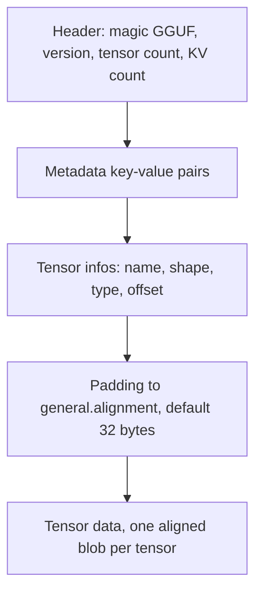
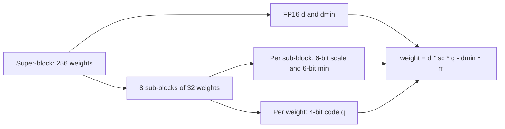
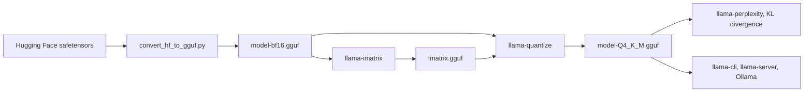

# GGUF and Running Models Locally with llama.cpp and Ollama

## Introduction

If you have run an open model on a laptop, you have probably used a **GGUF** file. GGUF is the model format of **llama.cpp**, a C/C++ inference engine started by Georgi Gerganov in 2023, and of the tools built on it, such as Ollama and LM Studio. One file holds the quantized weights, the tokenizer, the chat template and every hyperparameter the runtime needs. Hugging Face model pages for popular models usually list a dozen GGUF variants with names like `Q4_K_M`, `Q5_K_S`, `IQ3_XXS` and `Q8_0`, and picking one is the first decision you make when running a model locally.

This page explains what is inside those files and what the names mean. By the end you will be able to:

- describe the GGUF file layout and read one with the `gguf` Python package;
- explain llama.cpp's block quantization formats, from the simple `Q4_0` to the two-level k-quants, and compute their bits per weight;
- decode a name like `Q4_K_M` into the per-tensor types it uses;
- convert a Hugging Face model, quantize it with an importance matrix, check its quality, and run it with `llama-cli`, `llama-server` or Ollama;
- estimate how much memory a model will need and how fast it will generate on your machine.

The page assumes the scales and groups from [Quantization Basics](./0-llm-quantization-basics.mdx).

## The GGUF File Format

GGUF replaced llama.cpp's earlier GGML and GGJT formats in August 2023. Older files kept hyperparameters in a fixed binary header, so every new architecture broke compatibility. GGUF stores everything as named, typed key-value pairs instead, so new fields can be added without changing the format. The current version of the format is 3.



The metadata holds keys such as `general.architecture` (for example `llama` or `qwen3`), `llama.context_length`, `llama.attention.head_count_kv`, `llama.rope.freq_base`, the whole tokenizer vocabulary and merges, and `tokenizer.chat_template`. Each tensor info gives a name such as `blk.12.ffn_down.weight`, a shape, a quantization type and an offset into the data section. Because every tensor starts at an aligned offset, the runtime can **memory-map** (`mmap`) the file and use the weights in place, without copying them first. That is why a large GGUF model starts almost instantly the second time you load it: the operating system already has the pages cached.

The `gguf` Python package, maintained in the llama.cpp repository, can write and read these files. The script below writes a toy file with one weight matrix stored three ways, then reads it back:

```bash
pip install gguf numpy
```

```python
import numpy as np
import gguf
from gguf import GGMLQuantizationType as T
from gguf.quants import quantize, dequantize

rng = np.random.default_rng(0)
w = (rng.standard_normal((256, 512)) * 0.02).astype(np.float32)      # (rows, cols) a toy weight matrix

writer = gguf.GGUFWriter("toy.gguf", arch="llama")
writer.add_block_count(1)
writer.add_context_length(4096)
writer.add_string("general.name", "toy-model")
for qtype in (T.F16, T.Q8_0, T.Q4_0):
    data = quantize(w, qtype)                                         # raw bytes, shape (256, bytes_per_row)
    writer.add_tensor(f"blk.0.ffn_up.{qtype.name.lower()}", data, raw_dtype=qtype)
writer.write_header_to_file()
writer.write_kv_data_to_file()
writer.write_tensors_to_file()
writer.close()

reader = gguf.GGUFReader("toy.gguf")
print("magic/version:", bytes(reader.data[:4]).decode(), int(reader.fields["GGUF.version"].parts[-1][0]))
for name in ("general.architecture", "general.name", "llama.context_length"):
    f = reader.fields[name]
    val = f.parts[f.data[0]]
    print(f"  {name} = {bytes(val).decode() if f.types[0] == gguf.GGUFValueType.STRING else int(val[0])}")
for t in reader.tensors:
    back = dequantize(t.data, t.tensor_type).reshape(w.shape)
    err = np.linalg.norm(back - w) / np.linalg.norm(w)
    print(f"  {t.name:<20} type {t.tensor_type.name:<5} shape {[int(d) for d in t.shape]} "
          f"bytes {t.n_bytes:>7}  rel. error {err:.4f}")
```

```text
magic/version: GGUF 3
  general.architecture = llama
  general.name = toy-model
  llama.context_length = 4096
  blk.0.ffn_up.f16     type F16   shape [512, 256] bytes  262144  rel. error 0.0002
  blk.0.ffn_up.q8_0    type Q8_0  shape [512, 256] bytes  139264  rel. error 0.0054
  blk.0.ffn_up.q4_0    type Q4_0  shape [512, 256] bytes   73728  rel. error 0.0860
```

Notice that the shape is printed as `[512, 256]`, the reverse of the NumPy shape. GGML lists dimensions fastest-varying first, so `ne[0]` is the number of columns. Blocks always run along that first dimension, which is the input dimension of a weight matrix, the same direction as the groups in GPTQ and AWQ.

## Legacy Block Formats: Q4_0, Q4_1 and Q8_0

llama.cpp's first quantization types cut each row into blocks of 32 weights and store each block as a fixed-size C struct. From `ggml-common.h`:

- **`Q8_0`**: one FP16 scale `d` and 32 signed 8-bit values. The weight is $d \cdot q$. That is 34 bytes for 32 weights, or 8.5 bits per weight.
- **`Q4_0`**: one FP16 scale and 32 4-bit values packed two per byte. The weight is $d \cdot (q - 8)$, symmetric with codes 0 to 15. That is 18 bytes, or 4.5 bits per weight.
- **`Q4_1`**: an FP16 scale `d` and an FP16 minimum `m`, so the weight is $d \cdot q + m$, the asymmetric version. That is 20 bytes, or 5.0 bits per weight.
- **`Q5_0`** and **`Q5_1`** add a fifth bit per weight, stored in a separate 32-bit mask.

The pattern is the one from [Quantization Basics](./0-llm-quantization-basics.mdx): per-group scales, with a group size of 32 and a 16-bit scale costing half a bit per weight. These formats are simple and fast and are still used. `Q8_0` is nearly lossless and is the usual choice when you want "almost full quality at half the size".

## K-Quants: Two-Level Scales in 256-Weight Super-Blocks

In June 2023, llama.cpp pull request #1684, by Iwan Kawrakow, added the **k-quants**: `Q2_K`, `Q3_K`, `Q4_K`, `Q5_K` and `Q6_K`. The problem they solve is the cost of scales. A 16-bit scale for every 32 weights is half a bit per weight, which is 12% of a 4-bit budget. Smaller groups would help accuracy but would cost even more.

The k-quant answer is **double quantization of the scales**. Weights are grouped into **super-blocks of 256**, split into sub-blocks of 16 or 32. Each sub-block gets its own scale (and for some types a minimum), but those scales are stored as 4-, 6- or 8-bit integers relative to one FP16 scale for the whole super-block. `Q4_K` looks like this:



Count the bits for one `Q4_K` super-block: 256 weights at 4 bits is 1,024 bits; eight 6-bit scales and eight 6-bit minimums are 96 bits (packed into 12 bytes); and `d` plus `dmin` are 32 bits. The total is 1,152 bits, or exactly **4.5 bits per weight**: the same as `Q4_0`, but with asymmetric sub-blocks. The other k-quants follow the same plan with different sub-block sizes. For example, `Q6_K` uses 16 sub-blocks of 16 weights with 8-bit scales, which works out to 6.5625 bits per weight.

The `gguf` package knows every type's block size and byte count, so you can compute the bits per weight directly:

```python
import numpy as np
from gguf import GGML_QUANT_SIZES, GGMLQuantizationType as T

print(f"{'type':<8}{'block':>7}{'bytes':>7}{'bits/weight':>13}")
for t in [T.F16, T.Q8_0, T.Q6_K, T.Q5_K, T.Q4_K, T.Q4_0, T.Q3_K, T.Q2_K,
          T.IQ4_XS, T.IQ3_XXS, T.IQ2_XXS, T.MXFP4]:
    block, nbytes = GGML_QUANT_SIZES[t]          # weights per block, bytes per block
    print(f"{t.name:<8}{block:>7}{nbytes:>7}{8 * nbytes / block:>13.4f}")
```

```text
type      block  bytes  bits/weight
F16           1      2      16.0000
Q8_0         32     34       8.5000
Q6_K        256    210       6.5625
Q5_K        256    176       5.5000
Q4_K        256    144       4.5000
Q4_0         32     18       4.5000
Q3_K        256    110       3.4375
Q2_K        256     84       2.6250
IQ4_XS      256    136       4.2500
IQ3_XXS     256     98       3.0625
IQ2_XXS     256     66       2.0625
MXFP4        32     17       4.2500
```

To see why the two-level layout pays off, here is a simplified `Q4_K` quantizer. It uses a plain min-max fit for each sub-block, where llama.cpp runs a small search for the best scale and minimum. It is compared with llama.cpp's own `Q4_0` and `Q4_1` from the `gguf` package:

```python
import numpy as np
from gguf import GGMLQuantizationType as T
from gguf.quants import quantize, dequantize

rng = np.random.default_rng(0)
w = (rng.standard_normal((256, 4096)) * 0.02).astype(np.float32)   # (rows, cols)

def q4k_like(x):
    """Simplified Q4_K: 256-weight super-block = 8 sub-blocks of 32.
    Each sub-block: x ~ scale * q - min, q in 0..15 (asymmetric).
    The 8 scales and 8 mins are themselves quantized to 6 bits against
    one FP16 super-scale d and one FP16 super-min dmin (double quantization)."""
    sb = x.reshape(-1, 8, 32)                                     # (n_super, 8, 32)
    lo = np.minimum(sb.min(axis=2), 0)                            # Q4_K keeps the min at or below 0
    hi = sb.max(axis=2)
    scale, mn = (hi - lo) / 15, -lo                               # (n_super, 8) float scales and mins
    d = (scale.max(axis=1, keepdims=True) / 63).astype(np.float16).astype(np.float32)
    dmin = (mn.max(axis=1, keepdims=True) / 63).astype(np.float16).astype(np.float32)
    q_scale = np.clip(np.round(scale / np.maximum(d, 1e-12)), 1, 63)   # 6-bit integers
    q_min = np.clip(np.round(mn / np.maximum(dmin, 1e-12)), 0, 63)
    s = (d * q_scale)[..., None]                                  # effective scale per sub-block
    m = (dmin * q_min)[..., None]
    q = np.clip(np.round((sb + m) / s), 0, 15)                    # 4-bit codes
    return (s * q - m).reshape(x.shape)

def rel(a):
    return np.linalg.norm(a - w) / np.linalg.norm(w)

print("Q4_0 (llama.cpp)       ", round(rel(dequantize(quantize(w, T.Q4_0), T.Q4_0).reshape(w.shape)), 4))
print("Q4_1 (llama.cpp)       ", round(rel(dequantize(quantize(w, T.Q4_1), T.Q4_1).reshape(w.shape)), 4))
print("Q4_K-like (this script)", round(rel(q4k_like(w)), 4))
bits = (256 * 4 + 8 * 6 + 8 * 6 + 16 + 16) / 256
print("Q4_K bits per weight   ", bits)
```

```text
Q4_0 (llama.cpp)        0.086
Q4_1 (llama.cpp)        0.0782
Q4_K-like (this script) 0.0783
Q4_K bits per weight    4.5
```

Even this simplified version matches the accuracy of `Q4_1` (5.0 bits per weight) at the 4.5 bits of `Q4_0`.

### I-Quants and the Importance Matrix

From late 2023 onward, Kawrakow added the **i-quants** (`IQ1_S` through `IQ4_XS`). Below 4 bits, giving each weight its own few-bit integer wastes codes. The i-quants instead quantize groups of 8 weights together, picking each group from a fixed codebook of good patterns, some of them taken from the E8 lattice, an idea borrowed from the QuIP# research method. `IQ2_XXS` gets to 2.06 bits per weight this way.

Both k-quants and i-quants can use an **importance matrix** (imatrix). The `llama-imatrix` tool runs the model over calibration text and records, for every weight matrix, the average squared activation of each input channel, which is the diagonal of the Hessian from the [GPTQ derivation](./1-llm-post-training-quantization.mdx). `llama-quantize` then chooses each block's scale to minimize the importance-weighted error $\sum_j \mathrm{imp}_j (w_j - \hat{w}_j)^2$ instead of the plain error. It is the same idea as AWQ: errors on channels with large inputs matter more. The i-quants below 3 bits need an imatrix to be usable at all, and it also helps the k-quants.

## Reading Quantization Names: What Q4_K_M Means

A GGUF "quantization type" such as `Q4_K_M` is really a **recipe**: a default tensor type plus rules that give some tensors more bits. The name reads as follows:

- **`Q4`**: the base bit width, here 4.
- **`K`**: the k-quant family (an `IQ` prefix means i-quants, and no letter means the legacy formats).
- **`S`, `M`, `L`**: small, medium or large, meaning how many tensors are promoted to a higher type.

In llama.cpp's `src/llama-quant.cpp`, `Q4_K_M` uses `Q4_K` for most tensors but promotes:

- the output projection (`output.weight`) to `Q6_K`;
- `attn_v` and `ffn_down` to `Q6_K` in the "more bits" layers: the first eighth of the layers, the last eighth, and every third layer in between;
- fused `attn_qkv` tensors (used by some architectures) to `Q5_K`.

These tensors were chosen by experiment. The value projection and the MLP down projection feed straight into the residual stream, and errors in the first and last layers have the largest effect on the output. The net result for Llama 3.1 8B is 4.89 bits per weight instead of 4.5. Here are the official measurements from the `llama-quantize` README for that model:

| Type | Bits per weight | Size (GiB) | Prompt processing (tokens/s at 512) | Generation (tokens/s at 128) |
| --- | --- | --- | --- | --- |
| F16 | 16.00 | 14.96 | 923 | 29.2 |
| Q8_0 | 8.50 | 7.95 | 865 | 50.9 |
| Q6_K | 6.56 | 6.14 | 812 | 58.7 |
| Q5_K_M | 5.70 | 5.33 | 759 | 67.2 |
| Q4_K_M | 4.89 | 4.58 | 822 | 71.9 |
| Q4_K_S | 4.67 | 4.36 | 819 | 76.7 |
| Q3_K_M | 4.00 | 3.74 | 783 | 71.7 |
| IQ3_XXS | 3.25 | 3.04 | 814 | 74.0 |
| Q2_K | 3.16 | 2.95 | 784 | 79.9 |
| IQ2_XXS | 2.38 | 2.23 | 852 | 79.9 |

Two things stand out. First, generation speed tracks size: F16 generates at 29 tokens per second and `Q4_K_M` at 72, because decoding reads every weight once per token and is limited by memory bandwidth. Second, prompt processing barely changes, because it is compute-bound and every type is dequantized to the same arithmetic. Below about 4 bits, generation stops getting faster, because unpacking the more complex formats starts to cost as much as the memory it saves.

:::tip
A good default for local use is `Q4_K_M`, which is also what most Ollama library tags use (`llama3.1:8b` is the 4.9 GB `q4_K_M` build). Use `Q5_K_M` or `Q6_K` if you have the memory, `Q8_0` if you want near-lossless output, and the `IQ3` or `IQ2` types, built with an imatrix, only when the model would not fit otherwise. A larger model at 3 bits usually beats a smaller one at 8 bits.
:::

## Converting, Quantizing and Running a Model

The full llama.cpp workflow has four steps: convert, measure importance, quantize, and check quality.



llama.cpp builds separate binaries such as `llama-cli`, `llama-server` and `llama-quantize`. Recent releases also ship a single `llama` program with subcommands (`llama cli`, `llama serve`, `llama quantize`, `llama perplexity`), so you may see either form in guides. From a llama.cpp checkout, with the Python requirements installed:

```bash
# 1. Convert the Hugging Face checkpoint to a 16-bit GGUF
python convert_hf_to_gguf.py ./Qwen3-1.7B --outtype bf16 --outfile qwen3-1.7b-bf16.gguf

# 2. Collect an importance matrix from calibration text
./build/bin/llama-imatrix -m qwen3-1.7b-bf16.gguf -f calibration.txt -o imatrix.gguf

# 3. Quantize, using the importance matrix
./build/bin/llama-quantize --imatrix imatrix.gguf qwen3-1.7b-bf16.gguf qwen3-1.7b-Q4_K_M.gguf Q4_K_M

# 4. Compare against the 16-bit model with KL divergence
./build/bin/llama-perplexity -m qwen3-1.7b-bf16.gguf -f test.txt --kl-divergence-base logits.kld
./build/bin/llama-perplexity -m qwen3-1.7b-Q4_K_M.gguf --kl-divergence-base logits.kld --kl-divergence
```

KL divergence is the better quality check: it measures how far the quantized model's next-token distribution is from the original's on every token, while perplexity can hide changes that happen to cancel out. Always quantize from the 16-bit GGUF. `--allow-requantize` exists, but requantizing an already quantized file stacks errors.

To run the result, or download a ready-made GGUF straight from Hugging Face with `-hf`:

```bash
# Interactive chat in the terminal
./build/bin/llama-cli -m qwen3-1.7b-Q4_K_M.gguf -c 8192 -ngl 99

# OpenAI-compatible HTTP server with a web UI on port 8080
./build/bin/llama-server -hf ggml-org/Qwen3-1.7B-GGUF -c 8192 -ngl 99 --port 8080
```

`-c` sets the context length, which determines the KV cache size, and `-ngl` sets how many layers to offload to the GPU (99 means all of them). With a partial offload, the remaining layers run on the CPU from system RAM, which is how llama.cpp runs models larger than your GPU memory.

### Ollama

Ollama wraps llama.cpp-style inference in a model manager with its own registry. `ollama run llama3.1` downloads and runs the default 4-bit build. To use your own GGUF, write a `Modelfile`:

```text
FROM ./qwen3-1.7b-Q4_K_M.gguf
PARAMETER num_ctx 8192
PARAMETER temperature 0.7
```

Then build and run it:

```bash
ollama create my-qwen -f Modelfile
ollama run my-qwen "Explain GGUF in one sentence."
```

Ollama does not quantize GGUF files on import, so quantize first with `llama-quantize`. `ollama create --quantize` (or `-q`) only works when you import safetensors weights. If you want a long context, set `num_ctx` explicitly or set `OLLAMA_CONTEXT_LENGTH` for the server, because the default context window is only 4,096 tokens, far shorter than most models support.

## Sizing a Model for Your Machine

Two quick calculations tell you whether a model will run and how fast.

**Memory.** The total is the weights, plus the KV cache, plus a few hundred MB of compute buffers. For Llama 3.1 8B at `Q4_K_M` with an 8,192-token context and an FP16 cache (32 layers, 8 KV heads, head dimension 128, see [The KV Cache](../10-llm-inference/2-llm-kv-cache.mdx)):

$$
\text{KV} = 2 \times 32 \times 8 \times 128 \times 2\ \text{bytes} \times 8192 = 1.0\ \text{GiB}
$$

So you need about 4.6 GiB of weights, 1.0 GiB of cache and some buffer space, around 6 GiB in total. At the full 131,072-token context the cache alone would be 16 GiB. That is why `-c` matters, and why llama.cpp can also quantize the cache (`-ctk q8_0 -ctv q8_0`, see [KV Cache Compression](./4-llm-kv-cache-quantization.mdx)).

**Speed.** Each generated token reads all the weights once, so an upper bound on decode speed is:

$$
\text{tokens per second} \lesssim \frac{\text{memory bandwidth}}{\text{model size in bytes}}
$$

A laptop with about 100 GB/s of memory bandwidth running a 4.9 GB model is capped near 20 tokens per second. Real speeds reach perhaps 60 to 80% of the bound. This is also why Apple Silicon machines, with high-bandwidth unified memory, run local models well, and why a quantized MoE model (see [Mixture of Experts](../7-llm-mixture-of-experts/0-llm-moe-introduction.mdx)) generates faster than a dense model of the same total size: only the active experts' weights are read for each token.

## Common Mistakes

- **Quantizing from an already-quantized file.** Converting a 4-bit GPTQ checkpoint or a `Q4_K_M` GGUF into another low-bit type stacks rounding errors. Convert from the original BF16 weights.
- **Skipping the importance matrix for low-bit types.** `IQ2` and `IQ3` quants made without an imatrix can be badly broken. Use calibration text similar to your intended use.
- **Forgetting the KV cache in the memory budget.** A model that loads fine can run out of memory once the context fills up. Set `-c` (or `num_ctx`) to what you actually need.
- **Leaving the context at Ollama's default.** Long documents get silently truncated. Set `num_ctx` in the Modelfile or the request.
- **Assuming lower bits always means faster.** Below about 4 bits, generation speed flattens or drops because the formats take longer to unpack, and prompt processing barely changes at all.
- **Using a stale chat template.** The template is stored in the GGUF metadata at conversion time. If the upstream template was fixed later, re-convert or override it, or tool calling and thinking modes may misbehave.

## Summary

- GGUF is a single, memory-mappable file with typed key-value metadata (architecture, hyperparameters, tokenizer, chat template) followed by aligned tensor data.
- Legacy formats use blocks of 32 with an FP16 scale: `Q8_0` at 8.5, `Q4_0` at 4.5 and `Q4_1` at 5.0 bits per weight.
- K-quants use 256-weight super-blocks whose sub-block scales are themselves quantized against one FP16 scale. `Q4_K` reaches 4.5 bits per weight with asymmetric 32-weight sub-blocks, and `Q6_K` reaches 6.5625.
- I-quants use codebooks over groups of 8 weights to go down to about 2 bits. An importance matrix weights the rounding error by activation size and is essential at low bit widths.
- A name like `Q4_K_M` is a recipe: a base type plus promotions (here `Q6_K` for `output`, and for `attn_v` and `ffn_down` in selected layers), which gives 4.89 bits per weight for Llama 3.1 8B.
- The workflow is `convert_hf_to_gguf.py`, then `llama-imatrix`, then `llama-quantize`, then a KL-divergence check with `llama-perplexity`, then `llama-cli`, `llama-server` or Ollama.
- Budget memory as weights plus KV cache plus buffers. Decode speed is bounded by memory bandwidth divided by model size.

## Further Reading

- [GGUF specification](https://github.com/ggml-org/ggml/blob/master/docs/gguf.md): the official description of the file layout and the standard metadata keys.
- [llama.cpp quantize tool README](https://github.com/ggml-org/llama.cpp/blob/master/tools/quantize/README.md): options, the full table of types and measurements for Llama 3.1 8B.
- [k-quants pull request #1684](https://github.com/ggml-org/llama.cpp/pull/1684): the original design and evaluation of `Q2_K` through `Q6_K`.
- [Importance matrix pull request #4861](https://github.com/ggml-org/llama.cpp/pull/4861): how the imatrix is computed and used during quantization.
- [llama.cpp server README](https://github.com/ggml-org/llama.cpp/blob/master/tools/server/README.md): every `llama-server` flag, including context size, GPU offload and KV cache types.
- [Ollama: importing a model](https://docs.ollama.com/import): Modelfile syntax and importing GGUF and safetensors weights.
- [QuIP#: Even Better LLM Quantization with Hadamard Incoherence and Lattice Codebooks (Tseng et al., 2024)](https://arxiv.org/abs/2402.04396): the research method whose E8 lattice codebooks inspired the low-bit i-quants.
